# Object design

This document is the **binding object model** for Socra: the rules every module follows, the classes each module is made of, and the design patterns used where. It covers the code that exists today and the target for every roadmap phase.

- New code follows this document. If a change needs a class, collaborator, or pattern that isn't here, update this document **in the same change**.
- Where today's code differs from the target, the gap is listed in the [refactor backlog](#refactor-backlog). Close it when you next touch that module, or in a dedicated `refactor/<topic>` branch.
- Diagrams are Mermaid (`classDiagram`, `sequenceDiagram`); GitHub and VS Code render them. They show the public surface and the key collaborators, not every private helper.

Legend for status columns: ✅ in code · ◐ partly (functions still to wrap in a class) · ☐ planned (roadmap phase).

## Contents

- [1. Rules](#1-rules)
  - [1.1 Everything is object-oriented](#11-everything-is-object-oriented)
  - [1.2 SOLID in this codebase](#12-solid-in-this-codebase)
  - [1.3 Further conventions](#13-further-conventions)
- [2. Layers](#2-layers)
- [3. Pattern catalogue](#3-pattern-catalogue)
- [4. Module designs](#4-module-designs)
  - [4.1 `accounts`](#41-accounts)
  - [4.2 `core` and `config`](#42-core-and-config)
  - [4.3 `llm_registry`: registry and resolution](#43-llm_registry-registry-and-resolution)
  - [4.4 `llm_registry`: the gateway](#44-llm_registry-the-gateway)
  - [4.5 `llm_registry`: probes](#45-llm_registry-probes)
  - [4.6 `lessons`: domain and services](#46-lessons-domain-and-services)
  - [4.7 `graph`: nodes, routers and builders](#47-graph-nodes-routers-and-builders)
  - [4.8 `graph`: domain logic (grading, validation, prompts, codegen)](#48-graph-domain-logic-grading-validation-prompts-codegen)
  - [4.9 `graph`: media and sandbox adapters](#49-graph-media-and-sandbox-adapters)
  - [4.10 Flow execution and progress (Phase 3)](#410-flow-execution-and-progress-phase-3)
  - [4.11 Frontend (`frontend/lib`)](#411-frontend-frontendlib)
  - [4.12 Stage C and runtime repair (Phase 6)](#412-stage-c-and-runtime-repair-phase-6)
  - [4.13 Test grading, tracing and usage (Phase 7)](#413-test-grading-tracing-and-usage-phase-7)
  - [4.14 `onboarding`: first-topic suggestions](#414-onboarding-first-topic-suggestions)
  - [4.15 `marketing`: the landing page's question bank](#415-marketing-the-landing-pages-question-bank)
  - [4.16 `console`: the staff API](#416-console-the-staff-api)
  - [4.17 `graph`: levels, difficulties and score bands (Phase 9, modular lessons)](#417-graph-levels-difficulties-and-score-bands-phase-9-modular-lessons)
  - [4.18 `lessons`: the action gate (Phase 9, metering seam)](#418-lessons-the-action-gate-phase-9-metering-seam)
  - [4.19 `lessons` and `graph`: attempts and the questions pipeline (Phase 9.2)](#419-lessons-and-graph-attempts-and-the-questions-pipeline-phase-92)
  - [4.20 `graph` and `lessons`: the way in, lesson shapes and the mastery choice (Phase 9.3)](#420-graph-and-lessons-the-way-in-lesson-shapes-and-the-mastery-choice-phase-93)
  - [4.21 `graph` and `lessons`: follow-up lessons (Phase 9.4)](#421-graph-and-lessons-follow-up-lessons-phase-94)
  - [4.22 `graph` and `lessons`: modular sheets (Phase 9.5)](#422-graph-and-lessons-modular-sheets-phase-95)
  - [4.23 `quizzes`, `graph` and `lessons`: quick quizzes (Phase 9.6)](#423-quizzes-graph-and-lessons-quick-quizzes-phase-96)
  - [4.24 `graph`, `lessons` and `quizzes`: concept tags and page links (Phase 9.7)](#424-graph-lessons-and-quizzes-concept-tags-and-page-links-phase-97)
  - [4.25 `lessons` and `graph`: retiring the legacy test, choice and call (Phase 9.8)](#425-lessons-and-graph-retiring-the-legacy-test-choice-and-call-phase-98)
  - [4.26 `credits`: ledger, gate, earning and plans (Phases 10.1 to 10.4)](#426-credits-ledger-gate-earning-and-plans-phases-101-to-104)
- [5. How to extend](#5-how-to-extend)
- [Refactor backlog](#refactor-backlog)

## 1. Rules

### 1.1 Everything is object-oriented

Behaviour lives in classes. A unit of work is a method on an object with a single, nameable responsibility, and its collaborators are passed in.

| Construct | Use |
|---|---|
| **Class with methods** | All behaviour: services, policies, adapters, validators, graph nodes, prompt builders |
| **`typing.Protocol`** | Ports (interfaces) a class depends on: `LLMGateway`, `RateLimiter`, `MediaSource`… Structural, so test fakes need no inheritance |
| **`abc.ABC`** | Base classes that share an algorithm (Template Method): `Node`, `LLMNode`, `Prompt`, `HealthCheck` |
| **`@dataclass(frozen=True)` / Pydantic `BaseModel`** | Value objects: results, reports, snapshots, LLM inputs and outputs. Immutable, compared by value |
| **`StrEnum` / `models.TextChoices`** | Closed sets of values (`Capability`, `Stage`, `Route`) |
| **Module-level constants** | Configuration that never changes at runtime (`PAGE_KEYS`, `MAX_BYTES`) |
| **Django model methods, managers, querysets** | Behaviour that belongs to a row (`Profile.is_complete`) or to a query (`Lesson.objects.owned_by(user)`) |

**Allowed exceptions.** Some frameworks require a function, a module, or a component function at a fixed place. These are *adapters*, not logic: each one is a few lines that build or look up an object and call one method on it.

| Framework hook | Shape |
|---|---|
| Django `settings.py`, `urls.py`, migrations | Modules, as Django requires |
| Signal receivers (`@receiver`), system checks (`@register`), DRF `EXCEPTION_HANDLER` | Function → one call into a class (`RegistryResolver().invalidate()`) |
| Celery tasks (`@shared_task`) | Function → `FlowRunner().start(lesson_id)` |
| LangGraph state reducers in `Annotated[...]` | `@staticmethod`s on a `Reducers` class |
| pytest test functions and fixtures | pytest idiom (test classes are optional); see [testing.md](../process/testing.md) |
| React components and hooks | Function components and hooks (class components are legacy React). Non-UI logic they use lives in TypeScript classes in `lib/` |

### 1.2 SOLID in this codebase

| Principle | Rule here | Example | Smell to refuse |
|---|---|---|---|
| **S**ingle responsibility | One reason to change per class. Views parse and format; services decide; adapters talk to the outside world. | `Gateway` orchestrates the fallback chain; retrying, rate limiting, logging and output parsing are separate collaborators. | A view that grades a quiz, saves an attempt and enqueues Celery inline |
| **O**pen/closed | Add a variant by adding a class and registering it, not by editing an `if/elif` ladder. | A new provider kind is a new `ProviderProfile`; a new media source is a new `MediaSource`; a new LLM step is a new `NodeSpec` + node class. | `if kind == "anthropic": … elif kind == "google_genai": …` spread across modules |
| **L**iskov substitution | Every implementation of a port honours its contract, including errors raised and "empty" results. | Any `MediaSource.search` returns `[]` for no hits (never `None`) and raises `MediaError` for transport failures. | A subclass that ignores an argument or raises where the base returns |
| **I**nterface segregation | Ports are small and named for the client's need. | Validators depend on `LatexChecker.latex(expressions)`, not on all of `SandboxRunner`. | Passing the whole `FlowContext` into a pure validator |
| **D**ependency inversion | High-level code depends on Protocols; concrete classes are chosen at the composition root and injected through constructors. | Graph nodes use `ctx.gateway: LLMGateway`; tests inject a `FakeGateway`. `default_context()` is the composition root. | `Gateway()` or `httpx.Client()` constructed inside a node or validator |

### 1.3 Further conventions

- **Constructor injection** with production defaults, so callers stay short and tests pass fakes: `Gateway(chat_factory=..., limiter=..., sleep=...)`.
- **Composition over inheritance.** Inherit only for Template Method bases and framework base classes (Django, DRF, LangChain).
- **Tell, don't ask.** `lesson.advance_to(Stage.READY)` rather than `lesson.stage = "ready"` followed by checks at every caller.
- **Value objects cross boundaries.** Services return `GatewayResult`, `QuizResult`, `SyncReport`, never loose dicts. (LangGraph state stays a `TypedDict` of JSON-safe data, because it is checkpointed.)
- **Exceptions are classes per failure**, named for what went wrong (`AllModelsFailed`, `MissingAPIKey`, `RepairFailed`), and owned by the module that raises them.
- **No hidden globals.** Module-level singletons like `MEDIA_GRAPH = build_media_graph()` are acceptable only for immutable, compiled artefacts; anything holding a client or state is injected.

## 2. Layers

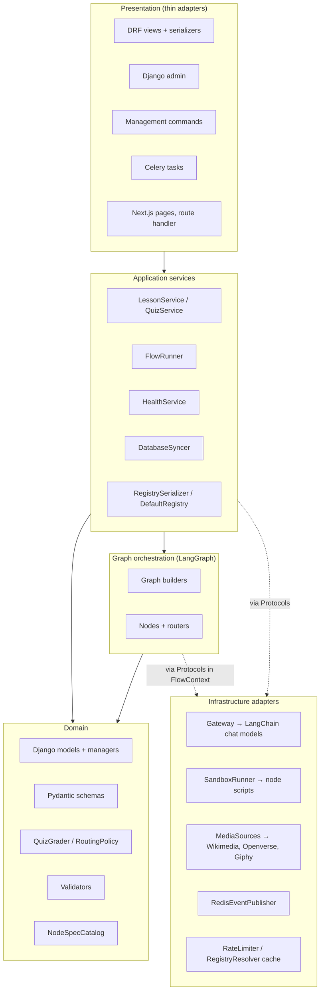

**Dependency rule:** arrows point down. Domain code imports nothing from presentation, orchestration, or infrastructure. Orchestration and services reach infrastructure only through Protocols, so every layer above infrastructure is testable with fakes.

## 3. Pattern catalogue

| Pattern | Where | Classes | Why here | Status |
|---|---|---|---|---|
| **Facade** | `llm_registry/gateway.py` | `Gateway` | One call (`invoke`) hides resolution, retries, fallback, rate limits, output parsing and logging from every node | ✅ |
| | `graph/media.py` | `MediaLibrary` | One object for search, download, sniffing and storage | ✅ |
| | flow execution | `FlowRunner` | Celery tasks and services run a graph segment without knowing LangGraph | ✅ |
| **Chain of Responsibility** | gateway | `ResolvedNode.chain` walked by `Gateway` | Each model in priority order handles the call or passes it on to the next fallback | ✅ |
| **Strategy** | gateway | `OutputAdapter` (`Structured…`, `Tools…`, `Text…`) | Output mode varies per node; the retry loop must not branch on it | ✅ |
| | gateway | `RetryPolicy` (`ExponentialBackoffPolicy`) | Which errors are retryable and how long to wait (a spent daily quota is not), swappable and testable | ✅ |
| | providers | `ProviderProfile` per provider kind | Allowed params, renames and reasoning kwargs differ per vendor | ✅ |
| | rate limits | `RateLimiter` (`CacheWindowRateLimiter`) | Gateway depends on "wait for room", not on Redis | ✅ |
| | probes | `CapabilityProbe` per capability | Each capability has its own check; `ModelProber` runs the declared ones | ✅ |
| | graph | `Validator` per artefact | Deterministic rules per output type, fed back as retry feedback | ✅ all of them: Stage A, study material, plan, page, test, interactive plan and grading |
| | graph | `RoutingPolicy` | Diagnostic score → route uses admin thresholds | ✅ |
| | media | `MediaSource` (`Wikimedia…`, `Openverse…`, `Giphy…`) | Sources are added or disabled by settings | ✅ |
| | health | `HealthCheck` (`Database…`, `Redis…`, `Celery…`) | Each dependency checked the same way | ✅ |
| **Composite** | health | `HealthService` aggregates `HealthCheck`s | Overall status = worst child status | ✅ |
| | graph | `CompositeValidator` | Deterministic validator + optional LLM reviewer (`diagnostic.review`) behave as one validator | ✅ |
| **Template Method** | graph | `Node`, `LLMNode`, `ValidateNode`, `PublishNode`, `AwaitNode` | Every LLM node follows prompt → gateway → state update; every publish/await pair keeps side effects out of the re-executed `await` | ✅ |
| | prompts | `Prompt` (`system()`, `user()`, shared feedback and language blocks) | 15+ prompts share the same skeleton | ✅ |
| | accounts | `_PublicAuthView` | Auth views share permission, throttle and CSRF set-up | ✅ |
| | Django | `BaseCommand`, `AppConfig`, `ModelAdmin` (registry admins share the `StatusMarks` and `RegistryExportActions` mixins) | Framework-defined hooks | ✅ |
| **Builder** | graph | `FlowGraphBuilder`, `StudyMaterialGraphBuilder`, `RuntimeRepairGraphBuilder`, `MediaGraphBuilder`, `CodeFixLoopBuilder`, `GradeTestGraphBuilder` | Graphs are assembled step by step (nodes, edges, conditional edges) then compiled | ✅ |
| | codegen | `DocumentAssembler` | The TSX document is built from page and component parts | ✅ (`graph/codegen.py`; `CodeSanitizer` in `graph/sanitizer.py`) |
| **Factory** | providers | `ChatModelFactory` (`LangChainChatModelFactory`) | Builds a LangChain client from a `ResolvedModel`; tests inject a fake factory | ✅ |
| | graph | `default_context()` (composition root) | The one place concrete adapters are chosen | ✅ |
| **Registry** | specs | `NODE_SPECS`, a `NodeSpecCatalog` (read-only `Mapping`) | Node keys are discovered by the admin, migrations and checks | ✅ |
| | graph | `GraphRegistry` over `GRAPH_BUILDERS` | `GraphRun.graph` name → builder | ✅ |
| | providers | `ProviderProfiles` | Provider kind → `ProviderProfile` | ✅ |
| **Adapter** | sandbox | `SandboxRunner` | Wraps `node sandbox/scripts/*.mjs` subprocesses as Python methods | ✅ |
| | media | `MediaSource` implementations | Wrap each external search API to one shape | ✅ (`graph/media/sources.py`) |
| | accounts | `CookieJWTAuthentication` | Adapts simplejwt to read the token from a cookie with CSRF | ✅ |
| | frontend | `app/api/[...path]/route.ts` | Remote proxy from Next.js to Django with forwarded headers | ✅ |
| **Observer** | Django signals | registry cache invalidation, `NodeConfig` sync on `post_migrate`, profile creation, media file deletion | Side effects follow saves without the saver knowing | ✅ |
| | progress | `EventPublisher` → Redis pub/sub → SSE `RunEventStream` | Nodes emit events; any number of browsers listen | ✅ |
| | gateway | `on_event` callback | Retries and fallbacks surface as progress events | ✅ |
| **Proxy (caching)** | resolver | `RegistryResolver` with cache-aside in Redis | Resolution is expensive; invalidated on every registry save | ✅ |
| **Repository** | Django managers | `UserManager`, `LessonQuerySet.owned_by(user)` | Ownership filtering lives in one place, so a forgotten filter can't leak lessons | ✅ |
| **Singleton** | settings | `FlowSettings.load()` | One editable settings row | ✅ |
| **Memento** | snapshots | `Lesson.config_snapshot`, `settings_snapshot`, `LessonVersion` | A lesson keeps the registry and code it was built with; repairs can roll back | ✅ |
| **State** | lessons | `Lesson.advance_to(stage)` with `StageTransitions` | Only legal stage moves happen (`awaiting_diagnostic` → `generating_lesson`, never `ready` → `awaiting_diagnostic`) | ✅ |
| **Command** | execution | Celery task messages, LangGraph `Command(resume=…)`, `Send` | Work is captured as data, queued, retried and replayed from checkpoints | ✅ |
| **Value Object** | everywhere | `ResolvedModel`, `ResolvedNode`, `GatewayResult`, `SyncReport`, `ProbeResult`, `CheckResult`, `RenderReport`, Pydantic schemas | Immutable results that are safe to cache, snapshot and compare in tests | ✅ |
| **Dependency Injection** | everywhere | constructor parameters, `FlowContext` (LangGraph runtime context) | DIP; fakes in tests | ✅ (`FlowContext` fields are Protocols) |

## 4. Module designs

### 4.1 `accounts`

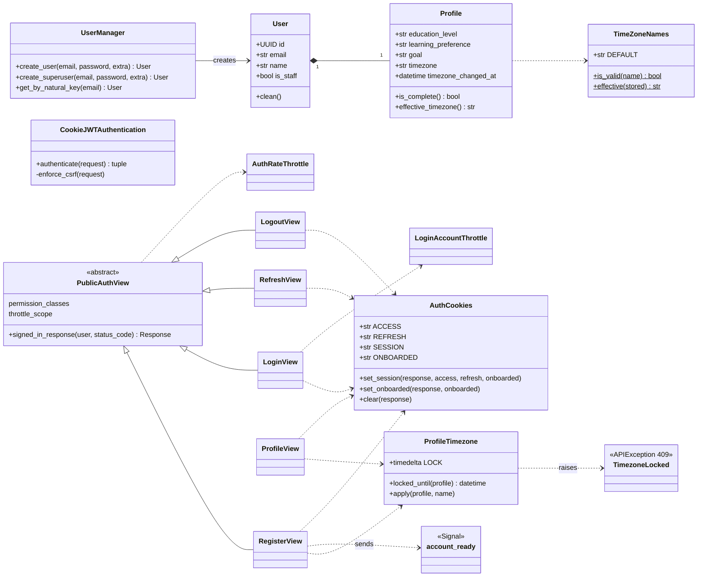

- `PublicAuthView` in the diagram is `_PublicAuthView` in code (module-private base).
- `Profile` is created by a `post_save` receiver (Observer) that only calls `Profile.objects.get_or_create`.
- `AuthCookies` (`cookies.py`) owns the cookie names, paths and flags; lifetimes and `Secure` come from settings unless injected. `CookieJWTAuthentication` and the OpenAPI scheme read `AuthCookies.ACCESS`.
- **The learner's time zone (Phase 10.0, `timezones.py`).** The learner's day (the daily credit and the streak of [the credits plan](../to_be_developed/credits-implementation-plan.md), D9) is the day in `Profile.timezone`, an IANA name. `TimeZoneNames` says which names are real (the system's `zoneinfo`, so old spellings such as `Asia/Calcutta` pass) and what the default is (`Asia/Kolkata`, for a profile where it was never set). `ProfileTimezone` is the one rule for setting it: the first value is free (the browser's, at sign-up), the same value again is nothing, and any other change stamps `timezone_changed_at` and refuses the next change for 30 days with `409 timezone_locked`. Its clock is injected, so the tests never sleep. `apply` sets attributes and leaves saving to the caller; `ProfileSerializer.update` calls it before anything else is saved, so a refused change leaves the rest of the request unsaved. At registration a name the database does not know is dropped instead of refused: a sign-up must not fail over a field the person cannot see.
- **`account_ready`** (`signals.py`) is a Django `Signal` sent with `user` when an account is usable: at registration today, when the email is confirmed once sign-in is built (Phase 11). The signup credits hang from it (`credits.signals`, live since phase 10.3), and `User.deleted_at` marks an account erased and anonymised in place ([§4.26](#426-credits-ledger-gate-earning-and-plans-phases-101-to-104)). It is sent with `send_robust` and a failing receiver is logged, never undoing the account.

### 4.2 `core` and `config`

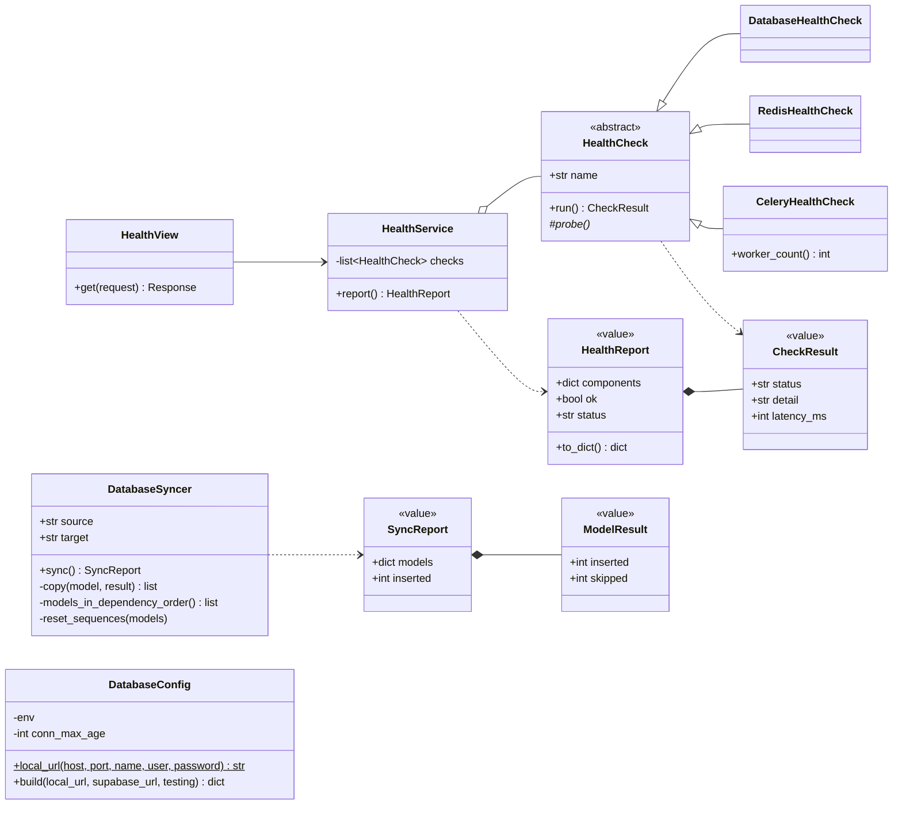

- `bootstrap` and `sync_to_supabase` commands call `DatabaseSyncer().sync()`.
- `DatabaseConfig` is used from `settings.py`, which stays a module.
- Framework hooks stay thin: the DRF `EXCEPTION_HANDLER` (`api_exception_handler`) runs DRF's handler and then `ApiErrorFormatter().format(...)` for the `{detail, code, fields?}` shape; the `check --deploy` hook returns `DeploySecurityChecks().errors()`.

### 4.3 `llm_registry`: registry and resolution

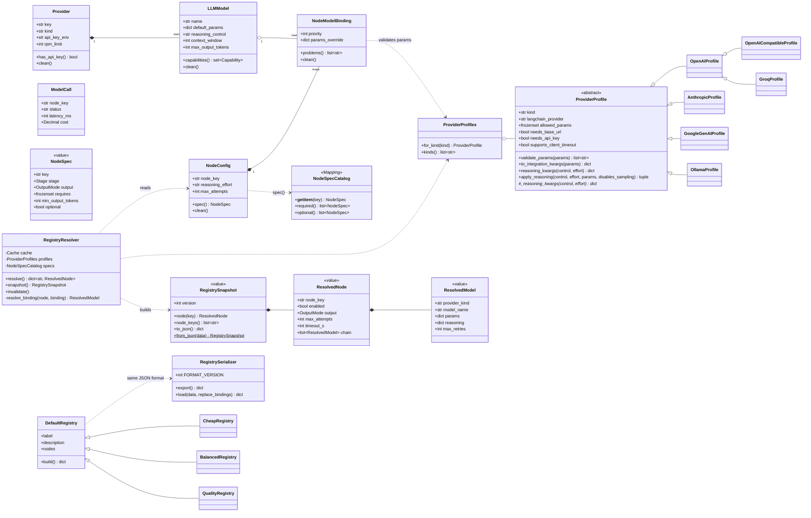

- `ProviderProfile` (`profiles.py`) holds everything that differs per vendor: allowed params and renames, whether a base URL or API key is needed, whether the client takes `timeout`, and reasoning translation. `OpenAICompatibleProfile` and `GroqProfile` subclass `OpenAIProfile`. `Provider.profile` returns the row's profile.
- Every save or delete of a registry row fires a receiver that calls `RegistryResolver().invalidate()` (Observer). A `post_migrate` receiver calls `NodeConfigSync().ensure()` (`node_configs.py`), which creates missing `NodeConfig` rows from `NODE_SPECS`.
- The `registry_check` system check is a thin hook over `RegistryHealth().warnings()`, one warning per kind of problem.

### 4.4 `llm_registry`: the gateway

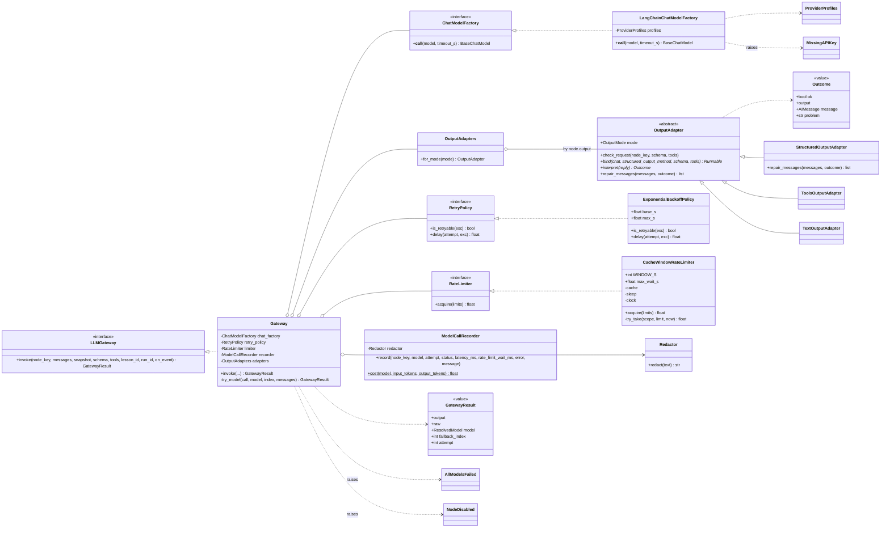

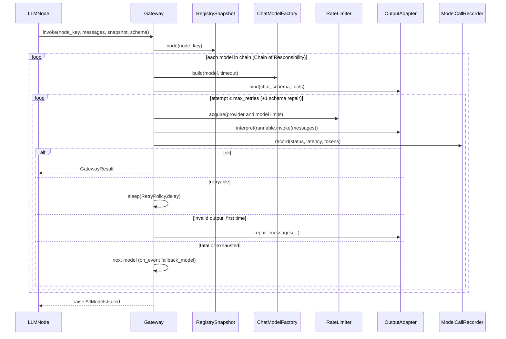

### 4.5 `llm_registry`: probes

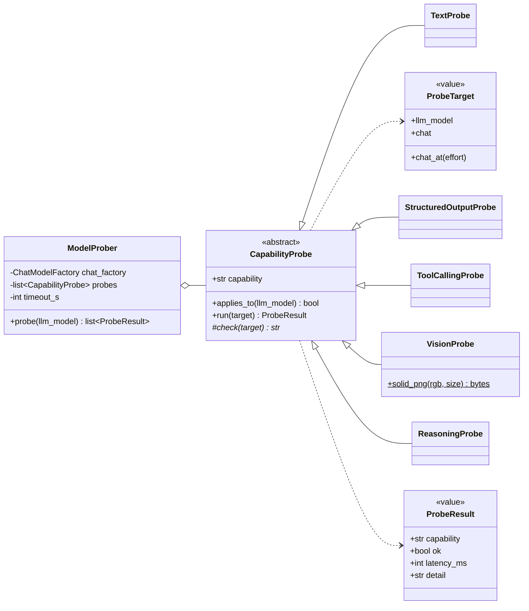

The admin **Test model** action and `manage.py probe_models` both call `ModelProber().probe(model)`.

### 4.6 `lessons`: domain and services

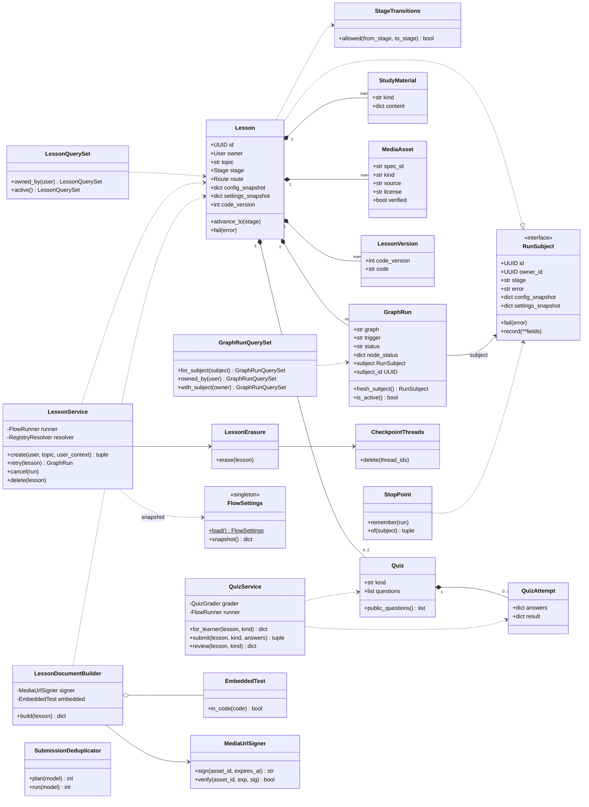

- **`RunSubject`** (`lessons/subjects.py`) is the port for "what a run belongs to": `id`, `owner_id`, `stage`, `error`, the two snapshots, `fail` and `record`. `Lesson` is the only implementation today; a quick quiz joins it in phase 9.6, together with a second column on `GraphRun` (`SUBJECT_FIELDS` names the column per kind). `FlowRunner` (thread id, final stage, failing the subject), `StopPoint`, `has_active_run`, `RunDispatcher`, `LessonService.cancel` and the console's runs list reach the owner through `GraphRun.subject` / `subject_id` / `fresh_subject()` and the queryset helpers (`for_subject`, `owned_by`, `with_subject`) rather than `run.lesson`. `fresh_subject()` reads the row again because the graph moves the stage in another process. Only the code that creates runs, and queries that filter on lesson columns (the console's search), still name `lesson`. `RunEffects` needed no change: its effects read the run's payload, not its lesson.
- **`LessonErasure`** (`lessons/erasure.py`) removes what a delete must not leave behind: the lesson's LangGraph threads (the flow thread `<lesson id>` and each small graph's `<lesson id>:<run id>`, through `CheckpointThreads` over `PostgresSaver.delete_thread`) and its `ModelCall` rows. `LessonService.delete` cancels active runs, erases, then deletes the lesson, so a failed erasure leaves the lesson to be deleted again. A database without checkpoint tables has no threads to delete.

- Views are thin: `LessonViewSet` calls `LessonService` / `QuizService` and serializes the result. Every queryset in a view starts from `Lesson.objects.owned_by(request.user)`, so another user's lesson is a `404`.
- `Quiz.public_questions()` is the only way questions leave the server before submission (answers stripped).

### 4.7 `graph`: nodes, routers and builders

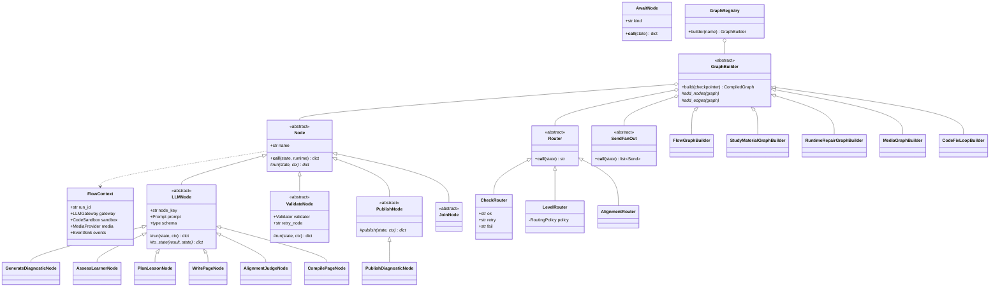

- **Segments.** `FlowGraphBuilder` assembles the lesson flow from `Segment`s (diagnose, mastery, author, build) plus the failure segment (`mark_failed` → `await_retry`). A segment adds its nodes and edges and is told where its exits (`lesson`, `mastery`, `failed`) lead; a segment can `provide` an exit for the others (the author segment provides `lesson`). Exits nobody provides lead to `END`, so Stage A works on its own and later stages plug in.
- **Node instances are the callables LangGraph registers** (`graph.add_node("plan_lesson", PlanLessonNode())`). `Node.__call__` unpacks `runtime.context`, calls `run`, and emits `node_started` / `retrying` / `degraded` events, so subclasses contain only their own logic.
- **`PublishNode` / `AwaitNode` pairing** encodes the rule from [lesson-graph.md](lesson-graph.md): side effects go in `publish`; `AwaitNode` only calls `interrupt()`, because it re-executes on resume.
- `FlowContext` fields are typed with Protocols (`LLMGateway`, `CodeSandbox`, `EventSink`; `MediaProvider` joins in Phase 5); `default_context()` is the composition root. `NodeBudget.of(state, node_key)` reads a node's attempts and whether it is enabled from the lesson's registry snapshot.
- A node declares the `stage` the lesson is in while it works; running while the lesson is `failed` moves it back, which is how Retry resumes without the nodes knowing about retries. A node also closes its worker thread's database connection when it ends.
- State stays a `TypedDict` (`FlowState`, `Branch`, `MediaState`, `FixState`, `RepairState`); reducers are static methods on `Reducers`.

### 4.8 `graph`: domain logic (grading, validation, prompts, codegen)

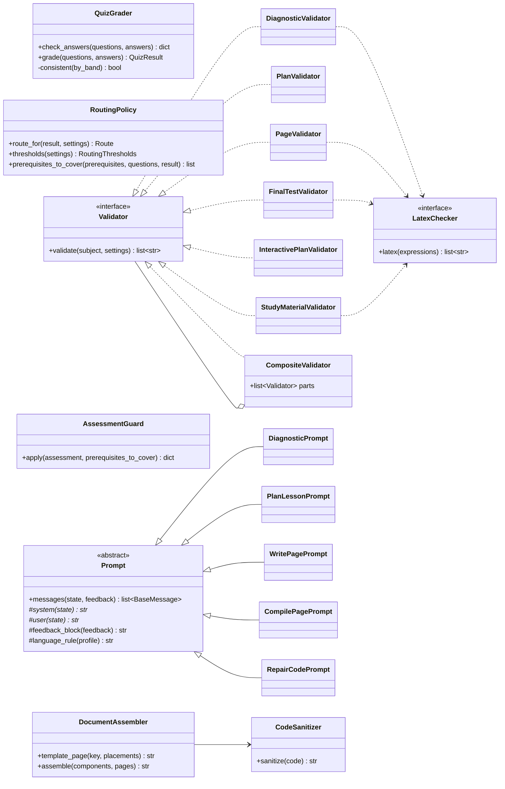

- `QuizGrader` is shared by `QuizService` (synchronous grading in the request) and the `grade_*` nodes, so both always agree.
- Validators are pure: no ORM, no network. They depend only on `LatexChecker` (implemented by `SandboxRunner`, faked in tests).
- `Prompt` subclasses hold no state between calls; one class per node key in `graph/prompts/`.

**Question types (`graph/questions/`, Phase 9.1).** What differs between kinds of question lives in one class per kind
(Strategy), found by name in `QuestionTypes`, instead of `if kind ==` ladders in six places:

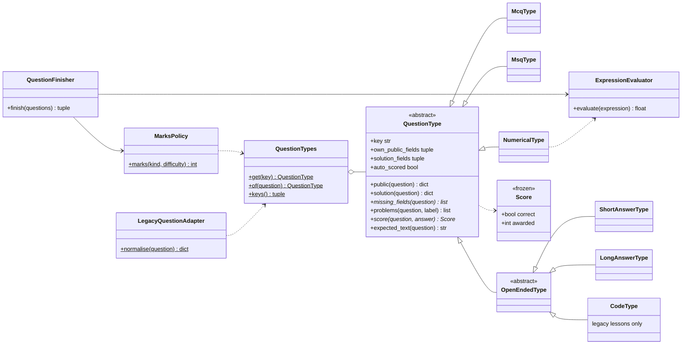

- Who asks: `TestQuestion`'s validator (`missing_fields`), `QuestionRules.problems` (`problems`), `public_question` and
  `Quiz`-style views (`public`), `Solution.of` (`solution`), `AnswerGrader.grade` (`score`), `ScoreCard` (`expected_text`,
  `auto_scored`). The flat Pydantic model a model writes is unchanged; these classes use its `type` to look up behaviour.
- A new kind is a new class in `types.py` and one entry in the registry; no other file gets a branch.
- **What a model writes and what is stored differ** (`graph/schemas/lesson.py` `TestQuestion`, then `QuestionFinisher`). A model writes no `marks` and no numerical `answer`: it writes `answer_expr`, `tolerance` and `decimal_precision`, and for short and long answers `criteria` (`[{text, marks}]`). The finisher, called by `ContentWriter.final_test` and the practice-sheet node, sets `marks` from `MarksPolicy` (the table is in the kinds: `QuestionType.marks`, by `MarkTier`) and computes `answer` with `ExpressionEvaluator`; `QuestionRules.problems` (through each kind's `problems`) re-checks the expression and that the criteria add up, so a bad question goes back to the generator. `QuestionType.generator_guidance` is what the prompts tell a model about each kind, marks included.
- **`ExpressionEvaluator`** parses with `ast` and walks only numbers, `+ - * / **`, unary signs, parentheses, `pi`, `e` and eleven one-argument functions. It is bounded (200 characters, nesting 20, exponent 1000, every result finite) and refuses everything else with a reason; nothing reaches `eval`.
- **`MsqType.score`** follows the spec's order: nothing picked or any wrong option is 0, all the right options is full, at least half of them is full minus 1, fewer is 1. A repeated option counts once; anything that is not a list of whole numbers is a wrong answer.
- **`LegacyQuestionAdapter.normalise`** gives a question from before criteria the `criteria` it never had (key points, a rubric, or one criterion for a code question; marks split evenly, the remainder one each to the first; more points than marks are grouped). The grader and the score card use it, stored data is never rewritten.

### 4.9 `graph`: media and sandbox adapters

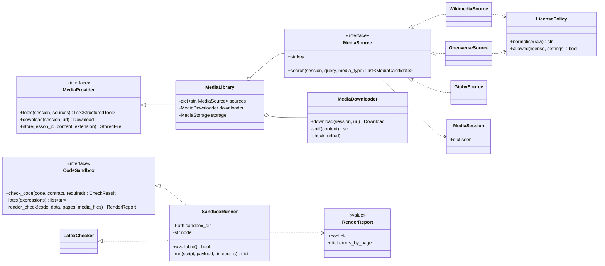

All external I/O goes through one injected `httpx.Client`; tests use `httpx.MockTransport`.

### 4.10 Flow execution and progress (Phase 3)

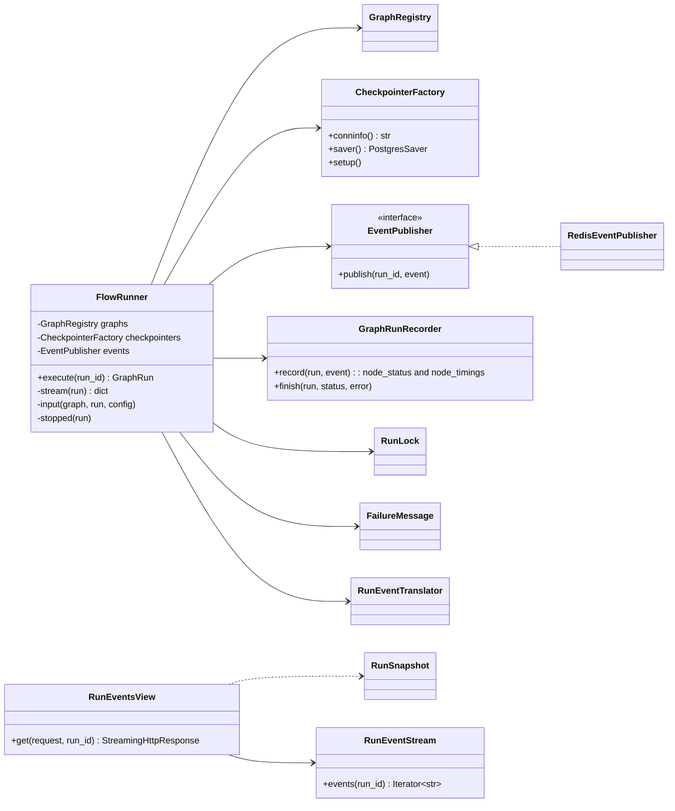

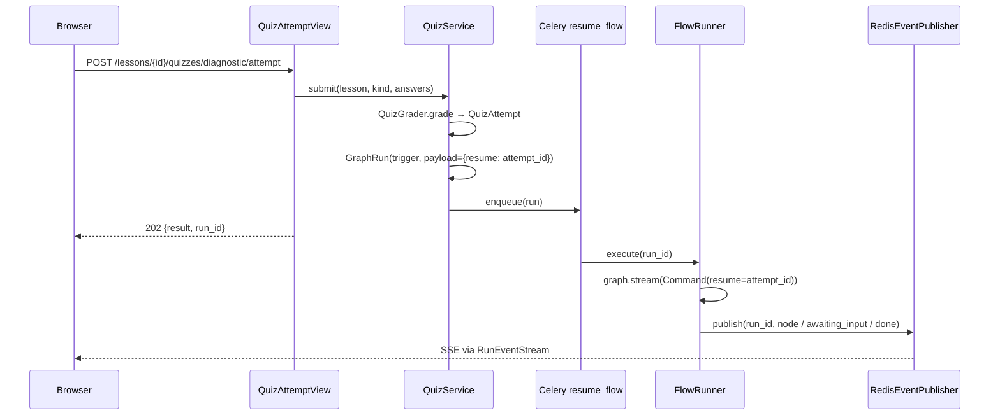

### 4.11 Frontend (`frontend/lib`)

```mermaid
classDiagram
    direction LR
    class ApiClient {
        -Fetch fetcher
        -readCookie(name) str
        -Promise refreshing
        +request(path, options) Promise~T~
        +refreshSession() Promise~bool~
        -csrfToken() Promise~str~
        -toApiError(response) Promise~ApiError~
    }
    class ApiError {
        +int status
        +str code
        +FieldErrors fields
    }
    class RunEventStream {
        +constructor(runId, onEvent)
        +close()
    }
    class RunFollower {
        +int TICK_MS
        +int POLL_MS
        +int MIN_GAP_MS
        +start()
        +stop()
    }
    class RunTimeline {
        +float MIN_WIDTH
        +layout(steps, runDurationS)$ TimelineView
    }
    class RunFilters {
        +parse(params)$ RunFilterState
        +href(path, filters)$ str
        +query(filters)$ RunQuery
        +runIdIn(text)$ str
        +tabLabel(tab, failedCount, more)$ str
    }
    class RunText {
        +duration(seconds)$ str
        +cost(money)$ str
        +status(status)$ StatusTone
        +callResult(call)$ StatusTone
        +ago(iso, now)$ str
    }
    class RunActions {
        +retry(id) Promise~ActionResult~
        +cancel(id) Promise~ActionResult~
    }
    class SandboxMessages {
        +parse(data)$ SandboxMessage
        +from(event, frame)$ SandboxMessage
    }
    class HarnessBuilder {
        +html(template) str
        +absolute(document) LessonDocument
    }
    class RepairGate {
        +shouldRepair(error, currentVersion) bool
        +stop()
    }
    class RedirectPolicy {
        +safeNext(value)$ str
    }
    class SheetCatalog {
        +all()$ SheetInfo[]
        +of(kind)$ SheetInfo
        +makeLabel(kind)$ str
        +addLabel(kind)$ str
    }
    class SheetTabs {
        +of(have, building)$ SheetTab[]
        +pick(tabs, wanted)$ MaterialKind
    }
    class MasteryBanner {
        +of(result)$ Banner
    }
    class CheatGroups {
        +of(items)$ CheatGroup
    }
    class RouteGuard {
        +redirectFor(pathname, search, visitor)$ str
    }
    class SetupMarker {
        +begin()
        +end()
    }
    class SessionProbe {
        +signedIn(cookies)$ bool
        +ask(fetcher)$ bool
    }
    class StopControl {
        +of(canStop, open)$ StopView
    }
    class ChartPalette {
        +family(color)$ str
    }
    class Initials {
        +of(person)$ str
    }
    class QuizNames {
        +of(kind)$ str
        +done(kind)$ str
        +resultLabel(kind)$ str
    }
    class PlainVersion {
        +of(reason)$ str
    }
    class HeroDemo {
        +isAnswer(value)$ bool
        +isRight(answer)$ bool
        +resultFor(answer)$ HeroResultCopy
    }
    class Walkthrough {
        +int index
        +bool autoplay
        +start(count, autoplay)$ Walkthrough
        +advance() Walkthrough
        +choose(index) Walkthrough
        +step(direction) Walkthrough
    }
    class ScorePaths {
        +pathFor(score)$ PathId
        +dots(score)$ bool[]
    }
    class SlideCycle {
        +next(index, count)$ int
        +previous(index, count)$ int
        +byKey(key, index, count)$ int
        +fromScroll(left, width, gap, count)$ int
    }
    class PendingTopic {
        +save(raw)
        +peek() str
        +take() str
    }
    class RevealPolicy {
        +startsHidden(top, viewportHeight)$ bool
        +delay(index)$ str
    }
    class DeckMotion {
        +fly(card)$
        +rise(card)$
        +prefersLessMotion()$ bool
    }
    SheetTabs ..> SheetCatalog : orders by
    RouteGuard ..> SetupMarker : reads its cookie (via proxy.ts)
    AuthProvider ..> SessionProbe : asks before /auth/me
    PipelineProgress ..> StopControl : asks what to show
    ProviderSeries ..> ChartPalette : is a provider colour
    RunFollower ..> RunEventStream : opens (injected)
    RunFollower ..> RunText : asks isActive
    RunActions ..> ConsoleApi : calls (injected)
    ApiClient ..> ApiError : throws
    ScorePaths ..> PathSlide : reads the ranges of
    HeroDemo ..> HeroResultCopy : picks
```

- **Stop, Retry and the session.** `StopPoint` (`lessons/stop_point.py`) is what `LessonService.cancel` leaves for `retry`: the answer the stopped run was about to give, and the stage the lesson waits in when the thread is at a question (see §4.22). `SessionProbe` asks the site's own `/api/session` whether the (httpOnly) session marker is there, so a signed-out page makes no `/auth/me` call to fail; `SetupMarker` is the one cookie the page itself sets, for the last onboarding step. `StopControl` keeps the stop dialog tied to the learner's action, not to the run. `ChartPalette` keeps provider and status colours in separate charts, enforced by `lib/console-charts.test.ts`.
- Components call the shared `apiClient` instance (`apiClient.request<T>(path, options)`), so concurrent 401s share one refresh. `fetch` and the cookie reader are constructor parameters, so `lib/api.test.ts` drives the client with a scripted fake `fetch`.
- The landing page (see [frontend.md](../reference/frontend.md#the-landing-page)) keeps every rule in a static class: `RouteGuard` is what the thin `proxy.ts` hook calls; `HeroDemo`, `Walkthrough` (an immutable value: each move returns the next state), `ScorePaths`, `SlideCycle`, `PendingTopic` (storage is a constructor parameter) and `RevealPolicy` are used by thin components in `components/landing/`. `DeckMotion` holds the fly-off and rise constants that `FlashcardDeck` and the try-it card share.
- The console's Lesson runs page (`components/console/runs/`) follows the same split. `RunFilters` is the address (`?status=&job=&q=&run=`) as a value, and the only way a run id from the address reaches an API path (it must be a whole UUID). `RunText` writes every time, cost, status and stage; `RunTimeline.layout` turns timeline steps into phase groups, lanes and bar percentages (minimum width, waiting steps open-ended); `RunActions` runs Retry and Stop and explains each refusal. `RunFollower` keeps the open run current: events say *when* something changed and the console's detail says *what*, so it reloads on events and on a slow beat, falls back to polling when the stream is refused (the stream is open only to the learner who owns the run), spaces its loads for the console's throttle, and stops once the run is over. Its timers, stream and loader are constructor parameters, so `run-follower.test.ts` drives it with a fake clock.
- The console's shell, Overview and Usage pages (`components/console/`, `components/console/overview/`, `components/console/usage/`) keep every decision in static classes, and the components only draw. `ConsoleGate` (not the backend's `ConsoleAccess`) decides what the layout does with a session (wait, sign in, not-found, show); `ConsoleQueryClient` and `ConsoleQueries` are the only TanStack Query setup (a factory for the client and a set of `queryOptions` with an injectable `ConsoleApi` and clock); `ConsoleUrl` is the address as a value (forgiving reads, defaults left out when writing); `ConsoleNav` is the sidebar as data; `ConsoleFormat` is the one place that writes numbers. `lib/console-charts.ts` has one class per chart (`SpendChart`, `LatencyChart`, `OutcomeChart`, `FunnelChart`, `SlowestSteps`, `StepTable`) with the same three methods where they apply: shape the reply into rows, say what a hover shows (`tooltip`, a `TooltipData` value), and give the table form (`table`); `ProviderSeries` is the only mapping from a provider to a colour, so a series never changes colour with its rank. `UsageFilterOptions` builds the drop-down choices and keeps a chosen model consistent with its provider. Variants are added to a class, not branched in a component (a new chart is a new class and a thin card).
- The Learners and Change log pages (`components/console/people/`) are thin views over `lib/console-people.ts` and `lib/console-audit.ts`. `LearnerText`, `LearnerStats`, `PeopleUrl` and `AdminLinks` (the only place a link out of the console is built, from an allow-listed scheme) are static classes; `AuditText` turns an `AuditEntry` into `Segment`s (a variant is a new `case` in one `switch` over the API's own action names, with a generic sentence as the fallback, so an action the frontend has not heard of still reads), `AuditAreas` maps a target to its area, and `AuditDiff` formats the changed fields. `PeopleQueries` holds the paged `infiniteQueryOptions` with an injectable `ConsoleApi`; it sits beside `ConsoleQueries` rather than in it so that each page's queries and shaping stay together. `useDebouncedText` (search to address) and `notFoundIfRefused` (the 404 rule for a paged list) are the only hooks.
- The console's Models, Model routing and Lesson settings pages (`components/console/models/`, `routing/`, `settings/`) are views over small classes in `lib/`. **Value objects with static methods** (`ModelCatalog`, `RoutingDraft`, `RoutingProfile`, `RoutingView`, `FlowBands`, `FlowSettingsForm`, `ModelForm`, `ProviderForm`, `UnsavedGuard`, `ConsoleFailure`) hold every rule and never mutate what they are given: each edit returns a new step, so the page keeps the saved copy beside the edited one and the diff (`RoutingDraft.changed`) says exactly what Save sends. **`RoutingSaver`** and **`ProbeQueue`** are the classes with collaborators, injected through the constructor (`Pick<ConsoleApi, "saveNode">`, a probe function), so their tests use fakes: the saver sends one `PUT` per step and keeps each outcome apart (the API replaces one step atomically, so some can succeed while others are refused), and the queue is a worker pool of two over the probe endpoint. `FlowBands` mirrors `RoutingPolicy.thresholds` on the server and is tested against the values the API reports. Edits live in component state (`useRoutingEdits`, the settings form) and never in the query cache, which only holds what the server has; the two queries a page edits are not refetched on focus, so the saved copy does not move under the edits.
- **Time zone and refusals (Phase 10.0).** `BrowserTimezone` (`lib/browser-timezone.ts`, static, bun-tested) holds what sign-up and the profile know about a zone: the browser's (`detect`), the one to show (`initial`), the list to offer (`names`), the search over it (`search`), the 30-day lock as words (`lockNote`, `lockedMessage`) and what a save sends (`payload`); `TimezoneField` only draws it. `ActionRefusedMessage` now recognises a `402 insufficient_credits` beside the `403` and its `refusal()` returns `{message, buyPath, required, available}`, so the screens that already show a refusal gain the way to buy more without being touched.
- `useRunEvents`, `useProfile` and the `LessonSandbox` component are hooks/components that own one instance of these classes.
- `SandboxMessages.from` accepts only messages whose `event.source` is the embedded iframe and gives every field a safe type; `HarnessBuilder` fills the harness with absolute addresses (the iframe's origin is opaque); `RepairGate` asks for a repair once per code version and stops when the server refuses; `HarnessSource` fetches the harness once; `RenderMessage` and `RepairReport` shape what is posted to the iframe and to `/repair`; `LessonPdf` prints the reading pages.

Where the pieces live: `lessons/runner.py` (`FlowRunner`, `GraphRunRecorder`, `RunLock`, `FailureMessage`), `lessons/events.py` (`RunEvent`, `RunEventTranslator`, `RedisEventPublisher`, `RunEventStream`, `RunSnapshot`), `lessons/checkpoints.py`, `lessons/tasks.py` (the tasks, `CeleryTaskQueue`, and `InlineTaskQueue` for the `flow` command), `lessons/services.py` (`LessonService`, `QuizService`, `RunDispatcher` over the `TaskQueue` port, chosen by `LESSON_TASK_QUEUE`), `lessons/reports.py`. Domain failures are `APIException`s in `lessons/errors.py`, so the API formats them itself.

### 4.12 Stage C and runtime repair (Phase 6)

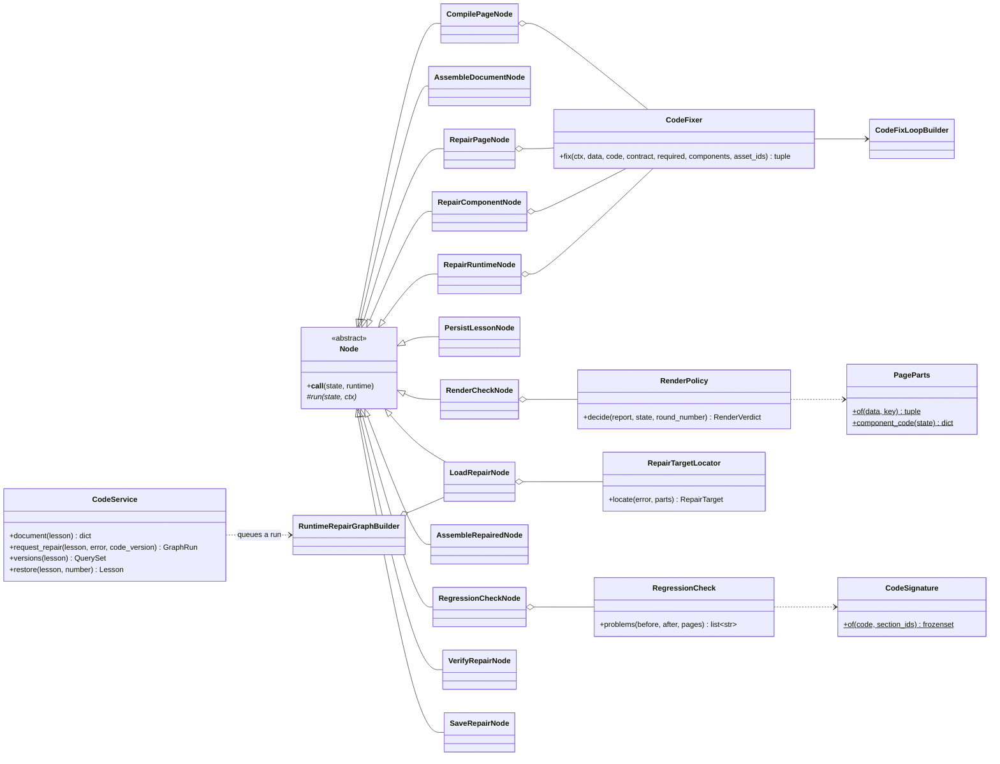

- **Template Method** again: every node is a `Node` subclass with its own `run`. `CodeFixer` is a small facade over the code-fix subgraph, injected into the nodes that need it so tests can replace it.
- **Strategy**: `RenderPolicy` decides what to do with a render report (pass, repair, fall back, fail) from the report and the round; the node only carries the decision out.
- `RepairTargetLocator`, `RegressionCheck` and `CodeSignature` are pure: no ORM, no network, no sandbox.
- `CodeService` owns the lesson's code use cases (serve, request a repair, list versions, restore); views stay thin.

### 4.13 Test grading, tracing and usage (Phase 7)

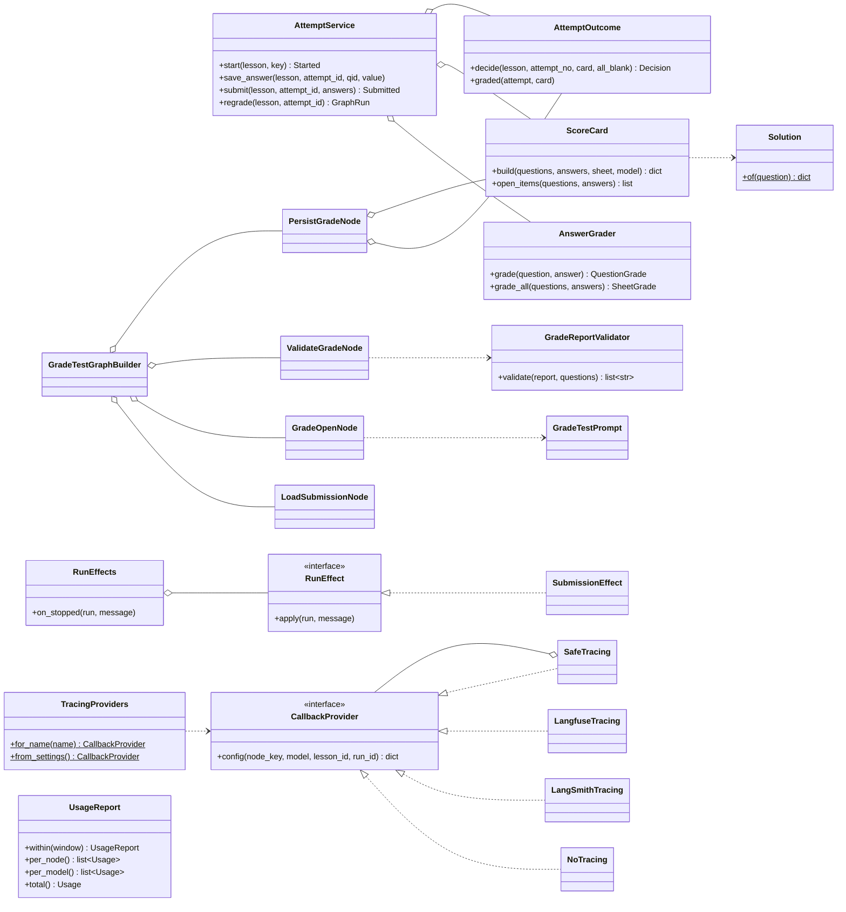

- **One grader for every score.** `AnswerGrader` marks practice sheets and the lesson test (`AttemptService`, section 4.19, replaced `SubmissionService`: a lesson attempt is graded in the request that submits it, and `grade_test` serves only legacy attempts with written answers); `ScoreCard` adds blank answers, the model's capped marks, topics to revisit and each question's solution.
- **Strategy**: `CallbackProvider` (tracing; none, LangSmith, Langfuse, chosen by `LLM_TRACING` through `TracingProviders`) and `RunEffect` (what a run that did not finish leaves behind, per graph). `SafeTracing` is a Decorator that makes tracing unable to fail a model call.
- `UsageReport` is a read model over the `ModelCall` log, with no side effects, behind the admin's usage page.
- The optional judges (`diagnostic.review`, `media.verify`) degrade instead of failing: see [lesson-graph.md](lesson-graph.md).

### 4.14 `onboarding`: first-topic suggestions

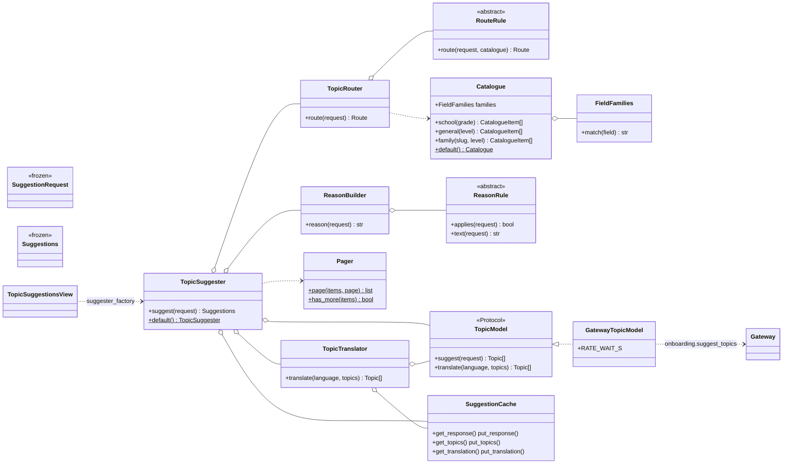

- **Facade**: `TopicSuggester` is the one entry point; the view only validates and formats. `default()` is the composition root (shipped catalogue, gateway-backed model, Redis cache); the view's `suggester_factory` is the seam tests replace.
- **Chain of responsibility / Strategy**: `RouteRule`s (school, interview, higher education, professional, self-learner) and `ReasonRule`s are lists the router and the builder walk, first match wins, so a new variant is a new class, never a new `if`. `FieldFamilies` is data-driven from the catalogue file.
- **Port**: `TopicModel` is the only thing onboarding needs from a model, and it raises only `TopicModelError`, which is what the service turns into the catalogue. `GatewayTopicModel` calls `Gateway().invoke("onboarding.suggest_topics", ...)` with a snapshot taken at the moment of the call and a limiter that does not wait out a rate limit. The prompts are `Prompt` subclasses (Template Method, as in `graph/prompts`).
- **Cache-aside**: `SuggestionCache` keeps pages, a model's list and translations, never fails a request, and builds normalised, short, plain keys.
- Results are frozen dataclasses (`SuggestionRequest`, `Topic`, `Suggestions`); the model's output is the Pydantic `TopicSuggestions`. [onboarding.md](../reference/onboarding.md) has the behaviour.

### 4.15 `marketing`: the landing page's question bank

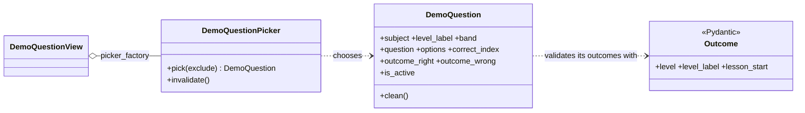

- `DemoQuestionPicker` is the only logic: random among the active ids, never the excluded one (unless it is all there is), ids cached with the cache injected, and a cached id that has gone is skipped for a fresh list. A signal receiver (`signals.py`, a thin hook) clears the cache when a question is saved or deleted. The view validates `exclude`, throttles per client address (scope `landing_demo`) and formats; an empty bank is a `NotFound`.
- `DemoQuestion.clean()` is the contract of a row (three different options, an answer among them, a band, outcomes validated by the Pydantic `Outcome`), so what the admin saves is what the card can show.
- The frontend side is in [frontend.md](../reference/frontend.md#the-landing-page): `DemoQuestions`, `DemoQuestionFetcher`, `HeroDemo` and `Autoplay`, all `lib/` classes with `bun test`.

### 4.16 `console`: the staff API

`console` is its own app, not part of `core`: it reads across `llm_registry`, `lessons` and `accounts` and owns one model (`AuditEntry`), while `core` is infrastructure that no domain app should depend on. The dependency runs one way: `console` imports the others, none of them imports `console`. It adds no behaviour of its own to the lesson flow: every action calls the service the learner's button calls (`LessonService.retry` and `cancel`) or the model's own `full_clean`.

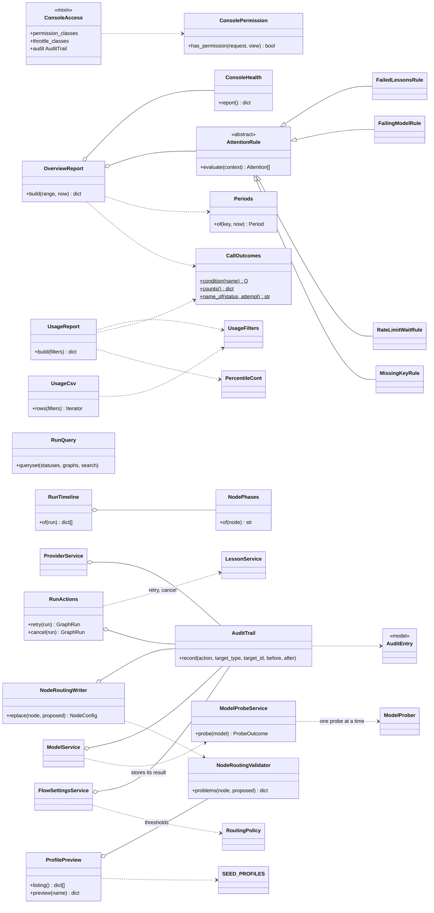

- **Facade + composition**: `OverviewReport` asks one small collaborator per card (`LessonCounts`, `SpendSummary`, `CallSummary`, `DailySpend`, `Funnel`, `SlowestSteps`, `ConsoleHealth`, `AttentionRules`), each injected with a production default, so a card changes without touching the others and the page costs a fixed number of queries. `OverviewView.health` is the seam tests replace so they never reach Redis or Celery.
- **Strategy / Chain**: `AttentionRule`s are a list the overview walks; a new warning is a new class added to `AttentionRules.DEFAULT`. The seed profiles are `DefaultRegistry` subclasses in `SEED_PROFILES` and `ProfilePreview` reads them as they are, so a new profile is a class there with a `label` and a `description`.
- **Specification**: `CallOutcomes` is the one definition of ok, retried, failed, fallback and retry attempt, as `Q` conditions for SQL and `name_of` for a row in hand; the overview, usage page, CSV and attention rules all use it, and a test proves the two agree.
- **Validate, then write**: `NodeRoutingValidator` returns every problem of a proposed routing by field (the node's own `clean()`, the binding's capability and size `problems()`, the provider key being set, duplicates); `NodeRoutingWriter` runs only after it passes, in one transaction with the audit entry. `ProfilePreview` reuses the validator on what a profile would propose, so the preview says what a save would refuse.
- **Template of every write**: a service method checks, then `transaction.atomic()` around the change and `AuditTrail.record`; a refused request raises before the transaction. Retry is the exception (the run it creates is queued for a worker as soon as it exists, and the worker must find it, so the entry is written after, not inside a transaction).
- **Adapter**: `ModelProbeService` runs the same `CapabilityProbe`s as `probe_models`, one at a time under one 20-second deadline (each client gets the time left), because `ModelProber` gives every probe the whole timeout. `UsageCsv` streams rows through a `csv.writer` over an `Echo` buffer.
- **Views** are thin: `ConsoleAccess` gives them staff-only access (404, never 403), the `console` throttle, `Cache-Control: no-store` and the audit trail; serializers (`console/serializers.py`) describe the shapes for Swagger and reject fields that cannot be set (`RejectUnknownFields`). A guard test fails when an endpoint that changes something is added without an audit test.
- The timeline is derived from `GraphRun.node_timings`, which `GraphRunRecorder.record` fills as node events arrive (first start, latest finish, retry count); `NodePhases` places a node in a phase by the module that defines it. [api.md](../reference/api.md#console-staff-only) has the derivation and every endpoint.

### 4.17 `graph`: levels, difficulties and score bands (Phase 9, modular lessons)

Pure value classes in `graph/levels.py` and `graph/scoring.py`: no ORM, no I/O, no settings lookups. They are the
vocabulary of the modular-lesson plan ([plan §6.1](../archive/modular-lessons-implementation-plan.md#61-value-objects-pure-in-graph)).
Phase 9.0 added them. Phase 9.1 wired `Level`, `LevelScheme` and `Difficulty` into the flow (the schemas, prompts, nodes and a data migration); `ScoreBand` and `Thresholds` are wired in 9.2.

```mermaid
classDiagram
    direction LR
    class Level {
        <<StrEnum>>
        BEGINNER
        FOUNDATION
        PROFICIENT
        EXPERT
        +parse(raw)$ Level
        +parse_legacy(raw)$ Level
        +shifted(by) Level
        +label str
    }
    class LevelScheme {
        +stamp(document)$ dict
        +level_of(document)$ Level
        +upgraded(document)$ dict
    }
    class StarRating {
        <<frozen>>
        +int halves
        +from_stars(stars)$ StarRating
        +stars float
        +level() Level
        +rater_category() RaterCategory
    }
    class RaterCategory {
        <<StrEnum>>
        LOW
        MID
        HIGH
        +of(level)$ RaterCategory
    }
    class Difficulty {
        <<StrEnum>>
        EASY
        BASIC
        STANDARD
        DIFFICULT
        EXPERT
        +parse(raw)$ Difficulty
        +tier MarkTier
    }
    class MarkTier {
        <<StrEnum>>
        NORMAL
        DIFFICULT
    }
    class BandDifficulty {
        +of(band)$ Difficulty
        +band_of(difficulty)$ str
    }
    class Thresholds {
        <<frozen>>
        +int fail_below
        +int excellent_above
    }
    class ScoreBand {
        <<StrEnum>>
        FAIL
        NORMAL
        EXCELLENT
        +of(awarded, available, thresholds)$ ScoreBand
    }

    LevelScheme ..> Level
    StarRating --> Level
    StarRating --> RaterCategory
    RaterCategory ..> Level
    Difficulty --> MarkTier
    BandDifficulty ..> Difficulty
    ScoreBand ..> Thresholds
```

- **Settled in 9.1** (plan C28, T19): `LevelScheme` (`graph/levels.py`) reads a stored document's `level` by its `level_scheme` marker, `Level.parse` with the stamp and `Level.parse_legacy` without it. Nodes stamp what they write (`LevelScheme.stamp`), `LoadContextNode` puts `level_scheme: 2` on the flow state, and the API reads through `LevelScheme.upgraded`. `lessons/renames.py` holds the data migration's logic.
- Patterns: value objects with a tolerant reader (`parse`), and an explicit bridge (`BandDifficulty`) between two
  vocabularies that overlap in words only. The diagnostic's bands (`basic`, `easy_moderate`, `moderate`, `moderate_hard`,
  `hard`) are never renamed; `hard` the band is `expert` the difficulty.
- `Level.parse` reads the new names and the three old names that cannot be confused (`novice`, `intermediate`,
  `advanced`). **`beginner` is both a new name and an old one** (it used to mean Foundation), so `parse` takes it as the
  new Beginner and only `Level.parse_legacy` maps the old four by position. Phase 9.1 must use `parse_legacy` only where
  the data is known to predate the rename (see the open item in the plan, D24 T19).
- `StarRating` stores whole halves (1 to 10), never a float. `ScoreBand` compares `awarded * 100` with
  `percent * available`, so the 30% and 90% edges are exact (both edges are Normal); it refuses zero available marks.

### 4.18 `lessons`: the action gate (Phase 9, metering seam)

A port that lets a later pricing feature say yes or no to work that costs model calls, and be told how it ended. Nothing
here prices anything and nothing is metered by default ([plan §5.5](../archive/modular-lessons-implementation-plan.md#55-extension-seam-for-metering)
and §6.7). Code: `lessons/metering.py` and `lessons/idempotency.py`.

```mermaid
classDiagram
    direction LR
    class MeteredAction {
        <<StrEnum>>
        LESSON_CREATE
        LESSON_CONTINUE
        LESSON_FOLLOWUP
        TEST_RETAKE
        QUIZ_CREATE
        QUIZ_RETAKE
        SHEET_GENERATE
    }
    class ActionGate {
        <<interface>>
        +authorize(context) Authorization
        +settle(authorization, outcome)
    }
    class OpenGate
    class ActionRefused {
        <<APIException>>
    }
    class ActionContext {
        <<frozen>>
        +user
        +action
        +size dict
        +subject_id
        +key str
        +resume bool
        +completes_at CompletionPoint
    }
    class Authorization {
        <<frozen>>
        +id str
        +action
        +size dict
        +resume bool
        +completes_at CompletionPoint
        +meta dict
        +tracked bool
        +of(context)$ Authorization
        +to_payload() dict
        +from_payload(data)$ Authorization
    }
    class CompletionPoint {
        <<frozen>>
        +at_stage(stage)$
        +at_run_end()$
        +reached(stage, ended) bool
    }
    class CompletionPoints {
        +TABLE
        +of(action)$ CompletionPoint
    }
    class ActionMetering {
        +authorize(user, action, size, subject_id, client_key, resume) Authorization
        +payload(authorization) dict
        +carry(subject) dict
        +ask_again(lesson) Authorization
        +settle_open(subject, outcome)
        +guard(authorization)
    }
    class AuthorizationLedger {
        +payload(authorization) dict
        +read(run) StoredAuthorization
        +latest(subject) GraphRun
        +settle_once(run_id, outcome, settle) bool
    }
    class AuthorizationSettlement {
        +on_finished(run, ended)
        +on_stopped(run, message)
    }
    class RunEffects {
        +on_stopped(run, message)
        +on_finished(run, ended)
    }
    class RunStarters {
        +METERED
        +RESUMING
        +NEVER
    }
    class ActivitySink {
        <<interface>>
        +record(user, kind, at)
    }
    class NullActivity
    class GuardedActivity {
        +sink
        +record(user, kind, at)
    }
    class ActivityKind {
        <<StrEnum>>
        TEST_ATTEMPT
        QUIZ_ATTEMPT
        QUICK_CHECK
    }
    class ActivitySinks {
        +configured()$ ActivitySink
        +guarded(sink)$ GuardedActivity
    }
    class IdempotentRequest {
        +run(request, scope, body, perform) Response
    }
    class IdempotencyKey {
        +of(request, scope, body)$ IdempotencyKey
    }
    class IdempotencyStore {
        <<interface>>
        +replay(key) StoredResponse
        +claim(key) bool
        +remember(key, response)
        +release(key)
    }

    ActionGate <|.. OpenGate
    ActionGate ..> ActionRefused : raises
    ActionGate ..> ActionContext
    ActionGate ..> Authorization
    ActionMetering --> ActionGate
    ActionMetering --> AuthorizationLedger
    ActionMetering ..> CompletionPoints
    CompletionPoints ..> MeteredAction
    Authorization --> CompletionPoint
    AuthorizationSettlement --> ActionGate
    AuthorizationSettlement --> AuthorizationLedger
    RunEffects --> AuthorizationSettlement
    IdempotentRequest --> IdempotencyStore
    IdempotentRequest ..> IdempotencyKey
    ActivitySink <|.. NullActivity
    GuardedActivity --> ActivitySink
    ActivitySinks ..> GuardedActivity
    ActivitySink ..> ActivityKind
```

- **Pattern:** the gate is a Strategy chosen by a setting (`ACTION_GATE`), the way `LESSON_TASK_QUEUE` chooses the queue; `OpenGate` is the Null Object. `ActionMetering` is a Facade the services use; `AuthorizationSettlement` is a `RunEffects` collaborator, so the runner needs to know nothing about it.
- **The rules** (all tested in `tests/lessons/test_action_gate.py`): a **service** asks, never a view or a graph node, and only on the creation path, after every other check and before the first row exists, so a refusal creates nothing. The answer is stored on the run that it authorizes (`GraphRun.payload["authorization"]`, no schema change). Idempotent paths (`409 already_exists`, an answered quiz, a stage that is not waiting, a replayed `Idempotency-Key`) never ask.
- **Wired today:** `lesson.create` (`LessonService.create`), `lesson.continue` (`QuizService.submit` for a diagnostic that is not perfect, after grading and before the attempt is stored; `MaterialService.choose` for a perfect one), `sheet.generate` (`MaterialService.request_extra`). `LessonService.retry` asks again for the action of the last flow run as a resume (`resume: true`), once, when Stop or a failure released it; `LessonService.delete` settles an open one as cancelled. `RunStarters` lists every service method that queues a run and how it is treated, and a test fails if a new one is missing. The other four actions exist in `MeteredAction` for the later phases and have no completion point yet (`CompletionPoints.of` says so).
- **Settlement:** `RunEffects.on_finished(run, ended)` is called by the runner when a run pauses or ends; the authorization is settled `succeeded` when its `CompletionPoint` is reached (`lesson.create`: the quiz is served; `lesson.continue`: the lesson is ready; `sheet.generate`: the run ended). `RunEffects.on_stopped` settles `cancelled` after Stop and `failed` otherwise. `AuthorizationLedger.settle_once` marks the run under a row lock, so each authorization is reported once even when a task is redelivered or Stop and the runner both report; a gate that raises leaves it unmarked and is logged, never breaking the run.
- **Carry:** the prerequisite quiz continues the work the diagnostic's `lesson.continue` authorized, so `ActionMetering.carry` copies that open authorization into its resume run instead of asking again.
- **The activity sink (Phase 10.0, `lessons/activity.py`).** The second seam of this kind: a port that tells a later feature when a learner studied, so a daily credit and a streak can be earned without `lessons` learning what a credit is. `ACTIVITY_SINK` names the class (default `NullActivity`, which does nothing), the way `ACTION_GATE` names the gate. Three services report a sealed attempt, once, with the owner, an `ActivityKind` and the instant it was sealed: `AttemptService.submit` (`TEST_ATTEMPT`), `QuizAttemptService.submit` (`QUIZ_ATTEMPT`) and `QuizService.submit` (`QUICK_CHECK`, for both the Quick check and the Basics check). It is called **after** the seal's transaction, before the next run is queued, through `GuardedActivity`, which logs a failing sink and swallows it: the answers are already stored and are worth more than a credit. **What counts:** an attempt sealed with at least one real answer. An attempt with every answer blank (Phase 9's blank-attempt rule: `all_blank`, stored, scores 0, no offer) does not, and for a Quick check, whose answers are an option or "I don't know", an attempt of only "I don't know" is the same thing. A submit that is refused or fails (an invalid answer, a sealed attempt, a stage that is not waiting, a refused gate) never reaches the call, nor does starting an attempt, saving one answer or beginning a retake. An attempt with written answers is reported when it is sealed, not when the model marks it. Tested in `tests/lessons/test_activity.py` with a counting sink (`tests/support/activity.py`).
- **The `quiz.retake` hint.** The retake is asked with `num_questions` and, since 10.0, `source_type` (`topic` or `lessons`), because a quiz made from lessons will cost one credit more than a topic quiz of the same length and the gate could not tell them apart. No other hint was added.
- **The refusal on the wire.** `ActionRefused` is still a `403`. The credits gate (phase 10.2) raises `InsufficientCredits`, a `402` with code `insufficient_credits` carrying `required` and `available`; the frontend's `ActionRefusedMessage` accepts both since 10.0 ([api.md](../reference/api.md)).
- **The credit gate (Phase 10.2).** `credits.gate.CreditGate` is the second implementation of the port: it prices the action, reserves the credits with the ledger and answers with an `Authorization` whose id is the reserve's id (`tracked`, with the credits and lines in `meta`), commits the reserve when the action is `succeeded` and releases it when it is `failed` or `cancelled`. It is chosen by `ACTION_GATE`, which stays `OpenGate` until phase 10.9. Nothing in `lessons` or `quizzes` changed for it; `ActionRefused` now has two statuses on the wire (`403`, and `402 insufficient_credits` from `InsufficientCredits`). See [§4.26](#426-credits-ledger-gate-earning-and-plans-phases-101-to-104).
- **The open gate stores nothing:** its authorization is `tracked=False`, so run payloads (and every test that compares them) are exactly as before the seam existed.
- **Idempotency:** `IdempotentRequest` wraps the two creation views. The key is the header made specific to the learner, endpoint and body (`IdempotencyKey`), kept in the cache (Redis) for `IDEMPOTENCY_TTL_S`; a `claim` makes a concurrent repeat a `409 request_in_progress`. The service passes the header on as `ActionContext.key`, so a gate can dedupe on its side too.

### 4.19 `lessons` and `graph`: attempts and the questions pipeline (Phase 9.2)

The lesson test is a fixed blueprint of ten objective questions, written in batches, and can be taken any number of times. The pure pieces are in `graph/questions/`, the use cases in `lessons/attempts.py`, the record in `lessons/bank.py`, the graph nodes in `graph/nodes/questions.py` and `bank.py`.

```mermaid
classDiagram
    direction LR
    class LessonTestBlueprint {
        +for_topic(quantitative)$ LessonTestBlueprint
        +for_old_test(questions)$ LessonTestBlueprint
        +cells tuple~Cell~
        +total_marks int
        +missing(accepted) tuple~Cell~
        +to_json() / from_json()
    }
    class Cell {
        +index int
        +type str
        +difficulty str
        +marks int
        +question_id str
    }
    class BatchPlanner {
        +plan(cells, round_no) list~Batch~
        +cap_applies(picked_types)$ bool
        +from_settings(settings)$ BatchPlanner
    }
    class BlueprintSampler {
        +draw(cells, candidates, seed) Draw
    }
    class QuestionDeduper {
        +fresh(candidates, excluded) DedupeResult
    }
    class StemHash {
        +of(text)$ str
    }
    class CriteriaRebalancer {
        +rebalance(criteria, marks) tuple
    }
    class QuestionRound {
        +close(state, ctx) RoundResult
        +retry_ids(state) tuple
    }
    class PlanBatchesNode
    class GenerateQuestionsNode
    class AuthoredJoinNode
    class BankJoinNode
    class PersistAttemptNode
    class QuestionBank {
        +add(lesson_id, batch, questions) list
        +retire(lesson_id, question_id)
        +exclusions(lesson) list
        +leftovers(lesson) list
        +set_first_set(lesson_id, stored)
        +replace_in_first_set(lesson_id, old_id, stored)
        +first_set(lesson) list
    }
    class AttemptService {
        +start(lesson, key) Started
        +save_answer(lesson, attempt_id, qid, value)
        +submit(lesson, attempt_id, answers) Submitted
        +regrade(lesson, attempt_id) GraphRun
        +for_learner(lesson) dict
        +history(lesson) dict
    }
    class AttemptOutcome {
        +decide(lesson, attempt_no, card, all_blank) Decision
        +graded(attempt, card)
    }
    class FollowupHook {
        <<interface>>
        +offer(lesson, facts) dict
    }
    class NoFollowup
    class AttemptTrend {
        +of(attempts) Trend
    }
    class AttemptGenerationEffect {
        +apply(run, message)
    }
    class ActionMetering

    LessonTestBlueprint o-- Cell
    BatchPlanner ..> Cell
    BlueprintSampler ..> Cell
    QuestionDeduper ..> StemHash
    QuestionRound o-- QuestionDeduper
    QuestionRound ..> LessonTestBlueprint
    PlanBatchesNode ..> BatchPlanner
    PlanBatchesNode ..> LessonTestBlueprint
    GenerateQuestionsNode ..> CriteriaRebalancer : via QuestionFinisher
    AuthoredJoinNode o-- QuestionRound
    AuthoredJoinNode o-- QuestionBank
    BankJoinNode o-- QuestionRound
    PersistAttemptNode o-- QuestionBank
    AttemptService o-- AttemptOutcome
    AttemptService o-- ActionMetering
    AttemptService ..> AttemptTrend
    AttemptOutcome o-- FollowupHook
    FollowupHook <|.. NoFollowup
    AttemptGenerationEffect ..|> RunEffect
```

- **Template Method / pipeline.** `plan_batches` and `generate_questions` are real nodes shared by the author stage and the `question_bank` graph; each graph has its own join (the author stage's also waits for the pages), but both decide through `QuestionRound`. A new graph that writes questions (the quick quiz of phase 9.6) adds its own entry and exit, not another pipeline.
- **Strategy**: `FollowupHook` is the seam for phase 9.4's `FollowupPolicy`; `NoFollowup` returns no offer, and `AttemptOutcome` stores whatever a hook returns on the attempt. `AttemptFacts` carries `all_blank`, so an empty attempt can be left out of the Foundation offer without changing a caller.
- **Value classes** (frozen, pure): `Cell`, `Batch`, `Draw`, `DedupeResult`, `Trend`/`TrendPoint`, `Started`, `Submitted`, `Decision`, `AttemptFacts`. The blueprint is **code, not a setting**: changing it would make old and new attempts incomparable.
- **Only one writer.** `QuestionBank` writes `Question` rows; `AttemptService` and `TestSubmission.seal` write an attempt's answers; `PersistAttemptNode` fills a waiting attempt once. A test scans the code for any other writer.
- **Metering.** `AttemptService.start` is the only new costly entry point, classified in `RunStarters.METERED` as `test.retake` (attempt 2 onward; attempt 1 is part of the lesson and never asks). Its `CompletionPoint` is the end of the `question_bank` run, which is when the attempt starts. `AttemptGenerationEffect` deletes a waiting attempt whose run failed or was stopped, then `AuthorizationSettlement` settles `failed`/`cancelled`. Submitting asks nothing: the lesson attempt is graded in full, no run.
- **Dependency rule.** `lessons/outcome.py` is apart from `attempts.py` because the `grade_test` graph (in `graph/`) needs `AttemptOutcome` and `attempts.py` imports the services, which import the runner, which imports the graphs.

### 4.20 `graph` and `lessons`: the way in, lesson shapes and the mastery choice (Phase 9.3)

A learner can rate themselves instead of taking the quick check, what a lesson's pages are for depends on the learner's level, and a learner who aced the quick check chooses between an Expert lesson and two sheets. The pure classes are `graph/shapes.py` and `graph/assessment.py`; the graph pieces are `graph/nodes/entry.py` and `sheets.py` with `EntrySegment` and `SheetsSegment` in `graph/builders.py`; the use cases are in `lessons/services.py`, `lessons/origins.py` and `lessons/stranded.py`.

```mermaid
classDiagram
    direction LR
    class LessonShape {
        <<abstract>>
        +level Level
        +requires_prerequisites bool
        +roles dict~str, PageRole~
        +start_point str
        +author_notes str
        +page_keys tuple
        +role(key) PageRole
        +describe() str
    }
    LessonShape <|-- BeginnerShape
    LessonShape <|-- FoundationShape
    LessonShape <|-- ProficientShape
    LessonShape <|-- ExpertShape
    class LessonShapes {
        +for_level(level)$ LessonShape
        +of(document)$ LessonShape
        +all()$ tuple
    }
    LessonShapes o-- LessonShape
    class AssessmentSource {
        <<abstract>>
        +key str
        +uses_model bool
        +assess(request) dict
    }
    AssessmentSource <|-- DiagnosticSource
    AssessmentSource <|-- SelfRatingSource
    class AssessmentSources {
        +for_key(key)$ AssessmentSource
        +keys()$ tuple
    }
    AssessmentSources o-- AssessmentSource
    SelfRatingSource ..> LessonShapes
    SelfRatingSource ..> StarRating
    DiagnosticSource o-- AssessmentGuard
    class EntryRouter
    class LevelGate
    class IntentRouter
    class ChoiceRouter
    class SheetsRouter
    class OriginVerifier {
        +verify(user, origin, recommended_from) VerifiedOrigin
    }
    class StrandedThreads {
        +find() list~StrandedThread~
        +mark_failed(stranded) int
    }
    StrandedThreads o-- PendingNodes
    LessonService o-- OriginVerifier
    AssessFromSourceNode ..> AssessmentSources
    AssessLearnerNode o-- DiagnosticSource
    PlanValidator ..> LessonShape
    SheetWriter ..> StudyMaterialValidator
```

- **Strategy**: `LessonShape` (four classes, one registry line each) and `AssessmentSource` (`DiagnosticSource`, `SelfRatingSource`; follow-ups, the calibration quiz and a quiz result arrive later as one class and one line). A source returns the one stored assessment dict, stamped with `level_scheme: 2` and `source`. `uses_model` says whether the node must call a model first: `AssessLearnerNode` does and hands the draft to `DiagnosticSource`, which applies `AssessmentGuard` and clamps the level to Expert for a learner who chose the Expert lesson; `AssessFromSourceNode` needs none.
- **Routers are classes, hung on junction nodes.** `EntryRouter`, `LevelGate` and `IntentRouter` are table-tested without a graph; `entry_router`, `level_gate` and `intent_router` are pass-through nodes so segments join through named exits (`begin`, `assessed`, `assess`, `sheets`), and a graph built without `EntrySegment` keeps the quick check as its only way in.
- **Template Method** is unchanged for the new LLM node: `plan_prerequisites` is an `LLMNode` and `validate_prerequisites` a `ValidateNode` whose `outcome` also saves a good list as the lesson's prerequisites.
- **Parallel sheets.** `PlanSheetsNode` clears the counters (so Retry starts both sheets again), `PlanSheetsRouter` sends one `generate_sheet` branch per sheet, and `SheetsJoinNode` saves both or neither; `SheetStatus` is the counterpart of `AuthoringStatus`. `SheetWriter` asks for a sheet and checks it, the way `ContentWriter` does for a page.
- **The server decides the origin.** `OriginVerifier` turns what a client claims into what the server verified; a recommendation must name the caller's own graded attempt and a topic it listed, with one message for a missing and for another learner's attempt. `LessonService.create` verifies before it asks the gate, so a refusal creates nothing.
- **Metering.** A self-rated `lesson.create` is asked with `covers: all`, so `CompletionPoints.of(action, size)` completes it when the lesson is `ready` rather than when a quiz is served; the mastery choice asks `lesson.continue` with `choice` (`lesson` or `sheets_only`) and `perfect: true`.
- **Operations.** `StrandedThreads` reads the raw checkpoint (the compiled graph hides a thread waiting at a node it no longer has) and `manage.py stranded_threads` lists such lessons and, with `--mark-failed`, ends them with a message that tells the learner to start a new lesson.
- **Frontend** (`frontend/lib/`, all pure and tested): `StarScale` (the ten half-star values with their approved sentences and the keys that move along them), `NewLesson` (the two ways in, the request), `MasteryOptions` (the two cards, the button, the words for a refusal; `legacy` for a lesson that was waiting at the old cards), `ActionRefusedMessage` (the one place a refused action becomes words), `PipelinePaths` (the steps of a lesson with no quick check, and the Beginner's extra step), and `AttemptPreparation.cancel` (stops the wait for a retake's questions).

### 4.21 `graph` and `lessons`: follow-up lessons (Phase 9.4)

A finished attempt can lead to an offer (a Foundation lesson, an Advanced lesson, or a quiet note), and accepting it makes a lesson of its own. The rule is pure (`graph/followups.py`); what it needs is read in `lessons/offers.py`; making the lesson is `lessons/followups.py`.

```mermaid
classDiagram
    direction LR
    class FollowupPolicy {
        +decide(band, rater, passed_once, existing, blank) Offer
    }
    class Offer {
        <<frozen>>
        +kind str
        +action str
        +lesson_id
        +to_json() / from_json()
    }
    class Passes {
        +once(scores, fail_below)$ bool
    }
    class FollowupTargets {
        +level_for(followup_level)$ Level
    }
    FollowupPolicy ..> Offer
    class RaterCategories {
        +of(lesson)$ RaterCategory
    }
    class PolicyFollowups {
        +offer(lesson, facts) dict
    }
    PolicyFollowups o-- FollowupPolicy
    PolicyFollowups ..> RaterCategories
    PolicyFollowups ..> Passes
    class FollowupHook {
        <<Protocol>>
        +offer(lesson, facts) dict
    }
    FollowupHook <|.. PolicyFollowups
    AttemptOutcome o-- FollowupHook
    class FollowupService {
        +create(parent, level, key) Lesson, GraphRun
    }
    class FollowupNames {
        +topic_for(parent, level) str
    }
    FollowupService o-- FollowupNames
    FollowupService o-- LessonService
    FollowupSource ..> FollowupTargets
    AssessmentSource <|-- FollowupSource
```

- **Policy and facts apart.** `FollowupPolicy.decide` takes the band, the rater category, whether an earlier attempt passed and the follow-ups that exist, and returns an `Offer` or none; it has no database, and its test table is the spec's pseudocode and all six worked examples. An attempt of blank answers gets no offer at all (it scores 0 and must not be used to collect lessons). `Passes.once` judges "passed" on whole marks against the lesson's own Fail line, and only over attempts *before* the current one.
- **Strategy / Protocol.** `FollowupHook` (the seam built in 9.2) now has `PolicyFollowups`; `AttemptOutcome` calls it on both paths (a lesson attempt graded at submit, and a legacy attempt graded later by `grade_test`), so there is one rule with two callers. Quizzes, when they arrive, simply have no hook. The stub `NoFollowup` is gone.
- **Who the learner is.** `RaterCategories.of(lesson)` is read from the stars when they rated themselves, else from the level of the lesson's assessment (through `LevelScheme`). A follow-up's level is fixed by `FollowupTargets` (Foundation: Beginner, Advanced: Expert), which is also its category (low, high), so chains of follow-ups stop on their own. The target is one method, so "one step below or above the parent's level" would change nowhere else.
- **Once for each level, even when two requests race.** `FollowupService.create` locks the parent (`select_for_update`), looks for the follow-up, and only then asks the gate and creates the lesson; the database refuses a duplicate anyway (`one_followup_per_level`). A second request is told which lesson exists (`FollowupExists`, `409 already_exists` with `lesson_id`), asks the gate nothing and makes nothing. A real two-thread test with `transaction=True` covers it.
- **Names without a model.** `FollowupNames` sets the topic from a template (`Foundations of X`, `Advanced X`), strips a template already on a parent that is itself a follow-up, adds a suffix on a collision with another of the learner's lessons, and never re-links an existing lesson (D6). The display title is written by `lesson.plan`, which is told the style.
- **A new assessment source.** `FollowupSource` is one more class and one line in `AssessmentSources`; every source now also says where the lesson records its level as coming from (`level_source`: a follow-up's is the test score). A lesson made this way goes through the same entry segment as a self-rated one, and a Foundation follow-up, being a Beginner, gets its prerequisites planned as usual.
- **Metering.** `FollowupService.create` is a metered run starter (`lesson.followup`, completed when the lesson is `ready`, size hint `followup_level`), found by the same scan test as the others; the endpoint counts against the new-lesson throttle.
- **Frontend** (`frontend/lib/`): `FollowupOffers` (every case in words that never tell a learner they were wrong about their level; a pop-up the learner can skip, or a quiet note), `FollowupMaker` (makes the lesson, or opens the one that exists on a `409`), `FollowupLinks` (links both ways on the lesson page).

### 4.22 `graph` and `lessons`: modular sheets (Phase 9.5)

Study sheets can be asked for in three places, and all three are one writer. A ready lesson gets a cheat sheet, a revision sheet or both (the small `study_material` graph); a learner can ask for sheets **instead of** a lesson (`intent=sheets`, by quick check or by rating); and the choice after a perfect quick check writes both (built in 9.3). Sheets are never versioned: a kind exists once (D16).

```mermaid
classDiagram
    direction LR
    class SheetsSegment {
        plan_sheets ‖ generate_sheet ‖ sheets_join
    }
    class SheetKinds {
        +of(state)$ tuple
        +CHOICE$
    }
    class SheetGrounding {
        +of(state)$ Grounding
    }
    class Grounding {
        <<frozen>>
        +kind lesson|quiz|none
        +audience mastered|level
        +concepts / level / known / gaps / lesson
    }
    SheetGrounding ..> Grounding
    SheetsSegment ..> SheetKinds
    SheetsSegment ..> SheetGrounding
    class SheetWriter {
        +sheet(data, kind, feedback)
    }
    SheetsSegment ..> SheetWriter
    class StudyMaterialPrompt
    SheetWriter ..> StudyMaterialPrompt
    class SheetRequest {
        +kinds(asked)$ list
        +of(lesson)$ list
    }
    class SheetGroundingHint {
        +of(lesson)$ str
    }
    class MaterialService {
        +request_extra(lesson, kinds, key) GraphRun
        +listing(lesson) list
    }
    MaterialService ..> SheetRequest
    MaterialService ..> SheetGroundingHint
    LessonService ..> SheetRequest
    QuizService ..> SheetRequest
    class StopPoint {
        +remember(run)
        +settle(run, paused_at)
        +of(subject)
    }
    FlowRunner ..> StopPoint
    LessonService ..> StopPoint
```

- **One writer, three entries.** `SheetsSegment` is added to the main flow and to `StudyMaterialGraphBuilder`. A run writes `SheetKinds.of(state)` (the `sheet_kinds` it was given, cheat sheet first; both by default; a run queued before the change carries one `mastery_choice` kind and still writes it). `plan_sheets` leaves a ready lesson ready (`extra_material`); `sheets_join` saves every sheet asked for in one step.
- **Grounding as a value.** `SheetGrounding.of(state)` finds what a sheet rests on once, at the plan, and returns a frozen `Grounding` stored as plain JSON in the state and handed to every branch (`BranchBuilder`). It is read in this order: a lesson with pages, a quick check, nothing but the topic and level. `StudyMaterialPrompt` tells the model who it writes for from it, and only a learner who aced the quick check is told they already know the topic.
- **`intent=sheets` is routing, not a branch in every node.** `LevelRouter` sends every route to the assessment when `intent=sheets`; `LevelGate` plans no prerequisites for it; `IntentRouter` has a `sheets` destination (a graph without a sheets writer leaves it out, so the intent is refused with a reason). Nodes shared with lessons ask `Node.stage_of(state)` instead of reading a fixed `stage`, so they work in `generating_material` for sheets and `generating_lesson` for lessons.
- **Requests.** `SheetRequest.kinds` is the one place that says which sheets can be asked for (the practice sheet is not). `MaterialService.request_extra` locks the lesson, refuses a kind that exists with `AlreadyExists(kinds)` before asking the gate or creating anything, and makes one run and one `sheet.generate` however many sheets. `LessonService.create` takes `sheets`, and `QuizService.authorization_for` asks `lesson.continue` once at submit with `choice: sheets_only` for a lesson that asked for sheets, whatever the score.
- **Follow-ups and sheets.** `Lesson.sheets_only` (intent sheets, or route mastery once the choice is made) is the one rule for "no pages and no test": a follow-up of such a lesson is refused (`SheetsOnlyLesson`, 400), and the frontend reads the same flag. A follow-up carries its parent's note (`user_context`) and none of its concepts.
- **Stop, Retry and the stage: one cause, one fix.** Stop is noticed after the step that is running, so a stage read at the click may be one the thread has left; Retry used to restore it, and the build failed at its last step. 9.3 and 9.4 each patched this in `Node.__call__` (the second widened the first); the cause is that the stage was trusted. `StopPoint` (`lessons/stop_point.py`, split out of `services.py`, which the runner would otherwise import in a cycle) now remembers a stage only when the thread is at a question: `remember` at the click for a run no worker had started, `settle` from `FlowRunner._stopped` once the worker has noticed the Stop and can read the thread's position. Otherwise the lesson stays `failed` until the first node with a stage moves it (the original rule, which is all `Node.__call__` does now).
- **Frontend** (`frontend/lib/`): `NewLesson` (what to make and which sheets), `SheetTabs` and `SheetRequests` (which tabs, which can still be asked for and whether both, what a 409 says exists), `LessonTabs` (a Study sheets tab for every ready lesson, and only that for `sheets_only`), `Journey` (its own three steps), `PipelinePaths` (the sheets' steps for a sheets lesson, and for more sheets on a ready one), `LessonStatus` (pill and kind line). Components stay thin: `ChoiceCards` is the one radio-card group for all three questions of the new-lesson form.

### 4.23 `quizzes`, `graph` and `lessons`: quick quizzes (Phase 9.6)

A quick quiz is a set of questions on a topic or on up to ten of the learner's own lessons, at a level found by a self-rating, a short adaptive calibration, or the learner's existing test scores. It is its own module (`backend/quizzes/`), with the same shape as a lesson's test: a stage machine, a graph that writes the questions, a second graph that grades, and an attempt that is a `GradableAttempt`.

```mermaid
classDiagram
    direction LR
    class GradableAttempt {
        <<abstract model>>
        +answers / score / band / status
        +seal()
    }
    GradableAttempt <|-- TestSubmission
    GradableAttempt <|-- QuickQuizAttempt
    class RunSubject {
        <<Protocol>>
        +subject_key
        +stage / set_stage()
    }
    RunSubject <|.. Lesson
    RunSubject <|.. QuickQuiz
    class QuickQuiz {
        +config / config_hash
        +level / calibration
        +stage
    }
    class QuickQuizSource
    class QuickQuizAttempt
    QuickQuiz "1" --> "*" QuickQuizSource
    QuickQuiz "1" --> "*" QuickQuizAttempt
    class QuizStageTransitions {
        +check(from, to)$
    }
    QuickQuiz ..> QuizStageTransitions
    class QuizConfig {
        <<frozen>>
        +validate()$
        +hash()
    }
    class QuizPresets
    class QuestionTypes {
        +for_topic(traits, count)$
    }
    class TopicTraits
    QuizConfig ..> QuizPresets
    QuizConfig ..> QuestionTypes
    QuestionTypes ..> TopicTraits
    class QuickQuizService {
        +create(user, body, key)
        +retake(quiz, key)
        +delete(quiz)
    }
    class CalibrationService {
        +next(quiz)
        +answer(quiz, qid, choice)
    }
    class QuizAttemptService {
        +start / answer / submit / regrade
    }
    QuickQuizService ..> ActionGate
    QuickQuizService ..> QuizSources
    QuickQuizService ..> QuizConfig
    CalibrationService ..> AdaptiveLadder
    QuizAttemptService ..> AttemptStore
    class QuizSources {
        +resolve(user, body) list~SourceRow~
    }
    class SourceSplit {
        +of(count, lessons)$
    }
    class ConceptSummaries {
        +within(plan, budget)
    }
    QuizSources ..> SourceSplit
    class DifficultyMix {
        +for_level(level, n)$
    }
    class QuizBlueprint {
        +for_topic()$
        +for_lessons()$
    }
    class AdaptiveLadder {
        +next_band(walk)
        +level(walk)
    }
    QuizBlueprint ..> DifficultyMix
    class AssessmentSource {
        <<Protocol>>
    }
    AssessmentSource <|.. CalibrationSource
    AssessmentSource <|.. TestScoreSource
    AssessmentSource <|.. QuizResultSource
    CalibrationSource ..> AdaptiveLadder
    class AttemptStore {
        <<Protocol>>
        +load(state)
        +save(card)
    }
    AttemptStore <|.. LessonAttemptStore
    AttemptStore <|.. QuizAttemptStore
    class GradeAttemptGraphBuilder
    GradeAttemptGraphBuilder o-- AttemptStore
    class TopicTraitsService {
        +traits(topic)
    }
    TopicTraitsService ..> TraitsCache
    TopicTraitsService ..> GatewayTopicTraits
    class QuizErasure
    QuickQuizService ..> QuizErasure
```

- **A run belongs to one subject.** `GraphRun.lesson` is nullable and `GraphRun.quick_quiz` is new; a check constraint says exactly one is set. `RunSubject` (9.1) is the port the runner, the stop point, the dispatcher and the console read, so none of them branch on "lesson or quiz"; `subject_key` (`lesson_id` / `quiz_id`) is the one name for the state key and the usage join.
- **`GradableAttempt`** (abstract model, `lessons/gradable.py`) holds the fields and `seal()` a graded attempt shares; `TestSubmission` and `QuickQuizAttempt` extend it, and `AttemptStore` (a port) is what lets one `GradeAttemptGraphBuilder` register as `grade_test` and `grade_quiz` (Strategy; `QuizAttemptStore` gives no follow-up offers).
- **The config is checked in one place.** `QuizConfig.validate` is the server's rule and the wizard's mirror: presets only, short and long answers only from 10 questions, kinds the topic offers (`QuestionTypes.for_topic`), the level mode. It is immutable once the quiz exists, and `config_hash` groups attempts at "the same quiz".
- **Sources and the split are code, not a model.** `SourceSplit` (at most 10 lessons, count at least the number of lessons, even split, remainder to the most recent), `ConceptSummaries` (from the stored plan within the token budget, lowest-priority concepts dropped first) and `LevelMean` (the middle level shown for a quiz from lessons). The model never sees lesson text.
- **Level.** The assessment sources of 9.3 gain `CalibrationSource`, `TestScoreSource` (D7: the latest graded attempt, excellent one level up, fail one down, via `BandShift`) and `QuizResultSource`. `AdaptiveLadder` is a pure table (start at the standard band, MCQ only, five steps scaled for 3-7, a pool of two questions a band, nearest band when one is used up) tested over every path; the pool lives on `QuickQuiz.calibration` and is never sent in full to the browser.
- **Calibration is driven by the API.** `CalibrationService` serves one question at a time, forward only, without the tier; the graph pauses once at an interrupt of kind `calibration` and resumes once, from the answer that ends the walk, with the authorization carried over (`ActionMetering.carry`), so the pause is not a settlement and the completion point of `quiz.create` and `quiz.retake` is the end of the run.
- **`topic.traits`** (`quizzes/traits.py`) follows the onboarding suggester: optional, one attempt, a short timeout, cached per topic (`TraitsCache`), never an error (`TraitsAnswer` falls back to `TopicTraits.everything()`). A quiz from lessons derives its traits from the plan and pages with no model (`TopicTraits.of_lessons`).
- **Deleting a quiz** is `QuizErasure`: checkpoints, `ModelCall` rows by quiz id, the calibration column, and any open authorization settled cancelled, in one place, like a lesson's.
- **Frontend** (`frontend/lib/`): `QuizzesApi`, `QuizConfigForm`, `QuestionTypeCatalog`, `LevelChoice`, `QuizStageView`, `CalibrationWalk`, `QuizResults`, `QuizProgress`, `QuizMessages`, `QuizList`, `TestGuard` ("Finish your test first"), `CodeLanguages`, `AttemptWords`. `AttemptRunner` is reused through an `AttemptApi<A>` port and a `kind` prop; the code editor is CodeMirror 6 behind `next/dynamic`, with a language pack loaded on demand.

### 4.24 `graph`, `lessons` and `quizzes`: concept tags and page links (Phase 9.7)

A weak concept in a result becomes a link to the page of the lesson that teaches it. Everything that makes that work is deterministic code; the model's only part is to tag its sections and to name a lesson's own concepts on its questions.

```mermaid
classDiagram
    direction LR
    class ConceptIndex {
        <<frozen>>
        +build(plan, pages)$
        +from_json(stored)$
        +find(concept) ConceptEntry
        +names() list
        +placed / unplaced
    }
    class ConceptEntry {
        <<frozen>>
        +concept / page / heading / summary
    }
    ConceptIndex o-- ConceptEntry
    class Normal {
        +text(value)$
    }
    ConceptIndex ..> Normal
    class QuestionConcepts {
        +allowed(data, cells)$
        +outline(plan)$
        +canonicalise(questions, allowed)$
        +problems(questions, allowed)$
    }
    QuestionConcepts ..> Normal
    class PageValidator
    class QuestionBatchValidator
    class ContentWriter
    PageValidator ..> Normal
    QuestionBatchValidator ..> QuestionConcepts
    ContentWriter ..> QuestionConcepts
    class PersistLessonNode
    PersistLessonNode ..> ConceptIndex
    class ConceptSummaries {
        +of(plan, budget, index)
    }
    ConceptSummaries ..> ConceptIndex
    class ConceptLinks {
        +index_of(lesson)$
        +of(lesson, concepts)$
    }
    ConceptLinks ..> ConceptIndex
    class QuizRecommendations
    class TestSubmissionSerializer
    QuizRecommendations ..> ConceptLinks
    TestSubmissionSerializer ..> ConceptLinks
    QuizRecommendations ..> ScoreCard : topics_to_revisit
    class ConceptIndexBackfill {
        +run(dry_run) BackfillReport
    }
    ConceptIndexBackfill ..> ConceptIndex
```

- **One class places a concept (`ConceptIndex`, pure, `graph/concept_index.py`).** The plan says which page a concept belongs to (each outline concept is on exactly one page); the pages say where on it. `build` places a concept by a section tagged with it, else the section with the outline's heading, else the section that talks about it most; a concept nothing places is listed without a page. New lessons and old ones go through the same rules, so the backfill is the same code as the live path.
- **`persist_lesson` writes the index** from the final pages (after any review fix), so the stored index never describes a page that was replaced.
- **Concept-bounded questions.** `QuestionConcepts` answers "which concepts may this cell's question name?" for a lesson test, a retake and a quiz from lessons. It lives in `graph/questions/` and shares `Normal` (a one-method class in `graph/normal.py`, free of other imports) with the validators, which breaks the import cycle between the schemas, the validators and the question code.
- **Recommendations stay deterministic.** `QuizRecommendations` takes each lesson's share of the card through `ScoreCard.topics_to_revisit` (now public: the same ordering as the card's own), totals the marks lost per concept, and asks `ConceptLinks` for the page of each. `ConceptLinks.index_of` is the lazy fallback: a lesson with no stored index has one worked out from its plan and pages in memory (a read never writes); a deleted lesson (`QuickQuizSource.lesson_ref` kept the id) is named and marked deleted. A lesson test's result gets the same links through `TestSubmissionSerializer.revisit_links`.
- **`ConceptIndexBackfill`** fills only empty indexes, writes only that column (not `updated_at`), and reports lessons indexed and skipped and concepts placed and not placed. `manage.py backfill_concept_index [--dry-run]`.
- **Frontend** (`frontend/lib/`): `PageLinks` (the three page keys, the address of a page, the words of the link and button, the link for a topic of a lesson's own result) and `QuizResults` (one `StudyLink` per weak concept). The lesson page reads `page=` from the address and gives it to `LessonViewer`, which starts the book there; a new `page=` remounts it.

### 4.25 `lessons` and `graph`: retiring the legacy test, choice and call (Phase 9.8)

Phase 9 was built additively; this is the contract step that removes what the new parts replaced. No behaviour is added.

```mermaid
classDiagram
    direction LR
    class QuestionBank {
        +set_first_set(lesson_id, stored)
        +replace_in_first_set(lesson_id, old_id, stored)
        +first_set(lesson) list
    }
    class FirstSetBackfill {
        +forward(apps, using)
        +backward(apps, using)
    }
    class AttemptService {
        +start(lesson, key) Started
        +submit(lesson, attempt_id, answers) Submitted
    }
    AttemptService o-- QuestionBank
    class AuthoredJoinNode
    class FixItemNode
    AuthoredJoinNode ..> QuestionBank
    FixItemNode ..> QuestionBank
    class ConceptIndex {
        +nearest(concept) ConceptEntry
    }
    class ConceptLinks {
        +of(lesson, concepts)$
    }
    ConceptLinks ..> ConceptIndex
```

- **The lesson's test lives on the record.** `Lesson.final_test` is gone. The questions a lesson was built with are its *first set*: `Question.first_set_position` says where each stands, `QuestionBank` is still the only writer, and `AttemptService.start` reads `first_set` for attempt 1. `AuthoredJoinNode` writes the set and `FixItemNode` replaces one place in it (the old row is retired), so the record and the test can never differ. The graph's state still carries a `final_test` key while a lesson is being authored (the alignment judge reads it); only the column went.
- **The data step is a class, not a function in a migration** (`lessons/first_sets.py`, as `StoredRenames` is), so it is tested with old-shape rows through the migration's own `apps`, is idempotent, and undoes itself (`backward` rebuilds `final_test` from the set). Migration 0019 runs it, 0020 drops the column and the retired `final_test_min`/`final_test_max`, and 0021 drops `mastery_options` after refusing to run while any lesson waits at the old three-sheet choice.
- **Migrations use the database they run on.** Migrations 0006 and 0008 (and the new ones) read and write through `schema_editor.connection.alias`. They used the default database, which worked until the test suite migrated its second database while the first was already at the latest schema.
- **One mastery choice.** `MasterySegment` is `publish_mastery_options → await_choice → (assess | sheets)`; `ChoiceRouter` has two exits; the three single-sheet nodes are gone and the sheets are written only by `SheetsSegment`. `PipelineModel` (frontend) shows the sheets' steps for every writing stage.
- **The combined call is gone.** `POST /lessons/{id}/test/submissions`, `AttemptService.submit_once`, `AlreadySubmitted`, `TestSubmitSerializer` and the `test_submit` throttle were removed; the attempts endpoints do everything it did.
- **Free-text concepts of old tests reach a page.** `ConceptIndex.nearest` maps a concept written in the model's own words to the plan's nearest concept (the same name, else the most words in common), and `ConceptLinks` uses it, so a legacy lesson's "Study this" links work without a model call.

### 4.26 `credits`: ledger, gate, earning and plans (Phases 10.1 to 10.4)

The first piece of the credits system ([plan](../to_be_developed/credits-implementation-plan.md), §6.1): wallets, buckets, an append-only ledger, holds, and the one class that moves credits between them. **Nothing in `lessons` or `quizzes` calls it directly.** They never import this app, and `ACTION_GATE` is still `OpenGate`, so no learner is charged yet (the switch is phase 10.9). Phase 10.2 adds the prices and the gate in front of the ledger, and phase 10.3 earning and closing an account (below); phase 10.4 plans and periods; payments (10.6) are built on top. Code: `backend/credits/`.

```mermaid
classDiagram
    direction LR
    class Wallet {
        +user pk
        +credits_exempt
        +created_at
    }
    class CreditBucket {
        +source
        +amount_granted
        +amount_remaining
        +expires_at
        +purchase_id
        +revoked_at
    }
    class CreditTransaction {
        <<append_only>>
        +type
        +amount
        +balance_after
        +action
        +subject_kind
        +subject_id
        +bucket_allocations
        +idempotency_key
        +meta
    }
    class CreditHold {
        +amount
        +lines
        +allocations
        +status
        +exempt
        +orphan_deadline
    }
    class CreditSettings {
        <<singleton>>
        +load()$
    }
    class Ledger {
        +grant(user, source, amount, key) Movement
        +place_hold(user, amount, action, key) HoldMovement
        +commit(hold_id) Movement
        +release(hold_id) Movement
        +debit(user, amount, action, key) Movement
        +expire_due(user) list
        +adjust(user, amount, key, reason, actor) Movement
        +claw_back(user, purchase_id, credits, key) Clawback
        +balance(user) int
        +reserved(user) int
    }
    class SpendPlanner {
        <<pure>>
        +plan(buckets, amount, now) SpendPlan
    }
    class SpendBucket {
        <<frozen>>
    }
    class BucketAllocation {
        <<frozen>>
        +bucket_id
        +amount
    }
    class SpendPlan {
        <<frozen>>
        +allocations
        +shortfall
    }
    class Clock {
        <<interface>>
        +now()
    }
    class SystemClock
    class ExpiryService {
        +run() ExpiryReport
    }
    class LedgerAudit {
        +check(user) AuditReport
        +check_all() AuditReport
    }
    class AdjustCreditsForm
    Wallet "1" --> "*" CreditBucket
    Wallet "1" --> "*" CreditTransaction
    Wallet "1" --> "*" CreditHold
    CreditHold "1" --> "*" CreditTransaction
    Ledger --> Wallet : locks first
    Ledger --> SpendPlanner
    Ledger --> Clock
    Ledger --> CreditSettings : refund and orphan windows
    Clock <|.. SystemClock
    SpendPlanner ..> SpendBucket
    SpendPlanner ..> SpendPlan
    SpendPlan ..> BucketAllocation
    ExpiryService --> Ledger
    LedgerAudit ..> CreditTransaction
    LedgerAudit ..> CreditBucket
    AdjustCreditsForm ..> Ledger : via the admin action
```

- **Pattern:** `Ledger` is a Facade over the models; `SpendPlanner` is a pure Strategy (the spend order), table-tested with no database; `Clock` is a port with `SystemClock` (production) and `FakeClock` (`tests/support/clock.py`). **No other source of "now" exists in `credits`:** no model has `auto_now` or a time default, every timestamp is given by the `Clock`, so a test moves the time instead of waiting for it.
- **One lock, one order (T2).** Every movement runs in one transaction that first makes the learner's `Wallet` row if it is new (`INSERT … ON CONFLICT DO NOTHING`, so two concurrent first movements both succeed and leave one wallet) and then `SELECT … FOR UPDATE`s it; then the buckets, in id order. The caller's lesson, if it holds one, is locked before all of this. A learner's movements never interleave; two learners never wait for each other.
- **Idempotent on a key (T8).** Under the lock, a key that is already on a ledger row returns that row with `created=False` and changes nothing; a key that belongs to another learner is `KeyReused`. A hold's key is its row's key; `commit` and `release` default to `commit:<hold id>` and `release:<hold id>`.
- **What `amount` means (T4, K7).** A row's `amount` is the change in the learner's balance: hold negative, release positive, commit zero, grant positive, expire negative. `balance_after` is the running total, so the sum of a learner's rows always equals the sum of their buckets' `amount_remaining`, which `LedgerAudit` and `manage.py credits_audit [--user]` check (and the ledger tests check after seeded random walks of hundreds of movements). A lapsed bucket is excluded by every query and by `balance()` at once, and written off with an `expire` row by whatever movement of that wallet comes next (and by `ExpiryService`, the hourly pass from 10.3), so correctness never waits for a job (K4).
- **Holds (T6, T7, T9).** `place_hold` takes the credits out of the buckets at once, earliest expiry first (`SpendPlanner`: soonest `expires_at`, never last, then the older bucket, then the lower id; lapsed, empty and revoked buckets skipped) and records where from on the hold and on its row. A hold of 0 is still a hold, and an exempt hold is always 0 and carries the lines it would have paid. A second held hold for one action and subject is `HoldConflict` (the partial unique constraint is the backstop). `release` returns each allocation to its source bucket; credits whose bucket has since lapsed go to a new `refund` bucket valid `refund_valid_days` (30), so a late failure loses nothing; credits whose bucket a refund revoked are **forfeited** and the row's `meta.forfeited` says how many. `commit` settles with a row of 0. A hold settled one way cannot be settled the other (`HoldNotHeld`).
- **Claw-back (T32).** `claw_back` takes up to `credits` of one purchase's unspent credits, never below zero, writes a `refund` row (even for 0, so a shortfall is on the record), and returns what it took and the shortfall. Every bucket of the purchase left empty, even by spending, is revoked, so a hold released later cannot put refunded credits back.
- **Append-only (T5), three ways.** The model refuses `save` on an existing row and `delete`; the queryset refuses `update`, `bulk_update` and `delete`; a Postgres trigger (migration `0002`) refuses `UPDATE` and `DELETE` from anyone. The admin shows the ledger, buckets and holds read-only.
- **No cascade from the world (K2).** The ledger and holds name their subject by `subject_kind` and `subject_id`, and a bucket its purchase by `purchase_id`: plain columns, no foreign key, so deleting a lesson leaves the money alone. The user is the one foreign key and it is `PROTECT`: a learner with a wallet cannot be deleted until someone decides what happens to their ledger.
- **Settings and admin (T18, §10).** `CreditSettings` is a singleton like `FlowSettings` (`CreditSettings.load()`), holding every amount and window the credits rules will use; the ledger reads only the refund period and the orphan deadline. The Django admin has the **Give or take credits…** action on wallets: a form with an amount and a **required** reason, sent once (a token in the form makes a double submit move the credits once), going through `Ledger.adjust`, with the reason and the administrator's email kept on the row.
- **Tested in** `tests/credits/`: `test_spend_planner` (no database), `test_ledger`, `test_ledger_invariant` (seeded random walks), `test_ledger_concurrency` (real threads, `transaction=True`), `test_expiry_service`, `test_audit`, `test_admin`, `test_models`, `test_migrations`; and for 10.2 `test_price_rules` (the whole matrix), `test_price_book`, `test_price_admin`, `test_credit_gate`, `test_gate_call_sites`, `test_hold_reconciler`, `test_quote_equals_gate`, `test_views`.

#### The prices and the credit gate (Phase 10.2)

`CreditGate` is the real `ActionGate` ([§4.18](#418-lessons-the-action-gate-phase-9-metering-seam)): chosen by `ACTION_GATE=credits.gate.CreditGate` (the default is still `OpenGate`), it prices an action, reserves that many credits with `Ledger.place_hold`, and settles the reserve when the work ends.

```mermaid
classDiagram
    direction LR
    class ActionGate {
        <<interface>>
        +authorize(context) Authorization
        +settle(authorization, outcome)
    }
    class OpenGate
    class CreditGate {
        +authorize(context) Authorization
        +settle(authorization, outcome)
    }
    class PriceQuoter {
        +quote(action, size) PriceQuote
    }
    class PriceRule {
        <<abstract>>
        +HINTS
        +quote(size) PriceQuote
        +keys(hints)* list
    }
    class PriceRules {
        +for_action(action, book)$ PriceRule
        +all(book)$ list
    }
    class LessonCreatePrice
    class LessonContinuePrice
    class LessonFollowupPrice
    class TestRetakePrice
    class QuizCreatePrice
    class QuizRetakePrice
    class SheetGeneratePrice
    class HintReader {
        +one_of(name, allowed)
        +whole(name, minimum, maximum)
        +flag(name)
    }
    class UnknownHints {
        <<ValueError>>
        +field
    }
    class PriceBook {
        +line(key) PriceLine
        +credits(key) int
        +clear()$
    }
    class PriceCatalog {
        +revise(key, credits, by, now, label)
        +deactivate(key, by, now)
    }
    class ActionPrice {
        <<versioned>>
        +key
        +credits
        +active
    }
    class PriceLine {
        <<frozen>>
        +key
        +label
        +credits
    }
    class PriceQuote {
        <<frozen>>
        +lines
        +total
    }
    class JourneyQuote {
        +of(action, size) Journey
    }
    class ExemptPolicy {
        +applies_to(user) bool
    }
    class HoldReconciler {
        +run() ReconcileReport
    }
    class InsufficientCredits {
        <<ActionRefused 402>>
    }
    class PriceUnavailable {
        <<ActionRefused 503>>
    }
    class Ledger
    ActionGate <|.. OpenGate
    ActionGate <|.. CreditGate
    CreditGate --> PriceQuoter
    CreditGate --> Ledger
    CreditGate --> ExemptPolicy
    CreditGate ..> InsufficientCredits : raises
    PriceQuoter --> PriceRules
    PriceRules --> PriceRule
    PriceRule <|-- LessonCreatePrice
    PriceRule <|-- LessonContinuePrice
    PriceRule <|-- LessonFollowupPrice
    PriceRule <|-- TestRetakePrice
    PriceRule <|-- QuizCreatePrice
    PriceRule <|-- QuizRetakePrice
    PriceRule <|-- SheetGeneratePrice
    PriceRule --> HintReader
    HintReader ..> UnknownHints : raises
    PriceRule --> PriceBook
    PriceBook ..> PriceUnavailable : raises
    PriceBook --> ActionPrice
    PriceCatalog --> ActionPrice
    PriceRule ..> PriceQuote
    PriceQuote o-- PriceLine
    JourneyQuote --> PriceQuoter
    HoldReconciler --> Ledger
    HoldReconciler --> CreditGate
```

- **Pattern:** `ActionGate` stays the Strategy chosen by a setting and `OpenGate` the Null Object. `PriceRule` is a **Template Method** (`quote` reads the hints strictly, asks the subclass for the price keys, and looks them up) plus a **registry** (`PriceRules.RULES`), the way `AssessmentSources` and `QuestionTypes` work: a new action is a new rule and one line, never an `if`. A test fails when a `MeteredAction` has no rule.
- **One question, one answer.** The gate and `POST /credits/quote` both call `PriceQuoter`, so the price shown and the price charged are the same code; `tests/credits/test_quote_equals_gate.py` holds them to the same table (`tests/support/pricing_matrix.py`, every row of the plan's §5.4 and §5.5) through the real endpoint and the real gate.
- **The rules (plan §5.4, as corrected by changelog P2).** A lesson from a Quick check is 3 now (2 if recommended) and 7 after it; a self-rated lesson is 10 (9 recommended) and a lesson from a quiz result 9, all at once. Study sheets are priced **by the number of sheets and never by the score**: from a Quick check they are 3 now and then 0 (one sheet) or 2 (both); self-rated or from a quiz result 2 each; a sheet added to a lesson is 2, plus 1 once when it rests on the lesson's pages. A follow-up is 5 or 7, a test retake 2, a quiz 1/2/3 by length plus 1 once for a quiz made from lessons or with the warm-up (never both), and a quiz retake the same tier plus 1 only for a quiz made from lessons. The rules read the hints the services already send (the one added in 10.0 was `source_type` on `quiz.retake`).
- **Hints are read strictly.** `HintReader` refuses a hint that is missing, unknown or the wrong kind of value (`UnknownHints`, naming it; a boolean is never a number). The quote endpoint turns that into a `400`, so it cannot be used to probe; a service that starts sending a hint the rules do not know fails loudly instead of being charged a wrong price.
- **Prices live in the database (T10, T35).** `ActionPrice` rows are versioned: a change adds a row and switches the old one off (`PriceCatalog.revise`), one live row a key (a partial unique constraint). `PriceBook` reads the live rows through the Django cache (Redis) and every save clears it. A key with no live row is `PriceUnavailable` (`503 price_unavailable`): it is never free, and a price of 0 is a row with 0. The plan's prices are seeded by migration `0004` and by `PriceSeed` (for the test fixtures and a lost table), which adds only the keys that have no row at all.
- **Authorize (T9).** `CreditGate.authorize` quotes, asks `ExemptPolicy` (the wallet's `credits_exempt` flag; `is_staff` does not exempt), and reserves. The authorization's `id` is the reserve's id and its `meta` carries `credits`, the `lines` charged and `exempt`, so the run it is stored on can find its reserve. **Every authorization makes a reserve, even for 0 credits**, so free work and an exempt learner's work are recorded. Too few credits is `InsufficientCredits` (`ActionRefused`, `402 insufficient_credits`, `required` and `available`), written before anything exists, so a refusal creates no row, run or attempt. A reserve is held on the key the metering layer builds (action, subject, `resume` number, client key).
- **A repeated ask is not a new ask.** The same key while the reserve is still held returns the same authorization (a double click, a retried request). A key whose reserve is **settled** is new work (another sheet for the same lesson) and takes a fresh reserve under `key#n`; a Retry is asked as a `resume` and has a key of its own, so at most one reserve per piece of work is live. An ask that finds another reserve open for the same action and subject is `409 action_in_progress`.
- **Settle.** `succeeded` commits (the credits stay spent); `failed` and `cancelled` release (each credit back to its bucket, or to a refund bucket if that bucket has lapsed). A second settle, a settle the other way and an authorization this gate never made are logged and ignored. The price is fixed when the reserve is made and stored on it, so an edit never changes work in flight or what a failure gives back.
- **`HoldReconciler` (T13).** For every reserve still held it finds the latest run that carries it: failed or cancelled and unsettled → released (and the run marked settled, through `AuthorizationLedger.settle_once`); succeeded and unsettled → committed; queued, running or **paused → left alone however old**; no run at all → released once `orphan_deadline` (30 minutes from the ask, `CreditSettings.orphan_minutes`) has passed. Callable and safe to run twice; the hourly tick that calls it arrives in 10.3.
- **The endpoints** (`credits/views.py`, plan §8.1): `GET /credits/wallet` (the balance, what is reserved, the spendable credits in spend order, the next expiry, the exempt flag; a read never makes a wallet), `POST /credits/quote` (throttle `credits_quote`; `JourneyQuote` adds what follows a Quick check), and `GET /credits/transactions` (cursor-paged, newest first, in the learner's words by `TransactionWords`, which never uses an internal term and sends none of the ledger's insides). All are owner-scoped.
- **Tests.** `credits_on` (`tests/support/credits_fixtures.py`) switches the gate on and funds a learner; the autouse `_pin_the_open_gate` starts every other test on `OpenGate`, so changing the default in 10.9 changes no existing test. `tests/credits/test_gate_call_sites.py` runs the eight call sites and the Stop, failure and Retry walk through the real services and API.

#### Plans and periods (Phase 10.4)

What money buys, built before any payment exists so the whole path can be tested: one-time credits, and plans that give credits a period at a time. `PlanFulfilment` is the **only** path that grants plan credits; phase 10.6's payment handling will call it, and for now an administrator's **Give a plan…** does.

```mermaid
classDiagram
    direction LR
    class Plan {
        +key
        +credits
        +period_days
        +price_paise
        +max_quantity
        +active
    }
    class PlanPurchase {
        +status
        +source
        +amount_paise
        +meta
    }
    class PlanPeriod {
        +position
        +starts_at
        +ends_at
        +credits
        +status
    }
    class CreditBucket
    class PlanPricing {
        +price(plan, quantity, credits, minimum, maximum) PricedPurchase
    }
    class PlanChain {
        <<pure>>
        +periods(last_end, now, period_days, credits, quantity, open_periods, limit) list
    }
    class PurchaseDesk {
        +open(user, plan_key, quantity, credits, source, by, reason, purchase_id) PlanPurchase
    }
    class PlanFulfilment {
        +fulfil(purchase) FulfilmentResult
    }
    class PeriodActivator {
        +start_due(books, new_bucket)
        +has_due(user_id, now) bool
        +sweep(ledger) SweepReport
    }
    class Ledger {
        +activate_periods(user)
    }
    class HourlyTick
    class QueueFull {
        <<APIException 409>>
    }
    class InvalidPlanRequest {
        <<APIException 400>>
    }
    Plan "1" --> "*" PlanPurchase
    PlanPurchase "1" --> "*" PlanPeriod
    PlanPeriod "1" --> "0..1" CreditBucket : made when it starts
    PurchaseDesk --> PlanPricing
    PurchaseDesk ..> InvalidPlanRequest : raises
    PurchaseDesk ..> QueueFull : raises
    PlanFulfilment --> PlanChain
    PlanFulfilment --> Ledger
    Ledger --> PeriodActivator : before every movement
    HourlyTick --> PeriodActivator : sweep
    PlanChain ..> QueueFull
```

- **What can be bought (D1, T20).** `Plan` rows (edited in the admin): one-time credits at 100 paise a credit, Weekly Pro (100 credits, 7 days, 4,900 paise, up to 12 weeks at once), Monthly Pro (500, 28 days, 19,900), Pro Plus (750, 28 days, 27,900). `PlanPricing` decides what a purchase costs and gives from the plan and the settings: the client names a plan and a quantity (or a one-time amount between `min_one_time_credits` and `max_one_time_credits`) and never a price; anything else is `InvalidPlanRequest` (`400 invalid_plan` or `invalid_amount`). A plan's price is the plan table's: the older `CreditSettings.paise_per_credit` is not read.
- **Opening a purchase.** `PurchaseDesk.open` checks the plan is on, prices the purchase, checks there is room in the queue (`QueueFull`, `409 queue_full`), and writes a `PlanPurchase` `pending` with the amount the server computed. Nothing is granted. An administrator's purchase (`source` admin) costs 0, needs a reason, and keeps who and why and the price it would have had in `meta`. The room is checked here, so a payment is never taken for a purchase that cannot be fulfilled, and not again at fulfilment, so a payment that was taken is always honoured.
- **When periods run (T19).** `PlanChain` is pure. One plan is active at a time, so a purchase starts when the learner's last open period ends (or now, if nothing is running or it already ended); several weeks are consecutive periods with no gap and no overlap; the number of **open** periods (running or waiting) may not pass `max_queued_periods` (12). A different plan queues behind the current one and so does the same plan again. One-time credits are not periods.
- **Fulfilment (idempotent on the purchase).** Under the learner's wallet lock: one-time credits become a `purchase` bucket valid `purchased_valid_days` (365), spendable at once and on top of any plan; a plan becomes its `PlanPeriod`s, queued behind the last. The purchase is marked `fulfilled`, and the first period is started at once. Fulfilling again returns the same periods and grants nothing.
- **Periods start when they start (T14, §5.7).** `PeriodActivator.start_due` runs **inside every movement of the wallet**, under its lock, before the ledger writes anything: a queued period whose time has come gets a `subscription` bucket of its credits expiring at its end (keyed `period:<id>`, tagged with the purchase) and becomes active, and a period that is over becomes ended. So credits are spendable the moment a period starts with no job running, and three weeks drip one at a time. A period that passed while nobody looked is granted and then written off by the ledger's expiry in the same movement, so the history says what happened. `Ledger.activate_periods` does the same for a read (the wallet and the plans endpoints) and does nothing, not even make a wallet, for a learner with nothing due; the hourly `credits.tick` sweeps the learners nobody touched (`PeriodActivator.sweep`), one transaction each.
- **Which bucket belongs to which purchase.** `CreditBucket.purchase_id` stays a **plain UUID column** (K2), now with a partial index; both a one-time bucket and every subscription bucket carry their purchase's id, which is what `ClawbackService` (10.6) will use to find "the unspent credits of that purchase". A foreign key would add nothing but a cascade rule the append-only ledger does not want.
- **Give a plan (admin).** The wallet admin's action writes an administrator's purchase for each selected wallet, fulfils it, and writes a console `AuditEntry` (`credits.give_plan`, with the plan, quantity or amount, reason and purchase). The reason is required; the form validates with the same `PlanPricing` as a purchase; the form's token makes the purchase id (`uuid5`), so sending it twice gives the plan once; a wallet whose queue is full is reported and the rest are still given it.
- **`GET /credits/plans`** (plan §8.1): the plans that are on with their prices in paise and their limits, the one-time rules, the learner's running and waiting periods soonest first, and how many are open against the limit.

#### Notices, the light balance and the price of a Retry (Phase 10.5)

What a learner is told and what a button says, all computed on read: nothing here writes. The frontend half is in the same subsection because it is the same idea seen from the other side: the server prices, the client only words the answer.

```mermaid
classDiagram
    direction LR
    class ExpiryNotices {
        +for_user(user) list~ExpiryNotice~
        +count(user) int
        +of(buckets, now, zone, settings) list~ExpiryNotice~
    }
    class NoticePolicy {
        <<abstract>>
        +shows(days_left, settings) bool
        #in_window(days_left, settings) bool
    }
    class WeeklyWindow
    class MonthlyWindow
    class BonusWindow
    class PurchasedWindow
    class NeverAnnounced
    class NoticePolicies {
        +of(bucket) NoticePolicy
    }
    class NoticeWords {
        +of(days_left, credits, day) str
    }
    class RetryQuote {
        +of(lesson) dict
    }
    class QuoteAnswer {
        +of(action, journey, user) dict
        +free(action, user) dict
    }
    ExpiryNotices --> NoticePolicies
    ExpiryNotices --> NoticeWords
    ExpiryNotices --> LearnerZone
    NoticePolicies --> NoticePolicy
    NoticePolicy <|-- WeeklyWindow
    NoticePolicy <|-- MonthlyWindow
    NoticePolicy <|-- BonusWindow
    NoticePolicy <|-- PurchasedWindow
    NoticePolicy <|-- NeverAnnounced
    RetryQuote --> JourneyQuote
    RetryQuote --> QuoteAnswer
    RetryQuote --> AuthorizationLedger
```

- **Notices (§5.10, `credits/notices.py`).** `ExpiryNotices` turns the learner's live, dated parcels into messages in their own days (`LearnerZone`, so Asia/Kolkata when unset). The *last day* of a parcel is the local day of the instant before it lapses, so a parcel that lapses at local midnight has the day before as its last day. Each parcel's `NoticePolicy` (Strategy, chosen by `NoticePolicies`) says from when it is announced: a week of Pro from `weekly_notice_days` (2) before the end; Monthly Pro and Pro Plus and the bonus sources (daily, weekly and monthly streak) in the last 7 days; bought credits at `purchased_notice_days` (30) left for `purchased_notice_show_days` (3) days and again in the last 7; signup, admin and refund credits never, and a kind the registry does not know never. Parcels that lapse on the same local day are **one** message with their credits summed ("This is your last day to use 40 credits."), including any that would not have been announced alone, so the number is true. The windows are `CreditSettings`, not constants. Nothing is stored, so a notice can never be stale or disagree with the wallet. A new kind of credit is a new policy in the registry, not a branch.
- **`GET /credits/notices`, `GET /credits/balance` (§8.1).** The first lists the notices, each with an `id` that is the same all day (`expiry-<date>`), so a browser can hide it for the day. The second is the header chip's: `{balance, reserved, notices}` from the same `Ledger` reads as the wallet, so the chip and the wallet cannot disagree; both start a plan period that is due, make no wallet, and share the `credits_balance` throttle scope (`CREDITS_BALANCE_THROTTLE_RATE`, `240/min`, because the chip asks on every page).
- **`GET /credits/retry-quote?lesson=<id>`.** Retry on a failed lesson asks the gate for the stopped run's action again, with the same hints (`AuthorizationLedger.ask_again`). The screen does not know them, so `RetryQuote` reads the last flow run's stored authorization and prices it with `JourneyQuote`, the rule the gate uses; a run that held nothing, or whose work was kept, costs nothing and answers with the free quote. The lesson must be the learner's (`404` otherwise). `QuoteAnswer` is the one place a price becomes the API's shape, for this and for `POST /credits/quote`.

**The frontend (`frontend/lib/credits/`).** All logic is in pure classes with `bun test`; components stay thin.

```mermaid
classDiagram
    direction LR
    class CostSizes {
        +newLesson(entry, intent, sheets) CostAsk
        +mastery(pick) CostAsk
        +followup(level) CostAsk
        +testRetake(no) CostAsk
        +sheets(count, grounding) CostAsk
        +quiz(request) CostAsk
    }
    class QuoteClient {
        +quote(ask) Quote
        +retry(lessonId) Quote
        +clear()
    }
    class CostWords
    class WalletWords
    class NoticeDismissals
    class StreakView
    class PlanWords
    class HistoryWords
    class CreditsApi
    CostSizes ..> CostAsk
    QuoteClient --> CreditsApi
    CostLabel --> QuoteClient
    CostLabel --> CostWords
    CreditsProvider --> CreditsApi
    CreditsProvider --> ApiClient : observe 402
    NoticesBanner --> NoticeDismissals
```

- **`CostSizes` builds the hints, the server prices them.** The hints are the very ones the services send (`LessonService.size_of`, `MaterialService.size_of`, `FollowupService.size_of`, the quiz create), and the server refuses any it does not know, so a wrong hint shows no price rather than a wrong one. `QuoteClient` asks `POST /credits/quote`, remembers each answer 30 seconds by action and hints (in any order), shares a request between two labels that ask at once, and turns a failure into "no price" so a label never blocks the action. `CostLabel` is the one component that shows it; it turns red with a **Buy credits** link when the learner has too few for what is due now, and the button beside it stays pressable (the server decides on the click, and a price shown to a learner who is exempt reads "Free for you").
- **`CreditsProvider`** (inside `AuthProvider`) keeps the balance for the header chip: it asks `GET /credits/balance` when the page changes, on focus and every minute, and subscribes to `ApiClient.observe` so any `402 insufficient_credits` from any screen refreshes the balance and shows one toast with a **Buy credits** action. Each screen still writes its own sentence for a refusal (`ActionRefusedMessage`); the provider adds only what they share. A Quick check handed in with too few credits keeps its answers in `sessionStorage` (as before) and shows a card with **Get more credits** and **Send my answers**.
- **Notices in the browser.** `NoticesBanner` asks `GET /credits/notices` only when the balance says there are some, shows at most two, and `NoticeDismissals` hides one for the rest of the browser's day (T27); nothing is stored on the server.
- **`/buy` is a shell** until phase 10.6: `BuyState.OPEN` is `false`, so the plans and the one-time amount (checked against the server's smallest and largest by `PlanWords.check`) are shown with a disabled **Buying isn't open yet**. The e2e stack opts into `CreditGate` and `CreditsActivitySink` (the dev default stays `OpenGate` and the do-nothing sink).

#### Earning and closing an account (Phase 10.3)

Studying becomes credits. **Nothing here is switched on yet**: `ACTIVITY_SINK` keeps defaulting to the do-nothing sink, so no learner earns a daily credit until the gate is switched on with it in phase 10.9. The one thing that is live is the signup grant, given on `account_ready` (and backfilled for older accounts). The `earning_on` test fixture switches the gate and the sink on together.

```mermaid
classDiagram
    direction LR
    class ActivitySink {
        <<interface>>
        +record(user, kind, at)
    }
    class NullActivity
    class CreditsActivitySink {
        +record(user, kind, at)
        +pay_milestones(user, today) int
    }
    class LocalDay {
        <<pure>>
        +of(instant, zone)$
        +today(clock, zone)$
        +next_midnight() datetime
    }
    class LearnerZone {
        +of(user)$ str
    }
    class StreakDays {
        +dates(user) set
        +add_active(user, day) bool
        +add_repaired(user, day, made_on)
        +snapshot(user, today)
        +refresh(user, snapshot)
    }
    class DailyCredit {
        +grant_for(user, day)
    }
    class StreakBonuses {
        +pay(user, snapshot) int
    }
    class StreakCalculator {
        <<pure>>
        +snapshot(days, today) StreakSnapshot
    }
    class StreakMilestones {
        <<pure>>
        +reached(run_length) list
        +next_after(run_length) int
    }
    class RepairPolicy {
        <<pure>>
        +outlook(days, repaired_on, today, limits) RepairOutlook
    }
    class StreakRepairService {
        +outlook(user) RepairOutlook
        +repair(user) RepairResult
    }
    class SignupGrant {
        +on_account_ready(user)
        +backfill(dry_run) BackfillReport
    }
    class HourlyTick {
        +run() TickReport
    }
    class AccountErasure {
        +erase(user, dry_run) ErasureReport
    }
    class CreditGate
    class Ledger {
        +forfeit(user, key, reason)
        +exclusive(user)
    }
    ActivitySink <|.. NullActivity
    ActivitySink <|.. CreditsActivitySink
    CreditGate ..> ActivitySink : reports a success
    CreditsActivitySink --> LocalDay
    CreditsActivitySink --> LearnerZone
    CreditsActivitySink --> StreakDays
    CreditsActivitySink --> DailyCredit
    CreditsActivitySink --> StreakBonuses
    StreakDays --> StreakCalculator
    StreakBonuses --> StreakMilestones
    StreakBonuses --> Ledger
    DailyCredit --> Ledger
    StreakRepairService --> RepairPolicy
    StreakRepairService --> StreakDays
    StreakRepairService --> StreakBonuses
    StreakRepairService --> Ledger
    SignupGrant --> Ledger
    HourlyTick --> Ledger
    AccountErasure --> Ledger
```

- **The learner's day (T15).** `LocalDay` is a pure value: an instant and a zone name give a date, using the system zone database, so a day is 23 or 25 hours long on the days the clocks change. In India it changes at 18:30 UTC. `LearnerZone` reads the learner's zone (or Asia/Kolkata). "Today" always comes from the injected `Clock`.
- **What counts, and when (T16).** `CreditsActivitySink.record(user, kind, at)` takes the day from `at` in the learner's zone. The **first** report of a day writes a `StreakDay` and gives the daily credit (1, a `daily` bucket of 90 days, key `daily:<user>:<date>`); a second the same day writes and gives nothing. The day, the credit and any bonus are written together in one transaction, so a failure leaves no half-recorded day. Reports come from the three sealing points (a test, a quick quiz or a Quick check handed in; a blank one is never reported, [§4.18](#418-lessons-the-action-gate-phase-9-metering-seam)) and from `CreditGate.settle`: a metered action that **succeeded** is reported once, at the instant its reserve was made, so a lesson asked at 23:50 and ready at 00:05 is the first day's. Refused, failed, cancelled and merely started work is never reported.
- **Streaks (T17).** A streak is the run of consecutive `StreakDay`s ending today or yesterday; it is alive until the end of the day after its last day. `StreakCalculator` is pure. It keeps counting past 28. `StreakMilestones` pays +10 at every multiple of 7 and +10 more at every multiple of 28 (day 7 pays 10, day 28 pays 20, day 35 pays 10, day 56 pays 20; a continuous 28 days earns at most 78). `StreakBonuses` pays them, each keyed `streak:<user>:<run start>:<n>:<weekly|monthly>`, so a bonus is paid once however often the run is looked at and a run that broke and began again earns its own. `StreakState` caches the result (the days are the truth).
- **Repair (T17, D2).** On the learner's day T, `RepairPolicy` allows a repair of T - 1 only if it is missing and T - 2 is a streak day, and only while fewer than 1 repair was made in the last 7 days and fewer than 3 in the last 28, **counted from the day each repair was made** (`repaired_on`), so breaking the streak resets nothing. `StreakRepairService.repair` does it under the learner's wallet lock (`Ledger.exclusive`): it debits 1 credit (a `repair` row, refused with `402` if short), writes the repaired day (which earns no daily credit), refreshes the cache and pays a bonus the repair completed, once. `409 nothing_to_repair`, `409 repair_limit`. `GET /credits/streak` and `POST /credits/streak/repair`.
- **The signup grant (D10, D15, T30).** `SignupGrant` gives 30 credits that never expire, keyed `signup:<user>`, from a thin receiver on `account_ready` (live from this phase). `manage.py grant_signup_credits [--dry-run]` gives them to active accounts that predate credits; it is safe to run again, a dry run writes nothing, closed accounts are skipped.
- **The hourly job (T14).** `HourlyTick` runs the plan-period sweep (10.4), `ExpiryService`, `HoldReconciler` and `LedgerAudit`, each harmless to repeat; a part that raises is reported and the others still run, and a break in the ledger is logged as an error. The Celery task `credits.tick` is thin (it builds a `HourlyTick` and calls `run`), and `CELERY_BEAT_SCHEDULE` runs it every 3600 seconds in the single `beat` service.
- **Closing an account (P5).** The ledger is append-only and the user is a protected key, so a closed account cannot be deleted; `AccountErasure` **anonymises it in place**. Open reserves are released first, then the learner's lessons and quizzes are erased through the existing services (which also erase checkpoints and model calls), and then, together: one `forfeit` ledger row writes off the balance (`Ledger.forfeit`, so the ledger still equals the buckets), streak days and the cached streak are deleted, the profile is emptied, and the user row gets a scrubbed email (`deleted-<id>@erased.invalid`) and name, an unusable password, `is_active` false, no staff powers and `deleted_at`. Ledger rows are never edited. An attempt that stops half way is finished by the next, because the anonymising comes last; an erased account is reported as such. `manage.py erase_account IDENTIFIER [--dry-run]`. A staff member's console audit entries keep their email by design (the trail's purpose is to say who it was).

## 5. How to extend

| You are adding | Do this |
|---|---|
| A hero question | A row in the Django admin (Marketing → Demo questions): it is live as soon as it is saved and active, because saving clears the cached list of ids. |
| A first-topic list, field family, routing rule or reason | A JSON edit in `onboarding/catalogue.json`, or a `RouteRule` / `ReasonRule` class in the router or the reason builder; see [onboarding.md](../reference/onboarding.md#extending). |
| An LLM step | `NodeSpec` in `node_specs.py` → `Prompt` subclass → `LLMNode` subclass (+ `Validator` and `ValidateNode` if its output has rules) → register in the graph builder → `migrate` → bind models. Tests first for the validator and the node with `FakeGateway`. |
| A provider kind | `ProviderProfile` subclass, registered in `ProviderProfiles`; a test that builds the real client offline (`tests/llm_registry/test_providers.py`). |
| A media source | `MediaSource` implementation, a `FlowSettings.media_sources` value, tests with `httpx.MockTransport`. |
| A health dependency | `HealthCheck` subclass, added to `HealthService`'s default list. |
| A lesson stage | `Stage` value, `StageTransitions` entries, a frontend view for it, and the stage table in [data-model.md](data-model.md). |
| An endpoint | Thin view with `@extend_schema` → service method → domain objects. |
| A console endpoint | A view on `ConsoleView` / `ConsoleListView` (tag `console`), a service that validates, then writes and `AuditTrail.record`s in one transaction if it changes something, a serializer for the shape, a route in `console/urls.py`, and tests in `tests/console/` (the guard in `test_audit.py` fails until the change has an audit test). |
| A console warning | An `AttentionRule` subclass in `console/services/attention.py`, added to `AttentionRules.DEFAULT`, with a test that it fires and stays quiet. |
| A routing profile | A `DefaultRegistry` subclass with `label`, `description` and `nodes`, registered in `SEED_PROFILES`; `tests/llm_registry/test_seed.py` checks it loads and gives every step a fallback. |

## Refactor backlog

Code written before this document that doesn't follow it yet. Behaviour must not change in a refactor: tests stay green before and after, and only imports and names in tests change. Tick items off here as they land.

Every row below is done: the registry, core, accounts and frontend code of phases 0–2, and the lesson-flow code (`graph/`, `lessons/`) that landed with phases 3–6. The status columns above (✅ ◐ ☐) match it. New gaps go in the table that follows.

| Module | Today | Target | Do it |
|---|---|---|---|
| ~~`llm_registry/params.py`, `reasoning.py`~~ | ~~dict tables and `if kind ==`~~ | `ProviderProfile` per kind + `ProviderProfiles` (`profiles.py`) | ✅ Done |
| ~~`llm_registry/gateway.py`~~ | ~~`is_retryable`, `backoff_delay`, `_record`, `if node.output ==`~~ | `ExponentialBackoffPolicy` (`retry.py`), `ModelCallRecorder` (`recorder.py`), `OutputAdapter`s (`outputs.py`), `LangChainChatModelFactory` (`providers.py`) | ✅ Done |
| ~~`llm_registry/ratelimit.py`~~ | ~~`acquire()` function~~ | `RateLimiter` Protocol + `CacheWindowRateLimiter` | ✅ Done |
| ~~`llm_registry/resolver.py`~~ | ~~module functions~~ | `RegistryResolver`, `RegistrySnapshot` | ✅ Done |
| ~~`llm_registry/probes.py`~~ | ~~`probe_model()`~~ | `ModelProber` + `CapabilityProbe`s | ✅ Done |
| ~~`llm_registry/serialization.py`, `seed.py`~~ | ~~functions~~ | `RegistrySerializer` (`export` / `load`), `DefaultRegistry`; seed profiles (`DefaultRegistry`, `CheapRegistry`) picked by name from `SEED_PROFILES` | ✅ Done |
| ~~`llm_registry/node_specs.py`~~ | ~~dict + `get_spec()`~~ | `NodeSpecCatalog` (`NODE_SPECS[key]`) | ✅ Done |
| ~~`llm_registry/redaction.py`~~ | ~~`redact()`~~ | `Redactor` + the stateless `REDACTOR` default | ✅ Done |
| ~~`core/views.py`~~ | ~~`_database`, `_redis`, `_celery`~~ | `HealthCheck`s + `HealthService` (`core/health.py`) | ✅ Done |
| ~~`core/sync.py`~~ | ~~`sync_databases()`~~ | `DatabaseSyncer(source, target).sync()` | ✅ Done |
| ~~`config/databases.py`~~ | ~~functions~~ | `DatabaseConfig(env).build(...)`, `DatabaseConfig.local_url(...)` | ✅ Done |
| ~~`accounts/cookies.py`~~ | ~~functions~~ | `AuthCookies`; `_signed_in_response` → `_PublicAuthView.signed_in_response` | ✅ Done |
| ~~`graph/grading.py`~~ | ~~functions~~ | `QuizGrader`, `RoutingPolicy` | ✅ Done |
| ~~`graph/validators.py`~~ | ~~`validate_*` functions~~ | `Validator` classes, `AssessmentGuard` (`graph/validators/`) | ✅ Done (tests for the study, plan, page, test and interactive-plan validators come with Phases 4–5) |
| ~~`graph/prompts.py`~~ | ~~functions in one 470-line module~~ | `graph/prompts/` package, one `Prompt` subclass per node | ✅ Done |
| ~~`graph/nodes/*.py`~~ | ~~functions~~ | `Node` and `Router` subclasses: Stage A, the mastery path, Stage B, the media agent, Stage C (`build.py`, `build_routers.py`) and the runtime repair (`repair.py`) | ✅ Done |
| ~~`graph/builders.py`, `graph/registry.py`~~ | ~~functions~~ | `FlowGraphBuilder` (diagnose, mastery, author, build and failure segments), `StudyMaterialGraphBuilder`, `MediaGraphBuilder`, `CodeFixLoopBuilder`, `RuntimeRepairGraphBuilder`; `GraphRegistry` | ✅ Done |
| ~~`graph/context.py`~~ | ~~`Any`-typed fields, `emit`/`warn`/`llm` functions~~ | Protocol-typed `FlowContext`, `EventSink` | ✅ Done |
| ~~`graph/codegen.py`~~ | ~~page/test templates and `assemble` as functions~~ | `DocumentAssembler`, `CodeSanitizer` (`graph/sanitizer.py`) | ✅ Done |
| ~~`graph/media.py`~~ | ~~search methods on `MediaLibrary`~~ | `graph/media/`: `MediaSource` classes, `MediaDownloader` behind a `UrlGuard`, `LicensePolicy`, `MediaStorage`, `MediaLibrary` facade | ✅ Done |
| ~~`lessons/document.py`~~ | ~~functions~~ | `LessonSource`, `LessonData`, `LessonDocumentBuilder`, with `MediaUrlSigner` (`lessons/media_urls.py`) | ✅ Done |
| ~~`frontend/lib/api.ts`~~ | ~~module functions + `ApiError`~~ | `ApiClient` + the shared `apiClient` instance | ✅ Done |
| ~~`frontend/lib/safe-redirect.ts`~~ | ~~`safeNext()`~~ | `RedirectPolicy.safeNext` | ✅ Done |
| `graph/schemas/lesson.py`, `graph/schemas/interactive.py`, `graph/nodes/media_agent.py`, `graph/media/sources.py`, `lessons/services.py`, `lessons/views.py`, `lessons/events.py`, `console/services/attention.py`, `console/services/overview.py`, `onboarding/prompts.py` | module-level helper functions that hold logic: `public_question`, `component_name`, `sources_of`, `strip_html`, `has_active_run`, `parse_id`, `channel`, `plural`, `money`, `language_name` | a method on the class or value object that owns the data (the rules above allow only framework hooks at module level) | ☐ Open |
| ~~`graph/grading.py`, `graph/schemas/lesson.py`, `graph/validators/questions.py`~~ | ~~`if kind ==` chains over question types~~ | `QuestionType` classes and `QuestionTypes` (`graph/questions/`, §4.8) | ✅ Done |
| `lessons/events.py`, `lessons/reports.py` | `if kind ==` chains over event kinds and sheet kinds | one registered variant class per kind (Open/Closed) | ☐ Open |
