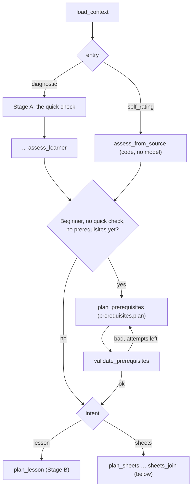
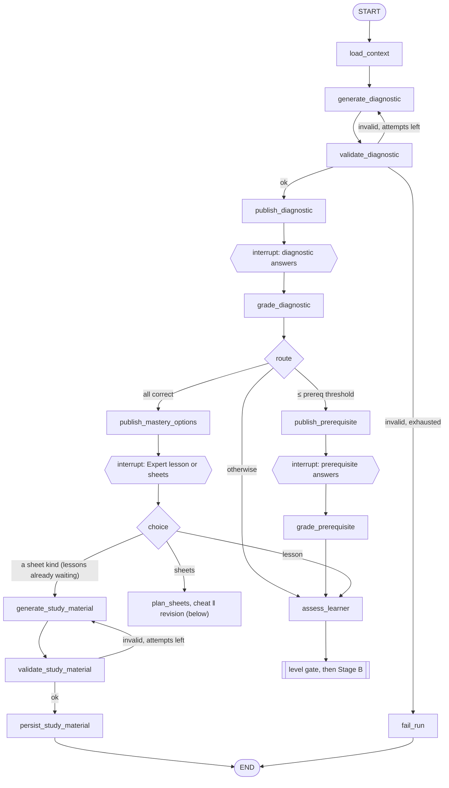
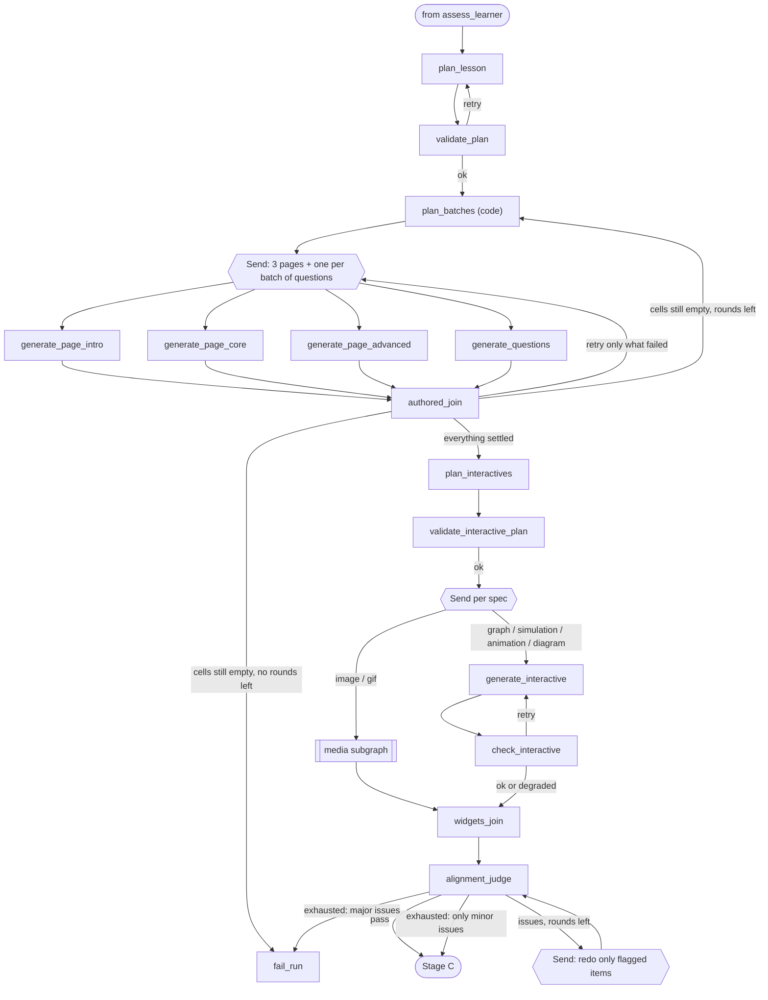
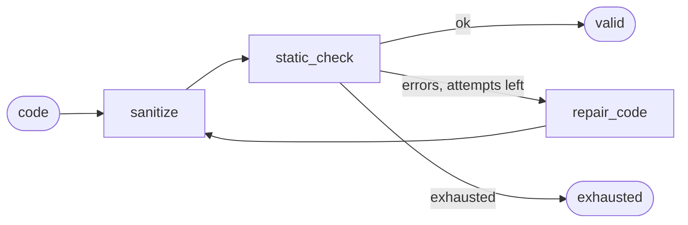
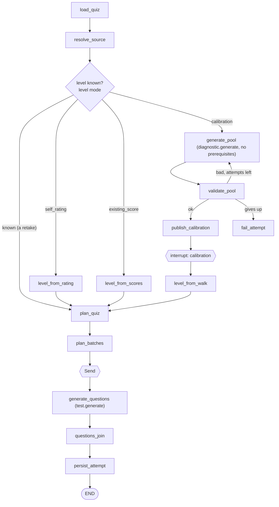

# Lesson flow graph (LangGraph)

The whole experience, from "I want to learn binary search" to a rendered three-page lesson (with its test as a separate screen) or a study sheet, is **one LangGraph `StateGraph` per lesson**. It is not a chain. The graph:

- **pauses for the learner** with `interrupt()` while they take a quiz or choose a sheet, and resumes when they answer;
- **branches** on how the learner got in (a quick check or their own rating) and on how they did (prerequisite path, full lesson, or mastery, where they choose an Expert lesson or two sheets);
- **fans out** with `Send` to write pages, fetch media, and compile code in parallel;
- follows every LLM step with **validation**, and routes on the result: retry with feedback, targeted regeneration, degrade, fall back, or fail.

Model choice, transport retries, and model fallbacks happen one level down, in the gateway (see [model-registry.md](model-registry.md)).

Conventions: **graph state is a `TypedDict`**, and **every LLM input and output is a Pydantic v2 model**, obtained through structured output.

## The three stages

```
Stage A: Diagnose           Stage B: Author                Stage C: Build & verify
────────────────────        ───────────────────────        ─────────────────────────
diagnostic quiz (10)   ─┐   plan 4 pages                    compile pages → TSX
[prerequisite quiz (5)] ├─▶ write pages ‖ final test   ─▶  static + security check
assess learner level   ─┘   plan interactives                sandbox render check
         │                  media agent ‖ widget code        repair loop
         └─ mastery ─▶ cheat / revision / practice sheet    alignment judge (end of B)
```

## The way in

A learner either takes the quick check (Stage A, below) or **rates themselves** (0.5 to 5 stars) and goes straight to the lesson. Both ways end in the same `plan_lesson`; they meet at the **level gate**. The `EntrySegment` owns the decisions (each is a small router class, hung on a pass-through "junction" node so the segments can be joined):



- **`entry_router`** sends `entry=self_rating`, `followup` or `quiz_result` (any entry but the quick check) to `assess_from_source`; a thread checkpointed before self-rating has no `entry` and is a quick check.
- **`assess_from_source`** asks `AssessmentSources.for_key(entry)` for the one `LearnerAssessment`. For a lesson made from a test result that is `FollowupSource`: the level is fixed by what the follow-up is for (`FollowupTargets`: Foundation is a Beginner lesson, Advanced an Expert lesson), with no known concepts or gaps, the level's own start point and notes, low confidence, and `test_score` as the level source. The lesson planner is told to title it in the style of its topic (`Foundations of …` / `Advanced …`). A Foundation follow-up is a Beginner, so the level gate plans its prerequisites as usual. For a lesson made from a **quick quiz result** (`entry=quiz_result`, phase 9.6) that is `QuizResultSource`: the quiz's level moved one step by how the attempt went (`BandShift`: excellent up, fail down, never past Beginner or Expert), the concepts that lost marks as the gaps and the ones answered in full as known, the level's own start point and notes, medium confidence, and `quiz_result` as the level source; `load_context` carries the attempt's id (`quiz_attempt_id`) and the node reads the card from it, failing the run with a reason if the attempt is gone. A Beginner result plans its prerequisites like any rating. For a rating that is `SelfRatingSource`: the level of the stars (0.5 to 1.5 Beginner, 2 to 3.5 Foundation, 4 Proficient, 4.5 to 5 Expert), no known concepts or gaps, the level's own start point and author notes (from its `LessonShape`), and low confidence, stamped `source: self_rating`. It moves the lesson from preparing to building (`PREPARING_DIAGNOSTIC → GENERATING_LESSON`), sets the route to `lesson` (so the test works) and the level source.
- **`level_gate`** plans prerequisites only for a **Beginner who took no quick check and has none yet** and who asked for a lesson: nobody tested them, so what they lack is chosen for them. A quick check already found theirs, and a lesson that asked for sheets only has no lesson to prepare them for.
- **`plan_prerequisites`** (`prerequisites.plan`, a small required node) returns a `PrerequisiteList` of 3 to 6; `validate_prerequisites` checks the count, the names and reasons, repeats, and that the topic itself is not one. A good list becomes the lesson's `prerequisites_to_cover` (on the lesson, in the state and as the names in the assessment), which the plan must then teach on page 1. Retry resumes at `plan_prerequisites`.
- **`intent_router`** sends a lesson on to `plan_lesson` and study sheets to `plan_sheets`. A graph that lacks the destination (no sheets writer) fails the run with a reason.

### Study sheets only (`intent=sheets`)

A learner can ask for **study sheets instead of a lesson**, from a topic, by the quick check or by rating themselves, and pick the cheat sheet, the revision sheet, or both (`sheets[]` on `POST /lessons`; the kinds travel in the start run's `payload["input"]["sheet_kinds"]`, so no column is needed). Such a lesson **skips the prerequisite quiz and the mastery choice** (the learner already chose sheets): every score goes from `grade_diagnostic` to `assess_learner` (`LevelRouter` sends every route there when `intent=sheets`), through the level gate (nothing is planned) to `plan_sheets`. A rating goes `assess_from_source → level_gate → intent_router → plan_sheets`. Neither records a lesson route: it is neither a lesson nor a mastery lesson, and ends `ready` with its sheets, **no pages and no test** (`Lesson.sheets_only`). The nodes that move the lesson work in `generating_material` instead of `generating_lesson` for it (`Node.stage_of`), and `PREPARING_DIAGNOSTIC` and `AWAITING_DIAGNOSTIC` may go straight to `GENERATING_MATERIAL`.

## Stage A: Diagnose



### Diagnostic quiz: `generate_diagnostic` (`diagnostic.generate`)

One call produces a **`DiagnosticBundle`**: the diagnostic quiz and the prerequisite quiz together. Generating them together has two benefits: the prerequisites are chosen with the diagnostic concepts in view, and the learner never waits for a second generation.

**Diagnostic quiz: 10 questions, 2 per difficulty band**

| Band | Meaning |
|---|---|
| `basic` | Vocabulary and the core idea. Anyone who has met the topic can answer. |
| `easy_moderate` | Direct application of the core idea |
| `moderate` | Standard problems and typical usage |
| `moderate_hard` | Edge cases, trade-offs, analysis |
| `hard` | Expert level. Only answerable with real mastery, and **not answerable** by a learner through general knowledge, elimination, or wording cues. |

Rules the prompt states and the validator enforces:

- **Independent questions.** Each question probes a *different* concept. No question depends on another's answer, and none reveals another's answer.
- Questions are multiple choice with exactly 4 options, one correct. The client adds an **"I don't know"** option to every question, and it scores as wrong. This keeps guessing from inflating the level: 10 four-option questions give about 2.5 correct by pure chance.
- Every question carries `band`, `concept`, and `explanation`, so the result says *what* the learner knows, not just how much.

**Prerequisite quiz: 5 questions, one per prerequisite concept**

This quiz is shown only on the prerequisite path. Each prerequisite has `name`, `why_needed`, and one `basic`-difficulty question.

```python
Band = Literal["basic", "easy_moderate", "moderate", "moderate_hard", "hard"]

class DiagnosticQuestion(BaseModel):
    id: str
    band: Band
    concept: str
    question: str
    options: list[str] = Field(min_length=4, max_length=4)
    correct_index: int = Field(ge=0, le=3)
    explanation: str

class Prerequisite(BaseModel):
    name: str
    why_needed: str

class PrerequisiteQuestion(BaseModel):
    id: str
    prerequisite: str            # must match a Prerequisite.name
    question: str
    options: list[str] = Field(min_length=4, max_length=4)
    correct_index: int = Field(ge=0, le=3)
    explanation: str

class DiagnosticBundle(BaseModel):
    diagnostic: list[DiagnosticQuestion]      # exactly 10
    prerequisites: list[Prerequisite]         # exactly 5
    prerequisite_questions: list[PrerequisiteQuestion]  # exactly 5
```

**`validate_diagnostic`** (deterministic, plus an optional LLM reviewer):

- Checks the counts, the 2-per-band distribution, that `concept`s are unique, that options are unique, that there are no "all/none of the above" options, and that no question's text contains another question's correct option.
- Checks that each prerequisite question maps to exactly one prerequisite.
- The optional `diagnostic.review` judge, if enabled, rates independence and band calibration. It flags, for example, a "hard" question that can be answered from the wording.
- Errors are sent back as `feedback` on the retry.

### Human in the loop: `publish_*` then `await_*`

```python
def publish_diagnostic(state):          # side effects live HERE
    quiz = Quiz.objects.create(lesson_id=..., kind="diagnostic", questions=...)
    Lesson.objects.filter(id=...).update(stage="awaiting_diagnostic")
    emit({"type": "awaiting_input", "kind": "diagnostic", "quiz_id": str(quiz.id)})
    return {"diagnostic_quiz_id": str(quiz.id)}

def await_diagnostic(state):            # NO side effects: re-executes on resume
    attempt_id = interrupt({"kind": "diagnostic", "quiz_id": state["diagnostic_quiz_id"]})
    return {"diagnostic_attempt_id": attempt_id}
```

- On resume, LangGraph re-runs the interrupted node from the top. For that reason, anything with side effects goes in the `publish_*` node *before* it, and each `await_*` node only calls `interrupt()`.
- The API grades the answers synchronously with the same pure function the graph uses (`graph/grading.py`), stores a `QuizAttempt`, and enqueues `resume_flow(lesson_id, Command(resume=attempt_id))`. The learner sees their score immediately while the graph continues.
- **Correct answers never reach the browser before submission.** The quiz endpoint strips `correct_index` and `explanation`.

### Routing: `grade_diagnostic` then `route_level`

This step is deterministic. The thresholds live in the admin (`FlowSettings`):

| Result (default settings) | Route |
|---|---|
| All 10 correct, including both `hard` | **mastery** → offer sheets |
| ≤ `prereq_trigger_max_correct` correct (default **2**, so 0–2) | **prerequisite** quiz |
| Otherwise (3–9) | **lesson** |

`QuizResult` records `correct`, `total`, `by_band`, `by_concept`, `dont_know_count`, and `highest_band_fully_correct`. It also records a `consistency` flag. For example, if both `hard` questions are right but the `basic` ones are wrong, the learner was probably guessing, so the assessment's confidence is lowered.

### Prerequisite outcome: `grade_prerequisite`

| Prerequisite result | Effect on the lesson |
|---|---|
| 0 / 5 | Introduction page teaches **all** prerequisites before the topic |
| 5 / 5 | Introduction goes straight to the topic |
| Partial | Introduction teaches only the **missed** prerequisites |

This produces `prerequisites_to_cover: list[Prerequisite]`.

### `assess_learner` (`learner.assess`)

The input is the profile, both quiz results, and the per-concept breakdown. The output is structured:

```python
class LearnerAssessment(BaseModel):
    level: Literal["beginner", "foundation", "proficient", "expert"]  # stamped level_scheme: 2 by the node
    known_concepts: list[str]
    gaps: list[str]                          # concepts to emphasise
    prerequisites_to_cover: list[str]        # copied from the deterministic step, not invented
    start_point: str                         # where the core page should begin
    author_notes: str                        # tone, depth, pacing guidance for page writers
    confidence: Literal["low", "medium", "high"]
```

A guard ensures `prerequisites_to_cover` equals the deterministic result. The LLM may *explain* the gaps but may not change them. This is `DiagnosticSource` in the assessment registry: it applies the guard, stamps `level_scheme: 2` and `source: diagnostic` on the stored document (the model is not asked for the source), and, for a learner who chose the Expert lesson after a perfect score, sets the level to **Expert** whatever the model said. The prompt describes what each level's lesson is like (`LessonShape.summary`), so the model chooses the level whose lesson would suit the learner.

### Mastery path

A perfect score (or one wrong non-hard answer, if the setting allows) pauses at `await_choice`, which takes `{choice: "lesson" | "sheets"}` (a bare string is accepted too; anything else, the old sheet kinds included, is refused). A `ChoiceRouter` follows it:

- **`lesson`**: on to `assess_learner` with the level set to Expert. Before the call, the lesson moves from the choice to building and its route becomes `lesson`, so it has a test like any other; after it, the flow goes through the level gate (a quick check, so no prerequisites are planned) to `plan_lesson`.
- **`sheets`**: the `SheetsSegment` (below) writes the **cheat sheet and the revision sheet in parallel**, grounded in the diagnostic's concepts, and the lesson ends `ready` (route `mastery`, no test).

### The one sheets writer

`SheetsSegment` is shared by **three things**: the mastery choice, a lesson that asked for sheets, and an extra sheet (or two) on a ready lesson (the small `study_material` graph, `load_context → plan_sheets → generate_sheet ‖ … → sheets_join`, with `extra_material` set so the lesson is left exactly as it is: ready). `plan_sheets` works out **which sheets** (`sheet_kinds` in the state: cheat sheet first, then revision sheet; both when none were named), what they rest on (`SheetGrounding`, below), and clears the counters, so a Retry starts again. One `generate_sheet` branch per sheet (`SheetWriter`: `study.generate`, then `StudyMaterialValidator`) keeps its sheet with its problems; `sheets_join` saves the sheets asked for (one persist step) and makes a lesson that was being built `ready`, sends back **only the sheet that failed** while it has attempts, or gives up with the problems (`failed_node=plan_sheets`; the small graph has no Retry and ends the run with the reason through `fail_study_material`). Nothing is saved unless every sheet asked for passes.

**What a sheet rests on** (`graph/grounding.py`, `SheetGrounding.of(state)`, stored in the state as `grounding`, the concepts being `concepts`):

| Situation | Grounding | What the model is given |
|---|---|---|
| A lesson with pages | `lesson` | its title, level and summary, the headings of its pages, and its plan's concepts (each once) |
| A quick check was taken, no pages | `quiz` | the quiz's concepts (each once), the level the assessment gave, what the assessment found known and hard |
| Nothing but a self-rating | `none` | the topic and the level of the stars; no concepts to cover |

`StudyMaterialPrompt` says who the sheet is for: **only a learner who aced the quick check** is told they already know the topic (the mastery wording); the others are told the lesson they studied, or the level, and are not talked down to or up to.

**What a sheet is.** `generate_sheet` (`study.generate`) writes one of two schemas:

- **Cheat sheet**: short notes. For quantitative topics, it gives formulas with variable definitions and when to use each. For theoretical topics, it gives key terms, facts, and one-line rules. It fits on one or two screens.
- **Revision sheet**: longer notes covering *every* subtopic, with key points, worked examples, and common mistakes.
- A **practice sheet** (15–25 questions, solutions hidden until attempted) cannot be asked for any more; the ones that exist still open and can be checked.

`sheets_join` checks each sheet (coverage of the concepts, lengths, LaTeX that parses) before it saves. The single-sheet nodes the mastery path used to have (`generate_study_material`, `validate_study_material`, `persist_study_material`) were removed in phase 9.8, together with the old three-sheet choice: no lesson was waiting at it, and `manage.py stranded_threads` found no thread at any removed node.
- The sheets are **rendered by fixed frontend templates from structured JSON**, not by generated code. They need no creative layout, and the templates give instant, reliable rendering. The learner can request another sheet type later, which runs a small separate `study_material` graph.

## Stage B: Author the lesson



### `plan_lesson` (`lesson.plan`)

The three page slots keep their keys; what each is *for* depends on the learner's level, and that is the **lesson shape** (`graph/shapes.py`: `BeginnerShape`, `FoundationShape`, `ProficientShape`, `ExpertShape`, found by `LessonShapes.of(assessment)`). The plan prompt describes the shape's roles ("Prerequisites and introduction", "Core", "A taste of what is next" for a Beginner; a short overview, depth and nuance, and hard cases for an Expert), the page prompt tells the writer what its page is for, and `validate_plan` asks the shape for the slots. The plan's `level` is always the learner's: the node overwrites whatever the model wrote with the assessment's level.

This step produces a `LessonPlan` with a title, the level, and for each of the three content pages: goals, outline, and which gaps and prerequisites it covers. It also says whether the topic is `quantitative` (mainly about calculating numbers). It no longer plans the test: the test is the same for every lesson and every level (the fixed blueprint, below), and the flag only chooses between its two variants. A plan made before this still carries its `final_test` spec, which nothing reads any more. The node stamps the plan and the assessment with `level_scheme: 2`, which says they use the level names beginner, foundation, proficient and expert; a document without it (a graph checkpoint from before the rename) is read by `LevelScheme.level_of` as the old names, where "beginner" meant what is now foundation.

| Page | Content |
|---|---|
| 1. Introduction | Hook, why it matters, and the **prerequisites to cover** (all, some, or none per Stage A), then an overview of the topic |
| 2. Core concepts | Starts at `assessment.start_point` and emphasises `gaps` |
| 3. Advanced concepts | Depth, edge cases, complexity, and real-world use, scaled to the level |
| 4. Test | Ten objective questions, two for each difficulty: MCQ, multiple select (MSQ), numerical (the fixed blueprint, below) |

`validate_plan` checks that the plan has the shape's slots, that each page's outline lists concepts that are distinct from the other pages (no overlap), and that every prerequisite the lesson was given appears on page 1 at any level (a quiz that found a gap made the promise; the shape does not relax it). It checks nothing about the test, which is not planned here.

### Page writers and the test writer: parallel `Send`

- `generate_page` (`page.generate`, run ×3 in parallel) → `PageContent`: sections with Markdown body, `concepts` (the outline concepts of the page the section teaches, copied exactly; `PageValidator` rejects a tag that is not a concept of this page's outline, and does not require tags), key points, worked examples, formulas (LaTeX), code snippets, and callouts. Each writer gets the *whole* plan, so the pages don't overlap or contradict each other.
- `generate_questions` (`test.generate`, one per batch, in parallel with the pages) → `QuestionBatch`: one question for each cell it was given, in order. A model writes `type`, `concept` and `difficulty` for each question, plus type-specific fields (`graph/questions/`, one `QuestionType` per kind):
  - `mcq`: options (exactly 4), correct_index
  - `msq`: options (4 to 6), correct_indices (at least two)
  - `numerical`: answer_expr, tolerance, decimal_precision (0 to 6), unit
  - `short_answer` / `long_answer`: model_answer, criteria (`[{text, marks}]`) (not used by a lesson test; quizzes ask for them in phase 9.6)
  - **Marks are not written by the model.** `QuestionFinisher` sets them from `MarksPolicy` (MCQ 1 / 2, MSQ 2 / 3, numerical 2 / 3, short 2 / 3, long 5 / 6: the first number for easy, basic and standard, the second for difficult and expert), computes a numerical question's `answer` from `answer_expr` with `ExpressionEvaluator` (an `ast` walk; never `eval`), rounded to `decimal_precision`, and, for a short or long answer, **rebalances** criteria that do not add up to the marks (`CriteriaRebalancer`: proportional, largest remainder, at least one mark each). Only an expression that cannot be computed, or more criteria than marks, is a problem for the model. A lesson from before these keeps the marks and fields it was stored with (`code` questions, `key_points`, `rubric`); `LegacyQuestionAdapter` derives criteria for them when they are graded.

### The fixed test and the questions pipeline

The test is **fixed in code** (`graph/questions/blueprint.py`, `LessonTestBlueprint`): ten cells, two for each of the five difficulties, objective types only, and the same for every lesson at every level, so the marks of every attempt of a lesson add up to the same total and attempts can be compared.

| Difficulty | Quantitative topic | Other topics |
|---|---|---|
| easy | MCQ, MCQ | MCQ, MCQ |
| basic | MCQ, MSQ | MCQ, MSQ |
| standard | MCQ, numerical | MCQ, MSQ |
| difficult | MSQ, numerical | MSQ, MCQ |
| expert | MSQ, numerical | MSQ, MCQ |
| **Marks** | **20** (2 + 3 + 3 + 6 + 6) | **18** (2 + 3 + 3 + 5 + 5) |

`plan_lesson` records the blueprint on the state and `validate_plan` on `Lesson.test_blueprint`. Writing it is one pipeline shared by the author stage and the retake graph (`graph/nodes/questions.py`):

- `plan_batches` (code, `BatchPlanner`) splits the cells that have no question yet into batches of `question_batch_size` (5 to 10, default 5, so two batches), with the subjective cap (at most `batch_max_long` long and `batch_max_short` short answers per batch; off when only short or long are asked) and an id per batch that names the round.
- `generate_questions` writes one batch. Ids are the cell's (`t1`…`t10`), set by code. The batch is checked by `QuestionBatchValidator` (the right type and difficulty for each cell, then the rules of each type); it is kept even with problems, and the join decides.
- **Concept-bounded questions (phase 9.7).** Every question written for a lesson must name one of that lesson's concepts, so a weak concept can be looked up in the lesson's concept index and linked to its page. `QuestionConcepts.allowed(data, cells)` gives each cell's list: the plan's whole outline for a lesson's test and its retakes, the concepts kept in the summary of the cell's own lesson for a quiz from lessons, nothing for a topic quiz. The prompt lists them (`Allowed concepts (copy one exactly into "concept"): [...]`, once for a test, under each lesson for a quiz), `ContentWriter.questions` writes a near-miss in case or spacing with the lesson's spelling, and `QuestionBatchValidator` reports any other name so the batch is written again.
- The join (`QuestionRound`, called by `authored_join` and by the retake graph's `questions_join`) **retries only the batches with problems** (up to `test.generate.max_attempts`), then accepts the questions that fit their cell, are usable (a numerical question has its answer…) and are new (`QuestionDeduper`: the same text after normalising, or almost the same words, as anything already asked or already in the set). Cells still empty are **planned again** as a new round, and when the rounds are used up **a lesson test fails the run** (`failed_node: plan_batches`, so Retry starts the test again) rather than keep a test that is not the blueprint. Problems that do not stop a question being used are shown as a warning, as before.
- A review fix (`fix_item`, target `final_test`) writes **one question again** as a batch of one cell, with the other questions of the test given as ones not to repeat; the old question is retired on the record, the new one added.
- Every accepted question goes on the record (`Question`, written only by `QuestionBank`), and the ten questions of attempt 1 become the lesson's **first set** on the record (`QuestionBank.set_first_set`: each row gets its `first_set_position`; a review fix gives its replacement the old question's place). There is no `Lesson.final_test` column any more.

### `compile_page` (`page.compile`)

- Writes the TSX for one page, as `function Page_core() { ... }`, laying out that page's content and placing its interactive components and `<Figure asset="...">` at their anchor sections.
- **Content is injected as data, not retyped.** The validated `PageContent` is available in scope as `LESSON.pages.core`, so the compiler writes code that *renders* the text. This stops the compile step from changing, cutting, or hallucinating content that already passed the alignment judge. It also saves a large number of output tokens.
- **The test is not a page.** Its questions are written by the batched pipeline above and kept as the lesson's first set on the record, but `assemble_document` does not put it in the document: it is served by `GET /lessons/{id}/test` and taken on its own screen, as many times as the learner likes. (Lessons made before this change still declare a `test` page in their code; `GET /document` flags them with `has_embedded_test`, and a repair rebuilds the document from the three content pages, which drops it.)

### `assemble_document` (deterministic)

This step concatenates the interactive components and the three page components into one TSX document. It adds `LessonDocument` (the runtime's `LessonShell`, which shows one page at a time; the app draws the navigation around it) and the `render(<LessonDocument />)` call. This produces the TypeScript document that is rendered.

### `code_fix_loop` (per page, subgraph)



- **`sanitize`** strips code fences, imports, exports, and `React.` hook prefixes, and removes any stray `render(...)`.
- **`static_check`** runs `sandbox/scripts/check.mjs` (Node) in a subprocess:
  1. **Syntax and types**: esbuild transform for TS and JSX.
  2. **Security scan** (Babel AST walk):
     - Forbidden identifiers and members: `fetch`, `XMLHttpRequest`, `WebSocket`, `EventSource`, `eval`, `Function`, `import()`, `window.parent`, `window.top`, `opener`, `document.cookie`, `localStorage`, `sessionStorage`, `indexedDB`, `navigator.sendBeacon`, `postMessage`, `setInterval` without cleanup, and `dangerouslySetInnerHTML`.
     - No `http(s)://` string literals and no raw ``, `<iframe>`, `<script>`, or `<link>`. Media must go through `<Figure asset>`.
  3. **Scope contract**: no undeclared free identifiers outside the sandbox scope. It also checks that the required component names exist and that every asset ID referenced exists in `LESSON.media`.
- **`repair_code`** (`code.repair`) receives the code, the exact errors with line and column, and the contract, and returns the full component.

### `render_check`: sandbox validation (Playwright, headless Chromium)

`sandbox/scripts/render-check.mjs` loads the **same** sandbox runtime the browser uses, with the assembled document and `LESSON` data. For each page it:

1. Renders the page and waits for idle. It fails on uncaught errors, React error-boundary errors, and `console.error`.
2. Smoke-tests interactions: it clicks up to N buttons and moves every range input, then checks for errors again.
3. Enforces a time budget per page, which catches infinite loops and runaway timers.
4. Blocks all network requests except local media. Any attempted request is a failure, reported as a security violation.
5. Checks that the page is not blank: its text length is at least that of its section headings.

Failures are mapped to a page, and only that page goes back through `repair_page` and then `code_fix_loop`.

### `persist_lesson`

This writes pages, the **concept index** (`ConceptIndex.build(plan, pages)`, from the final pages, so a section a review fix rewrote is the one indexed), the test, media links, the assembled code and its parts (`code_parts`), the next `code_version`, and warnings, then sets `stage=ready`. Only the media the document uses is kept. The frontend receives `done` and renders the document in its sandboxed iframe.

## After the lesson is ready (separate small graphs)

| Graph | Trigger | Nodes |
|---|---|---|
| `runtime_repair` | The browser iframe reports an error the sandbox check missed | `load_repair` → `repair_runtime` (`runtime.repair` → code-fix loop) → `assemble_repaired` → `regression_check` → `verify_repair` (render check) → `save_repair` (a new `code_version`) |
| `question_bank` | The learner starts attempt 2 or later (a retake) | `load_bank` → `plan_batches` → `generate_questions` ×batches → `questions_join` → `persist_attempt`; `fail_attempt` ends the run with the reason when the test cannot be filled. See below. |
| `grade_test` | A **legacy** attempt with open-ended questions is submitted | `load_submission` → `grade_open` (`test.grade`) → `validate_grade` → `persist_grade`, or straight to `persist_grade` when nothing needs a judgement. Produces a `ScoreCard` with feedback per question and topics to revisit. A lesson attempt is objective and is graded at submit, so it never runs this graph. |
| `study_material` | The learner asks for a cheat sheet, a revision sheet, or both, for any ready lesson | `load_context` → `plan_sheets` → `generate_sheet` ‖ … → `sheets_join` (the same writer as above; `fail_study_material` ends it with the reason) |


### How Stage C is built

- **The code-fix loop is a subgraph run inside the node** (`CodeFixer`), so `compile_page`, `repair_page` and `repair_component` all hold code to the same checks: sanitize → static check → `code.repair` with the exact errors and the contract, up to `code.repair.max_attempts`.
- **Failure policy.** Generated layout is never worth failing a lesson for. A page whose code keeps failing the checks, or keeps crashing in the browser, falls back to the **standard layout** (`DocumentAssembler.template_page`: every section, the interactives and figures at their anchors), and an interactive that keeps crashing is dropped; both leave a warning. Only a document that fails *after* the fallback fails the run, and a retry resumes at `assemble_document` without rewriting the pages.
- **Rounds** are `render_check_max_rounds` (default 2) repairs, then one fallback, then one last check (`RenderPolicy`). A repair goes only to the pages and interactives that the browser blamed, with its errors as feedback.
- **One runtime.** The render check loads the same bundle (`sandbox/dist/runtime.js`) and harness (with its CSP) the browser uses, so a lesson that passes behaves the same in the learner's iframe.

### The optional judges never fail a lesson

`diagnostic.review` (a judge of the diagnostic quiz) and `media.verify` (a vision check of a found picture) are on in the default registry, but they are bonuses on top of rules that already passed. A judge whose models all fail is skipped with a warning. A quiz that passes every rule is kept, with a warning, when only the reviewer still objects after the last attempt (a rule that fails still fails the run). A picture the vision models cannot check is kept unchecked. Their effect on real lessons has not been measured: see the roadmap.

### How `question_bank` is built (a retake)

- **Input** `{lesson_id, attempt_id}`, in its own thread (`<lesson id>:<run id>`), queued by `AttemptService.start` after the action gate has said yes to `test.retake`. The lesson stays `ready`; the learner sees "Getting your questions ready" while the run works.
- `load_bank` reads the lesson and the waiting attempt (a missing attempt fails the run with "That retake was cancelled"), gets the blueprint (a lesson made before the blueprint gets the one its old test implies, quantitative if the old test had a numerical question, and keeps it), gives the **exclusion list** (every stem the lesson has asked: the record, retired rows included, the lesson's own test and every attempt's snapshot), and draws any question written but never served for its cell (`BlueprintSampler`, seeded with the lesson and the attempt number, so it needs no model call). Because every retake needs ten new questions, this usually draws nothing.
- Then the same pipeline as the author stage. `persist_attempt` writes the new questions on the record and moves the attempt `generating` → `in_progress` with the set as its snapshot, in one transaction; if the attempt is gone (Stop) nothing is written.
- **No Retry.** A run that fails or is stopped deletes the waiting attempt (`AttemptGenerationEffect`), so the attempt number is never used up and the learner starts again; the authorization is settled `failed` or `cancelled`. `test.retake` is complete when the run ends, which is exactly when the attempt starts.

### How an attempt is graded

- **A lesson attempt is graded in the request that submits it.** Its questions are objective, so `AttemptService.submit` marks multiple-choice, multiple-select (partial marks, in whole marks) and numerical answers with `AnswerGrader` (the grader practice sheets use, so a score never depends on where the test was taken), gives blank answers 0, builds the finished `ScoreCard`, and stores the score, the band (`AttemptOutcome`, whole marks against `band_fail_below` and `band_excellent_above`), the follow-up offer (none until phase 9.4) and whether every answer was blank. No run is queued.
- **Only a legacy attempt with open-ended questions queues `grade_test`.** The request marks what it can, stores a first `ScoreCard` with the open-ended answers still `awarded: null`, and queues the run only if some open-ended answer has something to judge. `persist_grade` then stores the finished card through the same `AttemptOutcome`.
- **The model sees only what needs a judgement**, with its model answer and its criteria (derived by `LegacyQuestionAdapter` for questions from before criteria; code is read, not run). It returns one whole award per criterion. The learner's answer is delimited as data and the prompt says to ignore any instruction inside it.
- **Its marks are checked** (`GradeReportValidator`): every question once, one whole-number award per criterion in order, none above its criterion, with feedback; a bad grading goes back with the problems, up to `test.grade.max_attempts`, then the run fails with the reason. The card keeps the per-criterion breakdown and caps marks again when it is built.
- **Many attempts, each immutable.** A lesson has any number of attempts (`TestSubmission`, numbered from 1) but at most one open one (`generating` or `in_progress`, a partial unique constraint). The attempt stores a snapshot of the questions it was served; `PUT …/answers/{qid}` locks a question on the server (forward-only); `TestSubmission.seal` is the only way out of `in_progress`, and nothing else writes `answers` or `questions` (a test scans the code for it). Answers, score and recommendations of a sealed attempt are read-only.
- **No Retry of the learner's answers, but of the grading.** A run that cannot grade (or is cancelled, or cannot be queued) marks its attempt `failed` through `RunEffects`; the lesson stays ready. The learner never answers again: `POST …/regrade` runs `grade_test` once more on the stored answers, and only for a `failed` attempt.

### How `quick_quiz` is built (a quiz's first questions, and every retake's)



- **Input** `{quiz_id, attempt_id}`; the run belongs to the quiz (`run.subject`), and the first run and the calibration resume share the thread `<quiz id>` while every retake and grading run has its own `<quiz id>:<run id>` (`FlowRunner.thread_id`). The state key is `quiz_id`, not `lesson_id`; `Node.__call__` moves no lesson when there is none, and `FlowContext.invoke` logs the model calls against `quiz_id`.
- `load_quiz` reads the quiz, its settings, the level if it is known already (a retake), the **exclusion list** (every stem the quiz has ever asked, from all its attempts) and whether the per-batch cap on written answers applies (not when only short or long answers were picked). A missing waiting attempt fails the run with "That quiz was cancelled".
- `resolve_source` builds, **in code from each lesson's concept index (a lesson without one: its stored plan's outline), never its text**, a summary of the concepts within the token budget (`quiz_source_token_budget`, 1500 per lesson, characters divided by four; the core page's concepts are kept longest, then the introduction's, then the advanced page's, and what is dropped is listed). A lesson deleted since fails the run. The concepts that fit the summary are the ones the lesson's questions may name (`quiz.sources[key].concepts`, listed under the lesson in the prompt); a concept with no page, which the index could not place, is the first to be dropped.
- **The level.** `level_from_rating` and `level_from_scores` call no model (`SelfRatingSource`, `TestScoreSource`; a quiz from lessons shows the middle level of its lessons). The **calibration walk** is `generate_pool` (the diagnostic's questions, two for each band, no prerequisite half), `validate_pool` (the diagnostic validator without the prerequisite rules), `publish_calibration` (keeps the pool and the empty walk on the quiz and moves it to `awaiting_calibration`), `await_calibration` (an interrupt of kind `calibration` that does nothing but wait) and `level_from_walk` (`CalibrationSource`: the ladder's table, quiz back to `preparing`). The walk itself is driven by the API one answer at a time (`CalibrationService`) and calls no model; the graph resumes **once**, from the answer that ends the walk, in a run that carries the authorization on.
- `plan_quiz` makes the `QuizBlueprint` in code: for each source, in order, the difficulty mix of its level (`DifficultyMix.for_level`, largest remainder, ties to the easier) and the kinds picked dealt out in turn across the quiz, with marks from `MarksPolicy`. Then the shared questions pipeline (`plan_batches`, `generate_questions`, `questions_join`; see above): a batch is told only the summaries of the lessons its cells are about. The join is lenient for a quiz (`QuestionRound(strict=False)`): cells still unfilled after the last round are left out with a warning rather than failing a quiz of 9 questions out of 10; a quiz with none fails.
- `persist_attempt` moves the waiting attempt `generating` → `in_progress` with the questions (each tagged with its lesson) and, for a quiz still being made, the quiz `preparing` → `ready`, in one transaction. **No Retry**: a run that fails or is stopped deletes the waiting attempt (`AttemptGenerationEffect`) and fails a quiz that was still being made (a ready quiz stays ready); the authorization settles `failed` or `cancelled`. `quiz.create` and `quiz.retake` are complete when the run **ends**, so the pause for the calibration is not a settlement.

### How `grade_quiz` is built

The same graph as `grade_test` (`GradeAttemptGraphBuilder`, registered under both names), built with an **`AttemptStore`**: `LessonAttemptStore` loads a lesson attempt through its lesson and saves the card through `AttemptOutcome` (band and follow-up offer), `QuizAttemptStore` loads a quiz attempt through its quiz (input `{quiz_id, attempt_id}`) and saves the card with a band from the **quiz's own** thresholds and no offer: a quiz has none. A quiz is the one place short and long answers are asked, so most of its attempts with such answers go through it: the request marks what it can and queues the run (`QuizAttemptService.submit`); a run that cannot finish marks the attempt `failed` (`QuizAttemptEffect`) and `POST …/regrade` runs it again on the stored answers.

### How `runtime_repair` is built

- **Input** `{lesson_id, repair_error: {message, stack?, page?}, expected_code_version}`, run in its own thread. A crash can only be repaired on a ready lesson at the version the browser was showing; a stale report is refused and nothing is changed.
- **`RepairTargetLocator`** finds the broken part from the error: an interactive named in the message or stack (`Interactive_x`), else the page the viewer reports or `Page_x` in the stack. The final test is not part of the document, so it is never a target. An error that cannot be traced is refused rather than guessed.
- **Only that part is rewritten** (`runtime.repair`), held to the same code checks as a first draft; code identical to the old code is refused.
- **`RegressionCheck`** (cheap, so before the browser): the same pages and interactives, and everything each page placed before (interactives, figures, the sections loop, named sections) is still placed.
- **`verify_repair`** renders the repaired document in the headless browser; any error refuses the repair.
- **`save_repair`** (one transaction, re-checking the version) keeps the old code as a `LessonVersion` and stores the new code under `code_version + 1`. Any refusal raises `RepairFailed`: the run ends with its reason, the lesson stays ready with the code it had, and no retry is offered.
- **The cap.** Each `POST /repair` counts against `max_auto_runtime_repairs` whether or not it succeeds, so a crash the model cannot fix cannot loop. `POST /versions/{n}/restore` is not counted.

## How Stage B is built

- **Segments.** The flow graph is assembled from segments (diagnose, entry, mastery, sheets, author, build); the author segment provides the `lesson` exit, which leads to the build segment's `prepare_build`. Segments are joined through named exits: the entry segment provides `begin` (where `load_context` goes) and `assessed` (where an assessment goes: the level gate); the diagnose segment provides `assess`; the mastery segment provides `mastery`; the sheets segment provides `sheets`. A graph built without the entry segment (a test) keeps the quick check as the only way in.
- **Parallel items and joins.** `Send` branches carry the shared context (`BranchBuilder`) and write under keys with reducers (`pages`, `final_test`, `interactives`, `media`, `feedback`, `attempts`). `authored_join` and `widgets_join` read each item's problems and attempts: items under their attempt budget are sent again *alone* (the router builds the `Send`s), items out of attempts are kept with a warning (pages, test) or dropped with a warning (widgets).
- **One writer for first drafts and fixes.** `ContentWriter` asks for a page, a batch of test questions or a component and checks it (`PageValidator`, `QuestionBatchValidator`, the sandbox's `check.mjs`), so a fix after the alignment judge is held to the same rules.
- **Alignment is decided in code** (`AlignmentPolicy`): pass, fix (only flagged items that exist, one issue per item), accept with a warning (rounds spent, nothing major) or fail (rounds spent, a major issue). A fix that fails its own checks keeps the old version.
- **The media agent** is a subgraph run inside `find_media` (`MediaFinder`): search tools per allowed source, bounded by `max_tool_steps`; `submit_media` is a tool whose arguments are the structured result; only URLs a tool returned in this session are downloaded (`UrlGuard`: https only, never a private address, redirects re-checked; size, type and dimensions read from the bytes); the optional `media.verify` vision check writes the alt text and can reject; out of rounds, the spec is drawn as an SVG diagram.
- **Media is served** by `GET /api/media/{asset_id}?exp=&sig=` ([api.md](../reference/api.md)); generated code never sees a URL.

## State

```python
# graph/state.py
class FlowState(TypedDict, total=False):
    # inputs
    lesson_id: str
    topic: str
    user_context: str | None
    profile: LearnerProfile
    snapshot: dict                         # resolved model registry (Lesson.config_snapshot)
    settings: dict                         # FlowSettings snapshot

    # Stage A
    bundle: DiagnosticBundle
    diagnostic_quiz_id: str
    diagnostic_attempt_id: str
    diagnostic_result: QuizResult
    prerequisite_quiz_id: str | None
    prerequisite_attempt_id: str | None
    prerequisite_result: QuizResult | None
    prerequisites_to_cover: list[Prerequisite]
    route: Literal["prerequisite", "lesson", "mastery"]
    assessment: LearnerAssessment                       # stored with `source` and `level_scheme: 2`
    mastery_choice: Literal["lesson", "sheets", "cheat_sheet", "revision_sheet", "practice_sheet"] | None
    study_material: dict | None
    sheets: Annotated[dict[str, dict], merge_dicts]     # cheat_sheet / revision_sheet, written in parallel
    sheet_kinds: list[str]                              # the sheets this run was asked for (else both)
    grounding: dict                                     # what they rest on: the lesson, the quiz, or the topic and level
    concepts: list[str]                                 # what the sheets must cover
    sheets_outcome: str                                 # the sheets' join: retry, failed or complete

    # the way in (all optional: a thread from before self-rating has none, and means a quick check)
    entry: str                                          # diagnostic | self_rating
    intent: str                                         # lesson | sheets
    self_rating_halves: int | None
    level_source: str
    prerequisite_plan: dict                             # PrerequisiteList, planned for a Beginner who took no quiz

    # Stage B (parallel writers → reducers required)
    plan: LessonPlan
    pages: Annotated[dict[str, PageContent], merge_dicts]            # intro / core / advanced
    final_test: FinalTest  # the ten questions of attempt 1 (graph state only; the lesson keeps them as its first set)
    interactive_plan: InteractivePlan
    media: Annotated[dict[str, MediaRef], merge_dicts]               # spec_id → asset
    interactives: Annotated[dict[str, InteractiveComponent], merge_dicts]
    alignment: AlignmentReport | None

    # Stage C
    page_code: Annotated[dict[str, str], merge_dicts]
    document_code: str | None
    render_report: dict | None

    # control
    attempts: Annotated[dict[str, int], merge_counts]
    feedback: Annotated[dict[str, list[str]], merge_dicts]
    warnings: Annotated[list[str], operator.add]
    error: str | None
```

Any key written by parallel branches needs a reducer. Without one, LangGraph raises `InvalidUpdateError`.

## Retry, fallback, and failure rules

| Situation | Handled by | Behaviour |
|---|---|---|
| Timeout, 429, 5xx | Gateway | Backoff retries on the same model, then the next model in the node's chain |
| Output doesn't match the Pydantic schema | Gateway | One in-place retry with the parse error attached, then the next model |
| Schema valid but rules broken | `validate_*` node + router | Retry the same node with `feedback`, up to `NodeConfig.max_attempts` |
| One page, question, or widget bad | Router with `Send` | Regenerate **only** that item |
| Widget keeps failing | Degrade | Drop the widget and add a warning |
| No acceptable media | Fallback | Draw an SVG diagram instead |
| Code fails static or render checks | `code_fix_loop` / `repair_page` | Targeted repair of that page |
| Unrecoverable (diagnostic, plan, or major alignment issue exhausted) | `fail_run` | `stage=failed`, a readable error, and a **Retry** button that resumes from the last checkpoint |

## Execution

- **Checkpointer:** `langgraph-checkpoint-postgres` (`PostgresSaver`) on the Supabase database, with `thread_id = lesson.id`. A thread can wait at an `interrupt()` for days, so its checkpoints must be durable. Redis stays for the queue, events, cache, and rate limits.
- **Runs and tasks:** every execution segment is a `GraphRun` row created by the API (so `POST` can return its id at once) and queued as `start_flow(run_id)` or `resume_flow(run_id)`. Both call `FlowRunner.execute(run_id)`, which looks at the lesson's thread and feeds it what it needs: `Command(resume=…)` when it waits at an `interrupt()`, nothing when a crash left it mid-run (it continues from its last checkpoint), the first input for a new thread, and nothing at all when the thread already finished (a redelivered task). The task uses `acks_late` and `reject_on_worker_lost`; a per-run lock (TTL `FLOW_RUN_LOCK_TTL_S`, which is also Redis's `visibility_timeout`) keeps a redelivered task from running the graph twice while the first worker is alive.
- **Two kinds of failure.** When a validator runs out of attempts the graph *gives up in the graph*: `mark_failed` records the reason, `await_retry` pauses, and Retry resumes at the node that gave up with its attempt counters reset. When a node *raises* (every model failed, the sandbox is missing, a bug), the run ends `failed` with a readable message (`FailureMessage`: unexpected errors are named by type only), the lesson is failed, and Retry re-runs that node from the checkpoint. A node that declares its `stage` moves a failed lesson back to it when it runs again.
- **Stop, then Retry.** Stop (`POST /runs/{id}/cancel`) is cooperative: the lesson is failed at once, the run is marked cancelled, and the worker stops after the step it is in. Closing LangGraph's stream there leaves the thread with a step whose tasks have finished but whose results are not yet applied, and then `StateSnapshot.next` is empty although `tasks` is not. `FlowRunner._input` reads both: tasks still standing mean the thread continues (an empty `next` alone once read as "the thread is finished", so Retry ended in a fraction of a second and left the lesson failed for good). Stop also records, on the cancelled run, the stage Retry should put the lesson back in (`StopPoint`, `payload["stopped_in"]`), and hands the retry run the answer the stopped run was about to give, labelled with the kind of question it is for (`resume_for`). **A stage is only remembered when the thread is at a question**, because Stop is noticed after the step that is running, so a stage read at the click can be one the thread has already left (`awaiting_diagnostic` while the thread is past `grade_diagnostic`, or `preparing_diagnostic` for a self-rated lesson whose first step had not finished) and the build then failed at its last step (`awaiting_diagnostic` to `ready`). That was patched twice (9.3, 9.4) in `Node.__call__` before this was seen to be one cause. Now: a run no worker had started leaves the thread where it was, so `cancel` records the stage the lesson waits in; a run the worker had started records none at the click (`""`), and when the worker notices the Stop (`FlowRunner._stopped`) it reads where the thread is and records that quiz's stage if it is paused at one (`StopPoint.settle`), else none. A lesson Retry leaves `failed` stays `failed` while the run works (the page shows progress for an active run) until the first node that declares a stage runs and moves it (`Node.__call__`, as for any retry). If the thread meanwhile paused at a different question (the stop landed after the diagnostic was graded and the prerequisite quiz was published), that answer is not fed to it: the retry run ends paused there, and the lesson shows that quiz. An error that surfaces after Stop (the step being cut short) leaves the "Cancelled" message in place and publishes `cancelled`, not `error`.
- **Events:** nodes emit `node` (running), `attempt` (a validation retry), `warning` and, through the gateway, `retrying` and `fallback_model` via `get_stream_writer()`. The runner translates them, together with the `updates` stream (a node finished) and the interrupt itself, into the run events of [api.md](../reference/api.md). `awaiting_input` comes from the interrupt, after the run is marked `paused`, so a learner who answers at once never races the run's bookkeeping.
- **Threads:** LangGraph runs sync nodes on pool threads; a node closes its thread's database connection when it ends so runs don't leak connections. Under pytest those threads only see committed rows (see [testing.md](../process/testing.md)).
- **Parallelism:** `Send` branches run in the same superstep, so page writers, media searches, and page compiles make their LLM calls concurrently. Per-provider rate limits in Redis keep that within quota.

## Testing

- **Validators and grading** are pure functions. Test them with fixtures of real bad LLM outputs.
- **Routing:** table-driven tests over `QuizResult` → route, and prerequisite result → `prerequisites_to_cover`.
- **Graph tests** inject a `FakeGateway` with scripted outputs per node key. Assert the node path, the interrupts, resuming with `Command(resume=...)`, targeted regeneration, degrade paths, and the final state.
- **Sandbox:** `check.mjs` and `render-check.mjs` have their own fixtures: known-malicious snippets must be rejected, and known-good lessons must pass.
- **Live:** golden topics (binary search, coordinate geometry, asexual reproduction) run against real models under `pytest -m live`.
