# Object design

This document is the **binding object model** for Lesson Crafter: the rules every module follows, the classes each module is made of, and the design patterns used where. It covers the code that exists today and the target for every roadmap phase.

- New code follows this document. If a change needs a class, collaborator, or pattern that isn't here, update this document **in the same change**.
- Where today's code differs from the target, the gap is listed in the [refactor backlog](#refactor-backlog). Close it when you next touch that module, or in a dedicated `refactor/<topic>` branch.
- Diagrams are Mermaid (`classDiagram`, `sequenceDiagram`); GitHub and VS Code render them. They show the public surface and the key collaborators, not every private helper.

Legend for status columns: ✅ in code · ◐ partly (functions still to wrap in a class) · ☐ planned (roadmap phase).

## 1. Rules

### 1.1 Everything is object-oriented

Behaviour lives in classes. A unit of work is a method on an object with a single, nameable responsibility, and its collaborators are passed in.

| Construct | Use |
|---|---|
| **Class with methods** | All behaviour: services, policies, adapters, validators, graph nodes, prompt builders |
| **`typing.Protocol`** | Ports (interfaces) a class depends on: `LLMGateway`, `RateLimiter`, `MediaSource`… Structural, so test fakes need no inheritance |
| **`abc.ABC`** | Base classes that share an algorithm (Template Method): `Node`, `LLMNode`, `Prompt`, `HealthCheck` |
| **`@dataclass(frozen=True)` / Pydantic `BaseModel`** | Value objects: results, reports, snapshots, LLM inputs and outputs. Immutable, compared by value |
| **`StrEnum` / `models.TextChoices`** | Closed sets of values (`Capability`, `Stage`, `Route`) |
| **Module-level constants** | Configuration that never changes at runtime (`PAGE_KEYS`, `MAX_BYTES`) |
| **Django model methods, managers, querysets** | Behaviour that belongs to a row (`Profile.is_complete`) or to a query (`Lesson.objects.owned_by(user)`) |

**Allowed exceptions.** Some frameworks require a function, a module, or a component function at a fixed place. These are *adapters*, not logic: each one is a few lines that build or look up an object and call one method on it.

| Framework hook | Shape |
|---|---|
| Django `settings.py`, `urls.py`, migrations | Modules, as Django requires |
| Signal receivers (`@receiver`), system checks (`@register`), DRF `EXCEPTION_HANDLER` | Function → one call into a class (`RegistryResolver().invalidate()`) |
| Celery tasks (`@shared_task`) | Function → `FlowRunner().start(lesson_id)` |
| LangGraph state reducers in `Annotated[...]` | `@staticmethod`s on a `Reducers` class |
| pytest test functions and fixtures | pytest idiom (test classes are optional); see [testing.md](testing.md) |
| React components and hooks | Function components and hooks (class components are legacy React). Non-UI logic they use lives in TypeScript classes in `lib/` |

### 1.2 SOLID in this codebase

| Principle | Rule here | Example | Smell to refuse |
|---|---|---|---|
| **S**ingle responsibility | One reason to change per class. Views parse and format; services decide; adapters talk to the outside world. | `Gateway` orchestrates the fallback chain; retrying, rate limiting, logging and output parsing are separate collaborators. | A view that grades a quiz, saves an attempt and enqueues Celery inline |
| **O**pen/closed | Add a variant by adding a class and registering it, not by editing an `if/elif` ladder. | A new provider kind is a new `ProviderProfile`; a new media source is a new `MediaSource`; a new LLM step is a new `NodeSpec` + node class. | `if kind == "anthropic": … elif kind == "google_genai": …` spread across modules |
| **L**iskov substitution | Every implementation of a port honours its contract, including errors raised and "empty" results. | Any `MediaSource.search` returns `[]` for no hits (never `None`) and raises `MediaError` for transport failures. | A subclass that ignores an argument or raises where the base returns |
| **I**nterface segregation | Ports are small and named for the client's need. | Validators depend on `LatexChecker.latex(expressions)`, not on all of `SandboxRunner`. | Passing the whole `FlowContext` into a pure validator |
| **D**ependency inversion | High-level code depends on Protocols; concrete classes are chosen at the composition root and injected through constructors. | Graph nodes use `ctx.gateway: LLMGateway`; tests inject a `FakeGateway`. `default_context()` is the composition root. | `Gateway()` or `httpx.Client()` constructed inside a node or validator |

### 1.3 Further conventions

- **Constructor injection** with production defaults, so callers stay short and tests pass fakes: `Gateway(chat_factory=..., limiter=..., sleep=...)`.
- **Composition over inheritance.** Inherit only for Template Method bases and framework base classes (Django, DRF, LangChain).
- **Tell, don't ask.** `lesson.advance_to(Stage.READY)` rather than `lesson.stage = "ready"` followed by checks at every caller.
- **Value objects cross boundaries.** Services return `GatewayResult`, `QuizResult`, `SyncReport`, never loose dicts. (LangGraph state stays a `TypedDict` of JSON-safe data, because it is checkpointed.)
- **Exceptions are classes per failure**, named for what went wrong (`AllModelsFailed`, `MissingAPIKey`, `RepairFailed`), and owned by the module that raises them.
- **No hidden globals.** Module-level singletons like `MEDIA_GRAPH = build_media_graph()` are acceptable only for immutable, compiled artefacts; anything holding a client or state is injected.

## 2. Layers

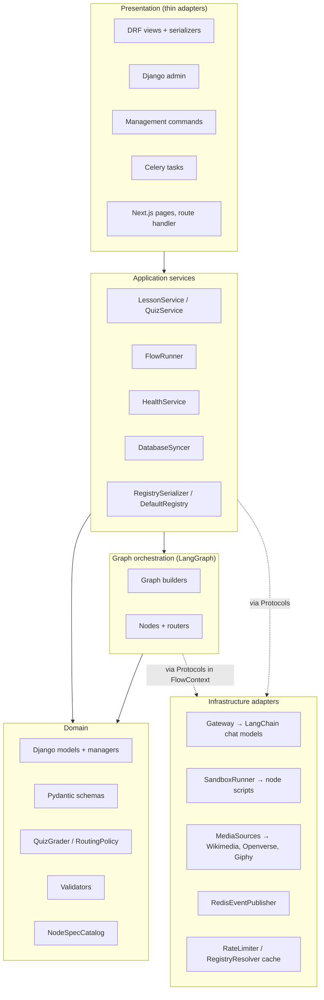

**Dependency rule:** arrows point down. Domain code imports nothing from presentation, orchestration, or infrastructure. Orchestration and services reach infrastructure only through Protocols, so every layer above infrastructure is testable with fakes.

## 3. Pattern catalogue

| Pattern | Where | Classes | Why here | Status |
|---|---|---|---|---|
| **Facade** | `llm_registry/gateway.py` | `Gateway` | One call (`invoke`) hides resolution, retries, fallback, rate limits, output parsing and logging from every node | ✅ |
| | `graph/media.py` | `MediaLibrary` | One object for search, download, sniffing and storage | ✅ |
| | flow execution | `FlowRunner` | Celery tasks and services run a graph segment without knowing LangGraph | ✅ |
| **Chain of Responsibility** | gateway | `ResolvedNode.chain` walked by `Gateway` | Each model in priority order handles the call or passes it on to the next fallback | ✅ |
| **Strategy** | gateway | `OutputAdapter` (`Structured…`, `Tools…`, `Text…`) | Output mode varies per node; the retry loop must not branch on it | ✅ |
| | gateway | `RetryPolicy` (`ExponentialBackoffPolicy`) | Which errors are retryable and how long to wait, swappable and testable | ✅ |
| | providers | `ProviderProfile` per provider kind | Allowed params, renames and reasoning kwargs differ per vendor | ✅ |
| | rate limits | `RateLimiter` (`CacheWindowRateLimiter`) | Gateway depends on "wait for room", not on Redis | ✅ |
| | probes | `CapabilityProbe` per capability | Each capability has its own check; `ModelProber` runs the declared ones | ✅ |
| | graph | `Validator` per artefact | Deterministic rules per output type, fed back as retry feedback | ✅ Stage A and study material · ◐ plan, page, test and interactive-plan validators are classes but not wired until Phase 5 |
| | graph | `RoutingPolicy` | Diagnostic score → route uses admin thresholds | ✅ |
| | media | `MediaSource` (`Wikimedia…`, `Openverse…`, `Giphy…`) | Sources are added or disabled by settings | ✅ |
| | health | `HealthCheck` (`Database…`, `Redis…`, `Celery…`) | Each dependency checked the same way | ✅ |
| **Composite** | health | `HealthService` aggregates `HealthCheck`s | Overall status = worst child status | ✅ |
| | graph | `CompositeValidator` | Deterministic validator + optional LLM reviewer (`diagnostic.review`) behave as one validator | ✅ |
| **Template Method** | graph | `Node`, `LLMNode`, `ValidateNode`, `PublishNode`, `AwaitNode` | Every LLM node follows prompt → gateway → state update; every publish/await pair keeps side effects out of the re-executed `await` | ✅ Stage A · ☐ later stages (Phases 4–6) |
| | prompts | `Prompt` (`system()`, `user()`, shared feedback and language blocks) | 15+ prompts share the same skeleton | ✅ |
| | accounts | `_PublicAuthView` | Auth views share permission, throttle and CSRF set-up | ✅ |
| | Django | `BaseCommand`, `AppConfig`, `ModelAdmin` (registry admins share the `StatusMarks` and `RegistryExportActions` mixins) | Framework-defined hooks | ✅ |
| **Builder** | graph | `FlowGraphBuilder`, `StudyMaterialGraphBuilder`, `RuntimeRepairGraphBuilder`, `MediaGraphBuilder`, `CodeFixLoopBuilder` | Graphs are assembled step by step (nodes, edges, conditional edges) then compiled | ✅ flow (Stage A) · ☐ the others (Phases 4–6) |
| | codegen | `DocumentAssembler` | The TSX document is built from page and component parts | ◐ (`codegen.py` functions) |
| **Factory** | providers | `ChatModelFactory` (`LangChainChatModelFactory`) | Builds a LangChain client from a `ResolvedModel`; tests inject a fake factory | ✅ |
| | graph | `default_context()` (composition root) | The one place concrete adapters are chosen | ✅ |
| **Registry** | specs | `NODE_SPECS`, a `NodeSpecCatalog` (read-only `Mapping`) | Node keys are discovered by the admin, migrations and checks | ✅ |
| | graph | `GraphRegistry` over `GRAPH_BUILDERS` | `GraphRun.graph` name → builder | ✅ |
| | providers | `ProviderProfiles` | Provider kind → `ProviderProfile` | ✅ |
| **Adapter** | sandbox | `SandboxRunner` | Wraps `node sandbox/scripts/*.mjs` subprocesses as Python methods | ✅ |
| | media | `MediaSource` implementations | Wrap each external search API to one shape | ◐ |
| | accounts | `CookieJWTAuthentication` | Adapts simplejwt to read the token from a cookie with CSRF | ✅ |
| | frontend | `app/api/[...path]/route.ts` | Remote proxy from Next.js to Django with forwarded headers | ✅ |
| **Observer** | Django signals | registry cache invalidation, `NodeConfig` sync on `post_migrate`, profile creation, media file deletion | Side effects follow saves without the saver knowing | ✅ |
| | progress | `EventPublisher` → Redis pub/sub → SSE `RunEventStream` | Nodes emit events; any number of browsers listen | ✅ |
| | gateway | `on_event` callback | Retries and fallbacks surface as progress events | ✅ |
| **Proxy (caching)** | resolver | `RegistryResolver` with cache-aside in Redis | Resolution is expensive; invalidated on every registry save | ✅ |
| **Repository** | Django managers | `UserManager`, `LessonQuerySet.owned_by(user)` | Ownership filtering lives in one place, so a forgotten filter can't leak lessons | ✅ |
| **Singleton** | settings | `FlowSettings.load()` | One editable settings row | ✅ |
| **Memento** | snapshots | `Lesson.config_snapshot`, `settings_snapshot`, `LessonVersion` | A lesson keeps the registry and code it was built with; repairs can roll back | ✅ / ☐ Phase 6 |
| **State** | lessons | `Lesson.advance_to(stage)` with `StageTransitions` | Only legal stage moves happen (`awaiting_diagnostic` → `generating_lesson`, never `ready` → `awaiting_diagnostic`) | ✅ |
| **Command** | execution | Celery task messages, LangGraph `Command(resume=…)`, `Send` | Work is captured as data, queued, retried and replayed from checkpoints | ✅ |
| **Value Object** | everywhere | `ResolvedModel`, `ResolvedNode`, `GatewayResult`, `SyncReport`, `ProbeResult`, `CheckResult`, `RenderReport`, Pydantic schemas | Immutable results that are safe to cache, snapshot and compare in tests | ✅ |
| **Dependency Injection** | everywhere | constructor parameters, `FlowContext` (LangGraph runtime context) | DIP; fakes in tests | ✅ (`FlowContext` fields are Protocols) |

## 4. Module designs

### 4.1 `accounts`

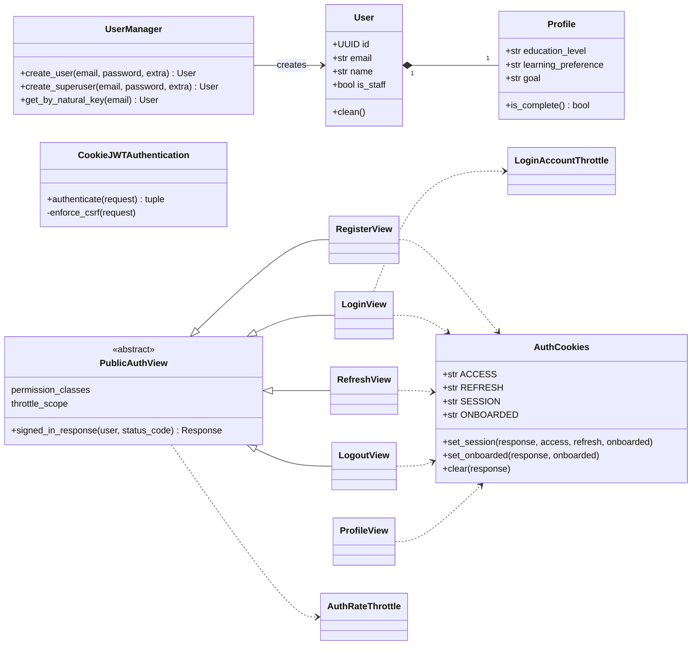

- `PublicAuthView` in the diagram is `_PublicAuthView` in code (module-private base).
- `Profile` is created by a `post_save` receiver (Observer) that only calls `Profile.objects.get_or_create`.
- `AuthCookies` (`cookies.py`) owns the cookie names, paths and flags; lifetimes and `Secure` come from settings unless injected. `CookieJWTAuthentication` and the OpenAPI scheme read `AuthCookies.ACCESS`.

### 4.2 `core` and `config`

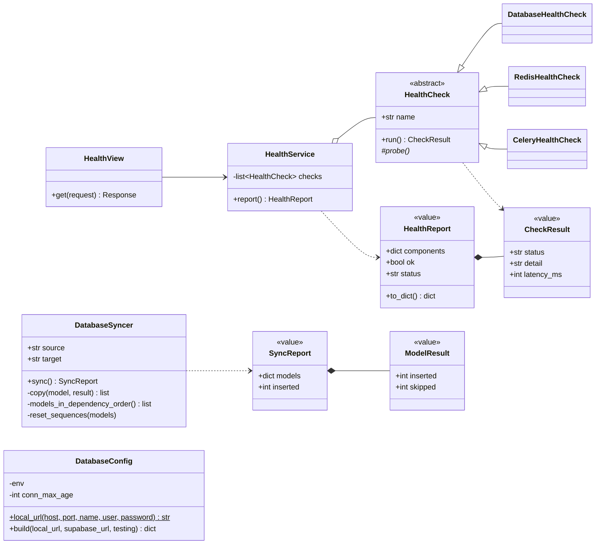

- `bootstrap` and `sync_to_supabase` commands call `DatabaseSyncer().sync()`.
- `DatabaseConfig` is used from `settings.py`, which stays a module.
- Framework hooks stay thin: the DRF `EXCEPTION_HANDLER` (`api_exception_handler`) runs DRF's handler and then `ApiErrorFormatter().format(...)` for the `{detail, code, fields?}` shape; the `check --deploy` hook returns `DeploySecurityChecks().errors()`.

### 4.3 `llm_registry`: registry and resolution

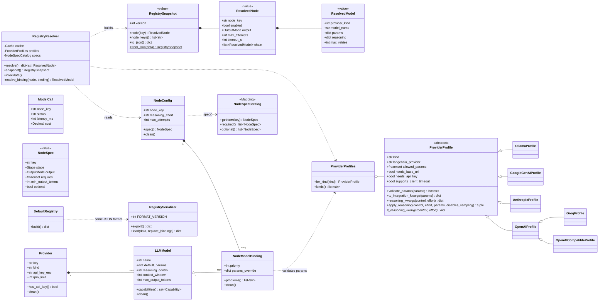

- `ProviderProfile` (`profiles.py`) holds everything that differs per vendor: allowed params and renames, whether a base URL or API key is needed, whether the client takes `timeout`, and reasoning translation. `OpenAICompatibleProfile` and `GroqProfile` subclass `OpenAIProfile`. `Provider.profile` returns the row's profile.
- Every save or delete of a registry row fires a receiver that calls `RegistryResolver().invalidate()` (Observer). A `post_migrate` receiver calls `NodeConfigSync().ensure()` (`node_configs.py`), which creates missing `NodeConfig` rows from `NODE_SPECS`.
- The `registry_check` system check is a thin hook over `RegistryHealth().warnings()`, one warning per kind of problem.

### 4.4 `llm_registry`: the gateway

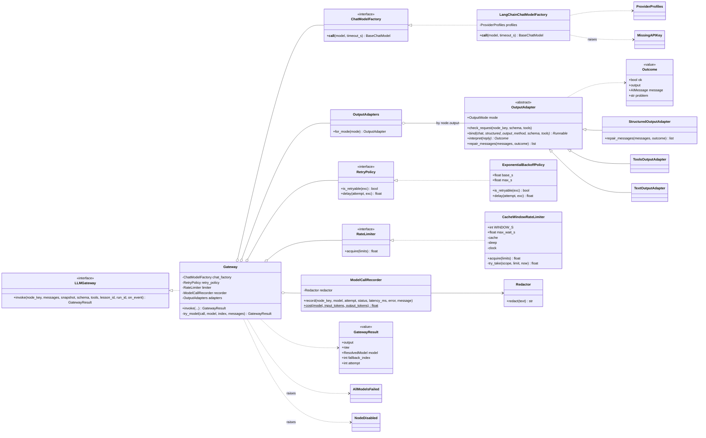

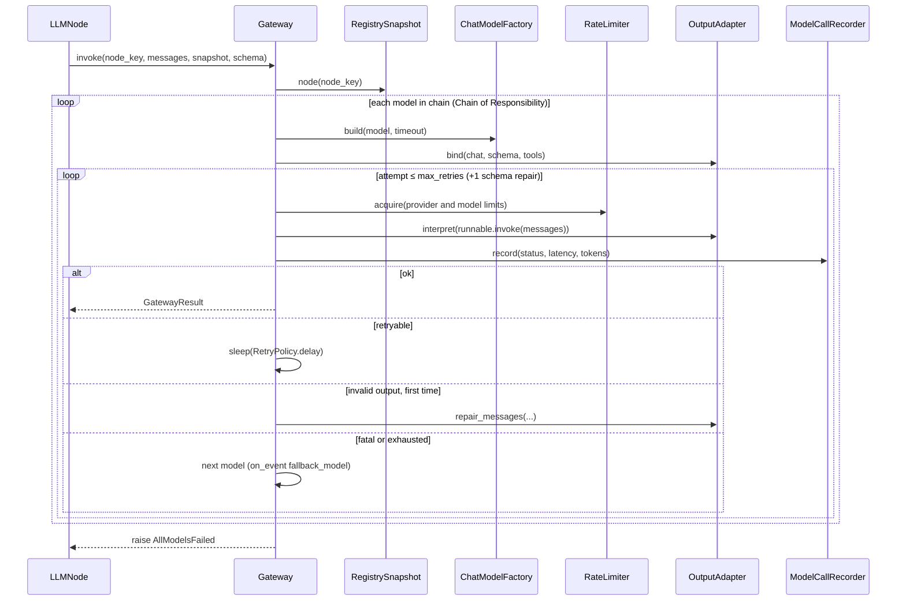

### 4.5 `llm_registry`: probes

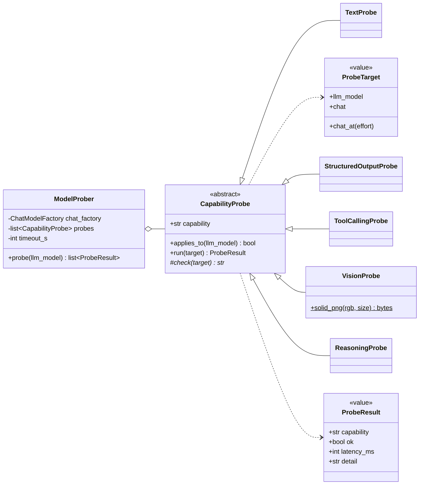

The admin **Test model** action and `manage.py probe_models` both call `ModelProber().probe(model)`.

### 4.6 `lessons`: domain and services

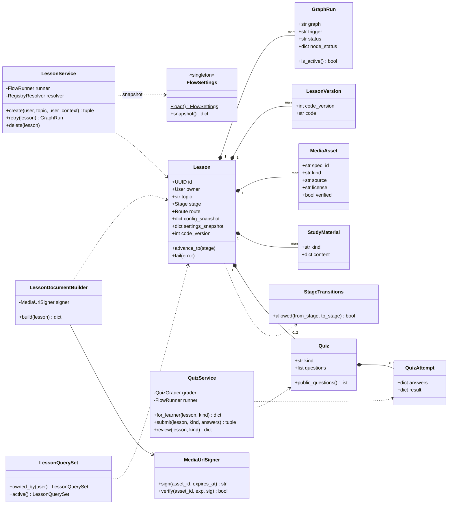

- Views are thin: `LessonViewSet` calls `LessonService` / `QuizService` and serializes the result. Every queryset in a view starts from `Lesson.objects.owned_by(request.user)`, so another user's lesson is a `404`.
- `Quiz.public_questions()` is the only way questions leave the server before submission (answers stripped).

### 4.7 `graph`: nodes, routers and builders

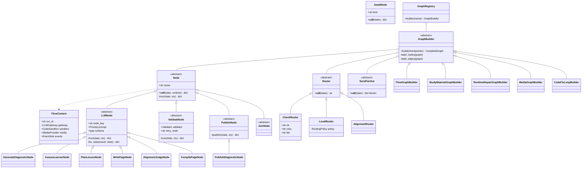

- **Segments.** `FlowGraphBuilder` assembles the lesson flow from `Segment`s (diagnose, mastery, author, build) plus the failure segment (`mark_failed` → `await_retry`). A segment adds its nodes and edges and is told where its exits (`lesson`, `mastery`, `failed`) lead; a segment can `provide` an exit for the others (the author segment provides `lesson`). Exits nobody provides lead to `END`, so Stage A works on its own and later stages plug in.
- **Node instances are the callables LangGraph registers** (`graph.add_node("plan_lesson", PlanLessonNode())`). `Node.__call__` unpacks `runtime.context`, calls `run`, and emits `node_started` / `retrying` / `degraded` events, so subclasses contain only their own logic.
- **`PublishNode` / `AwaitNode` pairing** encodes the rule from [lesson-graph.md](lesson-graph.md): side effects go in `publish`; `AwaitNode` only calls `interrupt()`, because it re-executes on resume.
- `FlowContext` fields are typed with Protocols (`LLMGateway`, `CodeSandbox`, `EventSink`; `MediaProvider` joins in Phase 5); `default_context()` is the composition root. `NodeBudget.of(state, node_key)` reads a node's attempts and whether it is enabled from the lesson's registry snapshot.
- A node declares the `stage` the lesson is in while it works; running while the lesson is `failed` moves it back, which is how Retry resumes without the nodes knowing about retries. A node also closes its worker thread's database connection when it ends.
- State stays a `TypedDict` (`FlowState`, `Branch`, `MediaState`, `FixState`, `RepairState`); reducers are static methods on `Reducers`.

### 4.8 `graph`: domain logic (grading, validation, prompts, codegen)

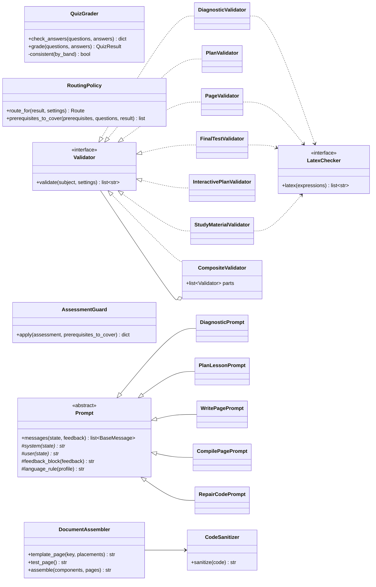

- `QuizGrader` is shared by `QuizService` (synchronous grading in the request) and the `grade_*` nodes, so both always agree.
- Validators are pure: no ORM, no network. They depend only on `LatexChecker` (implemented by `SandboxRunner`, faked in tests).
- `Prompt` subclasses hold no state between calls; one class per node key in `graph/prompts/`.

### 4.9 `graph`: media and sandbox adapters

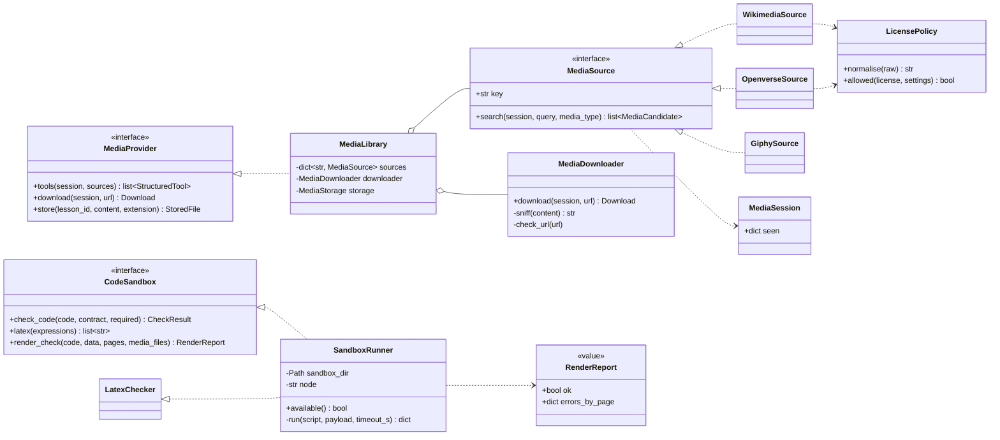

All external I/O goes through one injected `httpx.Client`; tests use `httpx.MockTransport`.

### 4.10 Flow execution and progress (Phase 3)

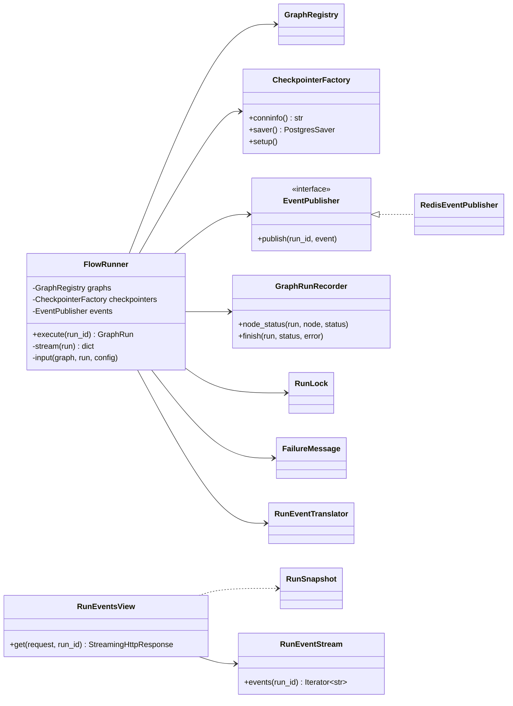

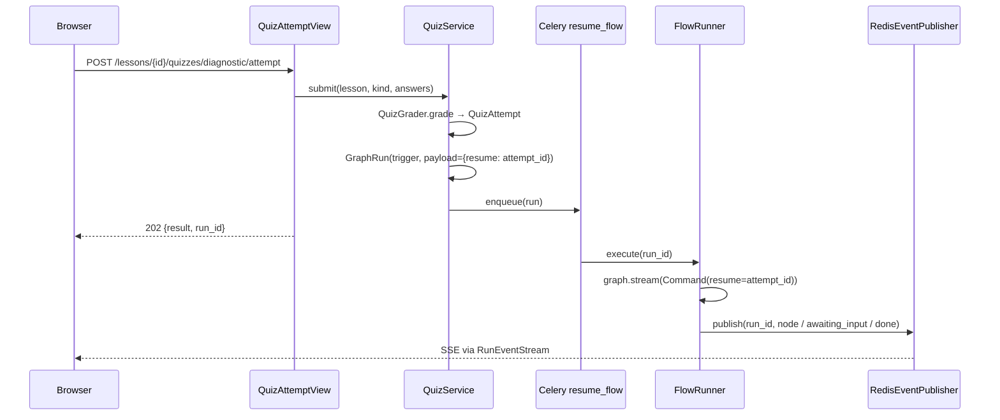

### 4.11 Frontend (`frontend/lib`)

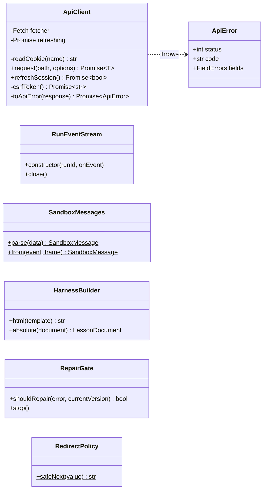

- Components call the shared `apiClient` instance (`apiClient.request<T>(path, options)`), so concurrent 401s share one refresh. `fetch` and the cookie reader are constructor parameters, so `lib/api.test.ts` drives the client with a scripted fake `fetch`.
- `useRunEvents`, `useProfile` and the `LessonSandbox` component are hooks/components that own one instance of these classes.
- `SandboxMessages.from` accepts only messages whose `event.source` is the embedded iframe and gives every field a safe type; `HarnessBuilder` fills the harness with absolute addresses (the iframe's origin is opaque); `RepairGate` asks for a repair once per code version and stops when the server refuses; `HarnessSource` fetches the harness once; `RenderMessage` and `RepairReport` shape what is posted to the iframe and to `/repair`; `LessonPdf` prints the reading pages.

Where the pieces live: `lessons/runner.py` (`FlowRunner`, `GraphRunRecorder`, `RunLock`, `FailureMessage`), `lessons/events.py` (`RunEvent`, `RunEventTranslator`, `RedisEventPublisher`, `RunEventStream`, `RunSnapshot`), `lessons/checkpoints.py`, `lessons/tasks.py` (the tasks, `CeleryTaskQueue`, and `InlineTaskQueue` for the `flow` command), `lessons/services.py` (`LessonService`, `QuizService`, `RunDispatcher` over the `TaskQueue` port, chosen by `LESSON_TASK_QUEUE`), `lessons/reports.py`. Domain failures are `APIException`s in `lessons/errors.py`, so the API formats them itself.

### 4.12 Stage C and runtime repair (Phase 6)

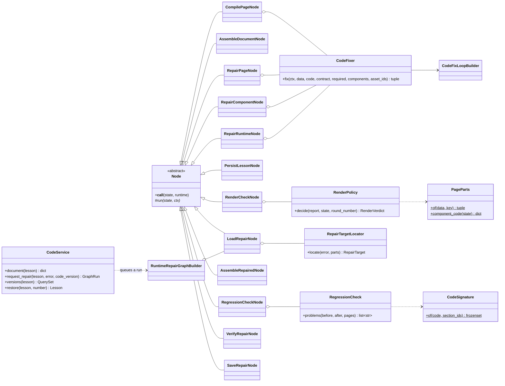

- **Template Method** again: every node is a `Node` subclass with its own `run`. `CodeFixer` is a small facade over the code-fix subgraph, injected into the nodes that need it so tests can replace it.
- **Strategy**: `RenderPolicy` decides what to do with a render report (pass, repair, fall back, fail) from the report and the round; the node only carries the decision out.
- `RepairTargetLocator`, `RegressionCheck` and `CodeSignature` are pure: no ORM, no network, no sandbox.
- `CodeService` owns the lesson's code use cases (serve, request a repair, list versions, restore); views stay thin.

## 5. How to extend

| You are adding | Do this |
|---|---|
| An LLM step | `NodeSpec` in `node_specs.py` → `Prompt` subclass → `LLMNode` subclass (+ `Validator` and `ValidateNode` if its output has rules) → register in the graph builder → `migrate` → bind models. Tests first for the validator and the node with `FakeGateway`. |
| A provider kind | `ProviderProfile` subclass, registered in `ProviderProfiles`; a test that builds the real client offline (`tests/llm_registry/test_providers.py`). |
| A media source | `MediaSource` implementation, a `FlowSettings.media_sources` value, tests with `httpx.MockTransport`. |
| A health dependency | `HealthCheck` subclass, added to `HealthService`'s default list. |
| A lesson stage | `Stage` value, `StageTransitions` entries, a frontend view for it, and the stage table in [data-model.md](data-model.md). |
| An endpoint | Thin view with `@extend_schema` → service method → domain objects. |

## Refactor backlog

Code written before this document that doesn't follow it yet. Behaviour must not change in a refactor: tests stay green before and after, and only imports and names in tests change. Tick items off here as they land.

Every phase 0–2 item is done. The rows still open describe the work-in-progress lesson-flow code (`graph/`, `lessons/`), which is kept on the `phase-3/lesson-flow` branch rather than in `main`. It is brought in line with this design, with tests, as Phase 3 lands.

| Module | Today | Target | Do it |
|---|---|---|---|
| ~~`llm_registry/params.py`, `reasoning.py`~~ | ~~dict tables and `if kind ==`~~ | `ProviderProfile` per kind + `ProviderProfiles` (`profiles.py`) | ✅ Done |
| ~~`llm_registry/gateway.py`~~ | ~~`is_retryable`, `backoff_delay`, `_record`, `if node.output ==`~~ | `ExponentialBackoffPolicy` (`retry.py`), `ModelCallRecorder` (`recorder.py`), `OutputAdapter`s (`outputs.py`), `LangChainChatModelFactory` (`providers.py`) | ✅ Done |
| ~~`llm_registry/ratelimit.py`~~ | ~~`acquire()` function~~ | `RateLimiter` Protocol + `CacheWindowRateLimiter` | ✅ Done |
| ~~`llm_registry/resolver.py`~~ | ~~module functions~~ | `RegistryResolver`, `RegistrySnapshot` | ✅ Done |
| ~~`llm_registry/probes.py`~~ | ~~`probe_model()`~~ | `ModelProber` + `CapabilityProbe`s | ✅ Done |
| ~~`llm_registry/serialization.py`, `seed.py`~~ | ~~functions~~ | `RegistrySerializer` (`export` / `load`), `DefaultRegistry` | ✅ Done |
| ~~`llm_registry/node_specs.py`~~ | ~~dict + `get_spec()`~~ | `NodeSpecCatalog` (`NODE_SPECS[key]`) | ✅ Done |
| ~~`llm_registry/redaction.py`~~ | ~~`redact()`~~ | `Redactor` + the stateless `REDACTOR` default | ✅ Done |
| ~~`core/views.py`~~ | ~~`_database`, `_redis`, `_celery`~~ | `HealthCheck`s + `HealthService` (`core/health.py`) | ✅ Done |
| ~~`core/sync.py`~~ | ~~`sync_databases()`~~ | `DatabaseSyncer(source, target).sync()` | ✅ Done |
| ~~`config/databases.py`~~ | ~~functions~~ | `DatabaseConfig(env).build(...)`, `DatabaseConfig.local_url(...)` | ✅ Done |
| ~~`accounts/cookies.py`~~ | ~~functions~~ | `AuthCookies`; `_signed_in_response` → `_PublicAuthView.signed_in_response` | ✅ Done |
| ~~`graph/grading.py`~~ | ~~functions~~ | `QuizGrader`, `RoutingPolicy` | ✅ Done |
| ~~`graph/validators.py`~~ | ~~`validate_*` functions~~ | `Validator` classes, `AssessmentGuard` (`graph/validators/`) | ✅ Done (tests for the study, plan, page, test and interactive-plan validators come with Phases 4–5) |
| ~~`graph/prompts.py`~~ | ~~functions in one 470-line module~~ | `graph/prompts/` package, one `Prompt` subclass per node | ✅ Done |
| ~~`graph/nodes/*.py`~~ | ~~functions~~ | `Node` and `Router` subclasses: Stage A, the mastery path, Stage B, the media agent, Stage C (`build.py`, `build_routers.py`) and the runtime repair (`repair.py`) | ✅ Done |
| ~~`graph/builders.py`, `graph/registry.py`~~ | ~~functions~~ | `FlowGraphBuilder` (diagnose, mastery, author, build and failure segments), `StudyMaterialGraphBuilder`, `MediaGraphBuilder`, `CodeFixLoopBuilder`, `RuntimeRepairGraphBuilder`; `GraphRegistry` | ✅ Done |
| ~~`graph/context.py`~~ | ~~`Any`-typed fields, `emit`/`warn`/`llm` functions~~ | Protocol-typed `FlowContext`, `EventSink` | ✅ Done |
| ~~`graph/codegen.py`~~ | ~~page/test templates and `assemble` as functions~~ | `DocumentAssembler`, `CodeSanitizer` (`graph/sanitizer.py`) | ✅ Done |
| ~~`graph/media.py`~~ | ~~search methods on `MediaLibrary`~~ | `graph/media/`: `MediaSource` classes, `MediaDownloader` behind a `UrlGuard`, `LicensePolicy`, `MediaStorage`, `MediaLibrary` facade | ✅ Done |
| ~~`lessons/document.py`~~ | ~~functions~~ | `LessonSource`, `LessonData`, `LessonDocumentBuilder`, with `MediaUrlSigner` (`lessons/media_urls.py`) | ✅ Done |
| ~~`frontend/lib/api.ts`~~ | ~~module functions + `ApiError`~~ | `ApiClient` + the shared `apiClient` instance | ✅ Done |
| ~~`frontend/lib/safe-redirect.ts`~~ | ~~`safeNext()`~~ | `RedirectPolicy.safeNext` | ✅ Done |
