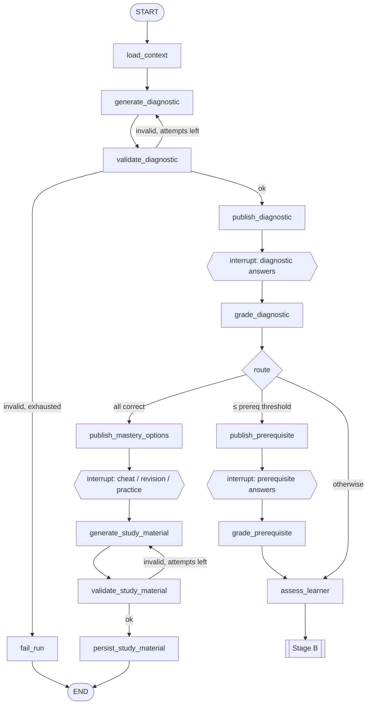
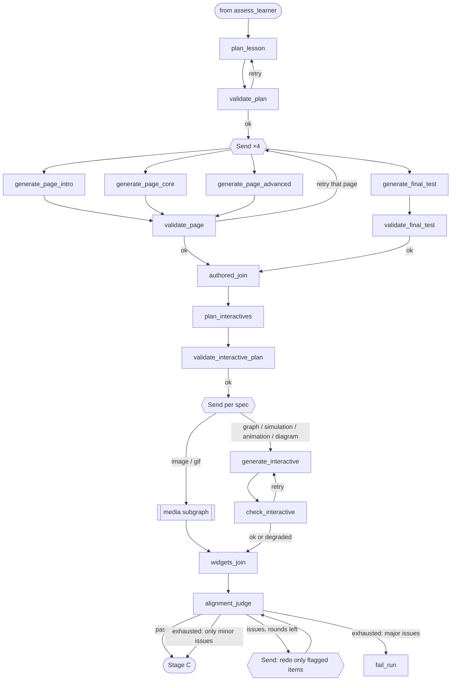
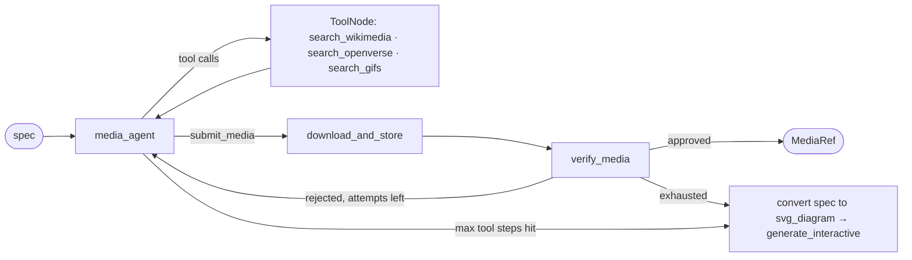
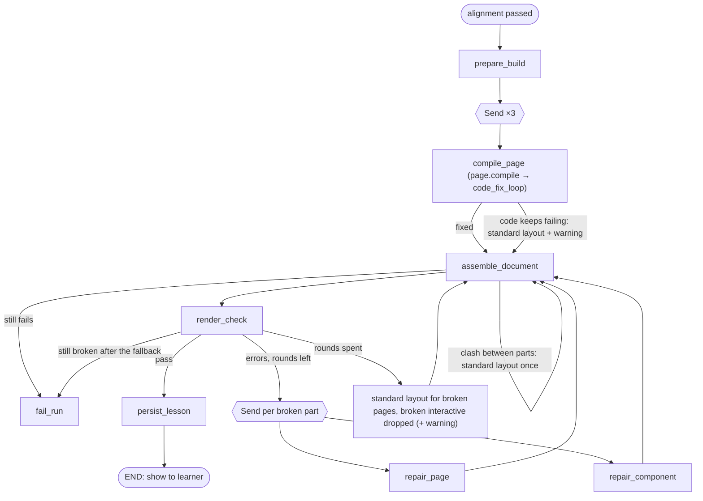
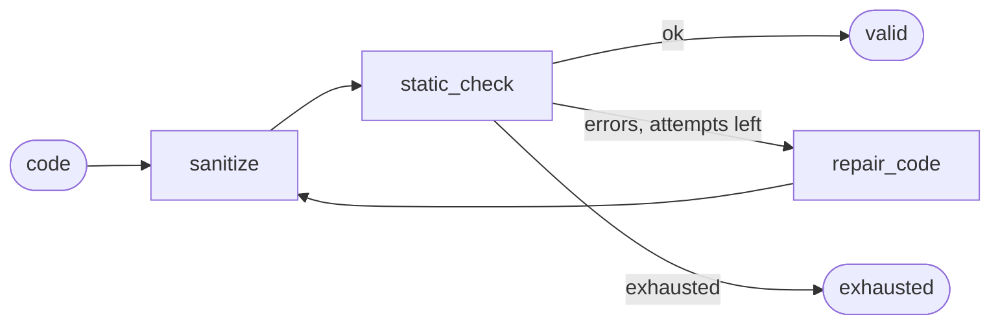

# Lesson flow graph (LangGraph)

The whole experience, from "I want to learn binary search" to a rendered four-page lesson or a study sheet, is **one LangGraph `StateGraph` per lesson**. It is not a chain. The graph:

- **pauses for the learner** with `interrupt()` while they take a quiz or choose a sheet, and resumes when they answer;
- **branches** on how the learner did (prerequisite path, full lesson, or mastery);
- **fans out** with `Send` to write pages, fetch media, and compile code in parallel;
- follows every LLM step with **validation**, and routes on the result: retry with feedback, targeted regeneration, degrade, fall back, or fail.

Model choice, transport retries, and model fallbacks happen one level down, in the gateway (see [model-registry.md](model-registry.md)).

Conventions: **graph state is a `TypedDict`**, and **every LLM input and output is a Pydantic v2 model**, obtained through structured output.

## The three stages

```
Stage A: Diagnose           Stage B: Author                Stage C: Build & verify
────────────────────        ───────────────────────        ─────────────────────────
diagnostic quiz (10)   ─┐   plan 4 pages                    compile pages → TSX
[prerequisite quiz (5)] ├─▶ write pages ‖ final test   ─▶  static + security check
assess learner level   ─┘   plan interactives                sandbox render check
         │                  media agent ‖ widget code        repair loop
         └─ mastery ─▶ cheat / revision / practice sheet    alignment judge (end of B)
```

## Stage A: Diagnose



### Diagnostic quiz: `generate_diagnostic` (`diagnostic.generate`)

One call produces a **`DiagnosticBundle`**: the diagnostic quiz and the prerequisite quiz together. Generating them together has two benefits: the prerequisites are chosen with the diagnostic concepts in view, and the learner never waits for a second generation.

**Diagnostic quiz: 10 questions, 2 per difficulty band**

| Band | Meaning |
|---|---|
| `basic` | Vocabulary and the core idea. Anyone who has met the topic can answer. |
| `easy_moderate` | Direct application of the core idea |
| `moderate` | Standard problems and typical usage |
| `moderate_hard` | Edge cases, trade-offs, analysis |
| `hard` | Expert level. Only answerable with real mastery, and **not answerable** by a learner through general knowledge, elimination, or wording cues. |

Rules the prompt states and the validator enforces:

- **Independent questions.** Each question probes a *different* concept. No question depends on another's answer, and none reveals another's answer.
- Questions are multiple choice with exactly 4 options, one correct. The client adds an **"I don't know"** option to every question, and it scores as wrong. This keeps guessing from inflating the level: 10 four-option questions give about 2.5 correct by pure chance.
- Every question carries `band`, `concept`, and `explanation`, so the result says *what* the learner knows, not just how much.

**Prerequisite quiz: 5 questions, one per prerequisite concept**

This quiz is shown only on the prerequisite path. Each prerequisite has `name`, `why_needed`, and one `basic`-difficulty question.

```python
Band = Literal["basic", "easy_moderate", "moderate", "moderate_hard", "hard"]

class DiagnosticQuestion(BaseModel):
    id: str
    band: Band
    concept: str
    question: str
    options: list[str] = Field(min_length=4, max_length=4)
    correct_index: int = Field(ge=0, le=3)
    explanation: str

class Prerequisite(BaseModel):
    name: str
    why_needed: str

class PrerequisiteQuestion(BaseModel):
    id: str
    prerequisite: str            # must match a Prerequisite.name
    question: str
    options: list[str] = Field(min_length=4, max_length=4)
    correct_index: int = Field(ge=0, le=3)
    explanation: str

class DiagnosticBundle(BaseModel):
    diagnostic: list[DiagnosticQuestion]      # exactly 10
    prerequisites: list[Prerequisite]         # exactly 5
    prerequisite_questions: list[PrerequisiteQuestion]  # exactly 5
```

**`validate_diagnostic`** (deterministic, plus an optional LLM reviewer):

- Checks the counts, the 2-per-band distribution, that `concept`s are unique, that options are unique, that there are no "all/none of the above" options, and that no question's text contains another question's correct option.
- Checks that each prerequisite question maps to exactly one prerequisite.
- The optional `diagnostic.review` judge, if enabled, rates independence and band calibration. It flags, for example, a "hard" question that can be answered from the wording.
- Errors are sent back as `feedback` on the retry.

### Human in the loop: `publish_*` then `await_*`

```python
def publish_diagnostic(state):          # side effects live HERE
    quiz = Quiz.objects.create(lesson_id=..., kind="diagnostic", questions=...)
    Lesson.objects.filter(id=...).update(stage="awaiting_diagnostic")
    emit({"type": "awaiting_input", "kind": "diagnostic", "quiz_id": str(quiz.id)})
    return {"diagnostic_quiz_id": str(quiz.id)}

def await_diagnostic(state):            # NO side effects: re-executes on resume
    attempt_id = interrupt({"kind": "diagnostic", "quiz_id": state["diagnostic_quiz_id"]})
    return {"diagnostic_attempt_id": attempt_id}
```

- On resume, LangGraph re-runs the interrupted node from the top. For that reason, anything with side effects goes in the `publish_*` node *before* it, and each `await_*` node only calls `interrupt()`.
- The API grades the answers synchronously with the same pure function the graph uses (`graph/grading.py`), stores a `QuizAttempt`, and enqueues `resume_flow(lesson_id, Command(resume=attempt_id))`. The learner sees their score immediately while the graph continues.
- **Correct answers never reach the browser before submission.** The quiz endpoint strips `correct_index` and `explanation`.

### Routing: `grade_diagnostic` then `route_level`

This step is deterministic. The thresholds live in the admin (`FlowSettings`):

| Result (default settings) | Route |
|---|---|
| All 10 correct, including both `hard` | **mastery** → offer sheets |
| ≤ `prereq_trigger_max_correct` correct (default **2**, so 0–2) | **prerequisite** quiz |
| Otherwise (3–9) | **lesson** |

`QuizResult` records `correct`, `total`, `by_band`, `by_concept`, `dont_know_count`, and `highest_band_fully_correct`. It also records a `consistency` flag. For example, if both `hard` questions are right but the `basic` ones are wrong, the learner was probably guessing, so the assessment's confidence is lowered.

### Prerequisite outcome: `grade_prerequisite`

| Prerequisite result | Effect on the lesson |
|---|---|
| 0 / 5 | Introduction page teaches **all** prerequisites before the topic |
| 5 / 5 | Introduction goes straight to the topic |
| Partial | Introduction teaches only the **missed** prerequisites |

This produces `prerequisites_to_cover: list[Prerequisite]`.

### `assess_learner` (`learner.assess`)

The input is the profile, both quiz results, and the per-concept breakdown. The output is structured:

```python
class LearnerAssessment(BaseModel):
    level: Literal["novice", "beginner", "intermediate", "advanced"]
    known_concepts: list[str]
    gaps: list[str]                          # concepts to emphasise
    prerequisites_to_cover: list[str]        # copied from the deterministic step, not invented
    start_point: str                         # where the core page should begin
    author_notes: str                        # tone, depth, pacing guidance for page writers
    confidence: Literal["low", "medium", "high"]
```

A guard ensures `prerequisites_to_cover` equals the deterministic result. The LLM may *explain* the gaps but may not change them.

### Mastery path

- `await_choice` interrupts, and the learner picks `cheat_sheet`, `revision_sheet`, or `practice_sheet`.
- `generate_study_material` (`study.generate`) produces one of three schemas:
  - **Cheat sheet**: short notes. For quantitative topics, it gives formulas with variable definitions and when to use each. For theoretical topics, it gives key terms, facts, and one-line rules. It fits on one or two screens.
  - **Revision sheet**: longer notes covering *every* subtopic, with key points, worked examples, and common mistakes.
  - **Practice sheet**: 15–25 questions across the `FinalTest` question types (below), graded easy to hard, with solutions hidden until attempted.
- `validate_study_material` checks coverage of the diagnostic concepts, lengths, LaTeX that parses, and the question schema.
- The sheets are **rendered by fixed frontend templates from structured JSON**, not by generated code. They need no creative layout, and the templates give instant, reliable rendering. The learner can request another sheet type later, which runs a small separate `study_material` graph.

## Stage B: Author the lesson



### `plan_lesson` (`lesson.plan`)

This step produces a `LessonPlan` with a title, the level, and for each of the three content pages: goals, outline, and which gaps and prerequisites it covers. It also includes a `FinalTestSpec`: the number of questions (10–15), the type mix, and the difficulty mix, all derived from the level.

| Page | Content |
|---|---|
| 1. Introduction | Hook, why it matters, and the **prerequisites to cover** (all, some, or none per Stage A), then an overview of the topic |
| 2. Core concepts | Starts at `assessment.start_point` and emphasises `gaps` |
| 3. Advanced concepts | Depth, edge cases, complexity, and real-world use, scaled to the level |
| 4. Test | 10–15 questions: MCQ, numerical, short answer, long answer, code |

`validate_plan` checks that each page's outline lists concepts that are distinct from the other pages (no overlap), that every required prerequisite appears on page 1, and that the test spec matches the settings.

### Page writers and the test writer: parallel `Send`

- `generate_page` (`page.generate`, run ×3 in parallel) → `PageContent`: sections with Markdown body, key points, worked examples, formulas (LaTeX), code snippets, and callouts. Each writer gets the *whole* plan, so the pages don't overlap or contradict each other.
- `generate_final_test` (`test.generate`) → `FinalTest`. Every question has `type`, `concept`, `difficulty`, and `marks`, plus type-specific fields:
  - `mcq`: options, correct_index
  - `numerical`: answer, tolerance, unit
  - `short_answer`: model_answer, key_points
  - `long_answer`: model_answer, rubric
  - `code`: language, starter_code, reference_solution, test_cases
- The schema uses one flat model with a `type` field and optional fields, enforced by a `model_validator`, instead of a JSON-Schema `oneOf` union. Several providers handle unions poorly in structured-output mode.
- The validators are deterministic: lengths, LaTeX parses (a KaTeX check in `sandbox/`), code snippets parse, the test's type and difficulty mix matches the spec, and questions are unique. When a page fails validation, **only that page** is re-sent.

### Interactives: `plan_interactives` (`interactive.plan`)

For each page, this decides what would *teach* better than text. It produces `InteractiveSpec(id, page, anchor_section, kind, purpose, description, media_query?)`:

| kind | Example | Produced by |
|---|---|---|
| `interactive_graph` | Coordinate geometry: drag points, see the line equation update | `generate_interactive` using `Mafs` |
| `simulation` | Binary search stepping through an array with low/mid/high pointers | `generate_interactive` |
| `css_animation` / `svg_diagram` | A self-made animation of amoeba binary fission, labelled cell parts | `generate_interactive` using `motion` / SVG |
| `image` / `gif` | A real micrograph or animation of amoeba splitting | media subgraph |
| `code_playground` | An editable JS snippet with a Run button (sandboxed) | `generate_interactive` |

The rules: at least one interactive on pages 1–3, at most `FlowSettings.max_interactives_per_page`, and every spec's `purpose` names the concept it teaches.

### Media subgraph (tool-calling agent)



- **`media_agent`** (`media.search`, requires **tool calling**) searches with its tools and finishes by calling `submit_media(candidates)`. The arguments of that final tool are a Pydantic schema, so the result is structured. The loop is capped at `NodeConfig.max_tool_steps`.
- **Sources** are Wikimedia Commons and Openverse, both openly licensed with no key needed, plus optionally Giphy for GIFs (needs a key). Only licences on an allow-list are accepted, and attribution is stored.
- **`download_and_store`** is deterministic. It checks MIME type by sniffing the file, and enforces size and dimension limits. It saves the file to local media storage as a `MediaAsset`. **Generated code never contains external URLs.** It refers to media by asset ID.
- **`verify_media`** (`media.verify`, requires **vision**, optional) checks: does the image actually show what the spec describes, and is it appropriate for teaching? It also writes the alt text.
- **Fallback:** if no suitable media is found, the spec becomes an `svg_diagram` and is drawn instead. The lesson never has an empty slot.

### Widget code: `generate_interactive` (`interactive.generate`)

- The output is `InteractiveComponent(spec_id, component_name, tsx)`: one self-contained React component using only the **sandbox scope** (see [frontend.md](frontend.md)).
- `check_interactive` runs the same static and security check as Stage C, on this component alone. It retries with the errors fed back. If it keeps failing, the spec is **degraded**: dropped, with a warning.

### Content validation: `alignment_judge` (`alignment.judge`)

This is the gate before any document code is written. The judge gets the topic, `LearnerAssessment`, plan, pages, test, interactive specs, and media captions. It returns:

```python
class AlignmentIssue(BaseModel):
    target: Literal["page", "final_test", "interactive", "media"]
    target_id: str                    # page key / question id / spec id
    severity: Literal["minor", "major"]
    problem: str
    fix_instruction: str

class AlignmentReport(BaseModel):
    topic_relevance: int = Field(ge=1, le=5)
    level_fit: int = Field(ge=1, le=5)          # right depth for this learner
    prerequisite_coverage: int = Field(ge=1, le=5)
    factual_accuracy: int = Field(ge=1, le=5)
    interactive_relevance: int = Field(ge=1, le=5)
    issues: list[AlignmentIssue]
    passed: bool
```

- `passed` is recomputed in code: every score must be at least `FlowSettings.alignment_min_score` and there must be no `major` issues. The LLM's own `passed` value is not trusted.
- Issues are routed with `Send` **only to the items flagged**, and the `fix_instruction` becomes their feedback. The judge then re-runs, up to `alignment.judge.max_attempts` rounds.
- If only minor issues remain when the rounds run out, the flow continues and records warnings. If a major issue remains, the run fails.

## Stage C: Build and verify the document



### `compile_page` (`page.compile`)

- Writes the TSX for one page, as `function Page_core() { ... }`, laying out that page's content and placing its interactive components and `<Figure asset="...">` at their anchor sections.
- **Content is injected as data, not retyped.** The validated `PageContent` is available in scope as `LESSON.pages.core`, so the compiler writes code that *renders* the text. This stops the compile step from changing, cutting, or hallucinating content that already passed the alignment judge. It also saves a large number of output tokens.
- **Page 4 (the test)** is generated deterministically by `assemble_document`: `<Assessment test={LESSON.final_test} />` inside the shared page frame. The test needs reliable answer capture and grading, so it isn't left to the LLM.

### `assemble_document` (deterministic)

This step concatenates the interactive components and the four page components into one TSX document. It adds `LessonDocument`, with page navigation (Introduction · Core · Advanced · Test), a progress bar, and the `render(<LessonDocument />)` call. This produces the TypeScript document that is rendered.

### `code_fix_loop` (per page, subgraph)



- **`sanitize`** strips code fences, imports, exports, and `React.` hook prefixes, and removes any stray `render(...)`.
- **`static_check`** runs `sandbox/scripts/check.mjs` (Node) in a subprocess:
  1. **Syntax and types**: esbuild transform for TS and JSX.
  2. **Security scan** (Babel AST walk):
     - Forbidden identifiers and members: `fetch`, `XMLHttpRequest`, `WebSocket`, `EventSource`, `eval`, `Function`, `import()`, `window.parent`, `window.top`, `opener`, `document.cookie`, `localStorage`, `sessionStorage`, `indexedDB`, `navigator.sendBeacon`, `postMessage`, `setInterval` without cleanup, and `dangerouslySetInnerHTML`.
     - No `http(s)://` string literals and no raw ``, `<iframe>`, `<script>`, or `<link>`. Media must go through `<Figure asset>`.
  3. **Scope contract**: no undeclared free identifiers outside the sandbox scope. It also checks that the required component names exist and that every asset ID referenced exists in `LESSON.media`.
- **`repair_code`** (`code.repair`) receives the code, the exact errors with line and column, and the contract, and returns the full component.

### `render_check`: sandbox validation (Playwright, headless Chromium)

`sandbox/scripts/render-check.mjs` loads the **same** sandbox runtime the browser uses, with the assembled document and `LESSON` data. For each page it:

1. Renders the page and waits for idle. It fails on uncaught errors, React error-boundary errors, and `console.error`.
2. Smoke-tests interactions: it clicks up to N buttons and moves every range input, then checks for errors again.
3. Enforces a time budget per page, which catches infinite loops and runaway timers.
4. Blocks all network requests except local media. Any attempted request is a failure, reported as a security violation.
5. Checks that the page is not blank: its text length is at least that of its section headings.

Failures are mapped to a page, and only that page goes back through `repair_page` and then `code_fix_loop`.

### `persist_lesson`

This writes pages, the test, media links, the assembled code and its parts (`code_parts`), the next `code_version`, and warnings, then sets `stage=ready`. Only the media the document uses is kept. The frontend receives `done` and renders the document in its sandboxed iframe.

## After the lesson is ready (separate small graphs)

| Graph | Trigger | Nodes |
|---|---|---|
| `runtime_repair` | The browser iframe reports an error the sandbox check missed | `load_repair` → `repair_runtime` (`runtime.repair` → code-fix loop) → `assemble_repaired` → `regression_check` → `verify_repair` (render check) → `save_repair` (a new `code_version`) |
| `grade_test` | The learner submits page 4 | MCQ and numerical graded deterministically. Short, long, and code answers graded by `test.grade` against the model answer or rubric. Produces a `TestResult` with feedback per question and recommended topics to revisit. |
| `study_material` | The learner requests another sheet type | `generate_study_material` → validate → persist |


### How Stage C is built

- **The code-fix loop is a subgraph run inside the node** (`CodeFixer`), so `compile_page`, `repair_page` and `repair_component` all hold code to the same checks: sanitize → static check → `code.repair` with the exact errors and the contract, up to `code.repair.max_attempts`.
- **Failure policy.** Generated layout is never worth failing a lesson for. A page whose code keeps failing the checks, or keeps crashing in the browser, falls back to the **standard layout** (`DocumentAssembler.template_page`: every section, the interactives and figures at their anchors), and an interactive that keeps crashing is dropped; both leave a warning. Only a document that fails *after* the fallback fails the run, and a retry resumes at `assemble_document` without rewriting the pages.
- **Rounds** are `render_check_max_rounds` (default 2) repairs, then one fallback, then one last check (`RenderPolicy`). A repair goes only to the pages and interactives that the browser blamed, with its errors as feedback.
- **One runtime.** The render check loads the same bundle (`sandbox/dist/runtime.js`) and harness (with its CSP) the browser uses, so a lesson that passes behaves the same in the learner's iframe.

### How `runtime_repair` is built

- **Input** `{lesson_id, repair_error: {message, stack?, page?}, expected_code_version}`, run in its own thread. A crash can only be repaired on a ready lesson at the version the browser was showing; a stale report is refused and nothing is changed.
- **`RepairTargetLocator`** finds the broken part from the error: an interactive named in the message or stack (`Interactive_x`), else the page the viewer reports or `Page_x` in the stack. The test page is written by code, so it is never a target. An error that cannot be traced is refused rather than guessed.
- **Only that part is rewritten** (`runtime.repair`), held to the same code checks as a first draft; code identical to the old code is refused.
- **`RegressionCheck`** (cheap, so before the browser): the same pages and interactives, and everything each page placed before (interactives, figures, the sections loop, named sections) is still placed.
- **`verify_repair`** renders the repaired document in the headless browser; any error refuses the repair.
- **`save_repair`** (one transaction, re-checking the version) keeps the old code as a `LessonVersion` and stores the new code under `code_version + 1`. Any refusal raises `RepairFailed`: the run ends with its reason, the lesson stays ready with the code it had, and no retry is offered.
- **The cap.** Each `POST /repair` counts against `max_auto_runtime_repairs` whether or not it succeeds, so a crash the model cannot fix cannot loop. `POST /versions/{n}/restore` is not counted.

## How Stage B is built

- **Segments.** The flow graph is assembled from segments (diagnose, mastery, author, build); the author segment provides the `lesson` exit, which leads to the build segment's `prepare_build`.
- **Parallel items and joins.** `Send` branches carry the shared context (`BranchBuilder`) and write under keys with reducers (`pages`, `final_test`, `interactives`, `media`, `feedback`, `attempts`). `authored_join` and `widgets_join` read each item's problems and attempts: items under their attempt budget are sent again *alone* (the router builds the `Send`s), items out of attempts are kept with a warning (pages, test) or dropped with a warning (widgets).
- **One writer for first drafts and fixes.** `ContentWriter` asks for a page, the test or a component and checks it (`PageValidator`, `FinalTestValidator`, the sandbox's `check.mjs`), so a fix after the alignment judge is held to the same rules.
- **Alignment is decided in code** (`AlignmentPolicy`): pass, fix (only flagged items that exist, one issue per item), accept with a warning (rounds spent, nothing major) or fail (rounds spent, a major issue). A fix that fails its own checks keeps the old version.
- **The media agent** is a subgraph run inside `find_media` (`MediaFinder`): search tools per allowed source, bounded by `max_tool_steps`; `submit_media` is a tool whose arguments are the structured result; only URLs a tool returned in this session are downloaded (`UrlGuard`: https only, never a private address, redirects re-checked; size, type and dimensions read from the bytes); the optional `media.verify` vision check writes the alt text and can reject; out of rounds, the spec is drawn as an SVG diagram.
- **Media is served** by `GET /api/media/{asset_id}?exp=&sig=` ([api.md](api.md)); generated code never sees a URL.

## State

```python
# graph/state.py
class FlowState(TypedDict, total=False):
    # inputs
    lesson_id: str
    topic: str
    user_context: str | None
    profile: LearnerProfile
    snapshot: dict                         # resolved model registry (Lesson.config_snapshot)
    settings: dict                         # FlowSettings snapshot

    # Stage A
    bundle: DiagnosticBundle
    diagnostic_quiz_id: str
    diagnostic_attempt_id: str
    diagnostic_result: QuizResult
    prerequisite_quiz_id: str | None
    prerequisite_attempt_id: str | None
    prerequisite_result: QuizResult | None
    prerequisites_to_cover: list[Prerequisite]
    route: Literal["prerequisite", "lesson", "mastery"]
    assessment: LearnerAssessment
    mastery_choice: Literal["cheat_sheet", "revision_sheet", "practice_sheet"] | None
    study_material: dict | None

    # Stage B (parallel writers → reducers required)
    plan: LessonPlan
    pages: Annotated[dict[str, PageContent], merge_dicts]            # intro / core / advanced
    final_test: FinalTest
    interactive_plan: InteractivePlan
    media: Annotated[dict[str, MediaRef], merge_dicts]               # spec_id → asset
    interactives: Annotated[dict[str, InteractiveComponent], merge_dicts]
    alignment: AlignmentReport | None

    # Stage C
    page_code: Annotated[dict[str, str], merge_dicts]
    document_code: str | None
    render_report: dict | None

    # control
    attempts: Annotated[dict[str, int], merge_counts]
    feedback: Annotated[dict[str, list[str]], merge_dicts]
    warnings: Annotated[list[str], operator.add]
    error: str | None
```

Any key written by parallel branches needs a reducer. Without one, LangGraph raises `InvalidUpdateError`.

## Retry, fallback, and failure rules

| Situation | Handled by | Behaviour |
|---|---|---|
| Timeout, 429, 5xx | Gateway | Backoff retries on the same model, then the next model in the node's chain |
| Output doesn't match the Pydantic schema | Gateway | One in-place retry with the parse error attached, then the next model |
| Schema valid but rules broken | `validate_*` node + router | Retry the same node with `feedback`, up to `NodeConfig.max_attempts` |
| One page, question, or widget bad | Router with `Send` | Regenerate **only** that item |
| Widget keeps failing | Degrade | Drop the widget and add a warning |
| No acceptable media | Fallback | Draw an SVG diagram instead |
| Code fails static or render checks | `code_fix_loop` / `repair_page` | Targeted repair of that page |
| Unrecoverable (diagnostic, plan, or major alignment issue exhausted) | `fail_run` | `stage=failed`, a readable error, and a **Retry** button that resumes from the last checkpoint |

## Execution

- **Checkpointer:** `langgraph-checkpoint-postgres` (`PostgresSaver`) on the Supabase database, with `thread_id = lesson.id`. A thread can wait at an `interrupt()` for days, so its checkpoints must be durable. Redis stays for the queue, events, cache, and rate limits.
- **Runs and tasks:** every execution segment is a `GraphRun` row created by the API (so `POST` can return its id at once) and queued as `start_flow(run_id)` or `resume_flow(run_id)`. Both call `FlowRunner.execute(run_id)`, which looks at the lesson's thread and feeds it what it needs: `Command(resume=…)` when it waits at an `interrupt()`, nothing when a crash left it mid-run (it continues from its last checkpoint), the first input for a new thread, and nothing at all when the thread already finished (a redelivered task). The task uses `acks_late` and `reject_on_worker_lost`; a per-run lock (TTL `FLOW_RUN_LOCK_TTL_S`, which is also Redis's `visibility_timeout`) keeps a redelivered task from running the graph twice while the first worker is alive.
- **Two kinds of failure.** When a validator runs out of attempts the graph *gives up in the graph*: `mark_failed` records the reason, `await_retry` pauses, and Retry resumes at the node that gave up with its attempt counters reset. When a node *raises* (every model failed, the sandbox is missing, a bug), the run ends `failed` with a readable message (`FailureMessage`: unexpected errors are named by type only), the lesson is failed, and Retry re-runs that node from the checkpoint. A node that declares its `stage` moves a failed lesson back to it when it runs again.
- **Events:** nodes emit `node` (running), `attempt` (a validation retry), `warning` and, through the gateway, `retrying` and `fallback_model` via `get_stream_writer()`. The runner translates them, together with the `updates` stream (a node finished) and the interrupt itself, into the run events of [api.md](api.md). `awaiting_input` comes from the interrupt, after the run is marked `paused`, so a learner who answers at once never races the run's bookkeeping.
- **Threads:** LangGraph runs sync nodes on pool threads; a node closes its thread's database connection when it ends so runs don't leak connections. Under pytest those threads only see committed rows (see [testing.md](testing.md)).
- **Parallelism:** `Send` branches run in the same superstep, so page writers, media searches, and page compiles make their LLM calls concurrently. Per-provider rate limits in Redis keep that within quota.

## Testing

- **Validators and grading** are pure functions. Test them with fixtures of real bad LLM outputs.
- **Routing:** table-driven tests over `QuizResult` → route, and prerequisite result → `prerequisites_to_cover`.
- **Graph tests** inject a `FakeGateway` with scripted outputs per node key. Assert the node path, the interrupts, resuming with `Command(resume=...)`, targeted regeneration, degrade paths, and the final state.
- **Sandbox:** `check.mjs` and `render-check.mjs` have their own fixtures: known-malicious snippets must be rejected, and known-good lessons must pass.
- **Live:** golden topics (binary search, coordinate geometry, asexual reproduction) run against real models under `pytest -m live`.
