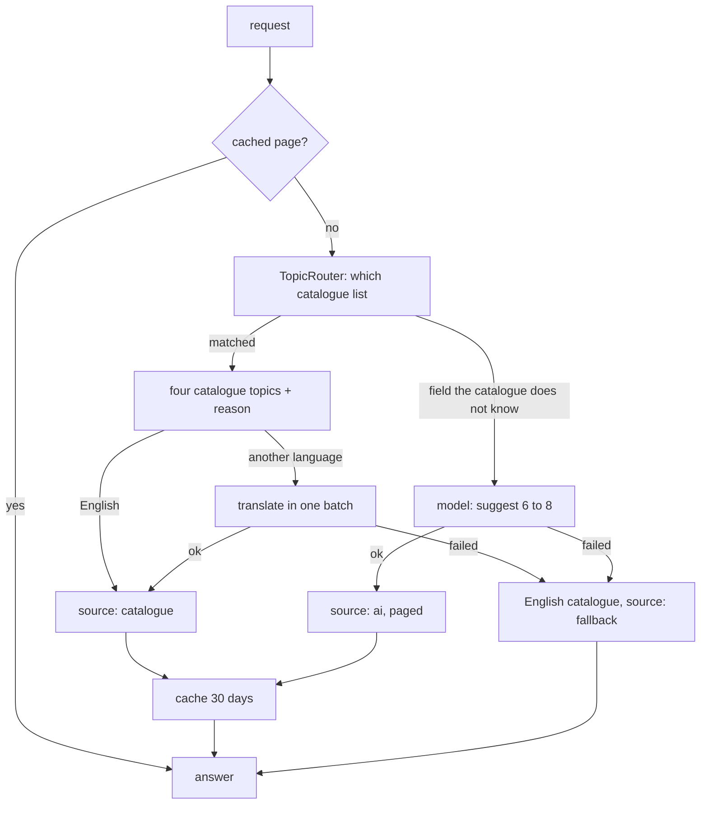

# Onboarding: first-topic suggestions

The last onboarding step asks "Where would you like to start?" and offers four topics picked for the learner. It has to be **fast, cheap and never in the way**: the learner can always type a topic of their own, and nothing here may fail the step.

The code is the Django app `onboarding/`, separate from `accounts/` because it is a different job (choosing topics, a cache, a model call) from keeping a profile. `accounts` owns the profile and its choice lists (`GET /api/profile/options`); `onboarding` only reads those choices to validate a request. The module design is in [design.md](design.md#414-onboarding-first-topic-suggestions).

## The request

`POST /api/onboarding/topic-suggestions` ([api.md](api.md#onboarding)) is sent from step 5, **before the profile is saved**, with the answers of the earlier steps: `education_level`, `grade_or_year`, `field_of_study`, `goal`, `preferred_language` and a `page`. Only the level and the goal are required. It needs a signed-in learner (not a finished profile) and is limited to 30 a minute per learner (`TOPIC_SUGGESTIONS_THROTTLE_RATE`), because a request can cost a model call.

## Where the topics come from

1. **The catalogue is the primary source**: instant and free. `backend/onboarding/catalogue.json` holds it as data, validated when it loads (a malformed edit fails the tests, not a learner).
   - **School**: Classes 6 to 12 with 9 or 10 topics each (Maths, Science or Physics / Chemistry / Biology, Geography or History, chapter-sized like a textbook), plus a general school list for a class it does not cover.
   - **Undergraduate and postgraduate**: five field families (computer science and IT, engineering, commerce and economics, arts and humanities, science), each with a list per level, matched on `field_of_study` by keywords (whole words, any case or punctuation; the more specific family wins, so "Computer Science" is not "Science" and "Political Science" is not "Science"). With no field, a general list for the level.
   - **Professional, interview preparation and self-learner** lists. Order of precedence: school, then the interview goal, then undergraduate or postgraduate, then professional, then self-learner (`TopicRouter`).
2. **The reason** under each topic is built from rules over the answers (`ReasonBuilder`): "Class 9 · often in exams", "Common in interviews", "In your Class 9 syllabus", "Popular with self-learners", "Useful at work", "Picked for your course".
3. **Paging**: `page` takes four at a time from the list and wraps round; `has_more` is true when the list is longer than four.
4. **A model is asked only when the catalogue has no good match**: a field of study that no family claims (medicine, architecture...). Node `onboarding.suggest_topics` returns `TopicSuggestions` (6 to 8 topics: `title`, `title_en`, `subject`, `reason`) in the learner's language, each learnable in one lesson. The learner's words go into the prompt as quoted JSON data, and the prompt says never to follow instructions found in them. The model's whole list is cached, so every page of it comes from one call.
5. **Another language**: the catalogue is English. The four topics' titles, subjects and reasons are translated by the same node in **one batched call**, and each piece is cached per (language, English text), so what was translated once is never sent again. `title_en` keeps the English title.

## Never in the way

- The node is seeded for speed: `gpt-oss-20b` then `gemini-3.5-flash-lite`, low effort, one attempt, `timeout_s` 4, `max_retries` 0 on both models (the next model is the retry). The gateway waits at most one second for a rate limit (`GatewayTopicModel.RATE_WAIT_S`) instead of the lesson flow's two minutes. A request therefore makes at most one model call and waits at most a few seconds.
- **Any** model failure (every model failed, a timeout, a rate limit, a reply of the wrong size, the node not bound in the registry) gives the catalogue list for the learner's level, in English, with `source: "fallback"`. The API never answers `5xx` for a model's sake. A fallback is **not** cached (the next request tries again).
- The cache is the same: Redis being down reads as an empty cache, and an entry in an unknown shape is ignored.
- The node is optional (`NodeSpec.optional`): without a binding the feature still works from the catalogue. After upgrading, bind it in the admin or run `manage.py seed_registry --force` (which replaces *all* bindings with the seed, so prefer the admin on a tuned registry).

## Caching

Redis (the cache database), 30 days (`ONBOARDING_SUGGESTION_TTL_S`):

| What | Key |
|---|---|
| A whole page | education level, class or year (as "class-9"), the list (class, family or field slug), goal, language, page |
| A model's topic list | the same, without the page |
| A translation | language and the English text |

"Class 9", "9th" and "grade 9" are one key; so are a field in any case or spacing. A key stays short and plain whatever the learner typed (long or non-Latin text is hashed).

## Extending

| You want | Do this |
|---|---|
| A new class, topic or list | Edit `catalogue.json` (every list needs at least four topics, six or more in practice). The catalogue tests check each class and list |
| A new field family | Add it to `higher_education.families` with its keywords and a list per level, before any family it could be mistaken for |
| A new routing rule | A `RouteRule` class in `router.py`, added to the router's list |
| A new reason | A `ReasonRule` class in `reasons.py` |
| A new language | Add it to `Profile.PreferredLanguage` (a migration, because it is a choice) and to `LANGUAGE_NAMES` in `graph/prompts/base.py` |
