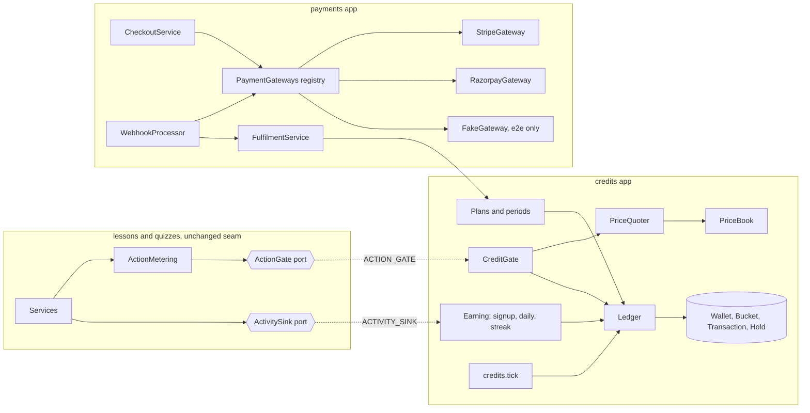
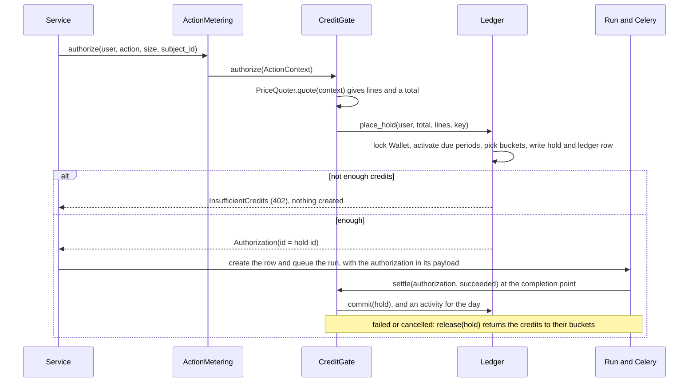
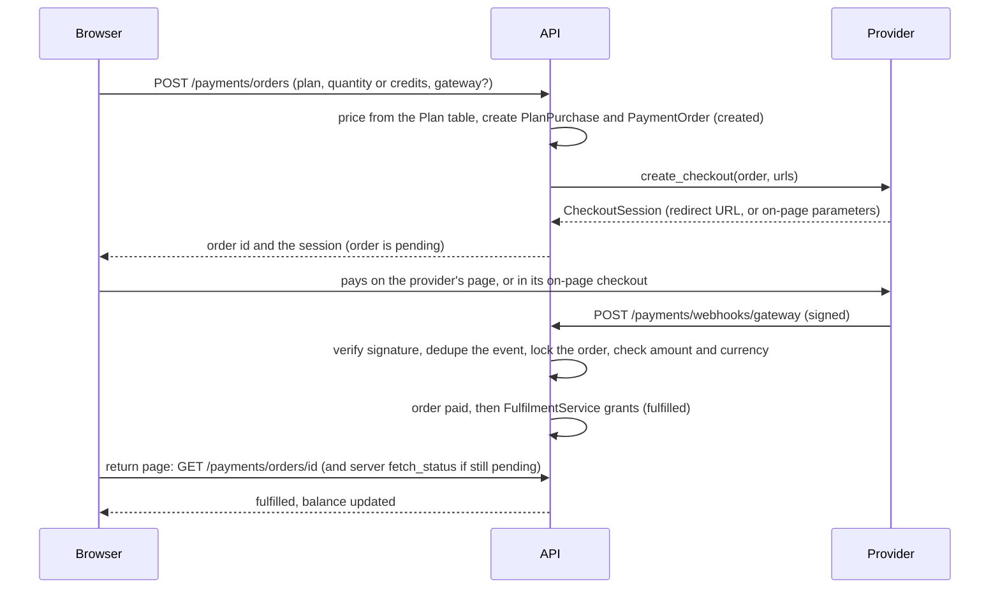
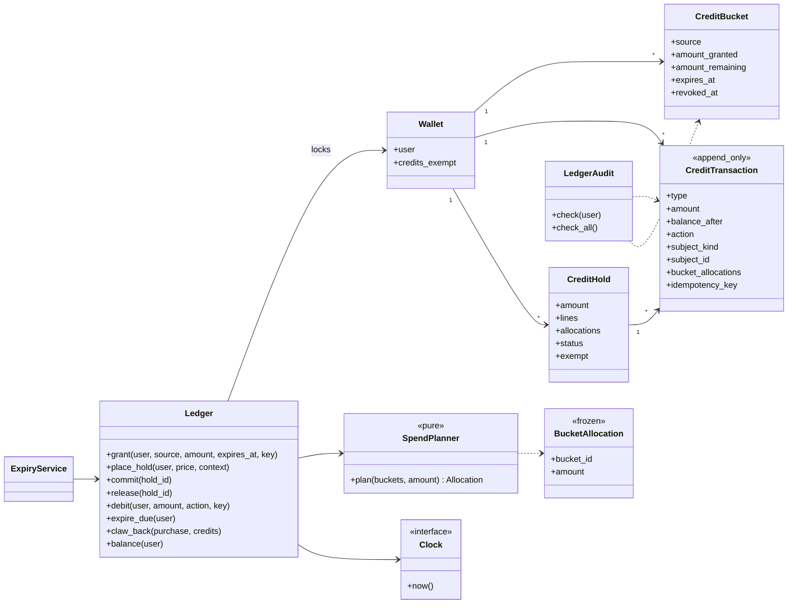
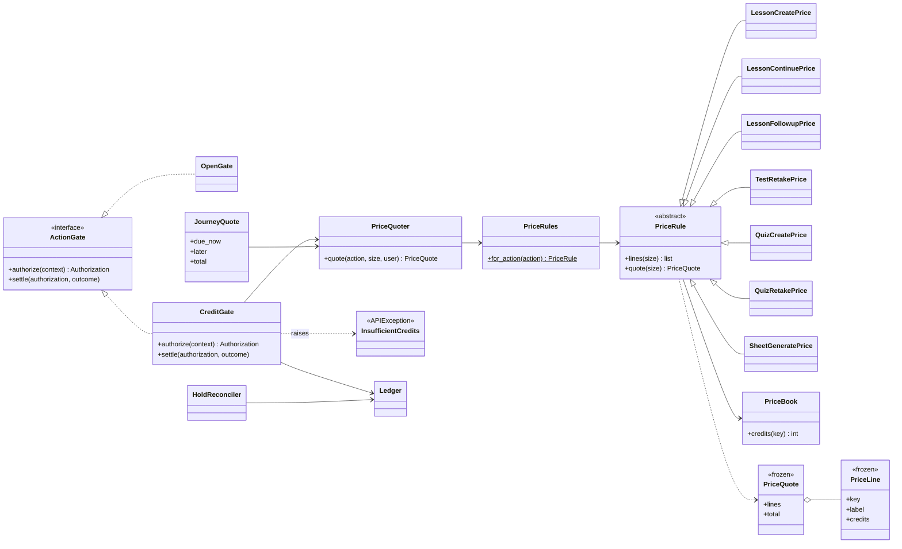
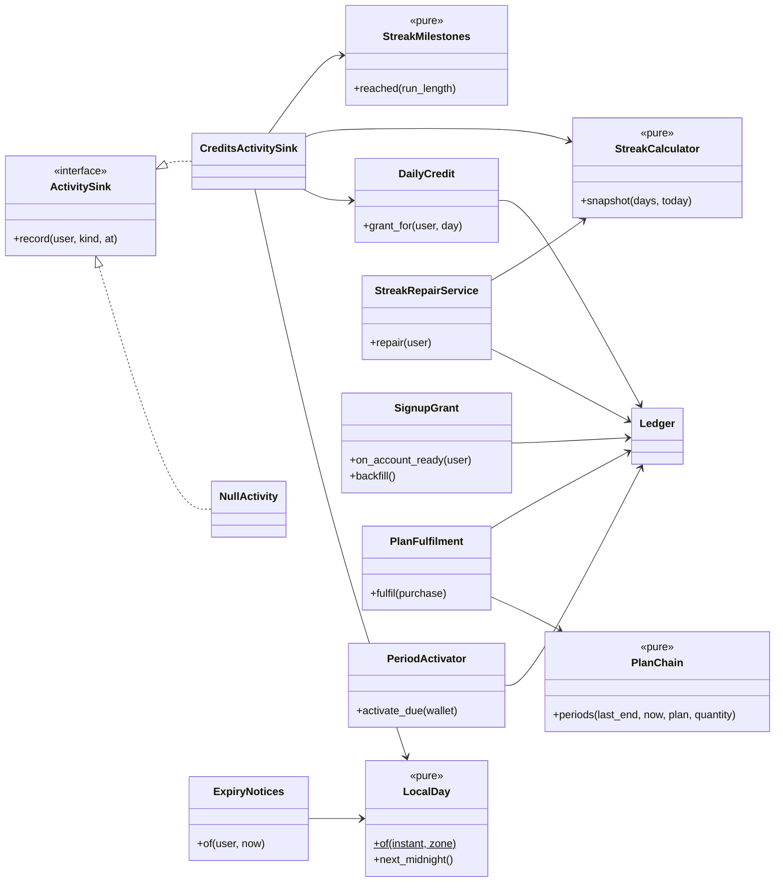
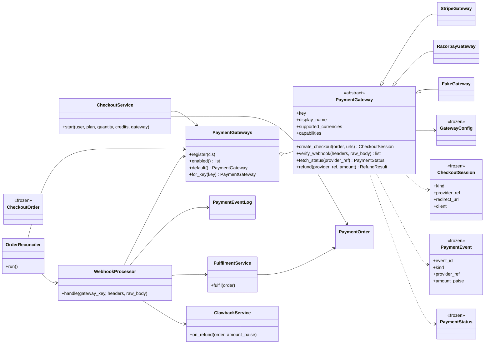
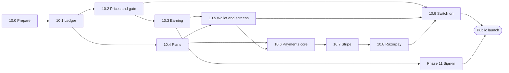

# Implementation plan: Credits and payments

**Spec:** [credits-system.md](credits-system.md) (amended 2026-11-03: see its changelog, A1 to A25)
**Status:** Planned. Nothing is built. The docs are on branch `docs/credits-plan`; the build branches are `phase-10/<topic>` (see [section 12](#12-rollout-phases-order-exit-criteria)).
**Last updated:** 2026-11-03
**Checked against:** the code and docs after phase 9.8 (branch `fix/live-suite-findings`, cut from `main`), in particular `lessons/metering.py` and `lessons/idempotency.py` (the `ActionGate` seam), the `accounts` app, `config/settings.py`, `docker-compose.yml` and the Phase 9 plan ([§5.5](../archive/modular-lessons-implementation-plan.md#55-extension-seam-for-metering), [§6.7](../archive/modular-lessons-implementation-plan.md#67-action-gate), D19, D20, D24).

This plan says how to build the credits system of the spec on top of today's Socra: a wallet and an append-only ledger, a real gate behind the `ActionGate` that Phase 9 left open, the ways to earn credits, plans, and payments through interchangeable provider adapters. It also lists the places where the spec cannot be built as written ([section 3](#3-where-the-spec-needs-rethinking)). The product decisions are **confirmed** (D1 to D21 in [section 4](#4-decisions)); the technical ones are made and listed there too (T1 to T36).

## Changelog

| # | Change | Sections touched |
|---|---|---|
| P1 | First version of the plan, written after the product owner answered the twelve questions of 2026-11-03 (spec changelog A12 to A25) | all |
| P2 | **Second answers (spec A26, A27).** (1) The streak keeps counting past 28 is **confirmed** (K6, T17). (2) **Sheets-only lessons price by the number of sheets, whatever the score**; the half-price rule and its message are for the mastery choice of a lesson only. Former K12 and its risk row are removed and the K numbers after it move up by one; `total_max` is gone from the quote; D7, the matrix (5.4), the journey table (5.5), the tests and the screen copy follow. (3) A sheet added later to a sheets-only lesson from a Quick check costs 2 is **confirmed** (K11). (4) The Stripe adapter **pins a `Stripe-Version` header**, and keeping `httpx` with no SDK is confirmed (T21, provider notes, tests, risks) | 3, 4, 5.4, 5.5, 6.2, 8.1, 9.2, 13, 14 |
| P3 | **Phase 10.0 built** (branch `phase-10/prepare`). Where the build differs from, or adds to, this plan: (a) **A blank attempt is not activity** (spec A28): T16 and K12 now say a sealed attempt with every answer blank, or a Quick check of only "I don't know", is not reported; the call is made after the seal's transaction through `GuardedActivity`, which logs and swallows a failing sink. (b) `QuizService.submit` reports both the Quick check and the Basics check as `QUICK_CHECK` (one activity per local day makes the second harmless). (c) `GET/PATCH /profile` also return `effective_timezone` and `timezone_locked_until` (the page needs both); `POST /auth/register` **drops** a blank or unknown `timezone` instead of refusing it, so a sign-up never fails over a field the person cannot see; `PATCH /profile` refuses it with `400`. (d) `account_ready` is sent with `send_robust` and a failing receiver is logged. (e) The `beat` command is `watchfiles … celery -A config beat --schedule /tmp/celerybeat-schedule`. (f) The mermaid diagrams of this plan were rendered with the real mermaid library: all 8 are valid, none needed a fix. (g) **One existing assertion changed, with the product owner's approval**: `tests/quizzes/test_services.py::TestRetaking::test_a_retake_is_a_new_attempt_with_a_queued_run_and_one_ask` pinned the old `quiz.retake` hint (`asked.size == {"num_questions": 10}`), so it failed by design once the hint carried `source_type`. It now reads `{"num_questions": 10, "source_type": "topic"}`. **Closed:** `make check` is green on the finished phase (4896 passed, 5 skipped; lint and 1892 `bun test` passes) | 3, 4.2, 8.3, 12 |

## Contents

0. [Changelog](#changelog)
1. [Summary](#1-summary)
2. [Why this is good for the project](#2-why-this-is-good-for-the-project)
3. [Where the spec needs rethinking](#3-where-the-spec-needs-rethinking)
4. [Decisions](#4-decisions)
5. [Architecture](#5-architecture)
6. [Object design](#6-object-design)
7. [Database](#7-database)
8. [API](#8-api)
9. [Frontend](#9-frontend)
10. [Console and admin](#10-console-and-admin)
11. [Security, cost and abuse](#11-security-cost-and-abuse)
12. [Rollout: phases, order, exit criteria](#12-rollout-phases-order-exit-criteria)
13. [Test plan](#13-test-plan)
14. [Risks](#14-risks)
15. [Docs to update](#15-docs-to-update)
16. [Appendix](#16-appendix)

---

## 1. Summary

Today every action that starts paid model work already asks an `ActionGate` first and is told how it ended (Phase 9). The default gate says yes to everything. This work builds the gate that says yes only to someone with credits, and everything around it.

| # | Part | The biggest thing it needs |
|---|---|---|
| 1 | **Ledger** | A wallet of buckets with expiry, an append-only ledger, and holds that are taken, committed or released atomically, spending the earliest-expiring credits first and returning them to the same buckets |
| 2 | **Prices and the gate** | A `CreditGate` that prices every action from an admin-editable table, holds the price, commits or releases it as the run ends, and refuses with `402` before anything is created. A stateless quote so every button shows its cost |
| 3 | **Earning** | Signup credits, a daily credit, weekly and monthly streak bonuses and streak repair, on the learner's own local midnight (so a time zone must be stored) |
| 4 | **Plans** | One-time credits and three prepaid plans that chain end to end, with weekly credits dripped week by week |
| 5 | **Payments** | A `PaymentGateway` port with Stripe and Razorpay behind it, orders with a state machine, signature-verified webhooks, and fulfilment that is idempotent on the provider's event id |
| 6 | **Screens** | A wallet, the history, the streak, the buy page, a cost on every action button, expiry notices, and one handler for "not enough credits" |
| 7 | **Console and admin** | Prices and plans, grant and revoke with a reason, the exempt flag, refunds, revenue against model cost |
| 8 | **Switch-on** | Backfill the 30 credits for existing accounts, make the credit gate the default, retire `retakes_per_day`, update the Terms and Privacy pages |

The plan adds **no new infrastructure** beyond what the spec already implies: two Django apps (`credits`, `payments`), a Celery **beat** service (the stack has a worker and no scheduler), and two HTTPS providers. It adds **no new Python dependency**: the provider adapters speak plain HTTPS through `httpx`, which is already there, and sign with the standard library ([T21](#42-technical-decisions)).

Sign-in methods (Google, Apple, Microsoft, email OTP, disposable-email blocking) are **their own phase** (Phase 11) right after the credits core, and **public launch is blocked on it**. The credits build leaves one hook for it, an `account_ready` signal ([section 5.12](#512-sign-in-is-phase-11)).

---

## 2. Why this is good for the project

**The hard part is already built.** Phase 9 put one named gate in front of every costly entry point, passed it the size of the work, stored its answer on the run, and made Stop, failure and Retry tell it how the work ended. Credits arrive as one new class behind that port. The services change in two places (one extra hint, three activity calls); none of the eight call sites is reshaped.

**Money is correct by construction, not by care.** All balances are integers. Every movement is a ledger row with an idempotency key. The ledger sums to the buckets (an equation a command and a nightly check verify). A payment never grants anything except from a signature-verified provider event, once.

**Providers become configuration.** The wallet knows nothing about Stripe. Adding Razorpay is one class, one registry line and its settings. The buy page does not branch on provider.

**It protects the product it is selling.** "Users never pay for our failures" falls out of the hold, commit and release model, and "Retry asks again as a resume" (D19) makes Stop-then-Retry neither a free lunch nor a double charge.

**What it costs:** two new apps and about a dozen tables, a scheduler to run, two external integrations, new screens that need a design pass, and a change of the default gate that touches how every existing test runs ([T29](#42-technical-decisions)). [Section 14](#14-risks) covers the risks.

---

## 3. Where the spec needs rethinking

Each row is a place where building the spec literally would cause a problem. "Recommendation" is what this plan does.

| # | The spec says | What the code and docs show | Recommendation |
|---|---|---|---|
| K1 | Wallet updates use `select_for_update` on the user's buckets (§11) | A new user has no buckets, so there is nothing to lock for the first grant, and two concurrent spends lock only the rows they happen to read | A `Wallet` row per user is the **lock anchor** for every movement ([T2](#42-technical-decisions)). It also holds `credits_exempt` |
| K2 | The ledger and holds point at a `related_object` (generic foreign key) | The project avoids foreign keys that would delete money records with their subject: `ModelCall` uses plain UUIDs. A lesson delete must not delete its ledger rows | `subject_kind` and `subject_id` plain columns, no generic foreign key and no cascade ([T4](#42-technical-decisions)) |
| K3 | A `CreditHold` has an `expires_at` | A hold can legitimately last for hours: the Basics check, the warm-up and the mastery choice are **pauses inside a paid action**, and a learner may leave for a day. An age limit would release credits for work that then goes on for free | Holds are reconciled against **the state of the run that owns them**, not against their age ([T13](#42-technical-decisions)). `expires_at` is only the deadline for an *orphan* (a hold no run claimed) |
| K4 | A scheduled job "evaluates streaks, activates periods, expires buckets" | If correctness waited for a job, a plan period that starts at 14:03 would not be spendable until the next run | **Correctness never depends on the job.** Expired buckets are excluded by the query, due periods are activated lazily when the wallet is touched, a streak is computed from its days on read. The hourly job writes the ledger rows, reconciles, and audits ([T14](#42-technical-decisions)) |
| K5 | `StreakState` stores `repairs_used_week` and `repairs_used_month` | A counter that resets with the cycle is a loophole (break the streak, reset the counters, repair again) | The two limits are **counted from the repaired days over rolling 7 and 28 day windows** ([T17](#42-technical-decisions)) |
| K6 | Streak bonuses "at day 7, 14, 21, 28" and "28-day month" | The spec does not say what happens at day 29 and after | The streak keeps counting while it is unbroken. A weekly bonus is paid at every multiple of 7 and a monthly one at every multiple of 28; each is paid once per streak ([T17](#42-technical-decisions)). **Confirmed** (spec A27) |
| K7 | A transaction has an `amount (+/-)` and types `hold`, `commit`, `release` | A commit moves nothing: the hold already took the credits out of the buckets | The amount is **the change in spendable balance**: a hold is negative, a release positive, a commit zero. That gives one invariant: the sum of all of a user's ledger amounts equals the sum of their buckets' `amount_remaining` ([T4](#42-technical-decisions)) |
| K8 | `ActionPrice` has an `active` flag | It does not say what an inactive price means | Prices are **versioned**: a change adds a row and deactivates the old one, one active row per key ([T10](#42-technical-decisions)). A hold stores the lines it charged, so history never depends on the current table |
| K9 | The spec's "pricing" is a list of amounts | The same action costs different amounts by hint (`origin`, `grounding`, `choice`, `perfect`, `sheets`, `source_type`) and one lesson is charged in two stages | A `PriceRule` per `MeteredAction` turns the gate's hints into **lines** from the price table. The same code answers the gate and the quote endpoint, so the screens never repeat a rule ([section 5.4](#54-the-pricing-matrix)) |
| K10 | "Quiz retake" has a price only by implication | `quiz.retake` is asked with `num_questions` alone, so its price cannot tell a topic quiz from a quiz made from lessons | One hint is added: `source_type` ([T11](#42-technical-decisions), phase 10.0) |
| K11 | The +1 for a sheet "from a lesson, or with a quiz first" | A sheets-only lesson from a Quick check has already paid for its quiz | The +1 is charged **only for a sheet grounded in a lesson's pages**; grounding in a Quick check, or none, is 2 per sheet (D7) |
| K12 | Daily credit needs "a meaningful action" | The spec lists qualifying actions in words | An exact list: a metered action that **succeeded** (hold committed), and a **sealed** attempt (a lesson test, a quick quiz, or a Quick check handed in). Starting, refusing or failing earns nothing, and neither does an attempt with every answer blank ([T16](#42-technical-decisions), spec A28) |
| K13 | The day boundary is the learner's local midnight | No time zone is stored; the server runs in UTC (`TIME_ZONE = "UTC"`) | `Profile.timezone` (D9) |
| K14 | `retakes_per_day` is not mentioned | Two services enforce 3 retakes per 24 hours (`AttemptService._check_daily_limit`, `QuickQuizService._check_daily_limit`) and the lesson settings carry the field | Retired in the switch-on phase (D12). The hourly throttles remain |
| K15 | Signup gives 30 credits and email OTP verifies | Only email and password exist, **no email is sent**, and anyone can register without limit. Thirty free credits per account is a cost-farming hole | Phase 11 before launch (D15). The grant fires on `account_ready`, so it moves from "registered" to "verified" without touching the credits code |
| K16 | Payment status is held as a `stripe_payment_id` on the purchase | Two providers, and a refund can arrive for a partly refunded order | A provider-neutral `PaymentOrder` with a state machine, and a separate `PaymentEventLog` table that makes every provider event process at most once ([section 7](#7-database)) |
| K17 | The insufficient-credits redirect is the buy page | Phase 9 left `ActionRefused` at `403` and the frontend handler accepts only `403` | `InsufficientCredits` is `402` with its own code; `ActionRefusedMessage` accepts both (D21, phase 10.0) |
| K18 | Credit tables are ordinary tables | `core/sync.py` copies rows insert-only from the local Postgres to Supabase when `SUPABASE_DATABASE_URL` is set; buckets are *updated* rows | Money is written only to the active `default` database. The sync stays insert-only and never overwrites, so it cannot damage a balance; it is listed in the risks because a stale local copy can be inserted if Supabase is switched on late |

---

## 4. Decisions

### 4.1 Product decisions (confirmed)

Confirmed by the product owner. The spec changelog (A1 to A25) has the same decisions in the spec's words.

| # | Decision |
|---|---|
| D1 | Plans: one-time ₹1 per credit (minimum 10 credits, valid 1 year), Weekly Pro ₹49 for 100 credits per week, Monthly Pro ₹199 for 500 credits, Pro Plus ₹279 for 750 credits, the monthly ones for 28 days. Prepaid, no auto-renewal, one plan active at a time, others queue, several weeks drip |
| D2 | Streak repair fixes the previous day only, within 48 hours (a missed local day *D* can be repaired during *D + 1*); 1 per week and 3 per 28 days; a repaired day earns no daily credit |
| D3 | Signup credits (30) never expire; bonus credits last 90 days; so signup credits are spent last |
| D4 | The spending prices of [section 5.4](#54-the-pricing-matrix), as the spec §2 states them, including "Create a lesson for this" at **9** |
| D5 | A quick quiz retake costs the tier price, plus 1 only for a quiz made from lessons |
| D6 | Stop and failure release; Retry asks again as a resume (D19 of the Phase 9 plan) |
| D7 | Sheets-only lessons: the +1 for a sheet *is* the quiz and is never charged on top of one, and the price follows the **number of sheets, whatever the score**. Totals: Quick check with one sheet 3 (3 + 0), both 5 (3 + 2); self-rated or from a quiz result 2 per sheet, all at the start. The half-price rule and its message apply only to the mastery choice of a lesson. The learner sees totals |
| D8 | The recommended-lesson discount is taken at stage one (2 instead of 3, total 9); a self-rated recommended lesson is 9; no discount on a sheets-only lesson |
| D9 | `Profile.timezone` (IANA), taken from the browser at sign-up, editable once per 30 days, default `Asia/Kolkata` |
| D10 | Every existing account gets 30 non-expiring credits once, before the gate is switched on |
| D11 | An explicit `credits_exempt` flag (admin only, default off); `is_staff` does not exempt; an exempt account's actions still write ledger rows, at 0 |
| D12 | `retakes_per_day` is retired; the hourly throttles and the one-open-attempt rule stay |
| D13 | The default gateway is Stripe, from the environment. The buy page shows a picker automatically when two or more gateways are enabled and none when one is. The API accepts an optional `gateway`, validated against the enabled list |
| D14 | Refunds are made by an admin through the provider. A verified refund or dispute takes back only the unspent credits of that purchase, never takes a wallet below 0, and logs any shortfall |
| D15 | Sign-in is its own phase right after the credits core; the signup grant fires on `account_ready`; public launch is blocked on that phase |
| D16 | Expiry notices: bonus in the last 7 days; purchased at 30 days left and in the last 7; in-app only until email exists |
| D17 | Prices are tax-inclusive and the provider's receipt is the invoice for now; GST is decided before launch |
| D18 | Google Pay, UPI and cards are payment *methods* a gateway offers, not gateways |
| D19 | The build order is Stripe (test mode) first, then Razorpay (test mode) |
| D20 | Stripe's India onboarding and Razorpay as the fallback are a **risk**, not a product decision: nothing in the product changes over it |
| D21 | The refusal for credits is HTTP `402`, code `insufficient_credits`; the frontend handler follows |

### 4.2 Technical decisions

| # | Decision | Why |
|---|---|---|
| T1 | Two new apps, `credits` and `payments`. `lessons` and `quizzes` never import them; the gate is chosen by `ACTION_GATE`, activity by `ACTIVITY_SINK`, both dotted paths | The dependency points one way. `lessons` already works with the open gate |
| T2 | A `Wallet` row per user is locked first in every movement. Lock order is always lesson (when the caller holds it), then wallet, then bucket rows | One order means no deadlock; one anchor serialises a user's money |
| T3 | Money is an integer: credits as `int`, rupees as **paise** `int`. No floats, no `Decimal` | Rounding cannot appear |
| T4 | A ledger row's `amount` is the change in spendable balance (hold −, release +, commit 0, grant +, expire −). `subject_kind` and `subject_id` replace the generic foreign key. Each row stores `balance_after`. **Invariant:** sum of a user's ledger amounts = sum of their buckets' `amount_remaining` | A single equation to test, audit and alarm on (K7, K2) |
| T5 | The ledger is append-only: the model refuses `save` on an existing row and `delete`; the admin is read-only; a database trigger refuses `UPDATE` and `DELETE` (a migration, so it is versioned). A `credits_audit` command checks the invariant | A bug cannot rewrite history; a hand edit in a dashboard is already forbidden |
| T6 | Spend order: `expires_at` ascending with `NULL` last, then `created_at`, then id. A hold takes the credits out of the buckets at once and records the allocation on the hold and on its ledger row | Earliest expiry first (spec §6); concurrent spends see the true balance |
| T7 | A release returns each allocation to its source bucket. A bucket that has **expired** is not revived: the credits go to a new `refund` bucket that lasts 30 days. A bucket that was **revoked** by a refund is not refilled (the credits are forfeited and the row says so) | Nothing is lost to a late failure, and a refunded purchase cannot be re-credited |
| T8 | Idempotency: `idempotency_key` is unique on ledger rows and on holds; a partial unique constraint allows one `held` hold per (action, subject). A repeated `authorize` returns the same authorization | Redelivery, retry and a resume cannot double-charge |
| T9 | `Authorization.id` is the hold's id. Its `meta` carries the credits and the price lines. **Every tracked authorization makes a hold, even for 0 credits** | Settlement finds the hold directly; usage is always visible; a zero-credit action still counts as activity |
| T10 | `ActionPrice` rows are versioned (K8) and cached in the Django cache, cleared on save. A `PriceRule` per action turns hints into lines. The price is **fixed when the hold is taken** | An admin edit never changes work in flight |
| T11 | One hint is added: `source_type` on `quiz.retake`. No other hint changes | The only price that could not be told apart (K10) |
| T12 | An exempt account gets a hold of 0 with the lines it would have paid, flagged `exempt` | Staff use stays visible, and the real price is known if the flag is turned off |
| T13 | A `HoldReconciler` releases a hold whose run ended failed or cancelled but was never settled, and an orphan (no run claims it) after `orphan_minutes`. It never releases a hold whose run is merely paused | K3 |
| T14 | One hourly Celery task, `credits.tick`: write `expire` rows, activate due plan periods, reconcile holds, audit the invariant. Another, `payments.reconcile`, every 5 minutes. A `beat` service runs the schedule from `CELERY_BEAT_SCHEDULE` in settings; exactly one beat. Every task is idempotent, so a duplicate run is harmless | K4 |
| T15 | `LocalDay` (a pure value object) turns an instant and a time zone name into a local date, using `zoneinfo`. Time comes from an injected `Clock` | Day boundaries are table-tested at 18:29Z and 18:31Z for India; tests never sleep |
| T16 | Activity is recorded by an `ActivitySink` port defined in `lessons`. `CreditGate.settle(succeeded)` records one for the metered action. Three services record one when an attempt is sealed: `AttemptService.submit`, `QuizAttemptService.submit` and `QuizService.submit` (a Quick check handed in). Refused, failed, cancelled and merely started do not count, and neither does an attempt with every answer blank (Phase 9's `all_blank`; for a Quick check, every answer "I don't know"). The call is made after the seal's transaction, through a guard that logs a failing sink. The day is the local date of the hold's creation | K12 |
| T17 | A `StreakDay` row per local date (`active` or `repaired`). A pure `StreakCalculator` computes the streak from the dates. Bonuses are idempotent on (user, streak start date, n). Repair rules: only the day before today, only if the day before that is a streak day, 1 credit, rolling 7 and 28 day limits counted from `repaired_on`. The streak keeps counting past day 28: +10 at every multiple of 7 and +10 more at every multiple of 28, once per run (confirmed) | K5, K6 |
| T18 | Every earning amount and window (30, 1, 10, 10, 90 days, 365 days, the notice windows, the one-time minimum and maximum, queue limits) lives in a `CreditSettings` singleton edited in the admin and the console, like `FlowSettings` | "Prices live in the database, not the code" extends to the rewards |
| T19 | Plans chain end to end: a new purchase starts when the user's last period ends (or now). Buckets are created when a period **starts**, not when it is bought. A period that elapsed unused is recorded as granted then expired. Buying the same plan again queues like any other plan. At most `max_queued_periods` (12) | Spec §5.3 |
| T20 | One-time credits: minimum 10, maximum `max_one_time_credits` (5,000), price `paise_per_credit` (100). The amount is always computed on the server | The client never names a price |
| T21 | The Stripe and Razorpay adapters use `httpx` and the standard library's `hmac`. No provider SDK (confirmed). `StripeGateway` sends a **pinned `Stripe-Version` header** on every request, a constant in the adapter that is changed deliberately | The adapters are tested with `httpx.MockTransport` like the media sources; no dependency and no rebuild. Pinning the version means Stripe's response shapes cannot change under us; moving to a newer one is a reviewed change with its tests updated |
| T22 | `PaymentOrder` has the state machine of [section 5.8](#58-payment-flow). `PaymentEventLog` is unique on (gateway, provider event id) and is written in the same transaction as the effect, so an event takes effect at most once. Fulfilment locks the order row | Duplicates and races cannot grant twice |
| T23 | The webhook view has no authentication, is CSRF-exempt (the only such view), reads the raw body, caps it at 256 KB, and verifies the signature **before any database work** | The body is untrusted until signed |
| T24 | The browser's return to the site never grants anything. The return page asks the server for the order's status, and the server may call `fetch_status` (rate limited). The 5-minute task does the same for old pending orders | Webhooks can be late or lost; the return redirect can be forged |
| T25 | Settings: `PAYMENT_GATEWAYS_ENABLED` (comma list), `PAYMENT_DEFAULT_GATEWAY` (default `stripe`), the keys of each gateway, `PAYMENT_RETURN_BASE_URL`. A system check errors when an enabled gateway lacks a key | Config comes from the environment; a missing key shows at start |
| T26 | A `FakeGateway` is registered only when `PAYMENT_ALLOW_FAKE_GATEWAY=true` (the e2e stack, never the default). It signs its own webhooks with a secret from the environment | The whole buying path is tested in a browser without a provider |
| T27 | Expiry notices are computed when read; there is no notice table. A learner dismisses a notice for the day in the browser | Nothing to go stale |
| T28 | Frontend: a `CheckoutAdapters` registry, a `QuoteClient`, a `CostLabel`, and `ActionRefusedMessage` widened to `402`. Components never branch on a provider | The same Strategy and registry pattern the codebase uses |
| T29 | `ACTION_GATE` stays `lessons.metering.OpenGate` until the switch-on phase. Then the default becomes `credits.gate.CreditGate` and the test suite pins `OpenGate` in its root conftest, with a `credits_on` fixture for the tests that want credits | Every existing test keeps its meaning |
| T30 | `manage.py grant_signup_credits [--dry-run]` backfills the 30 for accounts without a signup grant, idempotent on `signup:<user id>` | D10; same shape as `backfill_concept_index` |
| T31 | Revenue against model cost shows both in rupees, using `USD_INR_RATE` from the environment for the model cost, and says so on the screen | `ModelCall.cost` is in dollars |
| T32 | A `ClawbackService` handles a refund or dispute event: removes up to the unspent credits of the purchase's buckets in proportion to the refund, marks emptied buckets revoked, records any shortfall in the ledger row and on the event | D14 |
| T33 | `RetakeLimitReached`, `_check_daily_limit`, the `retakes_per_day` column and its console field are removed in the switch-on phase, like `final_test_min` in 9.8 | D12 |
| T34 | Every migration adds tables or a defaulted column. The only data change is the backfill command, run by hand | Reversible and safe to deploy ahead of the switch |
| T35 | Gateway availability of a price: a line with no active price row refuses the action with `503 price_unavailable`, never charges 0 | A missing row must not mean "free" |
| T36 | `POST /credits/quote` accepts only the gate's actions and their known hints, and returns `400` for an unknown one | It is not a way to probe other things |

---

## 5. Architecture

### 5.1 What stays and what is new

**Stays:** `ActionGate`, `ActionContext`, `Authorization`, `ActionMetering`, `AuthorizationSettlement`, `CompletionPoints`, `IdempotentRequest`, the eight call sites and `RunStarters`. The services decide when to ask; they do not learn what a credit is.

**New:**



### 5.2 One action, from ask to settlement



The service code is exactly what Phase 9 wrote. Six call sites ask inside their own transaction (`QuizService.submit`, `MaterialService.choose`, `MaterialService.request_extra`, `FollowupService.create`, the test retake and the quiz retake; they already hold the lesson or quiz row), so the hold is rolled back with the rows if anything after it fails. For `lesson.create`, `quiz.create` and a lesson Retry the ask comes before the transaction, and `ActionMetering.guard` releases on error. Either way a crash between the ask and the run's creation leaves at most an orphan hold, which the reconciler releases (T13).

### 5.3 Package layout

```
backend/credits/
    models.py            Wallet, CreditBucket, CreditTransaction, CreditHold, ActionPrice, Plan, PlanPurchase,
                         PlanPeriod, StreakDay, StreakState, CreditSettings
    ledger.py            Ledger (facade), SpendPlanner, BucketAllocation, Clock
    gate.py              CreditGate
    pricing/             PriceBook, PriceQuote, PriceLine, PriceRules and one rule per action, JourneyQuote
    errors.py            InsufficientCredits (402), PriceUnavailable (503), the streak and plan errors
    earning/             SignupGrant, DailyCredit, StreakCalculator, StreakMilestones, StreakRepairService, LocalDay
    activity.py          CreditsActivitySink
    plans.py             PlanFulfilment, PeriodActivator, PlanChain
    notices.py           ExpiryNotices and its policies
    reconcile.py         HoldReconciler, LedgerAudit
    tasks.py             tick (Celery task, thin)
    views.py, serializers.py, urls.py, admin.py
    management/commands/ grant_signup_credits, credits_audit
backend/payments/
    models.py            PaymentOrder, PaymentEventLog
    gateways/            base.py (PaymentGateway, value objects), registry.py (PaymentGateways), stripe.py,
                         razorpay.py, fake.py
    checkout.py          CheckoutService
    webhooks.py          WebhookProcessor
    fulfilment.py        FulfilmentService, ClawbackService
    reconcile.py         OrderReconciler
    tasks.py             reconcile (Celery task, thin)
    views.py, serializers.py, urls.py, admin.py
backend/lessons/activity.py   ActivitySink (Protocol), NullActivity, ActivitySinks.default()
frontend/
    app/wallet/ (page, history), app/buy/ (page, return), app/streak/
    components/credits/ ...
    lib/credits/ (quote, wallet, notices, streak, checkout adapters)
```

### 5.4 The pricing matrix

Every size-hint combination the code produces, and what it costs. Prices are rows of `ActionPrice` (admin-editable), seeded as below. A **Retry** is asked again with the same hints, so it costs the same as the original.

**Price table (the seed)**

| Key | Credits | Used by |
|---|---|---|
| `lesson.check` | 3 | `lesson.create` on the Quick check path |
| `lesson.check_recommended` | 2 | the same, for a recommended lesson |
| `lesson.full` | 10 | `lesson.create` self-rated, direct |
| `lesson.full_recommended` | 9 | `lesson.create` self-rated, recommended |
| `lesson.full_from_quiz` | 9 | `lesson.create` from a quick quiz result |
| `lesson.rest` | 7 | `lesson.continue`, the lesson |
| `sheets.after_check` | 2 | `lesson.continue`, sheets only |
| `sheets.after_check_single` | 0 | `lesson.continue`, one sheet, any score |
| `sheet.each` | 2 | each sheet (`sheet.generate`, and a self-rated or quiz-result sheets lesson) |
| `sheet.grounded_extra` | 1 | once, for a sheet grounded in a lesson's pages |
| `followup.foundation` | 5 | `lesson.followup` |
| `followup.advanced` | 7 | `lesson.followup` |
| `test.retake` | 2 | `test.retake` |
| `quiz.tier_5` / `quiz.tier_10` / `quiz.tier_20` | 1 / 2 / 3 | `quiz.create` and `quiz.retake`, by question count (5; 10 and 15; 20, 25 and 30) |
| `quiz.extra` | 1 | once, for a quiz made from lessons or one with the warm-up |
| `streak.repair` | 1 | repairing a day (a direct debit, not an `ActionGate` action) |

**`lesson.create`** (hints `entry`, `intent`, `origin`, `covers`, `sheets`, `grounding`)

| Way in | Asks for | Origin | Credits | Rule |
|---|---|---|---|---|
| Quick check | lesson | direct | **3** | `lesson.check` |
| Quick check | lesson | recommendation | **2** | `lesson.check_recommended` |
| Quick check | 1 or 2 sheets | direct or recommendation | **3** | `lesson.check` (no discount on sheets) |
| Self-rating | lesson | direct | **10** | `lesson.full` |
| Self-rating | lesson | recommendation | **9** | `lesson.full_recommended` |
| Self-rating | 1 or 2 sheets | direct or recommendation | **2 or 4** | `sheet.each` × sheets |
| Quick quiz result | lesson | quiz_result | **9** | `lesson.full_from_quiz` |
| Quick quiz result | 1 or 2 sheets | quiz_result | **2 or 4** | `sheet.each` × sheets |

**`lesson.continue`** (hints `choice`, `perfect`, `intent`, `sheets`, `grounding`; the price reads `choice` and `sheets`, and the score changes nothing for sheets)

| Choice | Case | Credits | Rule |
|---|---|---|---|
| lesson | any score, including the Expert lesson after a perfect check | **7** | `lesson.rest` |
| sheets only | the mastery choice after a perfect check (both sheets) | **2** | `sheets.after_check` (the half-price rule) |
| sheets only | a sheets lesson, both sheets, any score | **2** | `sheets.after_check` |
| sheets only | a sheets lesson, one sheet, any score | **0** | `sheets.after_check_single` |

**The others**

| Action | Case | Credits |
|---|---|---|
| `lesson.followup` | Foundation / Advanced | **5 / 7** |
| `test.retake` | attempt 2 onward (attempt 1 is part of the lesson) | **2** |
| `quiz.create` | 5 / 10 or 15 / 20, 25 or 30 questions, from a topic with a self-rating | **1 / 2 / 3** |
| `quiz.create` | the same, from lessons, or with the warm-up (one +1, never both) | **2 / 3 / 4** |
| `quiz.retake` | the same tiers, +1 only if the quiz was made from lessons | **1 / 2 / 3**, or **2 / 3 / 4** |
| `sheet.generate` | 1 / 2 sheets grounded in a lesson's pages | **3 / 5** |
| `sheet.generate` | 1 / 2 sheets grounded in a Quick check, or in nothing | **2 / 4** |

The twelve `quiz.create` prices are the six counts times the two columns. The number of questions the quiz holds in short or long answers, the number of source lessons and the level mode other than warm-up change nothing.

### 5.5 What the learner sees: stages and totals

The quote endpoint returns a **journey quote** for the screens that start something staged: the part due now, the part that follows, and the total.

| Screen | Due now | Later | Total |
|---|---|---|---|
| New lesson, Quick check | 3 (2 if recommended) | 7 after the Quick check | 10 (9) |
| New lesson, self-rated | 10 (9 if recommended) | none | 10 (9) |
| New lesson from a quiz result | 9 | none | 9 |
| Sheets, Quick check, one sheet | 3 | 0 | 3 |
| Sheets, Quick check, both sheets | 3 | 2 | 5 |
| Sheets, self-rated or from a quiz result | 2 or 4 | none | 2 or 4 |
| Mastery choice | | Expert lesson 7, sheets 2 | |

Every journey has one total; none has a range.

### 5.6 Earning

- **Activity** is what the spec calls a meaningful action (K12): a metered action that succeeded (the hold committed), and a sealed attempt (a lesson test, a quick quiz, or a Quick check handed in). Each carries the instant it happened; the day is that instant in the learner's time zone.
- **Daily credit:** the first activity of a local day writes a `StreakDay` and grants 1 credit (a `daily` bucket, 90 days), idempotent on `daily:<user>:<date>`.
- **Streak:** the run of consecutive `StreakDay`s ending today or yesterday. It is alive until the end of the day after the last streak day. A weekly bonus (+10) is paid when the run reaches a multiple of 7 and a monthly bonus (+10 more) at a multiple of 28, so day 28 pays 20. Each is idempotent on (user, the run's start date, n).
- **Repair:** on local day *T* the learner may repair *T − 1* if it is missing and *T − 2* is a streak day, for 1 credit, if fewer than 1 repair fell in the last 7 days and fewer than 3 in the last 28. The repaired day counts for the streak and earns no daily credit; repairing can complete a milestone, which is paid then.
- **Signup:** 30 credits, no expiry, on `account_ready`, idempotent on `signup:<user>`.

### 5.7 Plans and periods

A purchase makes `quantity` periods (Weekly Pro may be bought 1 to 12 at once; the others once, and again to queue). Each period runs from the previous period's end (or now) for `period_days`. When a period starts, a `subscription` bucket of its credits is created, expiring at the period's end. Credits are never granted before the period starts, so three weeks bought today drip one week at a time. Periods are activated lazily when the wallet is touched and by the hourly task. A one-time purchase creates a `purchase` bucket at once, expiring after 365 days.

### 5.8 Payment flow



**Order states:** `created` (row exists, no checkout yet) → `pending` (checkout made) → `paid` (a verified success event, amount and currency match) → `fulfilled` (credits granted); or `failed` / `expired`. `paid` to `fulfilled` is one transaction; an order stuck in `paid` (a bug) is retried by the reconciler. A refund does not change the state; it adds to `refunded_paise` and runs the clawback, so a partial refund works.

### 5.9 Housekeeping

`credits.tick` (hourly) and `payments.reconcile` (every 5 minutes), both started by the `beat` service, both idempotent, both thin Celery tasks that call one method of a class.

| Task | Does |
|---|---|
| `credits.tick` | writes `expire` rows for lapsed buckets; activates due periods and marks ended ones; `HoldReconciler`; `LedgerAudit` |
| `payments.reconcile` | for orders `pending` longer than 15 minutes: `fetch_status` and apply it as if it were an event; retries `paid` orders; expires orders past their deadline |

### 5.10 Expiry notices

Computed on read from the buckets and each one's source, in the learner's time zone: weekly subscription credits from 2 days before the period ends, daily until the last day; monthly and Pro Plus credits in the last 7 days; bonus credits in the last 7 days; purchased credits when 30 days are left (shown for 3 days) and in the last 7; signup credits never. Buckets that lapse on the same local day are summed into one message: "This is your last day to use 40 credits."

### 5.11 What a learner's refusal looks like

`InsufficientCredits` is an `ActionRefused` with status 402 and code `insufficient_credits`, carrying `required` and `available` the way `FollowupExists` carries `lesson_id`. Every create path already shows a refusal through one handler; it learns 402 and adds a link to the buy page. A Quick check handed in with too few credits for stage two stores nothing; the answers stay in the browser (Phase 9, T18).

### 5.12 Sign-in is Phase 11

`accounts` sends an `account_ready` signal from the registration serializer today. `credits` receives it and grants the signup credits. When Phase 11 adds email verification, it moves the signal to the moment the email is verified. That is the entire interface between the two. Phase 11 also brings the first email infrastructure; until then notices are in-app only.

---

## 6. Object design

All behaviour is in classes; Celery tasks, signal receivers, views and migrations stay thin ([design.md rules](../architecture/design.md#1-rules)). New classes and patterns go into design.md in the phase that adds them (sections 4.26 and 4.27).

### 6.1 The ledger

| Class | Responsibility |
|---|---|
| `Wallet` (model) | One row per user. The lock anchor for every movement; holds `credits_exempt` |
| `CreditBucket` (model) | A parcel of credits with a source, an amount granted and remaining, an optional expiry, an optional purchase, and `revoked_at` |
| `CreditTransaction` (model) | One immutable ledger row: type, signed amount, `balance_after`, action, subject, the bucket allocations, a unique idempotency key and a small `meta` |
| `CreditHold` (model) | One reserved price for one authorization: amount, lines, allocations, status `held`, `committed` or `released`, exempt flag |
| `Ledger` | The facade the other classes use: `grant`, `place_hold`, `commit`, `release`, `debit`, `expire`, `adjust`, `claw_back`, `balance`. Each locks the wallet, writes rows, and returns a result value |
| `SpendPlanner` (pure) | Given a list of buckets and an amount, returns the allocation in spend order, or says how short it is |
| `BucketAllocation` (frozen) | A bucket id and an amount |
| `Clock` (`Protocol`), `SystemClock` | The only source of "now" in `credits` |
| `ExpiryService` | Turns lapsed buckets into `expire` rows |
| `LedgerAudit` | Checks the invariant of T4 for one user or all, and reports the breaking ones |
| `CreditSettings` (model, singleton) | The editable amounts and windows (T18) |



**Pattern:** `Ledger` is a Facade over the models; `SpendPlanner` is a pure Strategy (the spend order) so it is table-tested without a database.

### 6.2 Prices and the gate

| Class | Responsibility |
|---|---|
| `CreditGate` | Implements `ActionGate`. `authorize`: quote, place the hold, return an `Authorization` whose id is the hold's id. `settle`: commit on `succeeded`, release on `failed` or `cancelled`, a no-op if the hold is already settled. Raises `InsufficientCredits` or `PriceUnavailable` |
| `PriceQuoter` | `quote(action, size, user)` → `PriceQuote`. Picks the rule from the registry |
| `PriceRule` (ABC) | Template Method: `lines(size) → list[PriceLine]`, with a shared `quote`. One subclass per action: `LessonCreatePrice`, `LessonContinuePrice`, `LessonFollowupPrice`, `TestRetakePrice`, `QuizCreatePrice`, `QuizRetakePrice`, `SheetGeneratePrice` |
| `PriceRules` | The registry keyed by `MeteredAction`. A new action is a new rule and a registry line, never an `if` |
| `PriceBook` | Reads the active `ActionPrice` rows (cached); `credits(key)` raises `PriceUnavailable` when none |
| `PriceLine` (frozen) | A key, a label for the learner, and credits |
| `PriceQuote` (frozen) | The lines and their total |
| `JourneyQuote` | Composes the quotes of the stages a screen starts (section 5.5): due now, later, total |
| `ExemptPolicy` | Says whether a user pays (the wallet flag); an exempt hold has amount 0 |
| `HoldReconciler` | T13: releases settled-failed and orphan holds, never a paused one |
| `InsufficientCredits`, `PriceUnavailable` | `ActionRefused` subclasses with status 402 and 503 |



**Pattern:** `ActionGate` stays the Strategy (chosen by `ACTION_GATE`), `OpenGate` the Null Object; `PriceRule` is Template Method plus a registry, exactly how `AssessmentSources` and `QuestionTypes` work.

### 6.3 Earning, plans and notices

| Class | Responsibility |
|---|---|
| `LocalDay` (pure) | An instant and a zone name to a local date; the next midnight |
| `ActivitySink` (`Protocol`, in `lessons`) | `record(user, kind, at)`; `NullActivity` is the default |
| `CreditsActivitySink` | Records a `StreakDay`, then asks `DailyCredit` and `StreakMilestones` |
| `DailyCredit` | Grants 1 credit for a day that is new, idempotently |
| `StreakCalculator` (pure) | Dates and today to the current streak, the longest, the run's start, whether it can be repaired |
| `StreakMilestones` (pure) | Which multiples of 7 and 28 a run has reached |
| `StreakRepairService` | The repair rules of T17 and the 1-credit debit |
| `SignupGrant` | The signup grant on `account_ready`, and the backfill for existing accounts |
| `PlanFulfilment` | Makes a purchase's periods and buckets from a paid order |
| `PlanChain` (pure) | Start and end instants of a new purchase's periods |
| `PeriodActivator` | Activates due periods and ends elapsed ones for one wallet |
| `ExpiryNotices` | Strategy per bucket kind: `WeeklyNotice`, `MonthlyNotice`, `BonusNotice`, `PurchasedNotice` |



### 6.4 Payment adapters

This is the Strategy and registry pattern the codebase already uses for providers, media sources and assessment sources. Adding a provider is **one new class, one registry entry and its settings**.

| Class | Responsibility |
|---|---|
| `PaymentGateway` (ABC) | The port every provider subclasses. `key`, `display_name`, `supported_currencies`, `capabilities`; abstract `create_checkout`, `verify_webhook`, `fetch_status`; an optional `refund` (raises `NotSupported` unless the gateway declares the capability) |
| `GatewayConfig` (frozen) | The keys of one gateway read from the environment. Never logged; its `repr` hides values |
| `PaymentGateways` | The registry: `register(cls)`, `enabled()`, `default()`, `for_key(key)`. Reads `PAYMENT_GATEWAYS_ENABLED` and `PAYMENT_DEFAULT_GATEWAY` |
| `StripeGateway`, `RazorpayGateway` | The two adapters ([notes below](#provider-notes)) |
| `FakeGateway` | Test and e2e only (T26) |
| `CheckoutOrder` (frozen) | What a gateway needs to start a checkout: the order id, amount in paise, currency, a description, the buyer's email |
| `ReturnUrls` (frozen) | The success and cancel URLs |
| `CheckoutSession` (frozen) | `kind` (`redirect` or `client`), `provider_ref`, `redirect_url`, or `client` parameters (non-secret, with an `adapter` name the frontend picks its code by), `expires_at` |
| `PaymentEvent` (frozen value) | `event_id`, `kind` (`succeeded`, `failed`, `refunded`, `disputed`), `provider_ref`, `payment_ref`, `amount_paise`, `currency`, `occurred_at` |
| `PaymentStatus` (frozen) | `state` (`pending`, `paid`, `failed`, `expired`), amount, currency, `payment_ref` |
| `RefundResult` (frozen) | A refund reference and the amount refunded |
| `InvalidWebhook` | Raised by `verify_webhook` for a bad signature, an old timestamp or an unreadable body |
| `CheckoutService` | Prices the order on the server, makes the rows, calls the gateway, handles a provider outage |
| `WebhookProcessor` | Looks up the gateway, verifies, dedupes by event id, applies each event under the order lock |
| `FulfilmentService` | Moves `paid` to `fulfilled` by calling `PlanFulfilment` |
| `ClawbackService` | The refund and dispute rule (T32) |
| `OrderReconciler` | `fetch_status` for old pending orders; retries stuck `paid` ones |



#### Provider notes

| | Stripe | Razorpay |
|---|---|---|
| Checkout | Checkout Sessions, `mode=payment`, INR in paise, `client_reference_id` = our order id, the order id in `metadata`, an `Idempotency-Key` of the order id. Returns a **redirect URL** | Orders API (`POST /v1/orders`, amount in paise, `receipt` = our order id). Returns **client parameters** (key id, order id, amount, currency) for the on-page checkout |
| API version | A **pinned `Stripe-Version` header** on every call (the account's default version is never relied on); webhook endpoints are created for the same version | Razorpay's API is versioned by path (`/v1`); no header |
| Webhook signature | `Stripe-Signature: t=…,v1=…`: HMAC-SHA256 of `t.body` with the endpoint secret, 5-minute tolerance | `X-Razorpay-Signature`: HMAC-SHA256 of the body with the webhook secret. No timestamp, so replays are stopped by the event id (`X-Razorpay-Event-Id`) |
| Succeeded | `checkout.session.completed` with `payment_status=paid`, `checkout.session.async_payment_succeeded` | `order.paid` |
| Failed / expired | `checkout.session.async_payment_failed`, `checkout.session.expired` | `payment.failed` |
| Refunded / disputed | `charge.refunded`; `charge.dispute.created` | `refund.processed` |
| `fetch_status` | `GET /v1/checkout/sessions/{id}` | `GET /v1/orders/{id}` and its payments |
| `refund` | `POST /v1/refunds` | `POST /v1/payments/{id}/refund` |

Methods (cards, UPI, Google Pay, net banking) are enabled in each provider's dashboard and shown on its own page; Socra does not model them (D18).

### 6.5 Frontend classes

`lib/` holds the logic, components stay thin (the UI rules in CLAUDE.md).

| Class | Responsibility |
|---|---|
| `QuoteClient` | Asks `POST /credits/quote` and caches the answer by action and hints |
| `CostWords` | Turns a quote into the words on a button: "3 credits now, 10 in total" |
| `WalletView`, `TransactionWords`, `StreakView`, `NoticeWords` | Format what the wallet, history, streak and notices show |
| `ActionRefusedMessage` (existing) | Widened: a `402 insufficient_credits` is a refusal, with a link to the buy page |
| `CheckoutAdapter` (interface), `RedirectCheckout`, `RazorpayCheckout` | How a checkout session is carried out in the browser |
| `CheckoutAdapters` | The registry: picks an adapter from the session's `kind` and `client.adapter`. A new provider with an on-page checkout adds a class and a line |
| `GatewayChoices` | Whether to show a picker (two or more enabled) and which one is preselected |
| `BrowserTimezone` | Reads the zone from `Intl`, validates a name for the profile field |

---

## 7. Database

All through Django migrations (`make makemigrations`). Conventions of [data-model.md](../architecture/data-model.md) hold: empty strings not NULL for optional text, plain `varchar` choices, no database `ON DELETE`. Ids are UUIDs except the ledger, which uses a big auto id (it is ordered). Every migration adds tables or a defaulted column (T34).

### 7.1 `accounts.Profile`

| Column | Notes |
|---|---|
| `timezone` | `varchar(64)`, blank when never set (the effective zone is then `Asia/Kolkata`). Validated against `zoneinfo.available_timezones()` |
| `timezone_changed_at` | nullable `timestamptz`. The first value set from the browser leaves it empty; a later change sets it, and another change is refused for 30 days (`409 timezone_locked`) |

### 7.2 `credits`

| Table | Columns and constraints |
|---|---|
| `Wallet` | `user` one-to-one, `credits_exempt` (default false), `created_at` |
| `CreditBucket` | `id`, `user`, `source` (`signup`, `daily`, `weekly_streak`, `monthly_streak`, `purchase`, `subscription`, `admin_grant`, `refund`), `amount_granted`, `amount_remaining`, `expires_at` (null = never), `purchase` (null FK to `PlanPurchase`), `revoked_at`, `created_at`. Check: `0 <= amount_remaining <= amount_granted`. Index `(user, expires_at)` where `amount_remaining > 0` |
| `CreditTransaction` | `id` (big auto), `user`, `type` (`grant`, `debit`, `hold`, `commit`, `release`, `refund`, `repair`, `admin_adjust`, `expire`), `amount` (signed), `balance_after`, `action` (blank, a `MeteredAction` or `streak_repair`, `payment_refund`), `subject_kind`, `subject_id` (null), `hold` (null FK), `bucket_allocations` (JSON), `idempotency_key` (unique), `meta` (JSON: lines, reason, actor), `created_at`. Index `(user, id desc)`. A trigger refuses `UPDATE` and `DELETE` |
| `CreditHold` | `id` (= the authorization id), `user`, `action`, `subject_kind`, `subject_id`, `amount`, `lines` (JSON), `allocations` (JSON), `status` (`held`, `committed`, `released`), `exempt`, `idempotency_key` (unique), `orphan_deadline`, `created_at`, `settled_at`. Partial unique `(action, subject_id)` where `status = 'held'`. Index `(status, created_at)` |
| `ActionPrice` | `key`, `credits`, `label`, `active`, `updated_by`, `updated_at`. Partial unique on `key` where `active` |
| `CreditSettings` | A singleton: the amounts and windows of T18 |
| `Plan` | `key` (`one_time`, `weekly_pro`, `monthly_pro`, `pro_plus`), `name`, `credits` (0 for one-time), `period_days` (365 for one-time), `price_paise` (per credit for one-time), `max_quantity`, `active`, `sort` |
| `PlanPurchase` | `id`, `user`, `plan`, `quantity`, `credits` (the one-time amount), `amount_paise`, `status` (`pending`, `fulfilled`, `void`), `created_at` |
| `PlanPeriod` | `id`, `user`, `purchase`, `position`, `starts_at`, `ends_at`, `credits`, `bucket` (null FK), `status` (`queued`, `active`, `ended`). Unique `(purchase, position)`. Index `(user, starts_at)` |
| `StreakDay` | `id`, `user`, `local_date`, `kind` (`active`, `repaired`), `repaired_on` (null), `created_at`. Unique `(user, local_date)` |
| `StreakState` | `user` one-to-one, `current_streak`, `longest_streak`, `run_started_on`, `last_day`. A cache; the days are the truth |

### 7.3 `payments`

| Table | Columns and constraints |
|---|---|
| `PaymentOrder` | `id`, `user`, `purchase` (one-to-one), `gateway` (key), `amount_paise`, `currency` (`INR`), `status` (`created`, `pending`, `paid`, `fulfilled`, `failed`, `expired`), `provider_ref` (blank until the checkout exists), `payment_ref`, `checkout` (JSON, non-secret), `refunded_paise` (default 0), `failure_reason`, `expires_at`, `created_at`, `paid_at`, `fulfilled_at`. Unique `(gateway, provider_ref)` where `provider_ref` is not blank. Index `(status, created_at)` |
| `PaymentEventLog` | `id`, `gateway`, `event_id`, `kind`, `order` (null FK), `provider_ref`, `amount_paise`, `currency`, `outcome` (`applied`, `duplicate`, `unknown_order`, `amount_mismatch`, `ignored`), `shortfall` (credits not taken back), `received_at`. Unique `(gateway, event_id)`. Only the normalised fields are stored, never the raw body |

### 7.4 Migrations and backfill

1. `accounts`: `Profile.timezone`, `timezone_changed_at` (10.0).
2. `credits`: the ledger tables, then the trigger (10.1); `ActionPrice` and its seed (10.2); streak tables (10.3); plan tables and the plan seed (10.4).
3. `payments`: the order tables (10.6).
4. `lessons`: drop `FlowSettings.retakes_per_day` (10.9).

The backfill is not a migration: `manage.py grant_signup_credits` (T30) is run by hand at the switch-on, after a dry run.

---

## 8. API

Paths have no trailing slash, every endpoint has `@extend_schema`, JSON is `snake_case`, errors are `{detail, code, fields?}` plus extras where the client must act. Cursor pagination as elsewhere.

### 8.1 Credits (signed in)

| Method and path | Does | Phase |
|---|---|---|
| `GET /credits/wallet` | `balance` (spendable), `held`, `buckets` in spend order (source, remaining, expires), `next_expiry`, `exempt` | 10.2 |
| `POST /credits/quote` | `{action, size}` → the lines, `due_now`, `later`, `total`. Accepts only the gate's actions and known hints (T36). Throttle `credits_quote` | 10.2 |
| `GET /credits/transactions` | The history, newest first, with learner words (`Used 3 credits for "…"`, `Reserved`, `Returned`, `Earned`, `Bought`, `Expired`) | 10.2 |
| `GET /credits/streak` | Current and longest streak, today's state, repair availability and the repairs left this week and this month | 10.3 |
| `POST /credits/streak/repair` | Repairs yesterday. `409 nothing_to_repair`, `409 repair_limit`, `402 insufficient_credits` | 10.3 |
| `GET /credits/plans` | The plans with prices, the one-time rules, and the learner's active and queued periods | 10.4 |
| `GET /credits/notices` | The expiry notices for now | 10.5 |

### 8.2 Payments

| Method and path | Does | Phase |
|---|---|---|
| `GET /payments/gateways` | `{gateways: [{key, display_name}], default}`. Empty when none is enabled | 10.6 |
| `POST /payments/orders` | `{plan, quantity?, credits?, gateway?}` → the order id, the gateway, and the `checkout` (`kind: redirect` with `redirect_url`, or `kind: client` with `client`). Supports `Idempotency-Key`. Errors: `400 invalid_plan`, `400 invalid_amount`, `400 gateway_not_enabled`, `409 too_many_pending` (3 open orders), `502 gateway_unavailable` | 10.6 |
| `GET /payments/orders/{id}` | The order's state for the return page. If still pending past 30 seconds, the server may call `fetch_status` (throttle `payment_status`). Owner only, otherwise `404` | 10.6 |
| `GET /payments/orders` | The learner's orders (receipts list) | 10.6 |
| `POST /payments/webhooks/{gateway}` | The provider's callback. No auth, CSRF-exempt, raw body. `200` for an applied or duplicate event, `400` for a bad signature, `404` for an unknown gateway, `413` over 256 KB. Throttle `payment_webhook` per address | 10.6 |

### 8.3 Changes to existing endpoints

| Endpoint | Change | Phase |
|---|---|---|
| `PATCH /profile` | Accepts `timezone`; `409 timezone_locked` within 30 days of a change | 10.0 |
| Every endpoint that can refuse an action | May answer `402 insufficient_credits` with `required` and `available`. Documented in the "Refused actions" convention | 10.2 |
| `POST /auth/register` | Accepts `timezone` from the browser | 10.0 |
| `POST /lessons/{id}/test/attempts`, `POST /quick-quizzes/{id}/attempts` | `429 retake_limit` goes away | 10.9 |

### 8.4 Console (staff only, `console` throttle, audited)

`GET/PUT /console/credits/prices`, `GET/PUT /console/credits/plans`, `GET/PUT /console/credits/settings`, `GET /console/learners/{id}/wallet`, `POST /console/learners/{id}/credits` (`grant` or `revoke`, a reason is required), `PUT /console/learners/{id}/exempt`, `GET /console/payments` and `POST /console/payments/{id}/refund`, and a revenue block on `GET /console/usage`. Every change writes an `AuditEntry` with its before and after.

### 8.5 Throttles (settings and `.env.example`)

`credits_quote` (120/min, per user), `payment_order` (10/hour, per user), `payment_status` (60/min, per user), `payment_webhook` (600/min, per address; a provider's own addresses are not allow-listed, the signature is the control).

---

## 9. Frontend

Desktop first, 400px safe, tokens only, chunky buttons, `lucide-react` icons, and the copy rules of CLAUDE.md. **The approved mockup has none of these screens.** As in Phase 9, they are built from existing components and tokens, and each is added to [pending-screens.md](../design/pending-screens.md) for a designer's pass. Learners never see the words hold, ledger, gateway, webhook, order state or settle; "credits" is fine.

### 9.1 Routes and screens

| Route | Shows | Phase |
|---|---|---|
| `/wallet` | The balance, what is reserved for lessons being made, the buckets with expiry dates (grouped), the notices, a link to buy. A second tab or `/wallet/history` shows the history | 10.5 |
| `/streak` | The streak, today's state, the days of the last 28, what the next bonus is, and **Repair yesterday** with the repairs left | 10.5 |
| `/buy` | The plans and the one-time amount, the gateway picker when two or more are enabled, and the Buy button. "Buying isn't open yet" when no gateway is enabled | 10.5 (shell), 10.6 (live) |
| `/buy/return` | Waits for the server to say the payment arrived (polls the order), then shows the new balance. Never decides anything from its own address | 10.6 |
| Site header | A balance chip linking to `/wallet`; a notices banner under the header | 10.5 |
| `/profile` | A time zone field (a searchable list of names, defaulting to the browser's), with the "once every 30 days" note | 10.0 |

### 9.2 A cost on every action

`CostLabel` shows the price before the learner clicks, from `QuoteClient`. It appears on: the new-lesson form (updating as the choices change, with the totals of section 5.5), the mastery choice (Expert lesson 7, sheets 2), the follow-up dialog and card, **Take the Test again**, **Make a lesson on this** and **Create a lesson for this**, the quick-quiz wizard (live as the count and the source change), the quiz retake, **Add cheat sheet / revision sheet / both**, and the Retry card (the same price again). The sentence "You already know this. Here's half your credits back." appears on the mastery choice of a lesson only, never on a study-sheets journey.

### 9.3 Not enough credits

`ActionRefusedMessage` treats `402 insufficient_credits` as a refusal and returns the message plus the buy path. Each create screen already renders refusals through it; they gain the link. A Quick check handed in too poor keeps its answers in `sessionStorage` (Phase 9) and sends them again after the learner returns from buying.

### 9.4 Checkout without branching

`CheckoutAdapters` chooses by the session the server returned. `RedirectCheckout` sends the browser to the provider's page. `RazorpayCheckout` loads the provider's script on demand and opens its on-page checkout; on completion it only sends the learner to `/buy/return`, never telling the server it was paid. A provider with a third style adds an adapter class and one registry line. `GatewayChoices` shows the picker only when `GET /payments/gateways` returns two or more.

### 9.5 Sign-up and profile

Registration sends the browser's zone (`Intl.DateTimeFormat().resolvedOptions().timeZone`). The profile field lists the IANA names and shows when the zone can next be changed.

### 9.6 Tests (`bun test`, beside the files)

`QuoteClient`, `CostWords` (every row of the matrix as it reads), `ActionRefusedMessage` (402 and the existing 403 rows), `CheckoutAdapters` (picks per session; an unknown adapter is a clear error), `GatewayChoices`, `WalletView`, `TransactionWords` (no internal word leaks), `StreakView`, `NoticeWords`, `BrowserTimezone`.

---

## 10. Console and admin

The project has both the Django admin and the staff console. Prices are edited in both (as `FlowSettings` is); money movements are written to the ledger and to the console's `AuditEntry`.

**Django admin** (10.1 to 10.7): the ledger, buckets, holds, orders and events are read-only; `ActionPrice`, `Plan` and `CreditSettings` are editable (a price edit adds a row, T10); an admin action grants or revokes credits and **requires a reason**; the `credits_exempt` flag is on the wallet; an admin action on a fulfilled order calls `refund` on the gateway when it can, and otherwise says to refund in the provider's dashboard (the webhook then does the clawback).

**Console** (10.9):

| Screen | Does |
|---|---|
| `/console/credits` | Prices (history per key), plans, settings. Same save-bar pattern as Lesson settings |
| Learners | A wallet panel on a learner: balance, buckets, the last ledger rows, a grant or revoke form with a required reason, the exempt switch |
| `/console/payments` | Orders with state, gateway, amount, refunds, and unresolved shortfalls |
| Usage | A revenue block (paid, refunded, net) beside model cost, both in rupees, with the rate used (T31) |

---

## 11. Security, cost and abuse

| Risk | Control |
|---|---|
| **Credits granted for a payment that did not happen** | Credits come only from a signature-verified provider event or a verified `fetch_status`; the return page grants nothing; amount and currency are compared with the order; a mismatch is recorded as `amount_mismatch`, grants nothing and logs an error |
| **Webhook forgery and replay** | `hmac.compare_digest` on the signature before any database work; Stripe's 5-minute timestamp tolerance; a unique `(gateway, event_id)` makes every event take effect once; a 256 KB body cap; per-address throttle |
| **Double fulfilment** (webhook and reconcile at once, provider retries) | The order row is locked; the event row and the effect are one transaction; `paid` to `fulfilled` is a single guarded step; the grant has an idempotency key `order:<id>` |
| **Double spend** | The wallet row lock serialises all movement; a hold takes credits out at once; a unique key per hold and a partial unique per (action, subject); two-thread tests |
| **Free work through Stop then Retry** | Phase 9 D19 plus this gate: a stop releases, a retry takes a fresh hold. A test walks the cycle and counts one live hold at a time |
| **A price edit in flight** | The hold stores the lines it charged |
| **A client naming a price** | Orders and quotes are computed on the server from the `Plan` table and `ActionPrice`; the client sends a plan and a quantity |
| **Card data** | None reaches Socra: Stripe's page and Razorpay's on-page checkout take it. We store order ids, amounts and states |
| **Secrets** | Keys only from the environment; `GatewayConfig` hides its values in `repr`; nothing is logged; `.env.example` lists names only |
| **CSRF** | The webhook view is the only exempt one; every cookie-authenticated unsafe request keeps its check |
| **Signup farming** | Until Phase 11, 30 free credits per unverified account is a hole; launch is blocked on it (D15). The grant fires on `account_ready` |
| **Time zone hopping** | One change per 30 days; one `StreakDay` per local date |
| **Streak repair loop** | Only yesterday, only when the day before is a streak day, rolling 1 per 7 days and 3 per 28, 1 credit |
| **Refund after spending** | Clawback takes only what is unspent, never goes below 0, records the shortfall, and a revoked bucket is not refilled by a late release |
| **Order spam and pending orders** | 10 orders per hour, 3 open pending orders per user |
| **Exempt flag abuse** | Admin only, audited, default off; `is_staff` does not exempt |
| **Ledger tampering** | Append-only model, read-only admin, a database trigger, the nightly invariant audit |
| **IDOR** | Every wallet, order and history route is owner-scoped; another user's id is a `404`; the console routes are staff-only |
| **Stale balance shown** | The screen's quote is advisory; the server prices at the moment of the hold |
| **Cost abuse with credits** | Credits limit spend by design; the hourly throttles and the one-open-attempt rule stay |

---

## 12. Rollout: phases, order, exit criteria

Phase numbers continue the roadmap (0 to 9 are done). Branches follow CLAUDE.md: `phase-10/<topic>`. **Every phase is shippable and ends with `make check` and `make e2e` green**, docs and roadmap updated in the same change. Until the switch-on phase the default gate is still the open one, so nothing a learner does changes before 10.9 on a dev stack except the new screens and the time zone. The e2e stack opts into credits earlier, in 10.5. Sizes are relative (S, M, L, XL).



The **credits core** is 10.0 to 10.3. Phase 11 (sign-in) can start as soon as 10.3 is done and runs alongside 10.4 to 10.8.

### Phase 10.0: Prepare (no visible change) — M

Branch `phase-10/prepare`.

- Empty `credits` and `payments` apps in `INSTALLED_APPS`; the new environment variables in `.env.example` and settings; `ACTIVITY_SINK`.
- A `beat` service in `docker-compose.yml` and the e2e compose, `CELERY_BEAT_SCHEDULE` (empty for now), `make beat-log`.
- `Profile.timezone` and `timezone_changed_at` with their validation, the 30-day lock, the profile field, and the browser's zone sent at registration.
- `ActivitySink`, `NullActivity` and the three call sites (`AttemptService.submit`, `QuizAttemptService.submit`, `QuizService.submit`), tested with a counting sink.
- `source_type` added to the `quiz.retake` hint.
- `account_ready` signal sent at registration (no receiver yet).
- `ActionRefusedMessage` accepts `402 insufficient_credits`; api.md says so.
- Design pass: the wallet, streak, buy and notices screens added to [pending-screens.md](../design/pending-screens.md).

*Exit:* every existing test green and unchanged; the sink is called once per sealed attempt and not for a failed or blank submit; a zone name is validated, a second change inside 30 days is `409`; the `quiz.retake` hint test; `docker compose ps` shows `beat`; `make e2e` green.

### Phase 10.1: Ledger — L

Branch `phase-10/ledger`.

- `Wallet`, `CreditBucket`, `CreditTransaction`, `CreditHold`, `CreditSettings` with migrations and the append-only trigger.
- `Ledger`, `SpendPlanner`, `Clock`, `ExpiryService`, `LedgerAudit`, `credits_audit`.
- Read-only admin; the admin grant and revoke action with a required reason.

*Exit:* the spend order, allocation and release-to-source are table-tested without a database; the invariant (sum of the ledger equals the sum of the buckets) holds after a seeded random sequence of grants, holds, commits, releases and expiries; two simultaneous holds on one wallet never overspend (a real two-thread test with `transaction=True`); a repeated key changes nothing; a release into an expired bucket makes a `refund` bucket; the trigger refuses an update and a delete; nothing is wired into the app, so behaviour is unchanged.

### Phase 10.2: Prices and the credit gate — XL

Branch `phase-10/gate`.

- `ActionPrice` (versioned, seeded, in the admin), `PriceBook`, `PriceRules` and the seven rules, `PriceQuoter`, `JourneyQuote`.
- `CreditGate`, `InsufficientCredits` (402), `PriceUnavailable` (503), `ExemptPolicy`, `HoldReconciler`.
- `GET /credits/wallet`, `POST /credits/quote`, `GET /credits/transactions`.
- The `credits_on` test fixture (sets `ACTION_GATE`, funds a user).

*Exit:* **the whole matrix of section 5.4 as one table test** (every row's hints to its exact credits, and the journey totals of section 5.5); with the credit gate on, each of the eight call sites refuses with `402` when the balance is short and creates no row, no run and no quiz attempt (a Quick check handed in too poor stores nothing); the Stop, failure and Retry walk takes exactly one live hold at a time and ends committed or released as D19 says; an edit to a price does not change a hold in flight; an exempt account's hold is 0 with its lines; a missing price row is `503`, never free; the reconciler releases an orphan and a failed unsettled hold but not a paused one; `ACTION_GATE` still defaults to the open gate and `make e2e` is green.

### Phase 10.3: Earning — L

Branch `phase-10/earning`.

- `LocalDay`, `StreakDay`, `StreakState`, `StreakCalculator`, `StreakMilestones`, `DailyCredit`, `CreditsActivitySink`, `StreakRepairService`, `SignupGrant` (on `account_ready`), the `grant_signup_credits` command with `--dry-run`.
- `credits.tick` (expire, reconcile holds, audit) scheduled hourly; `GET /credits/streak`, `POST /credits/streak/repair`.

*Exit:* the spec's numbers as tests (day 7 pays 10, day 28 pays 20, 78 a cycle at most); the repair rules (only yesterday, only after a streak day, one a week, three in 28, no daily credit for the repaired day, a milestone completed by a repair is paid once); the day boundary at 18:29Z and 18:31Z for `Asia/Kolkata` and for another zone; a second activity on the same day earns nothing; a failed, refused or merely started action earns nothing; signup grants 30 that never expire; the backfill is idempotent and its dry run writes nothing; the tick run twice changes nothing.

### Phase 10.4: Plans and periods — L

Branch `phase-10/plans`.

- `Plan` and the seed, `PlanPurchase`, `PlanPeriod`, `PlanChain`, `PlanFulfilment`, `PeriodActivator`; the tick activates and ends periods.
- An admin action "Give a plan" (audited) so the whole path can be tested before any payment exists.
- `GET /credits/plans`.

*Exit:* a one-time purchase creates a bucket that expires in a year; three Weekly Pro weeks make three consecutive periods and grant 100 at a time as each starts; a Monthly Pro bought during a week queues and starts when the week ends; buying the same plan again queues; a period nobody used is recorded as granted then expired; credits are spendable the moment a period starts, without waiting for the task.

### Phase 10.5: Wallet, streak, buy shell and notices — L

Branch `phase-10/wallet-ui`.

- `ExpiryNotices` and `GET /credits/notices`.
- Frontend: the header chip and banner, `/wallet`, the history, `/streak`, `/buy` (plans from the API; Buy disabled while no gateway is enabled), `CostLabel` on every action button, `QuoteClient`, the 402 card with the buy link, and the tests of section 9.6.
- The screens added to the pending-screens list.
- The e2e stack opts into the credit gate (`ACTION_GATE` in its compose file) with a large signup grant set by its setup step, so the existing specs are unaffected and `credits.spec.ts` can check real amounts. The dev default is still the open gate.

*Exit:* every action button shows its cost and it equals the amount the credit gate holds (a backend test over the matrix, and an e2e that reads the wallet before and after); the wallet, history and streak screens match the API; notices follow the table of section 5.10 for each source; the screens hold at 400px with no horizontal scroll; no internal word reaches a learner.

### Phase 10.6: Payments core — XL

Branch `phase-10/payments`.

- `PaymentGateway`, the value objects, `PaymentGateways`, `GatewayConfig`, the system check, `PaymentOrder`, `PaymentEventLog`, `CheckoutService`, `WebhookProcessor`, `FulfilmentService`, `ClawbackService`, `OrderReconciler`, `payments.reconcile`, the views and the webhook route.
- `FakeGateway` (T26) and the e2e compose settings.
- Frontend: `/buy` live, `/buy/return`, `CheckoutAdapters` with `RedirectCheckout`, `GatewayChoices`.
- The e2e stack gets the fake gateway and its secret (`PAYMENT_ALLOW_FAKE_GATEWAY`, `PAYMENT_GATEWAYS_ENABLED=fake`).

*Exit:* with the fake gateway, a browser buys a one-time amount and a plan and the balance rises only after a signed webhook (sent through the frontend origin, so the proxy is shown to keep the raw body and the signature header); the same event sent twice grants once; a webhook with a bad signature or an old timestamp is refused and changes nothing; an amount that does not match the order grants nothing; the return page alone grants nothing; a lost webhook is recovered by `fetch_status`; a refund event takes back only unspent credits, never below 0, and records any shortfall; the picker is absent with one gateway and present with two.

### Phase 10.7: Stripe — M

Branch `phase-10/stripe`.

- `StripeGateway` (Checkout Sessions, signature check, event mapping, `fetch_status`, `refund`), registered, default in the environment template.
- The admin refund action works for Stripe.
- A test-mode spec (section 13.4) and `docs/getting-started/local-setup.md`: the Stripe CLI to forward webhooks.

*Exit:* adapter tests against `httpx.MockTransport` with responses shaped as Stripe's documents them; every request carries the pinned `Stripe-Version`; signature tests with computed and documented vectors; in test mode a real Checkout Session is created, paid with the test card, and fulfilled by the return page's status fetch (no tunnel needed) and by a forwarded webhook; `make check` and `make e2e` need no key and are green.

### Phase 10.8: Razorpay — M

Branch `phase-10/razorpay`.

- `RazorpayGateway` (Orders, signature check, event mapping, `fetch_status`, `refund`) and the frontend `RazorpayCheckout` adapter.

*Exit:* the same adapter tests; with two gateways enabled the buy page shows the picker and each gateway completes a purchase; adding Razorpay changed no wallet, order or component code outside its own adapter and registry line (reviewed in the PR); a test-mode purchase succeeds with Razorpay's test credentials.

### Phase 10.9: Console, legal and switch-on — L

Branch `phase-10/switch-on`.

- Console: prices, plans, settings, the learner wallet and grant or revoke, payments, the exempt switch, revenue against model cost.
- Retire `retakes_per_day` (T33).
- Terms of Use and Privacy Policy updated (section 15), `User.TERMS_VERSION` bumped.
- `ACTION_GATE` default becomes `credits.gate.CreditGate`; the root conftest pins `OpenGate`; the e2e stack no longer needs its own opt-in.
- Run `grant_signup_credits --dry-run`, then for real, **before** the default changes.
- The spec and this plan move from `to_be_developed/` into `docs/` (architecture and archive), as Phase 9.8 did; README index updated.

*Exit:* `make check` and `make e2e` green with credits on; an existing account has 30 non-expiring credits before it can be refused; a new account gets 30 at registration; lessons already running at the switch finish free (they carry no authorization); the console edits a price and the next hold uses it; revenue and model cost agree with fixtures; the Terms and Privacy pages say what the spec §10 requires.

### Phase 11: Sign-in (separate plan, scope here only for the boundary)

Google, Apple, Microsoft, email OTP, disposable-domain blocking, and the first email infrastructure. It moves the `account_ready` signal to email verification. **Public launch needs Phase 11 and 10.9.** A plan of its own is written when it starts.

---

## 13. Test plan

The rules of [testing.md](../process/testing.md) apply: test first, a header with use cases on every file, fakes not patches, no external service outside `-m live`, `make check` before finishing. Tests mirror `backend/` under `tests/credits/` and `tests/payments/`.

### 13.1 Pure classes (table-driven, the bulk of the value)

| Unit | Must cover |
|---|---|
| `SpendPlanner` | Earliest expiry first, `NULL` last, ties by age; spans several buckets; exact fit; one short; zero; an expired bucket is skipped |
| `PriceRules` (all seven) | **Every row of section 5.4**; each hint absent, unknown or malformed; a missing price row is `PriceUnavailable`; the `quiz.create` twelve and `quiz.retake` twelve |
| `JourneyQuote` | Every row of section 5.5 |
| `LocalDay` | The boundary at 18:29Z and 18:31Z for `Asia/Kolkata`; zones with daylight saving on the change day; midnight itself |
| `StreakCalculator`, `StreakMilestones` | Alive until the end of the next day; broken after; merged runs; multiples of 7 and 28; a run of 29 days; the spec's maximum of 78 |
| `PlanChain` | Starts now with no plan; chains after the last period; three weekly periods; the queue limit |
| `ExpiryNotices` | Each source and each window edge: 2 days for weekly, 7 for monthly and bonus, 30 and 7 for purchased, none for signup; same-day sums |
| `CostWords` (frontend) | Every journey as the learner reads it |
| `GatewayChoices`, `CheckoutAdapters` (frontend) | One gateway, two gateways, none; each session kind; an unknown adapter |

### 13.2 Services, views, gate

- **Ledger:** grant, hold, commit, release, debit, expire, claw back; idempotent keys; the invariant after a seeded random sequence; **two-thread** tests for concurrent holds and for a hold racing an expiry; the trigger refuses an update and a delete.
- **Gate (real services under `credits_on`):** refusal with `402` creates nothing at all eight call sites; the Stop, failure and Retry walk; idempotent paths never ask (open attempt, `409 already_exists`, a replayed `Idempotency-Key`); size hints are the ones the rules read; a deleted lesson releases its hold; a reconciler pass; exempt rows at 0; the `RunStarters` guard test still passes.
- **Earning:** each activity source, the daily credit once a day, repair rules and limits, the signup grant, the backfill with its dry run.
- **Views:** status codes for success, validation, unauthenticated, another user's id (`404`), throttled; no secret in any response; the webhook's `200`, `400`, `404` and `413`.
- **Migrations:** the trigger, the price seed, the plan seed, in the style of `tests/accounts/test_migrations.py`; the `retakes_per_day` drop.

### 13.3 Payments with a fake gateway

`FakePaymentGateway` in `tests/support/payments.py` subclasses the real ABC (so it proves the port is implementable), scripts the events it returns, signs its own bodies, and records every call. A fixture swaps the registry. Cases: the order state machine on each path; a duplicate event once; an unknown order; an amount mismatch; a late webhook after the order expired; a webhook and a reconcile at once (two threads); a refund event full and partial; a dispute; a gateway outage when creating a checkout (`502`, the order fails, nothing is granted); a disabled gateway named by the client; the picker data. `StripeGateway` and `RazorpayGateway` are tested with `httpx.MockTransport`: request shape (amounts in paise, the idempotency header, the order id carried, and, for Stripe, the pinned `Stripe-Version` header on every call), response mapping, error translation, signature verification (valid, wrong secret, altered body, old timestamp for Stripe), and every event mapping.

### 13.4 End to end

- **`make e2e`** (fake LLM and fake gateway, no key): `credits.spec.ts` covers a new learner with 30 credits; the cost shown on the new-lesson form equals the amount held; a lesson created and its stage-two credits; a learner too poor sees the buy page link and, after buying through the fake gateway (signed webhook via the frontend origin), can carry on and the Quick check answers were kept; Stop releases and Retry takes a new hold; a failed build refunds; daily credit and streak repair; the time zone field.
- **Test-mode provider specs** (`payments-stripe.spec.ts`, `payments-razorpay.spec.ts`): run by `make e2e-payments`, skipped unless the provider's test keys are in the environment, so `make e2e` needs none. Each pays with the provider's test card (or test UPI id for Razorpay) and proves fulfilment through the return page's status fetch, which needs no public URL. A forwarded webhook (Stripe CLI) is an optional extra step documented in local-setup.md.
- **Live-ish checks** (`pytest -m payments_live`, never in `make check`): create a real test-mode Stripe Checkout Session and Razorpay order and fetch their status, to catch an API change in the providers.

### 13.5 Frontend

`bun test` for the classes of section 9.6; `tsc`, eslint; the screens at 400px in the e2e specs.

---

## 14. Risks

| Risk | Likelihood | Impact | Mitigation |
|---|---|---|---|
| **Stripe India onboarding.** Stripe accounts for Indian businesses have been invitation-only, and RBI rules govern card payments | Medium | High for launch | A **risk, not a product decision** (D20). The adapter makes Razorpay a configuration change: enable it and set it default (D13). Re-check Stripe's status before launch. No product text changes over it |
| **Signup farming** before sign-in exists (30 free credits per unverified account) | High | High (model spend) | Launch is blocked on Phase 11 (D15). In development the open gate is the default |
| **Switching the default gate** changes how every existing test runs | Medium | Medium | The root conftest pins the open gate; a `credits_on` fixture is explicit; the switch is its own phase with `make check` and `make e2e` as the net |
| **Beat is a single instance.** Two would double the schedule | Low | Low | Every task is idempotent; the compose file starts one; documented |
| **A webhook never arrives** (a tunnel down, a provider outage) | Medium | Medium | The return page and the 5-minute task call `fetch_status`; an order stuck in `paid` is retried |
| **The Next.js proxy changes a webhook body** | Low | High (signature fails) | The proxy buffers the body and forwards headers untouched (read in `app/api/[...path]/route.ts`); the 10.6 e2e sends the signed webhook through the frontend origin |
| **Refund after spending** | Medium | Low | Clawback never goes below 0 and logs the shortfall; the admin sees unresolved ones |
| **GST and invoicing** are undecided | Medium | Medium for launch | Tax-inclusive prices and the provider's receipt for now (D17); decided before launch, outside this plan |
| **A held price differs from the screen** after an admin edit | Low | Low | The server prices at the hold; the 402 or the charge shows the true figure. Advisory quotes are cached for seconds |
| **Paused runs keep credits reserved for days** (an abandoned Basics check) | Medium | Low | The wallet shows what is reserved and for which lesson; deleting the lesson releases it. Not age-released, because that would give the work away (K3) |
| **Supabase sync** is insert-only and credit tables are mutable | Low | Medium | Money is written only to `default`; the sync cannot overwrite; documented for the day Supabase is switched on |
| **Scope**: the largest piece of work since Phase 9 | High | High | Ten independently shippable phases; the credits core (10.0 to 10.3) is complete before any payment code starts |
| **Provider API drift** | Low | Medium | `httpx` adapters are small; Stripe's version is pinned by header; the `payments_live` checks catch drift; moving the pinned version is a reviewed change (T21) |
| **A time zone list in the browser** differs from `zoneinfo` | Low | Low | The server validates names against `zoneinfo`; the field offers the server's list |
| **Spend order surprises** (signup credits last) | Low | Low | The wallet shows the order; the rule is the spec's (D3) |

---

## 15. Docs to update

`CLAUDE.md` requires these in the same change as the behaviour. Per phase, update only what that phase changes.

| Doc | What changes |
|---|---|
| [architecture/design.md](../architecture/design.md) | New sections 4.26 `credits` (ledger, gate, pricing, earning, plans, with the class diagrams of section 6) and 4.27 `payments` (the adapter diagram); section 4.18 gains `CreditGate`; the contents list; `ACTIVITY_SINK` next to `ACTION_GATE` |
| [architecture/data-model.md](../architecture/data-model.md) | Section 7 of this plan, folded into the tables; `Profile.timezone`; the access rules for wallets and orders |
| [reference/api.md](../reference/api.md) | Section 8, the new throttles, the "Refused actions" convention now `402 insufficient_credits`, `409 timezone_locked`, the webhook route, removal of `429 retake_limit` |
| [reference/frontend.md](../reference/frontend.md) | The new routes, the `lib/credits` classes, `CheckoutAdapters`, `CostLabel` |
| [architecture/overview.md](../architecture/overview.md) | The lifecycle with credits; the security section gains webhooks |
| [process/roadmap.md](../process/roadmap.md) | A Phase 10 block (the checklist below); Phase 11 under "Later" until it is planned |
| [process/testing.md](../process/testing.md) | `FakePaymentGateway`, the `credits_on` fixture, the `Clock` fake, `make e2e-payments`, `-m payments_live` |
| [getting-started/local-setup.md](../getting-started/local-setup.md) | The `beat` service, test keys for Stripe and Razorpay, the Stripe CLI for forwarding webhooks, the backfill command as a deploy step |
| [design/pending-screens.md](../design/pending-screens.md) | Wallet, history, streak, buy, return, banner, header chip, cost labels, the 402 card, the profile field, the console credits screens |
| `.env.example`, `docker-compose.yml`, `docker-compose.e2e.yml` | `PAYMENT_GATEWAYS_ENABLED`, `PAYMENT_DEFAULT_GATEWAY`, `STRIPE_SECRET_KEY`, `STRIPE_WEBHOOK_SECRET`, `RAZORPAY_KEY_ID`, `RAZORPAY_KEY_SECRET`, `RAZORPAY_WEBHOOK_SECRET`, `PAYMENT_RETURN_BASE_URL`, `PAYMENT_ALLOW_FAKE_GATEWAY`, `USD_INR_RATE`, `ACTIVITY_SINK`, the four throttles, the beat service (names only; no values) |
| `frontend/content/legal/terms.md`, `privacy.md`, `User.TERMS_VERSION` | Terms: credits are non-refundable once used, expiry rules, prepaid with no auto-renewal, the half-price rule, refunds by an admin through the provider, prices include tax. Privacy: payment and usage data (the provider keeps card and bank details; Socra keeps order references, amounts and the ledger). Bump the version and "Last updated" ([docs/legal/README.md](../legal/README.md)) |
| [README.md](../README.md) | The spec and this plan move from `to_be_developed/` in 10.9; index rows and statuses |
| `CLAUDE.md` | The copy rule gains "credits" as a word learners may see; the LLM-calls rule is unchanged |

### Roadmap checklist to copy into `roadmap.md` when work starts

- [ ] 10.0 Apps, environment, the beat service, `Profile.timezone`, `ActivitySink` and its three call sites, the `quiz.retake` hint, `account_ready`, the 402 handler
- [ ] 10.1 Ledger: wallet, buckets, transactions, holds, spend order, append-only, audit
- [ ] 10.2 Prices, quote, `CreditGate`, `402`, exempt, hold reconciler, wallet and history endpoints
- [ ] 10.3 Earning: signup, daily credit, streak, repair, the hourly tick, the backfill command
- [ ] 10.4 Plans and periods: one-time, weekly drip, queueing, activation
- [ ] 10.5 Wallet, history, streak and buy screens, notices, a cost on every button
- [ ] 10.6 Payments core: the gateway port and registry, orders, webhooks, reconciliation, clawback, the fake gateway, the buy flow
- [ ] 10.7 Stripe adapter (test mode)
- [ ] 10.8 Razorpay adapter (test mode)
- [ ] 10.9 Console, Terms and Privacy, retire `retakes_per_day`, backfill, switch the default gate, move the spec and plan into `docs/`
- [ ] 11 Sign-in methods (its own plan); public launch waits for 10.9 and 11

---

## 16. Appendix

### 16.1 What stays the same

- `ActionGate`, `ActionContext`, `Authorization`, `ActionMetering`, `AuthorizationSettlement`, `CompletionPoints`, `AuthorizationLedger`, the eight call sites, `RunStarters` and its guard test.
- The `Idempotency-Key` header and `IdempotentRequest`.
- The lesson graph, the registry and the gateway for models (`llm_registry`), the media pipeline, the sandbox.
- Authentication, the profile, onboarding, the landing page. Cookie JWT and CSRF are unchanged; the webhook is the one exempt route.
- `OpenGate` and the fakes in `tests/support/gates.py`.

### 16.2 File map (where the work lands)

| Area | Files |
|---|---|
| Backend, new | `backend/credits/`, `backend/payments/`, `backend/lessons/activity.py` |
| Backend, changed | `lessons/services.py`, `lessons/attempts.py`, `quizzes/services.py` (the activity calls and the `source_type` hint), `accounts/` (timezone, `account_ready`), `config/settings.py`, `config/celery.py`, `config/urls.py`, `console/` (10.9) |
| Frontend, new | `app/wallet/`, `app/buy/`, `app/streak/`, `components/credits/`, `lib/credits/` |
| Frontend, changed | `lib/action-refused.ts`, every create screen (a `CostLabel`), `components/site-header.tsx`, `components/profile/`, `components/lessons/test-results.tsx` and the others that start work |
| Infrastructure | `docker-compose.yml`, `docker-compose.e2e.yml`, `Makefile`, `.env.example` |
| Tests | `tests/credits/`, `tests/payments/`, `tests/support/payments.py`, `tests/support/clock.py`, `e2e/tests/credits.spec.ts`, `e2e/tests/payments-*.spec.ts` |
| Docs | the table in section 15 |

### 16.3 Spec traceability

| Spec | Built by |
|---|---|
| §1 Overview, buckets and an append-only ledger | 6.1, 7.2; phase 10.1 |
| §2.1 Full lesson, staged charging, perfect Quick check | 5.2, 5.4, 5.5; phase 10.2 |
| §2.2 Quick quiz | 5.4 (`QuizCreatePrice`, `QuizRetakePrice`); phase 10.2 |
| §2.3 Other actions, sheets-only lessons | 5.4; phase 10.2 |
| §2.4 Insufficient credits | 5.11, 9.3, 8.3; phases 10.2 and 10.5 |
| §3 Generation failures, completion points | Phase 9 D19, 5.2, `HoldReconciler`; phase 10.2 |
| §4.1 Signup | 5.6, `SignupGrant`; phases 10.3 and 11 |
| §4.2 Daily activity, day boundary | 5.6, T15 to T16, 7.1; phases 10.0 and 10.3 |
| §4.3 Streak bonuses | 5.6, T17; phase 10.3 |
| §4.4 Streak repair | 5.6, T17; phase 10.3 |
| §5.1 to 5.3 Plans, drip, queueing | 5.7, T19; phase 10.4 |
| §5.4 Payments | 5.8, 6.4; phases 10.6 to 10.8 |
| §5.5 Refunds and chargebacks | T32, `ClawbackService`; phases 10.6 and 10.9 |
| §5.6 Tax | D17; Terms in 10.9 |
| §6 Expiry and spend order | T6, T7; phase 10.1 |
| §7 Notifications | 5.10; phase 10.5 |
| §8 User-facing pages | 9.1; phase 10.5 |
| §9 Admin | 10; phases 10.1 and 10.9 |
| §10 Legal | 15; phase 10.9 |
| §11 Data model | 7; supersedes the sketch where it differs (K1, K2, K5, K7, K8, K16) |
