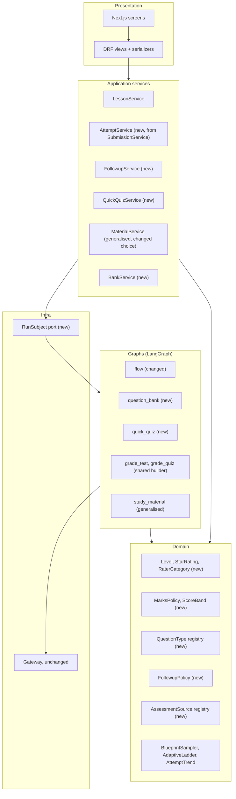
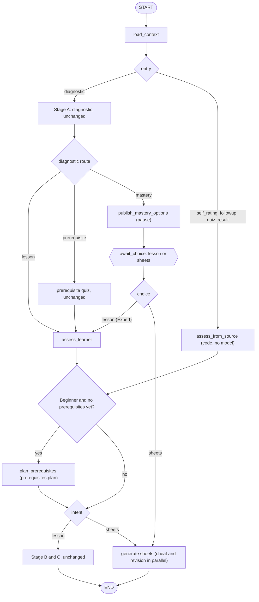
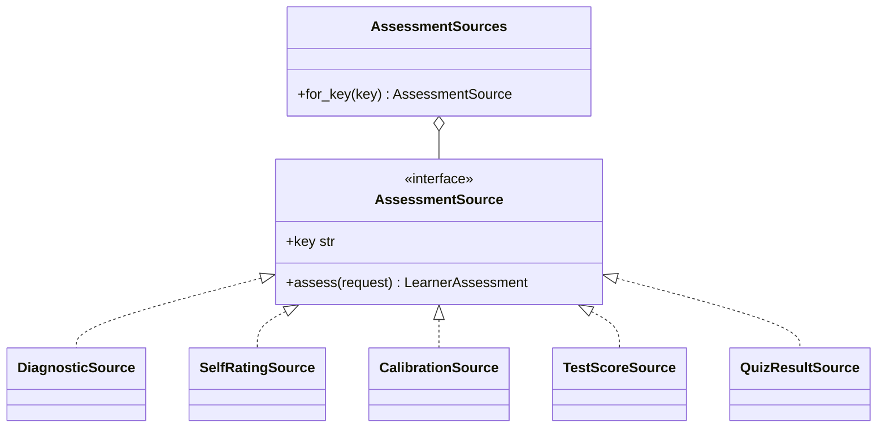
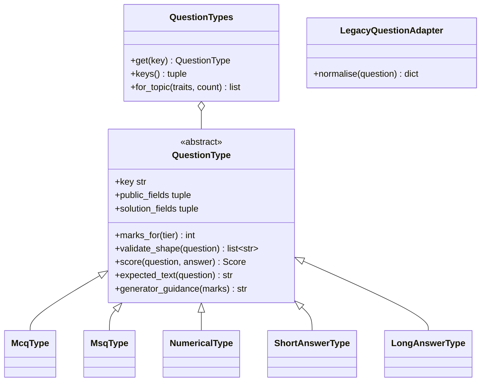
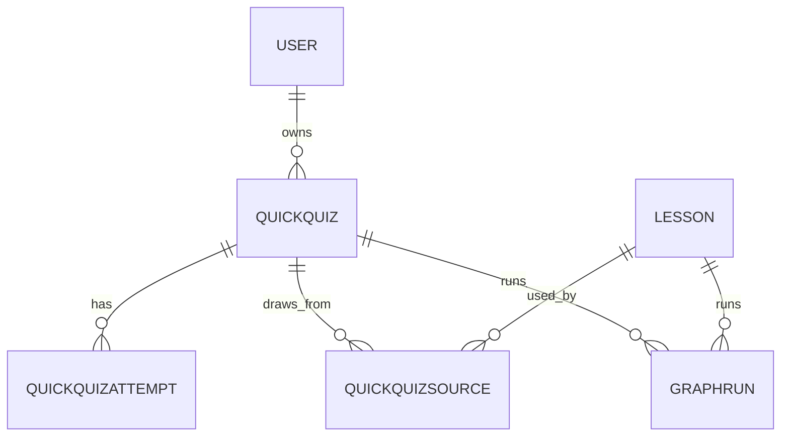
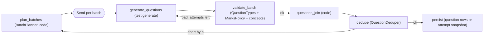
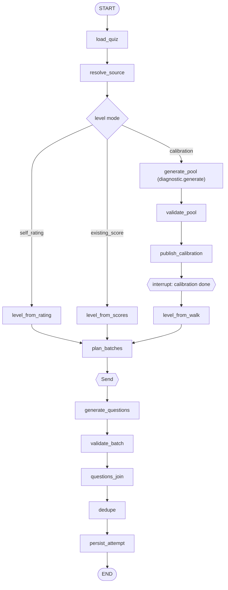
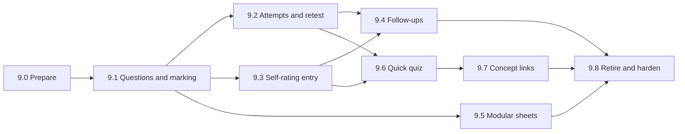

# Implementation plan: Modular Lesson Parts

**Spec:** [modular-lessons.md](modular-lessons.md) (finalized 2026-10-26)
**Status:** Plan. Phase 9.0 is built (branches `refactor/levels`, `refactor/run-subject`, `refactor/action-gate`); phases 9.1 to 9.8 are not started.
**Last updated:** 2026-10-30 (third pass: doc fixes before phase 9.0, see the [changelog](#changelog))
**Checked against:** the code and docs on branch `refactor/docs-layout` (Phases 0 to 8 built).

This plan says what has to change to build the spec on top of today's Socra: architecture, database, API, graphs, marking, frontend, console, tests and docs. It also lists the places where the spec cannot be built as written, or where a different solution is cheaper and safer. Those are in [section 3](#3-where-the-spec-needs-rethinking) and [section 4](#4-decisions-needed). The product decisions in section 4 are now **confirmed** (D13 to D23); the technical ones are made and listed in [D24](#d24-technical-decisions-made-in-the-second-pass).

## Changelog

Third pass, 2026-10-30 (branch `docs/spec-fixes`, before phase 9.0 starts). Docs only.

| # | Change | Sections touched |
|---|---|---|
| C19 | Spec §4 and this plan agree on retakes: every retake generates a fresh 10-question set, excluding every question already asked. The "bank generated once, topped up" paragraph is gone | Spec 4, R7, D20 |
| C20 | Spec §6.4 names the `ast`-based `ExpressionEvaluator` instead of `sympy` | Spec 6.4, R11 |
| C21 | Numerical marks (2 / 3) confirmed: the spec's open question is closed and the asterisk in §6.1 removed | Spec 6.1, 10 |
| C22 | Calibration starts at **standard**, not "medium" (the level was renamed in D14) | Spec 5.1 |
| C23 | **Star sentences approved.** 0.5 is "This is completely new to me." and 1 is "I've heard the name, but I don't know what it means."; every other sentence is approved as drafted and the "draft" markers are removed. The spec now carries the full table | Spec 2.2, 11.1, D23, C11 |
| C24 | **Blank-attempt rule decided:** an attempt with every answer blank is stored and scores 0, but does not count toward the Foundation offer | 8.2, 13, 15.1 |
| C28 | **Decisions from the 9.0 report.** (a) T19/C26 is settled with a **version marker**: every newly written assessment and plan, and the flow state, carries `level_scheme: 2`; with it `Level.parse` is used, without it the data is legacy and `Level.parse_legacy` is. The data migration rewrites database rows to the new names and adds the marker; graph checkpoints are not rewritten, so their missing marker routes them to `parse_legacy`. (b) `ActionRefused` stays `403`; a credits feature will use `402`. (c) Star sentence 1.5 is now "I have a rough idea what it is, but I couldn't explain it." (spec 2.2, 11.1) | D24 T19, 6.1, 7.1, 11.1 |
| C25 | Phase 9.0 deferral, recorded here so it is not forgotten: the `GraphRun.quick_quiz` foreign key and making `GraphRun.lesson` nullable land with the `quizzes` app in 9.6, not in 9.0. In 9.0 `RunSubject` is a property over the existing `lesson` column | 5.3, 7.6, 14 (9.0) |
| C26 | Found while building 9.0: `beginner` is ambiguous between the old and new level names. `Level.parse` and `Level.parse_legacy` are separate readers; how 9.1 tells old data from new is open (D24 T19) | R2, D24, 6.1 |
| C27 | **Phase 9.0 built.** Where the build differs from, or adds to, this plan: (a) the open gate's authorization is `tracked=False` and is **not stored** on the run, so payloads are unchanged with the default gate (a stored one would have changed every existing payload assertion); (b) `ActionContext` carries `completes_at`, and `CompletionPoint.reached(stage, ended)` takes whether the run ended, so the check stays pure; (c) `IdempotencyStore` gained `claim` and `release`, so two simultaneous requests with one key give `409 request_in_progress` instead of both running; the key is scoped to learner, endpoint and body; (d) an open authorization is **carried** into the prerequisite quiz's resume run (`ActionMetering.carry`) instead of being asked again, because the diagnostic's `lesson.continue` is not complete until the lesson is ready; (e) `ActionRefused` answers `403` for now (the plan left the status open); (f) only the three wired actions have completion points; `CompletionPoints.of` raises for the other four until their phases; (g) `RunSubject` gained `error`; (h) delete erases checkpoints and model calls **before** the lesson row, so a failed erasure can be repeated; (i) `Level.parse` and `Level.parse_legacy` are separate readers (T19) | 5.3, 5.5, 6.1, 6.7, D24 |

Second pass, 2026-10-29. The confirmed decisions below replace what the first pass assumed. Superseded decisions keep their number and say which decision replaced them.

| # | Change | Sections touched |
|---|---|---|
| C1 | **Mastery choice stays.** A perfect diagnostic no longer auto-routes to sheets or auto-builds a lesson: it shows the mastery choice with two options, "Continue with an Expert lesson" or "Cheat sheet + revision sheet only". `MasterySegment`, `MasteryChoice` and `POST /choice` are kept and changed (new router, new payload), and removed from the 9.8 retire list. Sheets stay available from any ready lesson | R5, D1 (superseded by D13), D13, 2, 5.2, 8.4, 9.3, 9.8, 11.5, 16, 17, 18.3 |
| C2 | **No sheet regeneration or versioning.** A second request for an existing kind is `409 already_exists`. Removed the `version` column, `?version=`, the versions list, the version switcher and versioning in phase 9.5 and the tests | 1, 7.5, 8.4, 11.5, 9.5, 15.2, D16 |
| C3 | **Quick quiz count is a preset** (5, 10, 15, 20, 25, 30), validated on the server (400 otherwise). Replaces "1 to 30" | 7.4, 8.5, 11.4, 12.1, D17 |
| C4 | **Short and long answers only at 10 or more questions.** `QuestionTypes.for_topic(traits, count)`; 400 for short or long on a 5-question quiz; the calibration quiz stays MCQ only | 6.4, 8.5, 9.5, 10.5, D17 |
| C5 | `question_batch_size` default **5**, admin range 5 to 10 | 12.1, D22 |
| C6 | **Five difficulty levels** (`easy`, `basic`, `standard`, `difficult`, `expert`). Normal tier = easy, basic, standard; Difficult tier = difficult, expert. Existing `easy/medium/hard` map to `easy/standard/difficult` by a data migration plus a tolerant reader. Rewrote R10, D2 (superseded by D14), `MarksPolicy`, `DifficultyMix` and their tests | R10, R21, D2, D14, 6.1, 7.1, 7.2, 7.7, 10.1, 15.1 |
| C7 | **The lesson test is fixed**: 10 questions, objective only (MCQ, MSQ, numerical), 2 per difficulty, for every lesson level. Lesson attempts are fully auto-graded at submit, so the band and the follow-up are decided in the same request. `grade_test` stays only for legacy lessons with open-ended questions; quizzes use `grade_quiz`. The blueprint is fixed (20 marks for quantitative topics, 18 for others) | R8, R20, D15, 5.2, 6.3, 6.6, 7.3, 8.2, 9.1, 9.3, 9.7, 12.1, 14 (9.2), 15 |
| C8 | **Combined quick quiz takes at most 10 source lessons.** Even split, remainder to the most recent lessons, `400` when the count is below the number of lessons, concept summaries only, with a stated token budget per source | 7.4, 8.5, 9.4, 11.4, 12.1, D18 |
| C9 | **Stop and Retry semantics.** Stop and backend failure release the stage's charge; the first diagnostic stage is kept once the quiz is served; **Retry re-authorizes as a resume (`resume: true`)**, so it never double-charges and may be refused | R22, 5.5, 6.7, 8.1, 13, 15.2, 16, D19 |
| C10 | **D9 decided:** keep both names, "Quick check" (diagnostic) and "Quick quiz" | D9, 17 |
| C11 | **Seven draft star sentences** (0.5, 1.5, 2, 2.5, 3.5, 4, 4.5), marked "draft, needs approval". *Approved in the third pass (C23).* | 11.1, D23 |
| C12 | **Metering seam widened** so a later pricing feature can tell the cases apart: new action `lesson.continue` (diagnostic submit, or the mastery choice); `test.retake` at attempt start for attempt 2 onward, with `test.bank_topup` folded into it; `Lesson.origin` as a `lesson.create` hint; `sheet.generate` hints gain grounding and sheet count; `ActionContext.key`; completion points | R23, R24, D20, 5.5, 6.7, 7.1, 8.1, 14 (9.0), 15.2, 16 |
| C13 | **Retakes always generate.** No spare set at lesson creation; the learner sees a "preparing questions" state. Legacy lessons get retakes on the new blueprint | R7, D20, 7.2, 7.3, 8.2, 11.2 |
| C14 | **Quick quiz difficulty mix per level** (table in D21) with **largest-remainder rounding** so every preset sums exactly. The learner can still override the inferred level | D21, 6.6, 8.5, 15.1 |
| C15 | **Subjective cap** (at most 1 long and 2 short per batch), a planner rule, off when the learner picked only short or long types | 6.6, 12.1, D22 |
| C16 | Technical decisions of this pass (band to difficulty map, completion points, one action per request, idempotency keys, verified `origin`, `generating` status, legacy backfill, code editor moved to 9.6, and others) | D24, 5.2, 5.5, 6.7, 7.1, 7.3, 9.1, 14 |
| C17 | **Spec amended**: `modular-lessons.md` edited to match the decisions above (nothing else in `docs/` outside this plan changes). Every edit is listed in [Spec amendments](#spec-amendments) | Spec amendments, 17 |
| C18 | Roadmap checklist and spec traceability table updated | 17, 18.3 |

### Spec amendments

Edits made to [modular-lessons.md](modular-lessons.md) in this pass (the credits document is untouched):

| Spec section | Was | Now |
|---|---|---|
| 1 Overview | "The 10/10 gate on cheat sheets and revision sheets is removed" | Sheets are available any time; a perfect diagnostic shows the mastery choice |
| 3.1 Entry | Lesson test not described | The final test is fixed: 10 objective questions, 2 per difficulty |
| 5.1 step 2 | "1 to 30, default 10" | Presets 5, 10, 15, 20, 25, 30 (default 10) |
| 5.1 step 3 | Five types for any count | Short and long answers only for 10 or more questions; calibration is MCQ only |
| 5.1 step 1 | "one or more existing lessons" | At most 10 |
| 5.2 | Even distribution across lessons | Even split, remainder to the most recent lessons, count at least the number of lessons |
| 6.1 | Difficulty names implied | Five difficulty levels and two mark tiers |
| 7 | "Regenerating a sheet creates a new version" and the 10/10 sentence | Sheets are generated once per kind; a perfect diagnostic shows the mastery choice |
| 8 | `version` on `Sheet` | Removed |
| 4 | "A question bank generated once, topped up when low" | Every retake generates a fresh 10-question set, excluding every question already asked |
| 5.1 step 4 | "Start at medium" | "Start at standard" |
| 6.1 | Numerical marks marked unconfirmed (`2*`, `3*`) | Confirmed 2 / 3, asterisk and footnote removed |
| 6.4 | "computes it (e.g. with `sympy`)" | The `ast`-based `ExpressionEvaluator` |
| 10 | Open question: numerical base marks | Closed, confirmed |
| 2.2 | Three example star sentences | The full table of ten approved sentences |

## Contents

0. [Changelog](#changelog)
1. [Summary](#1-summary)
2. [Why this is good for the project](#2-why-this-is-good-for-the-project)
3. [Where the spec needs rethinking](#3-where-the-spec-needs-rethinking)
4. [Decisions needed](#4-decisions-needed)
5. [Architecture changes](#5-architecture-changes)
6. [Object design](#6-object-design)
7. [Database changes](#7-database-changes)
8. [API changes](#8-api-changes)
9. [Graph and model-registry changes](#9-graph-and-model-registry-changes)
10. [Marking scheme](#10-marking-scheme)
11. [Frontend changes](#11-frontend-changes)
12. [Console, settings and operations](#12-console-settings-and-operations)
13. [Security, cost and abuse](#13-security-cost-and-abuse)
14. [Rollout: phases, order, exit criteria](#14-rollout-phases-order-exit-criteria)
15. [Test plan](#15-test-plan)
16. [Risks](#16-risks)
17. [Docs to update](#17-docs-to-update)
18. [Appendix: what stays the same, file map, spec traceability](#18-appendix)

---

## 1. Summary

Today the lesson is one straight path with one exit door. A learner takes the diagnostic, gets a lesson, takes the final test **once**, and that is the end. A perfect diagnostic is the only way to get a cheat or revision sheet, and then no lesson is built at all. After this work a perfect diagnostic gives a **choice** (an Expert lesson, or the two sheets only), and sheets are available from any ready lesson.

The spec turns that path into parts a learner can use alone or together. Here is what it takes, in the order the work should land:

| # | Part | The biggest thing it needs |
|---|---|---|
| 1 | **Marking and question types** | A fixed marks table over five difficulty levels, a new MSQ type, expression-based numerical answers, point-valued rubrics (quizzes only). One class per question type instead of the `if kind ==` ladders that exist today |
| 2 | **Retest** | The test stops being one-shot. A `TestSubmission` becomes one of many attempts of a fixed 10-question objective test; each retake generates a fresh set through a shared pipeline |
| 3 | **Self-rating entry** | A second way into the lesson flow that skips the diagnostic, plus lesson shapes per level |
| 4 | **Follow-up lessons** | Lesson links, a pure pop-up policy, and a safe "generate once" endpoint |
| 5 | **Modular sheets** | Sheets from a topic or any lesson, both at once, no gate, generated once per kind (no versions) |
| 6 | **Quick quiz** | A new aggregate and graph, which means `GraphRun` can no longer assume every run belongs to a lesson |
| 7 | **Concept tags and deep links** | Pages carry concept tags, and quiz recommendations link to them |

Parts 1 and 2 are the foundation. Part 4 needs parts 2 and 3, and part 6 needs parts 1, 2 and 3. [Section 14](#14-rollout-phases-order-exit-criteria) has the order.

The plan adds **no new infrastructure**: same Django, DRF, Celery, LangGraph, Postgres and Redis. It adds one new Django app (`quizzes`), one or two frontend packages for a code editor ([section 11](#11-frontend-changes)), and two new registry nodes ([section 9](#9-graph-and-model-registry-changes)).

It also leaves one deliberate **extension seam**: every action that starts paid model work goes through a small `ActionGate` port that allows everything by default ([section 5.5](#55-extension-seam-for-metering)). A credit or quota system can then be added later by supplying a different gate, without reshaping any of these features. No such system is designed or assumed here.

---

## 2. Why this is good for the project

**It closes the learning loop.** Today a failed test is a dead end and a passed one is too. With retests and follow-ups, Socra reacts to the result: weak result, easier lesson; strong result, harder lesson; try again with new questions. This is the difference between a lesson generator and a tutor.

**It makes the product cheaper to run.** Three examples:

- The self-rating path skips `diagnostic.generate`, `diagnostic.review` and `learner.assess`. That is the biggest first call plus a judge plus an assessment, and a wait of about a minute before the learner sees anything. It adds at most one small call (`prerequisites.plan`, section 9).
- A retake is generated only when a learner actually retests, and no spare set is made up front. Most learners never retest.
- One shared question pipeline (generate, validate, dedupe, grade) serves the final test, retests and quick quizzes, so each improvement to question quality is made once.

**It removes dead ends.** A learner who rates themselves an expert no longer has to sit a 10-question quiz. A learner who aces the diagnostic no longer has the lesson decided for them: they choose an Expert lesson or the two sheets only (see [D13](#d13-the-mastery-choice-stays)).

**It fixes real weaknesses in today's code on the way**, which the project would want fixed anyway:

- the `if kind ==` ladders in `AnswerGrader.grade`, `TestQuestion._fields_for_type` and `QuestionRules.problems`, which the [refactor backlog](../architecture/design.md#refactor-backlog) already lists as open;
- marks chosen by the model per question (`marks: int = Field(ge=1, le=20)`), which makes scores incomparable between tests;
- the roadmap item "server-side enforcement of the one-question-at-a-time rule", which attempts with server-side state make natural to close (section 8);
- `GraphRun` assuming a lesson, which has to be loosened for any future feature.

**It keeps the codebase's rules.** Every part below is a new class behind an existing seam (a Strategy registry, a Segment, a Protocol port, a NodeSpec). Nothing needs a new framework.

**It is ready for metering.** Because each costly action has one named entry point, usage limits or credits can be added later at those points instead of by searching for every place a model is called.

**What it costs:** a large number of files (dozens across backend and frontend, see [section 18](#18-appendix)), two risky refactors (`GraphRun` subject and question types), and more model spend per active learner. [Section 16](#16-risks) and [section 13](#13-security-cost-and-abuse) cover how to contain them.

---

## 3. Where the spec needs rethinking

Each row is a place where building the spec literally would cause a problem. "Recommendation" is what this plan assumes.

| # | The spec says | What the code and docs show | Recommendation |
|---|---|---|---|
| R1 | A new `LearnerProfile` object that every generator consumes (section 2.1) | `graph/profile.py` already has a class called `LearnerProfile`: the **account** profile (education level, goal, language). The spec's object is what the code calls **`LearnerAssessment`** (level, known concepts, gaps, start point, confidence) | Do not add a second concept. Extend `LearnerAssessment` with a `source` and build it from interchangeable **assessment sources** (diagnostic, self-rating, calibration, test score, quiz result). In docs, say "assessment". Section 6.2 |
| R2 | Levels are Beginner, Foundation, Proficient, Expert | The code uses `novice`, `beginner`, `intermediate`, `advanced` in `LessonPlan.level`, `LearnerAssessment.level`, `Lesson.level`, the prompts, the level meter and the journey tag. "Foundation" is also a follow-up kind, and the route is already called "Foundations first" | One `Level` value object with a tolerant reader (`Level.parse("novice")` gives Beginner). Map old to new by position (novice to Beginner, beginner to Foundation, intermediate to Proficient, advanced to Expert). Checkpointed graph state cannot be migrated, so the reader is needed even after a data migration. Section 6.1 and [D4](#d4-level-names) |
| R3 | Lesson shape differs per level: "Prerequisites, Intro, Core", "Core as page 1, Advanced, Expert depth" | Three page slots (`introduction`, `core`, `advanced`) are a fixed constant (`PAGE_KEYS`) in the schemas, validators, fan-outs, compile step, document assembler, sandbox `LessonShell` (`Page_core`), render check, PDF and the index flaps. Page TSX and `code_parts` are stored under those keys | **Keep three slots with stable keys; change what each slot holds and what it is called.** A `LessonShape` strategy per level gives each slot a role, and the page title (already in `PageContent.title`) becomes the label. No sandbox or stored-data change. Variable page counts are a much bigger change for little gain. [D11](#d11-page-slots) |
| R4 | A Beginner lesson starts with prerequisites | Prerequisites are generated **together with the diagnostic** (`DiagnosticBundle.prerequisites`). A self-rated learner has no bundle | A small `prerequisites.plan` node, run only for Beginner on non-diagnostic entries. Cheaper and cleaner than stretching `lesson.plan` |
| R5 | "The 10/10 gate is removed", "10/10 triggers a suggestion" (sections 1 and 7) | The gate is the **diagnostic**, not the final test: a perfect diagnostic routes to `mastery`, skips the lesson and the test entirely, and offers one of three sheets (`AwaitChoiceNode` accepts only sheet kinds). Mastery lessons have no test (`SubmissionService._questions` refuses them) | **Confirmed ([D13](#d13-the-mastery-choice-stays)): the mastery choice stays**, with two options: "Continue with an Expert lesson" or "Cheat sheet + revision sheet only". Sheets are also available from any ready lesson at any time. Because the choice node only leads to sheet generation today, `MasterySegment` is **changed** (a router, a new payload, an exit to the lesson), not kept as is. Anything else the spec attaches to a perfect score is specified separately and is outside this plan |
| R6 | A lesson's test is retaken "any number of times", each attempt immutable | `TestSubmission` has `UniqueConstraint(lesson)`, `submitted_at` is `auto_now_add`, the test lives in `Lesson.final_test`, and the UI says "One attempt" and "Your test is final" in about eight places | Evolve `TestSubmission` into the attempt (keep the model and URL names, so grading, effects and `GraphRun.payload` keep working). Add `attempt_no`, a `questions` snapshot, `started_at`, `in_progress`. Section 7 |
| R7 | A question bank "generated once", topped up when low | With a fixed 10-question blueprint, attempt 1 uses the whole first set, so **every retake needs 10 new questions**. A bank that is drawn from would be empty each time, and generating a spare set up front would double the cost of every lesson for the few learners who retake | Attempt 1's questions are generated as today (in batches). A retake **always generates** a fresh set through the same pipeline, with an exclusion list of every question the lesson has asked. `Question` rows are the record of past questions (and any unserved leftovers), not a stock. No spare set ([D20](#d20-retakes-always-generate-and-one-action-covers-them)). Section 9.3 |
| R8 | "Never generate all questions in one call", with `Send` batches | The final test is written by one call per attempt (`WriteTestNode`), validated against the plan's `FinalTestSpec`, and retried "alone" by `AuthoredJoinNode` | Move the final test to batches too, with a `BatchPlanner` that gives each batch an explicit list of cells (type, difficulty). The blueprint is now **fixed** ([D15](#d15-the-lesson-test-is-fixed)): 10 cells, so the default batch size of 5 makes two calls. The union is correct by construction and the validator keeps a totals check; the model no longer chooses the mix, so `LessonPlan.final_test` is dropped for new lessons |
| R9 | Marks come from a fixed table | Today the model assigns `marks` (1 to 20) per question, and numbers differ between tests. A fixed blueprint only gives comparable percentages if marks are fixed | `MarksPolicy` sets marks **in code** from type and difficulty, **before** generation, so the prompt can say "this question is worth 3, write a rubric that adds up to 3". The LLM-facing schema no longer carries `marks` |
| R10 | "Difficult or Expert difficulty levels" | The code has three difficulties: `easy`, `medium`, `hard`, stored in the lesson's test, in practice sheets and in the plan's `difficulty_mix` | **Five levels** (confirmed): `easy`, `basic`, `standard`, `difficult`, `expert`. Normal tier is the first three, Difficult tier the last two. Old `medium` becomes `standard` and `hard` becomes `difficult`, by a data migration plus a tolerant reader. [D14](#d14-five-difficulty-levels) (supersedes [D2](#d2-difficulty-names)) |
| R11 | Numerical answers are an **expression** the backend computes "e.g. with `sympy`" | `sympify`/`parse_expr` run `eval` on the string. The string is written by a model that read user-supplied text | Do not hand LLM output to an `eval`-based parser. Use a small `ExpressionEvaluator` over Python's `ast` with a whitelist of nodes and functions, size and exponent limits. Section 10.4 |
| R12 | `decimal_precision`: "how many decimal places are accepted (or integer-only)" | Not defined how it interacts with `tolerance` (today: absolute, inclusive) | Precision describes the **expected answer's** rounding and the input hint, never rejects an input. Integer-only means the expected answer is whole and the field shows no decimal point. [D3](#d3-numerical-details) |
| R13 | Code questions fall under Short and Long | The code has a separate `code` type with `language`, `starter_code`, `reference_solution` and `test_cases` (never executed). Stored lessons contain them | Keep an `answer_format` (`text` or `code`) on short and long questions. A `LegacyQuestionAdapter` reads old `code` questions as long answers in code format. Lesson tests are objective only now, so code appears only in quick quizzes of 10 or more questions, and the code editor ships with the quiz phase. [D10](#d10-code-questions) |
| R14 | Quick quiz is "a separate LangGraph flow" and also has a topic-only mode with no lesson | `GraphRun.lesson` is a required foreign key. The runner (`thread_id`), `StopPoint`, `RunEffects`, `has_active_run`, SSE, Stop/Retry, the console runs list and `ModelCall.lesson_id` all assume a lesson | Add a **`RunSubject` port** and make `GraphRun` point at exactly one of `lesson` or `quick_quiz`. A lesson-shaped container for quiz runs would be quicker but turns `Lesson` into a god table. Section 5.3 |
| R15 | The sketch has a `Topic` root above `Lesson` (section 8) | No `Topic` table exists; topic is a string on `Lesson`. None of the features needs one: follow-ups are linked by `created_from_lesson`, quizzes by lesson ids or a topic string | Skip `Topic` until a learning-path view needs it. Record this as a deliberate difference from the sketch |
| R16 | Calibration quiz: 5 adaptive MCQs "go harder after a correct answer" | Generating each next question after the previous answer would mean five model waits in a row | Generate one **pool** up front (the existing diagnostic's 2 questions in each of 5 bands) and let a pure `AdaptiveLadder` pick the next question from it. Zero extra waits, no new generation prompt. Section 9.4 |
| R17 | "Only topic-relevant types are shown" before the quiz exists | Needs a judgement about the topic before generation, and the screen needs it at once | A request-time model call is rare in this codebase, but `onboarding.suggest_topics` is the precedent: optional node, cached, never blocks. Add `topic.traits` on the same pattern; on failure show every type. Section 9.5 |
| R18 | Recommendations "deep link to the lesson page covering each weak concept" | Question `concept` strings are free text written by the model; page concepts are written elsewhere. Matching them would be fuzzy. Pages are shown in a sandboxed iframe that renders one page at a time and has no section anchors the app controls | When a quiz is built **from a lesson**, give the generator the lesson's concept list and require `concept` to be one of them (validator). Link at **page** level first; section anchors later. Section 9.6 |
| R19 | A follow-up's name is "generated by the model" | The name is needed immediately, to check for collisions and to find "already exists". `POST /lessons` must return at once and no request calls a model | Set the lesson `topic` from a deterministic template ("Foundations of X", "Advanced X") when the follow-up is created; let the existing `lesson.plan` write the display `title` in the same style. Name collisions get a suffix, never a silent re-link. [D6](#d6-follow-up-name-collisions) |
| R20 | `has_passed_once` and the band both depend on the score | Today open-ended answers are graded later by `grade_test`, so a score is provisional until then | **Simplified.** A lesson attempt is objective only, so it is graded in full at submit; its band and its follow-up offer are decided in the same request and stored on the attempt. Only a **legacy** attempt with open-ended questions is graded later (then the same `AttemptOutcome` service decides the offer). A failed grading offers none. Quizzes have no pop-up. Score bands use integer comparisons on marks, not rounded percentages (90.4% is excellent; a rounded 90% would not be) |
| R21 | Difficulty names (`easy`, `basic`, `standard`, `difficult`, `expert`) | The diagnostic already has **bands** called `basic`, `easy_moderate`, `moderate`, `moderate_hard` and `hard`, stored on its questions and used by `RoutingPolicy` (`by_band["hard"]`). The words overlap but mean different things | Keep both vocabularies and add an explicit `BandDifficulty` map (basic band to `easy`, `easy_moderate` to `basic`, `moderate` to `standard`, `moderate_hard` to `difficult`, `hard` to `expert`). The five bands map one to one, which is what the calibration pool needs (section 9.4). Nothing renames the diagnostic's bands |
| R22 | Stop and backend failure release the charge; Retry never authorizes (decision 9 as first stated) | Both together let a learner start paid work, press Stop (released) and Retry (not authorized) and get the work for free. `FlowRunner._fail`, `LessonService.cancel` and `RunEffects.on_stopped` already see every such end | **Retry re-authorizes as a resume** (`resume: true`). The earlier hold was released, so the learner is never charged twice, and a Retry may be refused for lack of balance. [D19](#d19-stop-failure-and-retry) |
| R23 | A recommended lesson is priced differently later | `POST /lessons` has no field for where the request came from, and a client-supplied flag could be claimed by anyone | `Lesson.origin` (`direct`, `recommendation`, `followup`, `quiz_result`) is set by the **server**: `recommendation` needs a reference to the learner's own graded attempt and a topic from its `topics_to_revisit`; `followup` only through `FollowupService`; `quiz_result` only with a quiz attempt the caller owns. Otherwise `400`. [D24](#d24-technical-decisions-made-in-the-second-pass) |
| R24 | A card or retake "creation" with a retry or double click | Today `POST /lessons` has no idempotency, so a double click makes two lessons | An optional `Idempotency-Key` header on creation endpoints (a small Redis-backed store), passed to the gate as `ActionContext.key`, so a replayed request returns the first response and never authorizes twice. Phase 9.0 |

---

## 4. Decisions needed

**Status:** D1 and D2 are **superseded** (by D13 and D14). D13 to D23 are product decisions **confirmed** on 2026-10-29. D24 lists the technical decisions made in this pass. D3 to D12 stand as written, except D9, which is now decided.

### D1. What the ten-out-of-ten rule means

**Superseded by [D13](#d13-the-mastery-choice-stays).** The first pass recommended that a perfect diagnostic build an Expert lesson automatically and that the mastery path be retired. That was rejected: the mastery choice stays.

### D2. Difficulty names

**Superseded by [D14](#d14-five-difficulty-levels).** The first pass recommended four names (`easy`, `medium`, `hard`, `expert`).

### D3. Numerical details

1. Base marks: 2 normal, 3 difficult (the spec's proposed default; this closes the spec's one open question).
2. `tolerance` stays absolute and inclusive, as today.
3. `decimal_precision` (0 to 6) tells the generator how to round the expected answer and tells the input how many decimals to hint. It never rejects input. `0` means the expected answer is a whole number.

### D4. Level names

**Recommendation:** user-visible names Beginner, Foundation, Proficient, Expert. Stored values `beginner`, `foundation`, `proficient`, `expert`. Rename "Foundations first" (the prerequisite route) in the UI to "Basics first", so "Foundation" has one meaning for learners.

### D5. Follow-up target levels

**Recommendation:** a Foundation follow-up is built at **Beginner**, an Advanced follow-up at **Expert**. It is predictable, matches the names, and keeps chains short: a Beginner who fails gets the inline suggestion, and an Expert who excels gets nothing, so follow-ups of follow-ups stop on their own. The alternative (one step below or above the parent's level) is easy to switch to, because the target is one method on `FollowupPolicy`.

### D6. Follow-up name collisions

The spec allows "reuse that lesson or add a suffix".

**Recommendation:** add a suffix ("Advanced Trigonometry (2)"). Re-linking a lesson the learner made on their own would attach the wrong level and score history to it.

### D7. Existing test score as a level

The spec says "existing test score: level (per lesson)" but not how.

**Recommendation:** use the **latest graded** attempt, and shift the lesson's own level: Excellent moves one level up (to a maximum of Expert), Fail one level down (to a minimum of Beginner), Normal keeps it. A 90% on a Beginner lesson does not make someone an Expert in the topic; the shift says what the spec's pop-ups already say.

### D8. The practice sheet

The code has three sheet kinds (cheat, revision, practice). The spec has two.

**Recommendation:** keep existing practice sheets readable, stop offering a new one in the sheet picker, and point those learners to Quick quiz, which does the same job with real marks and history.

### D9. "Quick quiz" and "Quick check"

`CLAUDE.md` fixes "Quick check" as the diagnostic. "Quick quiz" is close enough to confuse.

**Decided:** keep both names. "Quick check" stays the diagnostic and "Quick quiz" is the new feature; rename nothing that exists, and put both words on the new-lesson screen with one line each. If learners confuse them, "Practice quiz" is the fallback, and it is one string table in `lib/`. `CLAUDE.md`'s copy rule gains the second term (section 17).

### D10. Code questions

**Recommendation:** as R13. New generation produces only the five spec types; code is a format flag.

### D11. Page slots

**Recommendation:** as R3. Keep the keys, change the roles.

### D12. Server-side forward-only

**Recommendation:** include it. Starting an attempt creates server state anyway, so the answer endpoint can lock each question as it is answered. This closes the open roadmap item, gives resume after refresh, and makes "time taken" trustworthy. Section 8.

### D13. The mastery choice stays

A diagnostic that passes the existing mastery rule (full marks by default; the `mastery_requires_all_correct` setting stays in `FlowSettings` and the console, and `mastery_min` stays in the routing thresholds the console shows) shows the existing mastery choice with two options:

1. **Continue with an Expert lesson.** The flow goes on to `assess_learner` (the level is set to Expert), then `plan_lesson`. The lesson's route becomes `lesson`, so it has a test like any other.
2. **Cheat sheet + revision sheet only.** Both sheets are written in parallel, grounded in the diagnostic's concepts. The lesson ends `ready` with route `mastery` and no test.

Sheets are also available from **any ready lesson at any time** (`POST /lessons/{id}/materials`, section 8.4); the route test in `MaterialService.request_extra` goes away. What changes in code: the choice payload is `{choice: "lesson" | "sheets"}`, a `ChoiceRouter` follows `await_choice`, and the sheet nodes fan out for two sheets (section 5.2). Lessons already waiting at the old three-sheet choice still resume: `AwaitChoiceNode.accept` keeps the three legacy kinds. A sheets-only request from a topic (`intent=sheets`) skips both the mastery choice (the learner already chose sheets) and the prerequisite quiz (there is no lesson to prepare for).

### D14. Five difficulty levels

`easy`, `basic`, `standard`, `difficult`, `expert`, as one `Difficulty` value object with a tolerant reader. **Mark tiers:** Normal is `easy`, `basic`, `standard`; Difficult is `difficult`, `expert`. Existing `easy/medium/hard` map to `easy/standard/difficult` by a reversible data migration over every stored place a difficulty lives (section 7.7), and the reader accepts the old names so checkpointed graph state and old clients still work. The reverse migration maps `basic` to `easy` and `expert` to `difficult`'s old name `hard`, which loses detail only for rows written after the release.

### D15. The lesson test is fixed

For every lesson level: **10 questions, objective only (MCQ, MSQ, numerical), 2 per difficulty.** The blueprint is fixed, and the model no longer chooses the mix. The type split per difficulty:

| Difficulty | Quantitative topic | Other topics |
|---|---|---|
| easy | MCQ, MCQ | MCQ, MCQ |
| basic | MCQ, MSQ | MCQ, MSQ |
| standard | MCQ, numerical | MCQ, MSQ |
| difficult | MSQ, numerical | MSQ, MCQ |
| expert | MSQ, numerical | MSQ, MCQ |
| **Marks** | **20** (2 + 3 + 3 + 6 + 6) | **18** (2 + 3 + 3 + 5 + 5) |

`lesson.plan` returns a `quantitative` flag; the topic traits call is not needed for lessons. Attempts are compared **only within the same lesson**, where the total is identical. Consequences: lesson tests are fully auto-graded at submit; `grade_test` stays only for legacy lessons with open-ended questions; the band and the follow-up are decided at submit.

### D16. Sheets are not versioned

A second request for a sheet kind that exists is `409 already_exists`. There is no version column, no `?version=`, no versions list and no version switcher. A request for both sheets while one exists is also a `409` that names the kinds that exist; the client then asks for only the missing one.

### D17. Quick quiz size and question types

The question count is a preset: **5, 10, 15, 20, 25 or 30** (default 10), validated on the server (`400` otherwise). **Short and long answers are allowed only at 10 or more questions**: `400` for either on a 5-question quiz, and the wizard hides them. The calibration quiz stays MCQ only. `QuestionTypes.for_topic(traits, count)` returns the offered types.

### D18. Combined quick quiz

At most **10 source lessons**. Questions are split evenly; the remainder goes to the **most recent lessons by creation date**, one extra each. The count must be at least the number of lessons (`400` otherwise, so no lesson contributes nothing), and the wizard hides counts below the number of selected lessons. Each lesson's questions use that lesson's own level. The generator is given **per-lesson concept summaries built in code from the stored outline, never lesson text**, within a budget of **1,500 tokens per source** (setting `quiz_source_token_budget`, estimated as characters divided by four; the lowest-priority concepts are dropped first). Each batch receives only the summaries of the lessons it covers, so a call carries at most a few thousand tokens of source.

### D19. Stop, failure and Retry

- A paid stage's authorization **settles at its completion point**. `lesson.create` for a diagnostic entry completes when the quiz is served (`awaiting_diagnostic`), so that charge is **kept** from then on even if the learner never answers. `lesson.continue` and a self-rated `lesson.create` complete when the lesson is `ready`; a retake or quiz when the attempt reaches `in_progress`; a sheet when it is saved.
- **Stop** before the completion point settles `cancelled`, and a **backend failure** settles `failed`. Both release.
- **Retry** (and carrying on after a Stop) is the same action again: the service re-authorizes it with `resume: true`, once, before it creates the run. The earlier hold was released, so nothing is charged twice. If the gate refuses, the lesson stays failed, the Retry card shows the standard refused message, and nothing is created.
- A pause before the completion point (the prerequisite quiz, the calibration walk) is not a settlement. Deleting a lesson or quiz settles any open authorization as `cancelled`.
- The small extra-sheet graph has no Retry, so a failure releases and a new request authorizes fresh.

### D20. Retakes always generate, and one action covers them

Because every retake needs a full new set, the old `test.bank_topup` action is **folded into `test.retake`**: the learner orders a retake, never a top-up, so one price point and one authorization cover the generation. `test.retake` is asked when a learner starts attempt **2 or later**; attempt 1 is part of the lesson. If the generation fails or is stopped, the authorization settles `failed` or `cancelled` and the `generating` attempt row is removed. No spare set is generated at lesson creation: a retake shows a "preparing questions" state.

### D21. Quick quiz difficulty mix by level

The default share of each difficulty (easy / basic / standard / difficult / expert, percent):

| Level | easy | basic | standard | difficult | expert |
|---|---|---|---|---|---|
| Beginner | 30 | 40 | 20 | 10 | 0 |
| Foundation | 10 | 30 | 40 | 20 | 0 |
| Proficient | 0 | 10 | 40 | 30 | 20 |
| Expert | 0 | 0 | 20 | 40 | 40 |

`DifficultyMix.for_level(level, count)` uses **largest-remainder rounding** so every preset count sums exactly; ties go to the easier difficulty. The table is a code constant. The learner can still **override the inferred level**: the wizard defaults to the lesson's test score when every source lesson has a graded attempt and to self-rating otherwise, and the learner can pick any other level mode.

### D22. Subjective cap

Adopted as a `BatchPlanner` rule: at most **1 long and 2 short answers per batch** (settings `batch_max_long`, `batch_max_short`), so a quiz cannot be all subjective by accident. The cap is **off when the learner picked only short or long types**, since it would otherwise block their choice. `question_batch_size` defaults to **5** (admin range 5 to 10).

### D23. Star rating sentences

**Approved** (third pass). The spec carries all ten sentences in §2.2 and section 11.1 repeats them. 0.5 is "This is completely new to me." and 1 is "I've heard the name, but I don't know what it means."; the rest are as drafted in the second pass.

### D24. Technical decisions made in the second pass

| # | Decision | Why |
|---|---|---|
| T1 | `BandDifficulty` map between the diagnostic's bands and the five difficulties (R21) | Two vocabularies, one explicit bridge |
| T2 | A `CompletionPoint` on each `Authorization` and a finish hook next to `on_stopped` in `RunEffects`; delete settles `cancelled` | Run end is the wrong moment: a run can pause halfway (D19) |
| T3 | `lesson.continue` is asked in `QuizService.submit` after the pure grading and before the attempt row is written (not perfect, or `intent=sheets`), and in `MaterialService.choose` for a perfect score | A perfect score has no choice yet at submit. An unanswered diagnostic never reaches it |
| T4 | One action per creation request: `POST /lessons` is `lesson.create`, `POST /lessons/{id}/materials` is `sheet.generate` | Two actions on one request would authorize twice |
| T5 | `ActionContext.key`, with the new row's id generated before `authorize`, and an optional `Idempotency-Key` header (R24) | A replay or rollback must not authorize twice |
| T6 | `Lesson.origin` set by the server and verified (R23) | The client cannot claim a variant |
| T7 | `test.bank_topup` folded into `test.retake` (D20) | One order, one authorization |
| T8 | Lesson attempts gain a `generating` status; one open attempt is `generating` or `in_progress` | The retake's authorization needs a row, and a double click must not draw two sets |
| T9 | Legacy test questions are backfilled as **retired** `Question` rows (exclusion list only). Attempt 1 of a legacy lesson with no submission snapshots `final_test` directly | Old marks do not fit the policy, but old stems must not repeat |
| T10 | One `AttemptOutcome` service decides the band and the follow-up. Submit calls it; the legacy `grade_test` run calls it | One rule, two callers |
| T11 | `LessonPlan.final_test` is dropped from the model's output for new lessons (optional for old plans); `final_test_min/max` and the console row are retired; `LessonShape` loses the test bias; `lesson.plan` adds `quantitative` | The blueprint is fixed (D15) |
| T12 | A `ChoiceRouter` after `await_choice`; the mastery lesson's level is Expert (a clamp in `DiagnosticSource`); `intent=sheets` skips the choice and the prerequisite quiz | D13 |
| T13 | The code editor moves from 9.1 to 9.6 | Lesson tests have no code |
| T14 | Sheet `409` for both kinds names the existing kinds (D16) | One predictable error |
| T15 | Settings `quiz_source_token_budget` (1,500), `batch_max_long` (1), `batch_max_short` (2), `retakes_per_day` (3, renamed from `bank_max_topups_per_day`) | Admin-tunable guards |
| T16 | The data migration rewrites a stored `difficulty` wherever it is found (test, plan mix, practice sheets, stored results), with a scan test that fails on any leftover old name | A missed spot would break a legacy page |
| T17 | A failed or stopped `generating` attempt is **deleted** by a `RunEffect`, so the attempt number is never consumed | No gaps in the history |
| T18 | The diagnostic submit refuses before it stores anything; the learner's answers stay in the browser (session storage) until they resubmit | "Refusal creates nothing", and the one-attempt rule stays intact |
| T19 | **`beginner` is both an old and a new level name** (old: the second of four, now Foundation; new: the first). `Level.parse` takes it as the **new** Beginner; `Level.parse_legacy` maps the old four by position and is used only where the data is known to predate the rename. Found while building 9.0, and R2's "tolerant reader" cannot be one function. **Open for 9.1:** how a checkpointed value is known to be old (a one-off rewrite of the checkpoint state at deploy, a state version marker, or finishing every in-flight thread first) | One rule per vocabulary, and no silent change of level for a lesson mid-flight |

---

## 5. Architecture changes

### 5.1 What stays and what moves



Everything below the application layer is either new, or an existing class that gains a variant. The gateway, the registry, the sandbox, the media agent and the build stage (Stage C) are **not touched**.

### 5.2 The lesson flow graph, after

One thread per lesson stays. A router after `load_context` picks the way in; every way to a lesson ends in the same `plan_lesson`. The diagnostic keeps its three routes, and the perfect-score route keeps its pause, now with a two-way choice ([D13](#d13-the-mastery-choice-stays)).



For `intent=sheets` the diagnostic's prerequisite and mastery routes are skipped: the learner already chose sheets, so every score goes straight to `assess_learner` and then to `sheets_segment`.

What changes in the existing segments:

| Segment | Change |
|---|---|
| `DiagnoseSegment` | Its exit after `assess_learner` goes to `level_gate`. `LevelRouter` still sends a mastery-route score to `publish_mastery_options` (D13), except for `intent=sheets`, where it sends every score to `assess_learner` |
| `MasterySegment` | **Kept and changed.** `PublishMasteryOptionsNode` and `AwaitChoiceNode` stay; `AwaitChoiceNode.accept` takes `lesson` or `sheets` (and the three legacy sheet kinds for lessons already waiting). A new `ChoiceRouter` follows it: `lesson` goes to `assess_learner` and sets the lesson's route to `lesson`; `sheets` goes to the shared sheets nodes. The three-sheet pick and the practice sheet leave this screen |
| `AuthorSegment` | `plan_lesson` takes a `LessonShape` and no longer returns a test mix; `write_test` becomes the batched, fixed-blueprint pipeline (D15). Page keys unchanged |
| `BuildSegment` | Unchanged |
| New `EntrySegment` | `entry_router`, `assess_from_source`, `level_gate`, `plan_prerequisites`, `intent_router` |
| New `SheetsSegment` | Reuses the `study_material` generate, validate and persist nodes with a fan-out for two sheets; used by the mastery choice, by `intent=sheets`, and (as the small graph) by an extra sheet on a ready lesson |

`Stage` gains no new members for the lesson. One transition is added: `PREPARING_DIAGNOSTIC` may go straight to `GENERATING_LESSON` (self-rating skips the quiz), and to `GENERATING_MATERIAL` for a sheets-only lesson. `AWAITING_CHOICE` may now also go to `GENERATING_LESSON`.

### 5.3 Letting a run belong to something other than a lesson

Why this is needed: the quick quiz from a topic has no lesson, but it needs the machinery a lesson run has (queueing, progress events, Stop, a model snapshot, an owner).

A **`RunSubject` port** is the smallest honest fix:

```python
class RunSubject(Protocol):
    id: UUID
    owner_id: UUID
    stage: str                      # for StopPoint and the progress screen
    config_snapshot: dict
    settings_snapshot: dict
    def fail(self, error: str) -> None: ...
    def record(self, **fields) -> None: ...
```

- `Lesson` already fits. `QuickQuiz` is written to fit.
- `GraphRun` gets a nullable `quick_quiz` foreign key next to `lesson`, with a `CheckConstraint` that exactly one is set, and a `subject` property that returns whichever it is.
- `FlowRunner.thread_id`, `StopPoint`, `has_active_run`, `RunEffects`, `LessonService.cancel` and the console's runs list stop reaching for `run.lesson` and use `run.subject`. This is a behaviour-neutral refactor and lands **first and alone** ([phase 9.0](#phase-90-prepare-no-visible-change--m)), with the existing tests as its safety net.
- `ModelCall` gets a nullable plain `quiz_id` column (like `lesson_id`, not a foreign key) so usage stays attributable after a delete.

Alternatives considered:

| Option | Why not |
|---|---|
| Give each quick quiz a hidden `Lesson` | `Lesson` carries code, pages, plan, versions and a lesson-only stage machine. It would be a god table, and "My lessons" would need a filter everywhere |
| A second run table for quizzes | Duplicates `FlowRunner`, SSE, Stop and Retry, and the console would need two runs pages |
| A generic foreign key (content types) | Loses referential integrity and cascades, which the codebase relies on |

### 5.4 Package layout

New code goes where its module already lives. Only genuinely new areas get a new package.

| Area | Where | New or existing |
|---|---|---|
| Level, rater category, star rating, score band, marks policy, follow-up policy | `backend/graph/levels.py`, `scoring.py`, `followups.py` | New files, pure (no ORM), in the domain layer next to `grading.py` |
| Question types (one class each) | `backend/graph/questions/` | New package; replaces ladders in `grading.py`, `schemas/lesson.py`, `validators/questions.py` |
| Assessment sources | `backend/graph/assessment/` | New package |
| Lesson shapes | `backend/graph/shapes.py` | New |
| Question record, blueprint, planner, retake generation | `backend/lessons/bank.py` | New, application layer |
| Attempts | `backend/lessons/attempts.py` | Split out of `services.py` (`SubmissionService` moves here, renamed `AttemptService`) |
| Follow-ups | `backend/lessons/followups.py` | New |
| Quick quiz | new Django app `backend/quizzes/` (models, services, views, serializers, urls) | New. Own app, because it is a separate aggregate with its own routes |
| Quiz graph nodes and builder | `backend/graph/nodes/quiz.py`, `builders.py` | New nodes, builder added to `GraphRegistry` |
| Shared question nodes | `backend/graph/nodes/questions.py` | New; used by the author stage, the retake (`question_bank`) graph and the quiz graph |

`services.py` is already 557 lines holding five services; splitting out attempts keeps each file to one reason to change.

### 5.5 Extension seam for metering

A credit or quota system is a separate feature and is **not designed here**. This section only makes sure the features in this plan can be metered later without being reshaped, and that a later system can tell the cases apart (a quiz stage from a lesson stage, a first test from a retake, a recommended lesson from a direct one). The cost now is one small port, a default that allows everything, and a handful of call sites placed correctly.

**Rules**

1. Every action that starts paid model work is named once, in `MeteredAction`.
2. A **service** (never a view, never a graph node) asks the `ActionGate` before it creates any row or queues any run, and only on the *creation* path.
3. The answer travels with the run, together with the point at which the action is complete, so the gate can be told how the work ended (succeeded, failed, cancelled).
4. The default gate (`OpenGate`) allows everything and records nothing, so learners notice no change.
5. One request asks for exactly one action (T4).

**The actions**

| `MeteredAction` | Service that asks | Size hints the gate can see |
|---|---|---|
| `lesson.create` | `LessonService.create` | `entry` (diagnostic or self_rating), `intent` (lesson or sheets), `origin`, `covers` (`diagnostic` for the quiz stage only, `all` for a self-rated lesson), `sheets` (count, for `intent=sheets`), `grounding` (`quiz` or `none`) |
| `lesson.continue` | `QuizService.submit` (the diagnostic is not a perfect score, or `intent=sheets`) and `MaterialService.choose` (a perfect score) | `choice` (`lesson` or `sheets_only`), `perfect`, `intent`, `sheets`, `grounding` |
| `lesson.followup` | `FollowupService.create` | `followup_level`, `origin` is `followup` |
| `test.retake` | `AttemptService.start`, for attempt 2 and later | `question_count` (10), `attempt_no` |
| `quiz.create` | `QuickQuizService.create` | `num_questions`, `source_type`, `sources` (count), `level_mode`, `has_subjective` |
| `quiz.retake` | `QuickQuizService.retake` | `num_questions` |
| `sheet.generate` | `MaterialService.request_extra` | `sheets` (count), `grounding` (`lesson`, or `quiz` for a sheets-only lesson that has no pages) |

`test.bank_topup` of the first pass is **gone**: a retake always generates a full set, so its generation is part of `test.retake` ([D20](#d20-retakes-always-generate-and-one-action-covers-them)). Attempt 1 is part of the lesson and is never asked.

Where the diagnostic stages land: `lesson.create` with a diagnostic entry covers only the quiz stage (`covers: diagnostic`). Everything after the learner answers is `lesson.continue`, asked **inside `QuizService.submit`, after the pure grading and before the attempt row is written**, so an abandoned diagnostic never reaches it. A perfect score has no choice yet at submit time, so `lesson.continue` is asked later, in `MaterialService.choose`, with `perfect: true` and the choice (`lesson` or `sheets_only`). For `intent=sheets` the choice is known at submit, so submit asks with `choice: sheets_only` whatever the score. A self-rated lesson has no quiz stage: one `lesson.create` covers `all`.

Never metered, because they do not start new paid work or finish work already accepted: reads, answering and locking answers, submitting a lesson test (graded in full at submit), grading runs and regrading a failed grading, the calibration walk, Stop, version restore, runtime repair, delete (which settles any open authorization as cancelled). The cheap, cached `topic.traits` call is left to its throttle. If a later feature needs different choices, the table is the one place to change.

**Behaviour the seam must have**

- **Idempotent paths never ask.** Returning an open attempt (`generating` or `in_progress`), `409 already_exists`, a redelivered Celery task and a replayed `Idempotency-Key` do not call `authorize` again.
- **Refusal creates nothing.** The check happens before the first insert, in the same service call that would have created the row. For the diagnostic that means the answers are not stored; they stay in the browser and the learner can resubmit.
- **The authorization is stored on the run** in `GraphRun.payload["authorization"]` (already a JSON column, so **no schema change**), with its action, size hints, `resume` flag and `completes_at` (a completion point, below).
- **Completion points settle it, not run ends.** A run can pause halfway, so settlement is tied to a point: `lesson.create` (diagnostic) completes when the quiz is served; `lesson.continue` and a self-rated `lesson.create` when the lesson is `ready`; `test.retake`, `quiz.create` and `quiz.retake` when the attempt reaches `in_progress`; `sheet.generate` when the sheet is saved. A finish hook next to `on_stopped` in `RunEffects` reports `succeeded` when the point is reached; a flag in the payload makes the report exactly-once even if a task is redelivered.
- **Stop and failure release; Retry re-authorizes** ([D19](#d19-stop-failure-and-retry)). A run that ends before its point settles `cancelled` (Stop) or `failed` (backend failure). `LessonService.retry` then asks again for the same action with `resume: true`, once, before it creates the run, reading the action from the last flow run's payload. A refusal leaves the lesson failed and creates nothing. The first diagnostic stage is kept once the quiz is served because its run finished at its point. A pause (the prerequisite quiz, the calibration walk) is not a settlement.
- **A stopped or failed retake leaves no row.** A `RunEffect` deletes the `generating` attempt, so the learner starts again with a fresh authorization.
- **Stages older than the seam** (lessons created before it, with no authorization in the payload) are never asked and never settled.
- **One refusal type.** A single `ActionRefused` error is rendered as the usual `{detail, code, fields?}` body. Its HTTP status is decided when the feature is designed. The frontend already maps typed API errors in `lib/api.ts`, so every create screen, and the Retry card, gets the same handler.
- **Throttles stay separate.** Rate limits stop abuse; the gate decides entitlement. Neither replaces the other.
- **Cost attribution already exists.** `ModelCall` carries `run_id` and `lesson_id` (and `quiz_id`, section 7.6), and a run's `graph` and `trigger` identify the action.
- **Chosen like the task queue.** A setting `ACTION_GATE` holds the dotted path of the gate class, defaulting to the open one, the same way `LESSON_TASK_QUEUE` selects the queue, so tests inject fakes without patching.
- **Generation is already server-side.** Every paid stage runs in a Celery task independent of the client connection, so a dropped connection never kills or repeats it; reloading shows what was generated.

The classes are in [section 6.7](#67-action-gate).

---

## 6. Object design

This follows [design.md](../architecture/design.md): behaviour in classes, ports as `Protocol`, shared algorithms as `ABC`, results as frozen dataclasses, a registry instead of a branch. Everything below must also be added to design.md in the same change as the code (section 17).

### 6.1 Value objects (pure, in `graph/`)

| Class | Responsibility |
|---|---|
| `Level` (`StrEnum`) | `BEGINNER, FOUNDATION, PROFICIENT, EXPERT`. `parse(raw)` accepts the old four names. `shifted(by)` clamps at both ends. `label` for display |
| `Difficulty` (`StrEnum`) | `EASY, BASIC, STANDARD, DIFFICULT, EXPERT`. `parse(raw)` accepts the old `medium` (standard) and `hard` (difficult). `tier` is `normal` for the first three and `difficult` for the last two. `BandDifficulty` maps the diagnostic's five bands onto it ([R21](#3-where-the-spec-needs-rethinking)) |
| `DifficultyMix` (frozen) | Counts per difficulty. `for_level(level, count)` applies the shares in [D21](#d21-quick-quiz-difficulty-mix-by-level) with largest-remainder rounding, ties to the easier difficulty, so every preset sums exactly |
| `StarRating` (frozen) | Half-star steps stored as **integers 1 to 10** (never floats). `level()`, `rater_category()`, `halves`, `stars` for display. Validates the range |
| `RaterCategory` (`StrEnum`) | `LOW, MID, HIGH`. `of(level)`: Beginner is LOW, Expert is HIGH, the rest MID. This is exactly the spec's star ranges (at most 1.5, at least 4.5), and it also covers diagnostic-derived levels, as the spec requires |
| `ScoreBand` (`StrEnum`) | `FAIL, NORMAL, EXCELLENT`. `of(awarded, available, thresholds)` compares **integers**: fail if `awarded * 100 < fail_below * available`, excellent if `awarded * 100 > excellent_above * available`. 30% is Normal, 90% is Normal |
| `Thresholds` (frozen) | `fail_below=30`, `excellent_above=90`, read from the lesson's settings snapshot |
| `MarksPolicy` | A table of `(type, tier)` to marks. Section 10.1 |
| `AttemptTrend` (frozen) | For a list of graded attempts: score list, delta against the previous, delta against the best, time taken. Computed on the server |

### 6.2 Assessment sources (Strategy)

All produce the one `LearnerAssessment` (now with `source` and `level` as a `Level`).



| Source | Gives | Uses a model? |
|---|---|---|
| `DiagnosticSource` | Level, known concepts, gaps, start point. On the mastery route (D13) the level is clamped to Expert | Yes: the existing `learner.assess` node, unchanged |
| `SelfRatingSource` | Level, empty concepts, a start point from the level's shape | No |
| `CalibrationSource` | Level from the end of the ladder | No |
| `TestScoreSource` | Level (D7), and **weak concepts** from `ScoreCard.topics_to_revisit`, which is more than the spec asks for and free | No |
| `QuizResultSource` | Level, and weak concepts from per-concept results | No |

Adding a sixth source later is one new class and one registry line.

### 6.3 Lesson shapes (Strategy)

`LessonShape` has four implementations (`BeginnerShape`, `FoundationShape`, `ProficientShape`, `ExpertShape`) registered in `LessonShapes`. Each gives:

- the **role** of each of the three slots (for example Beginner: `introduction` is "Prerequisites and introduction", `core` is "Core", `advanced` is "A taste of what is next");
- whether prerequisites are required;
- text for the `lesson.plan` prompt (`describe()`).

The test is **not** part of a shape: it is the same fixed blueprint for every level ([D15](#d15-the-lesson-test-is-fixed)). `PlanValidator` asks the shape what it requires instead of hard-coding page names, so the old validator rule "every required prerequisite appears on page 1" stays true for Beginner and is simply not applied to others.

### 6.4 Question types (Strategy, replaces three `if kind ==` ladders)

One class per type, registered in `QuestionTypes`:



What moves into these classes:

| Today | Moves to |
|---|---|
| `AnswerGrader.grade` (if mcq, elif numerical, else open) | `QuestionType.score`. Open-ended types return "needs a judgement" |
| `TestQuestion._fields_for_type` | `QuestionType.validate_shape` |
| `QuestionRules.problems` (mcq options, python syntax) | The same, per type |
| `PUBLIC_QUESTION_FIELDS`, `Solution.FIELDS`, `ScoreCard._expected` | `public_fields`, `solution_fields`, `expected_text` per type |
| Prompt text for each type | `generator_guidance` |
| The offered type list | `QuestionTypes.for_topic(traits, count)`: MCQ and MSQ always; numerical only for quantitative topics; short and long (and the code format) only when `count >= 10`; the calibration quiz asks for MCQ directly |

The flat Pydantic question model stays (providers handle unions badly in structured output, per lesson-graph.md). The classes sit **beside** it and use its `type` field to look up behaviour. This is the single largest refactor and it is behaviour-neutral for the types that exist: **phase 9.1 does it with existing tests unchanged**, then adds MSQ and the five difficulty levels.

### 6.5 Follow-up policy (pure, table-testable)

```python
class FollowupPolicy:
    def decide(self, band: ScoreBand, rater: RaterCategory,
               passed_once: bool, existing: dict[str, UUID]) -> Offer | None: ...
```

- `Offer` is a frozen value: `kind` (`foundation`, `advanced`, `inline_suggestion`), `action` (`generate`, `open`), `lesson_id | None`.
- The spec's pseudocode and all six worked examples become the test table (section 15). The policy has no database access: the service gathers `passed_once` and `existing` and passes them in.
- `has_passed_once` counts **graded** attempts with score at or above the fail threshold, **before** the current one.
- `AttemptOutcome` (a small service) gathers `passed_once` and `existing`, runs the policy and stores the offer on the attempt. `AttemptService.submit` calls it in the same request for a lesson attempt, which is fully auto-graded; the legacy `grade_test` run calls it after `persist_grade` for an old lesson with open-ended questions. One rule, two callers (T10).

### 6.6 Blueprint, planner, record of questions

| Class | Responsibility |
|---|---|
| `LessonTestBlueprint` (frozen) | The **fixed** 10 cells of [D15](#d15-the-lesson-test-is-fixed): type and difficulty per cell, for a quantitative or an other topic. Stored on the lesson. Fixed marks per cell make the **total identical for every attempt of that lesson** (20 or 18), which is what makes attempts comparable. Not a setting |
| `QuizBlueprint` (frozen) | For a quick quiz: the cells from the chosen count, types, level and sources, using `DifficultyMix.for_level` and the even split of [D18](#d18-combined-quick-quiz) |
| `BatchPlanner` | Splits a list of cells into batches of `question_batch_size` (5 to 10, default 5), each with its marks and, for lesson sources, the allowed concepts. Applies the **subjective cap** (at most 1 long and 2 short per batch, [D22](#d22-subjective-cap)) unless the learner picked only short or long types |
| `QuestionDeduper` | Normalised text hash first (exact repeats), then token overlap (near repeats). No model call. Always given the exclusion list |
| `BlueprintSampler` | Takes unserved, non-retired questions for a cell when they exist (leftovers). Seed `(lesson id, attempt number)` so a draw is reproducible. Returns the picks or the empty cells. Because a retake needs a full new set, it usually returns everything as empty |
| `BankService` | For a start: draws what exists, and for the rest asks for a generation run. It is the only writer of `Question` rows |

### 6.7 Action gate

The port behind [section 5.5](#55-extension-seam-for-metering), in `backend/lessons/metering.py`.

| Class | Responsibility |
|---|---|
| `MeteredAction` (`StrEnum`) | The seven action keys in the table of 5.5: `lesson.create`, `lesson.continue`, `lesson.followup`, `test.retake`, `quiz.create`, `quiz.retake`, `sheet.generate` |
| `ActionContext` (frozen) | `user`, `action`, `size` (a dict of non-secret hints such as the question count, `origin`, `choice`, `perfect`, `grounding`), the subject id (generated before `authorize`, so the new row can use it as its id), `key` (an idempotency key: the action and subject id, plus the resume number or the client's `Idempotency-Key`) and `resume` (true for a Retry) |
| `CompletionPoint` (frozen) | Where an action is complete: the subject kind and the state that finishes it (a lesson stage such as `awaiting_diagnostic` or `ready`, an attempt status, or a saved sheet). `reached(subject)` is a pure check, table-tested per action |
| `Authorization` (frozen) | An opaque `id`, the `action`, the `size` it was asked with, `resume`, its `CompletionPoint`, and a free `meta` dict the gate may fill. `to_payload()` and `from_payload()` for storage on the run |
| `RunOutcome` (`StrEnum`) | `succeeded`, `failed`, `cancelled` |
| `ActionGate` (`Protocol`) | `authorize(context) -> Authorization`, which raises `ActionRefused` to refuse; `settle(authorization, outcome)` |
| `OpenGate` | The default. Returns an `Authorization` with a fresh id; `settle` does nothing |
| `ActionRefused` | The one refusal exception; carries `code` and a readable `detail` |
| `AuthorizationSettlement` | A `RunEffect` (next to `SubmissionEffect`) with two entry points: `on_finished` (the completion point was reached, so `succeeded`) and `on_stopped` (the run died first, so `failed` or `cancelled` from the run's status). It reads the authorization from the run's payload and calls `settle` exactly once, using a flag in the payload. `LessonService.delete` and `QuickQuizService.delete` call it with `cancelled` for any open authorization |
| `AttemptGenerationEffect` | A `RunEffect` that deletes a `generating` attempt when its `test.retake` or `quiz.retake` generation fails or is stopped (T17) |
| `IdempotencyStore` (`Protocol`) | `replay(user, key)` and `remember(user, key, response)`, with a Redis implementation and a 24 hour expiry; used by the creation views and passed through as `ActionContext.key` |

Services take the gate through their constructor with the production default (`import_string(settings.ACTION_GATE)()`), as `RunDispatcher` does for the queue. No graph node or view imports it. `RunEffects` gains an `on_finished` method beside `on_stopped`; the runner calls it where a run finishes or pauses, and `AuthorizationSettlement` decides whether the completion point was reached.

---

## 7. Database changes

All through Django migrations (`make makemigrations`), as `CLAUDE.md` requires. Conventions from [data-model.md](../architecture/data-model.md) hold: empty strings not NULL for optional text, plain `varchar` choices, no database `ON DELETE`.

Every change is **expand, then contract**: new columns are added and filled first; old ones are dropped in a later migration only after the code stops reading them. This keeps deploys safe and each migration reviewable.

### 7.1 `lessons.Lesson`: new columns

| Field | Type | Notes |
|---|---|---|
| `intent` | char, default `lesson` | `lesson` or `sheets`. A sheets-only lesson from a topic is a lesson that stops after sheets |
| `origin` | char, default `direct` | `direct`, `recommendation`, `followup`, `quiz_result`. Set by the server and verified (R23); a `lesson.create` size hint. Existing rows are `direct`, and follow-ups made later are `followup`. Different from `entry`, which says how the level was found |
| `recommended_from` | JSON, null | For `origin=recommendation`: `{attempt_id, topic}`, the learner's own graded attempt and a topic from its `topics_to_revisit` |
| `entry` | char, default `diagnostic` | `diagnostic`, `self_rating`, `followup`, `quiz_result` |
| `level_source` | char, blank | Where `level` came from: `diagnostic`, `self_rating`, `test_score`, `quiz_result` |
| `self_rating_halves` | smallint, null | 1 to 10 (stars times two). Check constraint on range |
| `created_from_lesson` | FK to self, null, `SET_NULL` | The follow-up link. The follow-up outlives its parent |
| `followup_level` | char, blank | `''`, `foundation`, `advanced` |
| `concept_index` | JSON list | `[{concept, page, heading, summary}]`, written when the lesson is persisted. Feeds multi-lesson quizzes and deep links |
| `test_blueprint` | JSON, null | The fixed `LessonTestBlueprint` (cells and total marks), written when the plan is saved. Null for legacy lessons until their first retake |

Constraints:

- `CheckConstraint`: `created_from_lesson` is set **if and only if** `followup_level` is not empty; and a lesson is not its own parent.
- `UniqueConstraint(created_from_lesson, followup_level)` with `condition=Q(followup_level__gt="")`. This is what makes "never create a second Foundation lesson" true even when two requests race. The service also takes `select_for_update` on the parent.
- Index on `created_from_lesson` for the "does one exist" lookup.

`Lesson.level` values move from `novice/beginner/intermediate/advanced` to the new four by a data migration (`RunPython`, reversible). `assessment.level` and `plan.level` inside the JSON are rewritten by the same migration. Graph checkpoints cannot be rewritten, hence the tolerant `Level.parse` ([R2](#3-where-the-spec-needs-rethinking)). The **difficulty rename** (`medium` to `standard`, `hard` to `difficult`) is a second data step in the same migration family, see [7.7](#77-migration-order-and-safety).

`Lesson.route` stays. When the learner picks the Expert lesson at the mastery choice (D13), the flow records route `lesson`, so the test works; a sheets-only choice keeps `mastery` and has no test.

`Lesson.final_test` stays during the expand phase. It is read only as a fallback for lessons not yet backfilled, and is dropped in the contract migration.

### 7.2 `lessons.Question`: the record of questions (new)

With a fixed 10-question test the "bank" is mostly a record: each retake generates a full set ([D20](#d20-retakes-always-generate-and-one-action-covers-them)). The table still earns its place: it feeds the exclusion list, holds unserved leftovers, and makes per-question analytics cheap.

| Field | Type | Notes |
|---|---|---|
| `id` | UUID | |
| `lesson` | FK, cascade | |
| `type` | char | `mcq`, `msq`, `numerical`, `short_answer`, `long_answer` |
| `difficulty` | char | `easy`, `basic`, `standard`, `difficult`, `expert` |
| `concept` | char | Matches an entry of `Lesson.concept_index` |
| `marks` | smallint | From `MarksPolicy`, fixed at creation |
| `payload` | JSON | The full question **with** its answer key, never sent to a client as is |
| `stem_hash` | char(64) | Hash of the normalised question text |
| `batch` | UUID | The generation run that made it |
| `retired` | bool | Withdrawn without deleting, so past attempts stay valid. **Legacy questions are backfilled retired** (T9): they only feed the exclusion list |
| `created_at` | datetime | |

`UniqueConstraint(lesson, stem_hash)`. Indexes on `(lesson, type, difficulty)` and `(lesson, concept)`.

Questions are **immutable once created**. A retake's generation only adds rows. Every question ever served is a row (or, for an attempt, a snapshot), so the exclusion list for a retake is complete.

### 7.3 `lessons.TestSubmission`: from "the" submission to "an attempt"

The model name, table, URL segment (`/test/submissions`) and `GraphRun.payload.submission_id` stay. In prose and the UI it is an **attempt**; this keeps the grading graph, `RunEffects` and the frontend client working without a rename.

| Change | Detail |
|---|---|
| Drop `UniqueConstraint(lesson)` | The point of the feature |
| `attempt_no` smallint | Per lesson, starting at 1. `UniqueConstraint(lesson, attempt_no)` |
| `questions` JSON | The **snapshot** of the questions served in this attempt, with answer keys and each question's id in the record. This is what makes the attempt immutable and gradable even if the record changes |
| `status` gains `generating` and `in_progress` | `generating` (a retake waits for its questions), `in_progress`, then `grading` (**legacy lessons only**), `graded`, `failed`. Partial `UniqueConstraint(lesson)` where `status in ('generating', 'in_progress')`: at most one open attempt, so a double click cannot draw two sets or authorize twice (T8) |
| `started_at` | Set when the attempt starts. Old rows: copied from `submitted_at` |
| `submitted_at` | Now nullable (null while in progress); drop `auto_now_add` |
| `awarded`, `available` | Integers, filled when graded. These make trend queries and the band cheap, without parsing JSON |
| `band` | char, blank until graded: `fail`, `normal`, `excellent` |
| `duration_s` | Integer, null. Server-measured from `started_at` to `submitted_at` |
| `followup` | JSON, null. The `Offer` decided by `AttemptOutcome` (at submit for a lesson attempt, after `grade_test` for a legacy one), kept so the attempt record stays stable |

**Backfill (reversible):** every existing row gets `attempt_no=1`, its `questions` copied from `Lesson.final_test`, `started_at=submitted_at`, and `awarded`, `available`, `band` from its `ScoreCard` if graded. The same migration writes each question of `Lesson.final_test` as a **retired** `Question` row, so a retake never repeats an old stem (T9). A legacy lesson with **no** submission yet snapshots `Lesson.final_test` as attempt 1 when the learner starts it. A legacy lesson can retake: attempt 2 onward uses the new objective blueprint, and the trend compares percentages (its attempt 1 total differs). `submissions_cleanup.py` is only imported by an old migration; keep it.

**Immutability:** once `status` leaves `in_progress`, `answers` and `questions` never change. `AttemptService` is the only writer, and a `TestSubmission.seal()` method is the only way out of `in_progress`. A test asserts that no other path writes those fields. Grading (or, for an objective attempt, the submit itself) writes `result`, `status`, `awarded`, `available`, `band`, `followup`, `graded_at` and nothing else.

### 7.4 `quizzes` app (new)



**`QuickQuiz`** (the persistent configuration and the level)

| Field | Type | Notes |
|---|---|---|
| `id`, `owner` | UUID, FK | |
| `source_type` | char | `topic` or `lessons` |
| `topic` | char, blank | For `topic`; for `lessons`, a title made from the lesson topics |
| `config` | JSON | `num_questions` (one of 5, 10, 15, 20, 25, 30), `types[]` (short and long only if `num_questions >= 10`), `level` (or `per_lesson`), `level_source` |
| `config_hash` | char | Same settings give the same hash, so attempts can be grouped across quizzes. The config itself is **immutable**; changing it makes a new quiz |
| `stage` | char | `preparing`, `awaiting_calibration`, `ready`, `failed` (a small `QuizStageTransitions` State class, like `StageTransitions`) |
| `assessment` | JSON, null | The `LearnerAssessment` once the level is known |
| `calibration` | JSON, null | The pool and the walk so far (server-side only) |
| `config_snapshot`, `settings_snapshot` | JSON | Registry and settings at creation, like a lesson |
| `error`, `created_at`, `updated_at` | | |

**`QuickQuizSource`** (through table): `quiz`, `lesson`, `level` (that lesson's own level), `share` (question count for that lesson, from the even split with the remainder to the most recent lessons). `UniqueConstraint(quiz, lesson)`. At most 10 rows per quiz and `sum(share) = num_questions`, both checked in the service and by a test.

**`QuickQuizAttempt`**: the same shape as an attempt on a lesson test, and ideally the same abstract base so grading is shared: `quiz`, `attempt_no`, `status` (`generating`, `in_progress`, `grading`, `graded`, `failed`), `questions` (snapshot), `answers`, `result`, `awarded`, `available`, `band`, `started_at`, `submitted_at`, `duration_s`. A **retake** is a new attempt row and a new generation run, so "each retake gets new questions" costs nothing extra to build. The first attempt is created together with the quiz.

The two attempt models share an abstract Django base `GradableAttempt` (fields and `seal()`), so `ScoreCard`, `AttemptTrend` and the grading graph treat them alike.

### 7.5 `lessons.StudyMaterial` (sheets)

**No schema change, and no versions** ([D16](#d16-sheets-are-not-versioned)). `unique(lesson, kind)` stays, so a second request for an existing kind is `409 already_exists`. Three things change in behaviour only:

| Change | Detail |
|---|---|
| Who can have sheets | Any ready lesson, not only mastery lessons. The route test in `MaterialService.request_extra` is removed |
| Two at once | One run writes both sheets in parallel; the two rows are saved by the same persist step |
| `kind` | Stays three values so old practice sheets still load ([D8](#d8-the-practice-sheet)); the picker offers only cheat and revision |

A sheet from an existing lesson is `StudyMaterial` on that lesson (grounded in its content). A sheet from a topic is `StudyMaterial` on a `Lesson(intent='sheets')`. The sheets of the mastery choice sit on the lesson that made the diagnostic (grounded in its concepts). No second table.

### 7.6 Other tables

| Table | Change |
|---|---|
| `lessons.GraphRun` | `quick_quiz` nullable FK; `lesson` becomes nullable; `CheckConstraint` exactly one; new `Graph` values `question_bank`, `quick_quiz`, `grade_quiz`; new `Trigger` values for the quiz resume and the retake. The existing `trigger` and `graph` columns are plain `varchar`, so no data change |
| `llm_registry.ModelCall` | `quiz_id` nullable UUID, indexed (plain column) |
| Metering seam | **No schema change.** The authorization is kept in `GraphRun.payload` (section 5.5). Idempotency keys live in Redis, not in a table |
| `lessons.TestSubmission` and `Lesson.origin` | See 7.3 and 7.1 |
| `lessons.FlowSettings` | New fields, in section 12.1 |
| `llm_registry.NodeConfig` | Two new rows (`prerequisites.plan`, `topic.traits`) created by `migrate` from `NODE_SPECS`; bind models in `seed.py` |
| LangGraph checkpoints | No schema change. See in-flight threads, section 16 |

### 7.7 Migration order and safety

1. Additive columns and tables (all of the above), no constraint that old rows could break.
2. Data: level rename; **difficulty rename** (`medium` to `standard`, `hard` to `difficult`) wherever a `difficulty` is stored: `Lesson.final_test` questions, `Lesson.plan.final_test.difficulty_mix`, practice-sheet content in `StudyMaterial`, and stored results that carry one (a scan test fails on any leftover old name, T16); `Lesson.final_test` into retired `Question` rows; attempt backfill.
3. Constraints that depend on the data (`unique(lesson, attempt_no)`, the follow-up constraints).
4. Drop `UniqueConstraint(lesson)` on `TestSubmission` last, in the release that also ships the retest UI.
5. Contract (later release): drop `Lesson.final_test` and any legacy reads.

Each data migration is reversible and has a test in the style of `tests/accounts/test_migrations.py` (build old-shape rows, migrate, assert). Run them against a copy of real data before release.

---

## 8. API changes

Conventions hold: no trailing slash, `@extend_schema` on every endpoint, owner-scoped `404`, errors as `{detail, code, fields?}`. Every endpoint below that starts paid work may later also answer with an `ActionRefused` error ([section 5.5](#55-extension-seam-for-metering)); nothing returns it today. New codes: `409 attempt_in_progress`, `409 already_exists` (reused for follow-ups and for sheets), `202` with a `run_id` when a retake has to generate its questions. Creation endpoints (`POST /lessons`, `/lessons/{id}/followups`, `/lessons/{id}/materials`, `/lessons/{id}/test/attempts`, `/quick-quizzes` and its retake) accept an optional `Idempotency-Key` header: a replay returns the first response and never authorizes again (R24).

### 8.1 Lessons

| Method | Path | Change |
|---|---|---|
| POST | `/lessons` | Body gains `entry` (`diagnostic` default, `self_rating`, `quiz_result`), `self_rating` (0.5 to 5 in 0.5 steps, validated and stored as halves), `intent` (`lesson` default, `sheets`), `sheets[]` (`cheat_sheet`, `revision_sheet`, for `intent=sheets`), `quiz_attempt_id` (for `quiz_result`), `origin` (`direct` default, `recommendation`) with `recommended_from: {attempt_id, topic}`. The server checks `recommendation` against the caller's own graded attempt and its `topics_to_revisit`, and `quiz_result` against a quiz attempt the caller owns; otherwise `400`. `followup` is never accepted here (R23). `intent=sheets` skips the prerequisite quiz and the mastery choice. Old bodies keep working |
| GET | `/lessons/{id}` | Adds `level`, `level_source`, `self_rating`, `intent`, `followup_of` (`{id, title, level}` or null), `followups` (`{foundation, advanced}`, each `{id, title}` or null), `origin`, `attempts_count`, `best_score`, `latest_score`, `has_open_attempt`. Removes nothing; `test_status` and `test_score` now describe the **latest** attempt |
| GET | `/lessons` | Summary gains `level`, `followup_level`, `attempts_count` |
| POST | `/runs/{id}/cancel` and `/lessons/{id}/retry` | Unchanged routes. Stop settles the run's authorization as `cancelled`. **Retry** now asks the gate again with `resume: true` ([D19](#d19-stop-failure-and-retry)); a refusal leaves the lesson failed and returns the refusal body |

### 8.2 Test attempts

| Method | Path | What it does |
|---|---|---|
| POST | `/lessons/{id}/test/attempts` | **Start** an attempt. Returns the open one (`generating` or `in_progress`) if there is one, so a refresh resumes. **Attempt 1** is part of the lesson: `201 {attempt_id, attempt_no, questions, total_marks, started_at}` from the questions the lesson was built with (a legacy lesson snapshots its old test). **Attempt 2 and later** always generate: the attempt row is created `generating`, the gate is asked for `test.retake`, and the reply is `202 {attempt_id, run_id}`; the lesson shows "preparing questions" until the `question_bank` run ends and the attempt becomes `in_progress`. `429` on `TEST_ATTEMPT_THROTTLE_RATE` and when `retakes_per_day` is spent |
| GET | `/lessons/{id}/test` | Kept. Returns the open attempt's questions if there is one, else `{questions: [], next_attempt_no}`. **No side effects** |
| PUT | `/lessons/{id}/test/attempts/{aid}/answers/{qid}` | Save one answer and lock that question. Enforces forward-only on the server and closes the open roadmap item. A locked question cannot change (`409 locked`) |
| POST | `/lessons/{id}/test/attempts/{aid}/submit` | Seal the attempt (missing answers are blank and score 0) and mark it. An attempt with **every** answer blank is stored and scores 0 but does not count toward the Foundation offer (C24). A lesson attempt is **objective only, so it is fully graded in this request**: the response carries the score, the band and the `followup` offer, and no run is queued. Only a legacy attempt with open-ended questions queues `grade_test`. Same response shape as today's `POST /test/submissions` |
| POST | `/lessons/{id}/test/submissions` | **Kept for compatibility**: starts and submits in one call, for the current UI during the transition. Removed in the contract release |
| GET | `/lessons/{id}/test/attempts` | `{attempts: [{id, attempt_no, status, awarded, available, percent, band, duration_s, submitted_at}], trend}`; `trend` has the series, delta against the previous, delta against the best |
| GET | `/lessons/{id}/test/attempts/{aid}` | One attempt, read-only: the learner's answers, the `ScoreCard` (now with a per-question `criteria` breakdown for rubric answers), and `followup` |
| GET | `/lessons/{id}/test/submission` | Kept; now returns the **latest** attempt |
| POST | `…/{aid}/regrade` | Unchanged in meaning; only a legacy attempt can be in `failed` grading |

### 8.3 Follow-ups

| Method | Path | What it does |
|---|---|---|
| POST | `/lessons/{id}/followups` | `{level: "foundation" \| "advanced"}`. Creates the follow-up lesson once: `202 {lesson_id, run_id}`. If it exists: `409 already_exists {lesson_id}`, which the client treats as "open it". Counts against `lesson_create`. Asks the gate for `lesson.followup`, and the new lesson has `origin=followup`. It is allowed whenever the parent lesson is ready, because the pop-up is advice and not a gate; the server only guarantees there is never a second one |

The offer itself arrives inside the graded attempt's `followup` field. The server decides; the browser only shows it.

### 8.4 Sheets and the mastery choice

| Method | Path | Change |
|---|---|---|
| POST | `/lessons/{id}/materials` | Now allowed for **any ready lesson** (not just mastery). `{kind}` or `{kinds: [...]}` to make both at once. If any requested kind already exists: `409 already_exists {kinds: [...existing]}` and nothing is created or authorized ([D16](#d16-sheets-are-not-versioned)). Asks the gate for `sheet.generate` once per request |
| GET | `/lessons/{id}/materials` | `[{kind, created_at}]`, so the tab row knows which exist |
| GET | `/lessons/{id}/materials/{kind}` | Unchanged. No `?version=` |
| POST | `/lessons/{id}/choice` | **Kept and changed.** Body `{choice: "lesson" \| "sheets"}` for a lesson waiting at the mastery choice; the old `{kind}` is still accepted for a lesson already waiting with the three-sheet choice. Asks the gate for `lesson.continue` (with `perfect: true` and the choice) and resumes the flow. A refusal changes nothing and the lesson stays at the choice |

### 8.5 Quick quizzes (new `quizzes` app, tag `quick quizzes`)

| Method | Path | What it does |
|---|---|---|
| POST | `/quick-quizzes/topic-traits` | `{topic, num_questions?}` gives `{numerical: bool, code: bool, source}` (cached, never errors, falls back to "all types"); the client combines it with the count to list the types, and the server enforces the same rule |
| POST | `/quick-quizzes` | `{source: {type: "topic", topic} \| {type: "lessons", lesson_ids[]}, num_questions (5, 10, 15, 20, 25 or 30), types[], level: {mode: "self_rating", rating} \| {mode: "calibration"} \| {mode: "existing_score"}}`. `202 {quiz_id, run_id}`. `400` for an unknown type; a count that is not a preset; `short_answer` or `long_answer` when the count is below 10; more than 10 lessons; a count below the number of lessons; or `existing_score` with a lesson that has no graded attempt. A lesson that is not the caller's is `404`. Asks the gate for `quiz.create`. The level mode is the learner's choice: the wizard's default is inferred, and any mode may override it |
| GET | `/quick-quizzes` | Own quizzes, paged, with the latest score |
| GET | `/quick-quizzes/{id}` | The quiz, its stage, `level`, and its attempts' summary |
| GET | `/quick-quizzes/{id}/calibration` | The current calibration question (no tier, no answer), or `{done: true, level}` |
| POST | `/quick-quizzes/{id}/calibration/answer` | `{question_id, answer}` returns the next question or the level; the server's `AdaptiveLadder` decides |
| POST | `/quick-quizzes/{id}/attempts` | Start a retake. `202 {attempt_id, run_id}` (new questions are generated). Asks the gate for `quiz.retake` |
| GET, PUT, POST | `/quick-quizzes/{id}/attempts/{aid}` and `…/answers/{qid}`, `…/submit` | Same shapes as the lesson test attempts |
| GET | `/quick-quizzes/{id}/attempts/{aid}` | Read-only result with `recommendations` |
| POST | `/quick-quizzes/{id}/create-lesson` | For a topic quiz: `202 {lesson_id, run_id}` through `entry=quiz_result` |
| DELETE | `/quick-quizzes/{id}` | Cancels active runs and deletes, like a lesson |

New throttle scopes (settings, with working defaults, in `.env.example`): `QUIZ_CREATE_THROTTLE_RATE`, `TEST_ATTEMPT_THROTTLE_RATE`, `TOPIC_TRAITS_THROTTLE_RATE`.

### 8.6 What a response never contains

`correct_indices`, `answer_expr`, `tolerance`, `rubric` criteria and points, `model_answer`, the ladder tier of a calibration question, and the other questions of an attempt that have not been reached. The public-field list is an **allowlist** per question type (`QuestionType.public_fields`), as `PUBLIC_QUESTION_FIELDS` already is, so a new field is private until someone adds it.

---

## 9. Graph and model-registry changes

### 9.1 New and changed node specs

| Key | Status | Notes |
|---|---|---|
| `prerequisites.plan` | **New**, required, small | Output `PrerequisiteList` (3 to 6 items, name and why needed). Run only for Beginner on non-diagnostic entries. Light model |
| `topic.traits` | **New**, optional | Output `TopicTraits {quantitative, programming}`. Never blocks, cached, default max attempts 1. Same family as `onboarding.suggest_topics` |
| `lesson.plan` | Changed | Returns a `quantitative` flag and **no longer** a `final_test` mix (D15); the fixed blueprint is built in code |
| `test.generate` | Changed | Now writes a **batch** of cells, used by the lesson test, retakes and quick quizzes. Key kept (no registry migration); minimum output tokens can drop to 8192 |
| `test.grade` | Changed | Used only for quick quizzes and legacy lessons. Output becomes per-criterion awards for rubric answers. `GradeReport` and `GradeReportValidator` change; the validator enforces integer awards, awards at most each criterion's points, total at most the question's marks |
| `study.generate` | Changed | The prompt gains lesson content when the sheet is grounded in a lesson, or the diagnostic concepts when it is grounded in a quiz |
| `diagnostic.generate` | Reused | For the calibration pool (R16), with an `include_prerequisites` flag so the prerequisite half is not written |
| `learner.assess`, `page.generate` | Changed prompts | They take a `LessonShape`; `page.generate` fills `Section.concepts` |

A node spec change means: add the `NodeSpec`, run `migrate`, add the binding to `seed.py` for every profile (`default`, `cheap`, `balanced`, `quality`), add the canned answer to `tests/e2e/fake_llm_server.py` and `fake_registry.json`, and add the step to the console's phase grouping (a new `Stage.QUIZ` in `node_specs.py` is justified because the console shows steps "in the order of a lesson").

### 9.2 State additions (`FlowState`)

`entry`, `intent`, `self_rating_halves`, `level`, `level_source`, `mastery_choice` (now `lesson` or `sheets`, or a legacy sheet kind), `sheet_kinds`, `source_lesson_id`, `quiz_attempt_id`, `blueprint`, `quantitative`. All optional keys, so threads checkpointed before the release keep working.

### 9.3 Questions: shared nodes, one pipeline

New file `graph/nodes/questions.py`, used by three graphs:



- **Author stage:** `write_test` is replaced by `plan_batches` and the fan-out over the **fixed 10 cells** (two batches of 5 by default). The alignment judge and `FixItemNode` still see and fix the test; a fix targets one question, as pages do.
- **`question_bank` graph (a retake):** `load_lesson` → `plan_batches` (all 10 cells, with the **exclusion list**: every stem and concept the lesson has asked) → the same nodes → `persist_attempt`, which moves the `generating` attempt to `in_progress`. The lesson stays `ready`; the run shows progress like an extra sheet. Generation is the same for every retake, so the graph is one code path.
- **`quick_quiz` graph:** the same nodes, with batches planned per source lesson at that lesson's own level and difficulty mix (D21, D18).

Dedupe that comes up short loops back to `plan_batches` for the missing cells, capped by `max_attempts`, then keeps what it has and warns, in line with the existing "optional judges never fail a lesson" rule: a quiz with 9 questions of 10 is better than none. A **lesson test** must have all 10 cells filled (it is a fixed blueprint), so a short test fails the generation instead.

### 9.4 The quick quiz graph



- Calibration uses the existing **Publish/Await** pairing. The walk itself (`AdaptiveLadder`) is driven by the API one answer at a time and holds no model call; the interrupt resumes once, when the walk ends.
- `AdaptiveLadder`: starts at the middle band (`standard`); correct moves one band up, wrong one band down, clamped; five questions; **MCQ only**, whatever the quiz's types; the level is a table of (final band, number correct), tested exhaustively. Questions come from a pool of two per band (the diagnostic's five bands map one to one onto the five difficulties, `BandDifficulty`), so a band is never run dry in five steps.
- Grading is **not** inside this graph. Like the final test, the learner takes the quiz in the app and a `grade_quiz` run grades the open-ended answers.

### 9.5 `topic.traits` and the type picker

`QuestionTypes.for_topic(traits, count)` returns which types to offer: MCQ and MSQ always; numerical only for quantitative topics; short and long only when `count >= 10`; code format only for programming topics (and then only with short or long). When the node fails or is off, every type allowed by the count is offered.

### 9.6 Concept tags and recommendations

1. `Section` gains `concepts: list[str]`; `PageValidator` checks each is in the plan's outline concepts. `Lesson.concept_index` is built from the plan outline and these tags when the lesson is persisted. **The summary for multi-lesson quizzes is built from the same plan, in code**, so it costs no model call.
2. For a quiz or bank built from a lesson, the generator is given that lesson's concepts and must pick from them (`validate_batch` enforces it). Weak concepts then match page tags exactly.
3. `Recommendations` is a deterministic class: weak concept → `concept_index` → `{lesson_id, page}` link, ordered by marks lost. `ScoreCard.topics_to_revisit` already does the ordering.
4. Lessons made before this change have no tags. `ConceptIndexBackfill` (a management command, also run lazily) builds the index from the stored plan by heading match. Where a concept cannot be placed the link goes to the lesson without a page.

### 9.7 Grading graph, generalised

`GradeTestGraphBuilder` becomes `GradeAttemptGraphBuilder` and is registered under both `grade_test` and `grade_quiz` (so `GraphRun` rows keep their meaning). `LoadSubmissionNode` loads the attempt through an **`AttemptStore` port** with a `LessonAttemptStore` and a `QuizAttemptStore`; the payload says which. `RunEffects` gets a `QuizAttemptEffect` next to `SubmissionEffect` (it is already a registry). A lesson attempt is graded in full at submit (D15), so this graph serves only **quick quizzes and legacy lessons**. After `persist_grade` for a legacy lesson attempt, a `decide_followup` step calls `AttemptOutcome`, the same service the submit path uses; a quiz has no offer.

---

## 10. Marking scheme

### 10.1 Marks (`MarksPolicy`)

| Type | Normal (`easy`, `basic`, `standard`) | Difficult (`difficult`, `expert`) |
|---|---|---|
| MCQ | 1 | 2 |
| MSQ | 2 | 3 |
| Numerical | 2 | 3 |
| Short answer | 2 | 3 |
| Long answer | 5 | 6 |

Marks are set by `MarksPolicy` when the batch plan is made and are never taken from a model. A legacy question keeps the marks it was stored with; the policy applies to new questions only. Totals and percentages use integers throughout.

### 10.2 MSQ

Schema: `options` (4 to 6), `correct_indices` (at least two, all within range). Learner answer: a list of option indices. `MsqType.score` evaluates in the spec's order: nothing selected is 0; any wrong option is 0; all correct is full; at least half of the correct ones is full minus 1; otherwise 1.

Check against the spec's own scales: 2 marks gives 2 / 1 / 1 / 0, 3 marks gives 3 / 2 / 1 / 0. A table-driven test covers every (correct count, selected correct, selected wrong, marks) combination.

### 10.3 MCQ and the rest

MCQ is unchanged except the marks. Short and long answers become rubric-based ([10.5](#105-short-and-long-answers)). Percentages come from marks, never counts.

### 10.4 Numerical

- Generator output: `answer_expr` (a string), `tolerance`, `decimal_precision`, `unit` stated in the question text.
- `ExpressionEvaluator` (new, pure): parses with `ast`, accepts only numbers, `+ - * / **`, unary minus, parentheses, a short list of functions (`sqrt, sin, cos, tan, asin, acos, atan, log, ln, exp, abs`) and constants (`pi, e`). It rejects anything else, input over 200 characters, nesting over a depth limit, and `**` with an exponent or result beyond a bound (so `9**9**9` is refused). The result must be finite.
- The computed value is stored as `answer` **when the question is validated**, so grading uses a number that has already been checked, and a bad expression fails validation and goes back to the generator with the reason.
- `AnswerGrader`'s existing numeric parsing (`4`, `4.0`, `4 steps`) is reused.

### 10.5 Short and long answers

These types appear **only in quick quizzes of 10 or more questions**; a lesson test never contains them (D15, D17).

- Each carries `criteria: [{text, marks}]` whose marks are positive integers adding up to the question's marks (validator rule).
- `test.grade` returns, per question, the marks awarded **per criterion** and one feedback text. `GradeReportValidator` checks integers, within each criterion, total within the question. `ScoreCard` stores the criteria breakdown for the result screen.
- Results stay labelled "AI-graded". Code is read, never run.
- Old stored questions have `key_points` (short) or an unpointed `rubric` list (long). `LegacyQuestionAdapter` turns these into criteria on read by splitting the marks evenly with the remainder on the first, so old attempts re-render without rewriting history.

### 10.6 Bands

`ScoreBand.of(awarded, available, thresholds)` from [section 6.1](#61-value-objects-pure-in-graph). Boundary tests at 29, 30, 31, 89, 90 and 91 percent on several totals, including a total where 90% is not a whole number of marks.

---

## 11. Frontend changes

Follows `CLAUDE.md`: logic in tested `lib/` classes, thin components, the chunky `Button`, `lucide-react` icons, tokens not raw colours, no internal words in copy, 400px layout with no horizontal scroll, keyboard and reduced-motion support. Read `frontend/AGENTS.md` and `frontend/node_modules/next/dist/docs/` before writing (Next 16).

**Before building:** the approved mockup (`docs/design/mockups/socra-mockup.html`) has none of these screens. Add the new ones to the mockup first (new lesson with the toggle and stars, attempt history, follow-up dialog, quiz wizard, calibration, quiz results, the two-option mastery choice, the star sentences), get them approved, then build. This is a process step, not code.

### 11.1 New lesson and entry

| Item | Detail |
|---|---|
| Entry toggle | "Take a quick check" or "Rate yourself", plus a second choice, "A lesson" or "Study sheets" |
| `StarRating` (component) and `StarScale` (`lib/`) | Ten values (half stars) as a keyboard-operable radio group, each with its explanatory sentence shown when chosen: the ten approved sentences below |
| `NewLesson` (`lib/new-lesson.ts`) | Validation for the new fields; the request body |
| Star sentences | Shown when a value is chosen. All ten are approved (D23):<br>0.5: "This is completely new to me."<br>1: "I've heard the name, but I don't know what it means."<br>1.5: "I have a rough idea what it is, but I couldn't explain it."<br>2: "I know a few words and ideas, but I get lost quickly."<br>2.5: "I understand some of the basics, but I need help to use them."<br>3: "I know the basics and can solve simple problems."<br>3.5: "I can solve most simple problems and I am starting on harder ones."<br>4: "I am comfortable with it and can solve most problems on my own."<br>4.5: "I can solve hard problems and spot my own mistakes."<br>5: "I could explain it to someone else." |
| Journey | `Journey.of` gets the variant steps: "Rate yourself" replaces "Diagnose" for self-rated lessons; follow-ups start at "Your level" |
| `StartingPointCard` | For a self-rated lesson it shows the level and the stars, and no per-question dots |

### 11.2 Lesson page and attempts

| Item | Detail |
|---|---|
| `LessonTabs` | Tabs: Lesson, Test (with a history), Study sheets (every lesson now), Quick check answers (only when the lesson entered by diagnostic). The Test badge shows "Attempt n" and the latest percentage |
| `TestRunner` to `AttemptRunner` | One runner for the lesson test and the quick quiz, with a **question input registry** keyed by type (`mcq`, `msq`, `numerical`, `short_answer`, `long_answer`), each a small component. A retake opens on a "preparing questions" state until the attempt is `in_progress`. A new type is a new entry, not a new branch. MSQ is a checkbox group with "choose all that apply" |
| `DeckSession` | Saves each answer to the server as the card is left (`PUT …/answers/{qid}`), so forward-only is enforced on the server and a refresh resumes. `sessionStorage` stays only as a cache |
| Code editor | **Ships with the quick quiz (9.6)**, because lesson tests have no code questions. CodeMirror 6, loaded with `next/dynamic` so it adds nothing to pages that do not use it; one language pack per language, loaded on demand. Keyboard: Tab indents, with a visible "Press Esc then Tab to leave" hint (a code editor must not trap focus). Run `bun add` and rebuild per `CLAUDE.md` |
| `AttemptHistory` | A list of attempts with the score, the change against the previous and against the best, and the time taken; a small bar or line chart reusing the shape helpers in `lib/chart-shapes.ts` |
| `TestResults` | Drops "Your test is final" and "never offers another attempt". Adds **Try again** and the follow-up offer, shown at once because a lesson attempt is graded at submit. The criteria breakdown with an "AI-graded" tag appears for quiz results and legacy attempts |
| `LessonStatus` | The pill reads "Test done · best 82%" and no longer treats a graded test as the end |

### 11.3 Follow-up offer

`FollowupDialog` (built on the existing `Dialog`): one message, **skippable**, with the action the server chose (**Make a Foundation lesson**, **Open it**, **Make an Advanced lesson**). The low-rater case is a small inline note under the result, not a dialog. Copy follows the spec's reasoning: it never tells a learner they were wrong about their own level. The existing "Make a lesson on this" per topic button stays.

### 11.4 Quick quiz

| Route | Screen |
|---|---|
| `/quizzes` | List and "New quiz" |
| `/quizzes/new` | A step-by-step wizard (source, how many, kinds of question, level), each step a `lib/` class: `QuizConfigForm`, `QuestionTypeCatalog`, `LevelChoice`. Counts are the presets 5, 10, 15, 20, 25, 30 and **those below the number of selected lessons are hidden**; at most 10 lessons can be selected; short and long answers are hidden below 10 questions. The level defaults to the inferred one and the learner can pick another mode |
| `/quizzes/[id]` | Stage-driven like a lesson: building, calibration (`CalibrationRunner`, one question at a time), taking (`AttemptRunner`), result (with "Study this" links or "Create a lesson for this"), history |

The site header gains a Quizzes link.

### 11.5 Sheets and the mastery choice

- **Mastery choice** (`MasteryChoice`, changed): the banner stays; the three sheet cards become **two options**: "Continue with an Expert lesson" and "Cheat sheet + revision sheet only". It sends `{choice}` and shows the standard refused message if the gate refuses. A lesson waiting with the old three-sheet choice keeps the old cards.
- **Sheet tab row:** every ready lesson can ask for a missing sheet, and "both" when neither exists. There is **no version switcher** and no "Make a new version" (D16). A `409` on an existing kind just opens it. The "more sheets are only for mastery lessons" logic in `SheetTabs` is removed. The practice sheet is no longer offered (D8).
- The new-lesson screen can ask for sheets only.

### 11.6 One handler for a refused action

Screens that start paid work (new lesson, follow-up, new quiz, retake, new sheet) already catch typed API errors for `429`. They share one `ActionRefusedMessage` helper in `lib/`, so a refusal can be shown the same way everywhere when metering exists. Today it is never raised.

### 11.7 Copy that must change

Search the frontend for "One attempt", "final", "read-only" and "never offers another"; the roadmap's UI audit lists the strings. Rename the user-visible "Foundations first" to "Basics first" (D4). Keep "Quick check" for the diagnostic and "Quick quiz" for the new feature (D9). The mastery options read exactly "Continue with an Expert lesson" and "Cheat sheet + revision sheet only".

---

## 12. Console, settings and operations

### 12.1 `FlowSettings` additions

All have working defaults, in the admin and the console's settings page, snapshotted on each lesson like the rest:

| Setting | Default | Meaning |
|---|---|---|
| `band_fail_below` | 30 | Percent under which an attempt is a Fail |
| `band_excellent_above` | 90 | Percent over which an attempt is Excellent |
| `question_batch_size` | **5** | Questions per generation call (admin range 5 to 10) |
| `batch_max_long` | 1 | Subjective cap: long answers per batch (off when only short or long types were picked) |
| `batch_max_short` | 2 | Subjective cap: short answers per batch |
| `retakes_per_day` | 3 | Per lesson, a cost guard (renamed from `bank_max_topups_per_day`) |
| `quiz_max_source_lessons` | 10 | The most lessons one quiz can combine |
| `quiz_source_token_budget` | 1500 | Tokens of concept summary per source lesson, estimated as characters divided by four |
| `calibration_questions` | 5 | The spec's length |

Constants, not settings: the question-count presets (5, 10, 15, 20, 25, 30), the lesson test blueprint (D15), the quiz difficulty shares (D21) and the marks table. Changing any of them would make attempts incomparable or the UI inconsistent, so they are code, versioned if they ever change.

`FlowSettings.clean()` is tightened at the same time (the roadmap lists it as open): lower threshold below upper, batch size in range. `final_test_min` and `final_test_max` are no longer read for new lessons (the test is fixed); they stay in the table for old snapshots, and the console row is removed (T11). `mastery_requires_all_correct` and the mastery threshold stay (D13).

### 12.2 Console

| Where | Change |
|---|---|
| Runs list and detail | Shows quiz runs (no lesson): topic and learner come from `run.subject`; filters gain the new graphs; `RunText` gets their names; `RunTimeline` gets a phase for the quiz nodes |
| Overview funnel | `test_submitted` becomes "lessons with at least one graded attempt"; add `retested` and `followups_started`. The funnel's "study sheets (ready by mastery)" is redefined as "sheets made" (mastery choices stay countable as lessons with route `mastery`) |
| Usage | `ModelCall.quiz_id` is joined for per-quiz cost |
| Models and routing | The two new nodes appear under their phases, and the profiles preview includes them |
| Settings | The new fields in 12.1; the "Final test questions" row is removed; the mastery switch stays |
| Learners | Optional: quiz and attempt counts. Not required |

### 12.3 Deleting

`LessonService.delete` and the quiz delete both gain the same two clean-ups that are already **open on the roadmap**: remove the LangGraph checkpoints for the thread and the `ModelCall` rows. Do this in phase 9.0 for lessons, and reuse it for quizzes, so the new feature does not widen a known privacy gap. A quiz holds answer keys in its checkpoint and its `calibration` column.

### 12.4 Environment

New settings in `.env.example` with comments, and in `docker-compose.yml` only if a container needs them: the three throttle rates in section 8.5, `ACTION_GATE` (the dotted path of the action gate class, default the open one, section 5.5), and the idempotency key expiry (`IDEMPOTENCY_TTL_S`, default 86400). No new secret.

---

## 13. Security, cost and abuse

| Risk | Control |
|---|---|
| **Answer-key leaks** through new fields (`correct_indices`, `answer_expr`, criteria, ladder tier) | Allowlist per type; a test per type that `public()` never contains a key from a deny list; calibration serves one question at a time with no tier |
| **Code execution via numerical expressions** | `ExpressionEvaluator` over `ast` only (R11); adversarial tests (`__import__`, attribute access, `9**9**9`, a 10 MB string, deep nesting, non-finite results) |
| **Cost abuse by retesting** | Start is throttled; one open attempt at a time (`generating` counts); `retakes_per_day`; a retake generates exactly the fixed 10; none for a lesson that is not ready |
| **Cost abuse by the pop-up** (fail on purpose to get a free Foundation lesson) | The follow-up counts against `lesson_create`; one per (lesson, level) ever, by constraint. **Decided rule (C24; not in the spec):** an attempt with every answer blank is stored and scores 0, but does not count toward the Foundation offer, so an empty submit cannot be used to farm one |
| **Paid work started in places nobody can meter** | Section 5.5: one named action per costly entry point, asked in the service on the creation path only; a test lists every service method that queues a run and fails if one is not classified. An abandoned diagnostic never reaches `lesson.continue` (T3) |
| **Race: two Foundation lessons** | Parent row lock plus the partial unique constraint; the loser gets `409 already_exists` with the id |
| **Race: two open attempts** | Partial unique on `status in ('generating', 'in_progress')` |
| **Free work through Stop then Retry** | Stop and failure release, and Retry re-authorizes with `resume: true` (D19); a test walks Stop, Retry and failure and counts one live authorization at a time |
| **A claimed lesson origin** (a client says "recommended" to get a different price) | `origin` is verified server-side against the caller's own graded attempt and its `topics_to_revisit`; `followup` only through `FollowupService`; otherwise `400` (R23) |
| **Double click or replay on a creation endpoint** | Optional `Idempotency-Key`; the first response is replayed and `authorize` is not called again (R24) |
| **Tampering with a finished attempt** | `seal()` is the only writer; the answers endpoint refuses once sealed; tests assert it |
| **IDOR** | Every attempt, quiz and calibration route is owner-scoped through the lesson or quiz; another user's id is a `404`. Quiz sources check every lesson id belongs to the caller |
| **Prompt injection** | The topic and learner answers stay delimited as data in prompts, as today. Lesson-sourced quizzes feed model-written lesson text, so they carry less risk than user text, but `test.grade` still treats the learner's answer as data |
| **Model quality** | The lesson-quality work on the roadmap (the golden-topic live suite has never been run) matters more now, because three features rest on question quality. Extend the live suite (section 15) before enabling retests widely |

---

## 14. Rollout: phases, order, exit criteria

Phase numbers continue the roadmap (0 to 8 are done). Branches follow `CLAUDE.md`: `phase-9/<topic>`. Each phase ends with something runnable on the offline fake-LLM stack, with `make check` green, docs and roadmap updated in the same change. Sizes are relative (S, M, L, XL), not calendar time.



### Phase 9.0: Prepare (no visible change) — M ✅ built (see C25, C26 and C27)

Branch `refactor/run-subject`, `refactor/delete-cleanup`.

- `RunSubject` port; `GraphRun` accepts a quiz (nullable columns and constraint, but nothing uses it yet); runner, `StopPoint`, `RunEffects`, console read `run.subject`.
- Delete clean-up for checkpoints and `ModelCall` (closes two roadmap items).
- `Level`, `StarRating`, `RaterCategory`, `ScoreBand`, `Thresholds` as pure classes with tests; `Level.parse` accepts old names. No data moved yet.
- The metering seam ([section 5.5](#55-extension-seam-for-metering)): `ActionGate`, `OpenGate`, `ActionRefused`, `CompletionPoint`, `AuthorizationSettlement` (with the new `RunEffects.on_finished`), the `ACTION_GATE` setting, the `IdempotencyStore` and the optional `Idempotency-Key` header, and the existing actions wired through it: `lesson.create`, `lesson.continue` (in `QuizService.submit` and `MaterialService.choose`), `sheet.generate`, and the resume ask in `LessonService.retry`. Behaviour-neutral, because the default gate allows everything.
- Answer the [decisions](#4-decisions-needed); extend the mockup.

*Exit:* every existing test green and unchanged; the new pure classes covered; deleting a lesson removes its checkpoints and call rows and settles any open authorization as cancelled; with a fake gate that refuses, no lesson, run or diagnostic attempt is created, and with a counting gate each action authorizes once and settles once; Stop then Retry releases, then asks once with `resume: true`; an unanswered diagnostic never calls `lesson.continue`.

**Every later phase wires the actions it adds** (the table in 5.5) through the gate in the same change that adds them, so no costly entry point ever ships unclassified.

### Phase 9.1: Questions and marking — L

Branch `phase-9/questions`.

- Introduce `QuestionTypes` and the five classes for **today's** behaviour (mcq, numerical, short, long, plus code through `LegacyQuestionAdapter`), moving the three ladders into them. **Behaviour-neutral; existing tests unchanged.** Tick the matching refactor-backlog items.
- Then: `Difficulty` (five levels) with its data migration and tolerant reader, `BandDifficulty`, `MarksPolicy`, MSQ, `ExpressionEvaluator` and `answer_expr`, criteria for short and long (used by quizzes), the changed `test.generate` and `test.grade` outputs, `GradeReportValidator`.
- Frontend: question input registry with MSQ and number inputs. (The code editor moves to 9.6.)

*Exit:* a lesson built on the fake LLM has marks from the table, an MSQ question, and an expression-based numerical question; every stored `medium`/`hard` is migrated and old lessons still open and re-render; the scan test finds no old difficulty name.

### Phase 9.2: Attempts and retest — XL

Branch `phase-9/retest`.

- Migrations 7.2 and 7.3 and their backfill; `Question` record; `LessonTestBlueprint`, `BatchPlanner` (with the subjective cap), `BlueprintSampler`, `QuestionDeduper`; shared question nodes; the fixed-blueprint batched `write_test` (and `LessonPlan.final_test` dropped for new lessons); `question_bank` graph for retakes; `AttemptService` and `AttemptOutcome` (submit grades a lesson attempt in full and decides the band and the follow-up); `test.retake` wired through the gate; `AttemptGenerationEffect`; the endpoints in 8.2 (including server-side forward-only); `AttemptTrend`.
- Frontend: `AttemptRunner` with the "preparing questions" state, history, results with **Try again**, copy changes; the console "Final test questions" row removed.
- Drop the one-submission constraint in the last commit of the phase.

*Exit:* take the test, see the result and the follow-up offer in the same response, try again with different questions (a legacy lesson too), see the trend; a retake that fails or is stopped leaves no row and releases; two simultaneous starts give one attempt and one authorization; a sealed attempt cannot change.

### Phase 9.3: Self-rating entry and lesson shapes — L

Branch `phase-9/self-rating`.

- `AssessmentSources` registry; `EntrySegment`; `prerequisites.plan`; `LessonShape` and the changed plan and page prompts; `Lesson` columns from 7.1 (except follow-up ones; `origin` verification included); the **mastery choice change** (D13): `ChoiceRouter`, the new payload, the Expert-lesson exit, `intent=sheets` skipping the choice and the prerequisite quiz.
- Frontend: entry toggle, `StarRating` with the star sentences, journey variants, starting-point card, the two-option `MasteryChoice`.

*Exit:* a self-rated learner reaches a lesson with no quiz, at each of the four levels, with the right page roles; a perfect diagnostic shows the two-option choice and each option reaches `ready` (an Expert lesson with a test, or two sheets); lessons already waiting at the old choice still resume; the mid-flow Stop and Retry still work on the new path.

### Phase 9.4: Follow-up lessons — M

Branch `phase-9/followups`.

- `FollowupPolicy`, `FollowupService`, the constraints, the endpoint, naming, `lesson.followup` through the gate. (The offer itself is decided by `AttemptOutcome`, built in 9.2.)
- Frontend: `FollowupDialog`, inline suggestion, lesson links both ways.

*Exit:* all six worked examples in the spec pass as a test table and also in the browser; a double click creates one lesson.

### Phase 9.5: Modular sheets — M

Branch `phase-9/sheets`.

- Sheets for any lesson; sheets-only lessons; "both at once"; `SheetsSegment`; the `409 already_exists` rule; the old mastery-only gate removed. **No version column, no versions list** (D16).
- Frontend: the sheet tab row without versions, entry intent.

*Exit:* a sheet from a topic, a sheet from a lesson, both sheets in one request; a second request for an existing kind is `409` and creates and authorizes nothing.

### Phase 9.6: Quick quiz — XL

Branch `phase-9/quick-quiz`.

- `quizzes` app, models, `QuickQuizService`, the graph, calibration and `AdaptiveLadder`, `topic.traits`, `grade_quiz`, `QuizAttemptStore`, routes, throttles; presets, the source limit and split, `DifficultyMix.for_level`, the type-by-count rule; `quiz.create` and `quiz.retake` through the gate.
- Frontend: all of 11.4, and the code editor (CodeMirror 6) for short and long code answers.

*Exit:* a quiz from a topic with calibration; a quiz from two lessons with each lesson's own level; a 5-question quiz refuses short and long; a retake gets new questions; an attempt compared only with the same quiz's attempts.

### Phase 9.7: Concept tags and deep links — M

Branch `phase-9/concept-links`.

- `Section.concepts`, `concept_index`, the concept-bounded generation for lesson sources, `Recommendations`, the backfill command; page-level deep links with `?tab=lesson&page=`.

*Exit:* a lesson-sourced quiz result links each weak concept to the right page; old lessons degrade to "the lesson".

### Phase 9.8: Retire and harden — M

Branch `phase-9/retire`.

- **The mastery choice is not retired** (D13). Drop `Lesson.final_test` and the old `/test/submissions` combined call; drop the legacy three-sheet values of the choice once no thread waits at the old choice (a query tells you); retire the unused `final_test_min/max` columns.
- Extend the live suite and e2e (section 15); update every doc in section 17; move the spec and this plan out of `to_be_developed/` into `docs/`.

*Exit:* `make check` and `make e2e` green; live suite run once and the results recorded.

---

## 15. Test plan

The rules in [testing.md](../process/testing.md) apply: test first, a header with use cases on every file, fakes not patches, no external services, `make check` before finishing and the real result reported. Each phase's tests mirror `backend/` under `tests/`.

### 15.1 Pure classes (table-driven, the bulk of the value)

| Unit | Must cover |
|---|---|
| `Level`, `StarRating`, `RaterCategory` | Every half star from 0.5 to 5 maps to the right level and category; old level names parse; shifting clamps at both ends |
| `Difficulty`, `BandDifficulty` | Five values and their tiers; old `medium` and `hard` parse; every diagnostic band maps to one difficulty |
| `DifficultyMix.for_level` | For every level and every preset (5, 10, 15, 20, 25, 30): counts sum exactly; ties go to the easier difficulty; the Beginner and Expert rows have no zero-share leaks |
| `ScoreBand` | 29, 30, 31, 89, 90, 91 percent on several totals; a total where 90% is fractional; zero available marks |
| `MarksPolicy` | Every cell of the table over the five difficulties (Normal for easy, basic, standard; Difficult for difficult, expert); unknown type raises |
| `LessonTestBlueprint` | 10 cells, 2 per difficulty, objective only; totals 20 (quantitative) and 18 (other); identical for every attempt |
| `QuestionTypes.for_topic` | Short and long absent below 10; numerical only for quantitative topics; calibration is MCQ only |
| `MsqType.score` | Every combination for 2 and 3 marks and for 2, 3 and 4 correct options; nothing selected; wrong plus right |
| `ExpressionEvaluator` | Valid expressions; each rejected construct; size, depth and exponent limits; non-finite results |
| `FollowupPolicy` | **The spec's pseudocode and all six worked-example rows as the fixtures**, plus: passed-once resets nothing; exists-then-open; low rater fail gives inline; high rater excellent gives nothing; cross cases; blank attempts do not count |
| `BlueprintSampler` | Never reuses a question; skips retired rows; reports an exact shortfall; the same seed gives the same draw |
| `BatchPlanner`, `QuestionDeduper` | Batch sizes of 5 to 10 (default 5); cells add up to the blueprint; the subjective cap (1 long, 2 short per batch) and its exemption for short/long-only quizzes; exact and near duplicates; exclusion list honoured |
| Quiz sources | Even split with the remainder to the most recent lessons; count below lessons rejected; at most 10 lessons; per-source summary stays inside the token budget |
| `AdaptiveLadder` | Start band; up on correct; down on wrong; clamps; every path of five maps to a level |
| `AttemptTrend` | Deltas against previous and best; first attempt; ties |
| `LegacyQuestionAdapter` | Old `code`, old short and long questions normalise; round-trip on a stored fixture |

### 15.2 Services, views, graphs

- **Services:** start returns the open attempt on repeat (including `generating`); attempt 1 never generates and attempt 2 always does; submit seals and, for a lesson attempt, returns the band and the follow-up in the same call with no run queued; a sealed attempt rejects writes; regrade (legacy only); a legacy lesson retakes on the new blueprint; follow-up created once under concurrency (a real two-thread test with `transaction=True`); name collision suffix; quiz source ownership; a second request for an existing sheet kind is `409` and creates nothing; the mastery choice with `lesson` and with `sheets`, and with a legacy sheet kind; `intent=sheets` skips the choice and the prerequisite quiz; `origin` is verified (a forged `recommendation` is `400`).
- **Action gate:** with a fake gate that refuses, each metered service call creates no row and queues no run (a refused diagnostic submit stores no attempt); with a counting gate, one `authorize` and one `settle` per authorization across success, failure and Stop; **Stop before the completion point settles `cancelled`, a backend failure settles `failed`, and the first diagnostic stage stays settled `succeeded` once the quiz is served**; **Retry asks exactly once with `resume: true` and a refusal creates no run**; a pause at the prerequisite quiz or calibration is not a settlement; an unanswered diagnostic never calls `lesson.continue`; a perfect score asks `lesson.continue` only at the choice, with the right `choice` hint; `test.retake` is asked for attempt 2 and never for attempt 1, and a failed or stopped generation settles and deletes the `generating` row; idempotent paths (open attempt returned, `already_exists`, redelivered task, replayed `Idempotency-Key`) never call `authorize`; delete settles `cancelled`; size hints (`origin`, `choice`, `perfect`, `grounding`, `sheets`) are asserted per action; a guard test fails if a service method that queues a run is not classified in `MeteredAction` or in the never-metered list.
- **Views:** status codes for success, validation errors, unauthenticated, another user's id (404), throttled, conflict; response shape; **a parametrised leak test per question type** that no private field appears.
- **Graphs:** with `FakeGateway` scripted per node key: each entry path of the flow graph and its node order; Stop and Retry at each new node; the retake graph generates the full fixed set with the exclusion list; the quiz graph for each level mode; the calibration interrupt and resume; the shared grading builder for both attempt kinds.
- **Migrations:** old rows migrate and reverse (levels, bank backfill, attempt backfill, constraints), in the style of `tests/accounts/test_migrations.py`.
- **Console:** quiz runs appear; access tests for any new console field; the audit guard test still passes.

### 15.3 Frontend (`bun test`)

`StarRating`/`StarScale` (all ten approved sentences), `NewLesson` validation, `MasteryChoice` options, `QuizConfigForm` (presets, hidden counts, hidden types), `QuestionTypeCatalog`, `AttemptSession` (locks on save, resumes), `AttemptHistory` formatting, `FollowupOffer` text for every case (including that it never contradicts a learner's own rating), `Journey` variants, `LessonTabs` with the new tabs.

### 15.4 End to end and live

- **`make e2e`** (fake LLM; answers are chosen by the test so scores are deterministic): self-rate → lesson → answer wrong → Foundation offer → generate → open it; answer right → Advanced offer; retest shows "preparing questions" and gives different questions and a trend; perfect diagnostic → each of the two mastery options; quiz from a topic with calibration; quiz from two lessons; sheets from a topic; a second sheet request is refused with `409`. Extend `tests/e2e/canned_lesson.py` and `fake_llm_server.py` for the new nodes.
- **Live (`pytest -m live`):** extend the golden checks (`tests/live/golden.py`) with: bank dedupe quality on a real topic, an MSQ question that really has two or more correct options, a numerical expression that evaluates, a rubric whose points add up, a lesson-sourced quiz whose concepts are all in the index. These are the checks that decide whether the question quality is good enough to ship.

---

## 16. Risks

| Risk | Likelihood | Impact | Mitigation |
|---|---|---|---|
| **`GraphRun` refactor** touches the runner, Stop/Retry and the console | Medium | High (breaks every lesson) | Phase 9.0 alone; behaviour-neutral; existing runner and e2e tests are the net; the quiz columns stay unused until 9.6 |
| **Question-type refactor** touches about twelve files at once | Medium | High | Two steps in 9.1: neutral move first with tests unchanged, new types second |
| **In-flight threads at deploy.** Checkpointed threads name nodes; a removed node strands a thread waiting there, and a changed prompt input is read from old state | Medium | Medium | Only **add** nodes and state keys until 9.8; `MasterySegment` is changed in place and `AwaitChoiceNode.accept` keeps the three legacy sheet kinds, so a thread already at `await_choice` still resumes; all new state keys optional; tolerant `Level.parse` and `Difficulty.parse` |
| **Batching the final test** changes the author stage's join and retry logic | Medium | Medium | `BatchPlanner` hands each batch an explicit cell list, so union correctness does not depend on the model; keep `FinalTestValidator`'s totals check on the union |
| **Model spend** grows: retests, quizzes up to 30 questions, follow-ups | High | Medium | Section 13 caps; per-quiz cost in the console; light models for the two new nodes; the self-rating path saves three calls per lesson |
| **Question quality** (MSQ with one correct option, near-duplicate questions, bad rubrics) | High | High for trust | Validators per type; the exclusion list; live-suite checks; "keep what we have and warn" instead of failing a quiz |
| **Rubric grading consistency** | Medium | Medium | Per-criterion integer awards, validated; AI-graded label; regrade path exists |
| **Naming confusion** ("Quick check" and "Quick quiz"; "Foundation" level vs lesson) | Medium | Low | D4 and D9; one string table; test with a few learners |
| **Frontend bundle size** from a code editor | Low | Low | `next/dynamic` and per-language loading; measure before and after |
| **Scope**: this is the largest piece of work since Phase 6 | High | High | The phases are independently shippable; 9.1 to 9.5 give a complete retest-and-follow-up product before the quick quiz starts |
| **Metering retrofitted later** would touch every create path and risk double or missed charges on retries | Medium | Medium | The seam in 5.5 lands in 9.0 and every new action goes through it; idempotent paths are tested to not authorize twice; Retry asks again as a resume so a release is never followed by free work (D19) |
| **Retry may be refused** for lack of balance once metering exists, leaving a failed lesson | Low | Medium | A refusal creates nothing and shows the standard refused message on the Retry card; the lesson and its checkpoint stay, so the learner can retry once they can pay |
| **Every retake waits** for generation (no spare set) | High | Low | A clear "preparing questions" state; two batches of 5 keep the wait short; the cost guard `retakes_per_day` |
| **Five-difficulty migration** misses a stored place | Low | Medium | A scan test over every JSON column that can hold a `difficulty`; the tolerant reader as a safety net |
| **Migration data loss** on the attempt backfill | Low | High | Reversible migrations; tests with old-shape rows; dry run on a copy of real data; `Lesson.final_test` kept until the contract release |

---

## 17. Docs to update

`CLAUDE.md` requires these in the same change as the behaviour. Per phase, update only what that phase changes.

| Doc | What changes |
|---|---|
| [architecture/design.md](../architecture/design.md) | New classes and patterns: `Level` family, `AssessmentSources`, `LessonShapes`, `QuestionTypes`, `FollowupPolicy`, bank classes, `RunSubject`, `AttemptStore`, the `ActionGate` family (section 6.7), the `quizzes` module with a class diagram; the refactor backlog items closed by 9.1 |
| [architecture/data-model.md](../architecture/data-model.md) | Section 7 of this plan, folded into the tables; "Deleting a lesson" updated |
| [architecture/lesson-graph.md](../architecture/lesson-graph.md) | The entry router, `plan_prerequisites`, batched questions, the `question_bank` and `quick_quiz` graphs, the generalised grading graph; the "One attempt" paragraph is rewritten |
| [architecture/model-registry.md](../architecture/model-registry.md) | The two new nodes and the changed ones |
| [architecture/overview.md](../architecture/overview.md) | The lifecycle with the new parts |
| [reference/api.md](../reference/api.md) | Section 8, including the new error codes and throttles; the "taken once" language |
| [reference/frontend.md](../reference/frontend.md) | New routes, `lib/` classes, the runner, the code editor |
| [process/roadmap.md](../process/roadmap.md) | A Phase 9 block with the checklist below; tick as items land |
| [process/testing.md](../process/testing.md) | New fakes if any (`FakeAttemptStore`), the e2e specs |
| [README.md](../README.md) | Index rows; this folder's two docs are not listed yet |
| `.env.example` | The three throttle rates and `ACTION_GATE` |
| `frontend/CLAUDE.md` / root `CLAUDE.md` | The copy rule gains "Quick quiz" beside "Quick check" (D9); nothing else |
| [to_be_developed/modular-lessons.md](modular-lessons.md) | Amended in this pass: see [Spec amendments](#spec-amendments). Moves out of `to_be_developed/` with this plan in 9.8 |

### Roadmap checklist to copy into `roadmap.md` when work starts

- [x] 9.0 `RunSubject`, delete clean-up (and settle on delete), `Level` family, the metering seam with completion points, resume-on-Retry and `Idempotency-Key`
- [ ] 9.1 `QuestionTypes` (neutral), then five-level `Difficulty` and its migration, marks, MSQ, expressions, criteria
- [ ] 9.2 Question record, fixed 10-question objective test, attempts graded at submit, retakes (always generate, `test.retake`), trend, forward-only on the server
- [ ] 9.3 Self-rating entry, `AssessmentSources`, lesson shapes, verified `origin`, the two-option mastery choice (Expert lesson or two sheets)
- [ ] 9.4 Follow-up lessons and the pop-up policy
- [ ] 9.5 Modular sheets, any ready lesson, once per kind (`409` on repeat), no versions
- [ ] 9.6 Quick quiz: presets, calibration, up to 10 sources, difficulty mix, graphs, screens, code editor
- [ ] 9.7 Concept tags, recommendations, deep links
- [ ] 9.8 Drop the combined test call and `Lesson.final_test`; live and e2e suites; docs and spec moved out of `to_be_developed/`

---

## 18. Appendix

### 18.1 What stays the same

- The gateway, provider profiles, retries, fallbacks, the registry, `ModelCall` logging.
- Stage C: compile, assemble, render check, repair, `runtime_repair`, versions.
- The sandbox runtime and its security checks. Page keys are unchanged, so stored `code_parts` and the sandbox's `Page_*` components are untouched.
- Media search and signed URLs.
- Authentication, the profile, onboarding, the landing page.
- The Publish/Await interrupt pattern, the per-run lock, SSE and the progress screen.
- Cookie JWT, CSRF, ownership scoping, `404` for others' rows.

### 18.2 File map (where the work lands)

| Area | Existing files that change | New files |
|---|---|---|
| Domain, pure | `graph/grading.py`, `graph/schemas/lesson.py`, `graph/schemas/diagnostic.py`, `graph/schemas/grading.py`, `graph/schemas/study.py`, `graph/profile.py` (comment only) | `graph/levels.py`, `graph/scoring.py`, `graph/followups.py`, `graph/shapes.py`, `graph/questions/*`, `graph/assessment/*`, `graph/expressions.py` |
| Validators and prompts | `graph/validators/questions.py`, `lesson.py`, `grading.py`, `study.py`, `diagnostic.py`; `graph/prompts/author.py`, `diagnose.py`, `grading.py`, `study.py` | prompts and validators for the two new nodes and the batch generator |
| Nodes and graphs | `graph/builders.py`, `graph/state.py`, `graph/registry.py`, `graph/nodes/diagnose.py`, `author.py`, `mastery.py`, `grading.py`, `routers.py`, `author_routers.py` | `graph/nodes/questions.py`, `quiz.py`, `entry.py` |
| Lessons app | `lessons/models.py`, `stages.py`, `services.py`, `views.py`, `serializers.py`, `urls.py`, `effects.py` (`on_finished`), `runner.py`, `admin.py` | `lessons/bank.py`, `attempts.py` (with `AttemptOutcome`), `followups.py`, `metering.py`, `idempotency.py`, new migrations |
| Quizzes app | | `backend/quizzes/*` |
| Registry | `llm_registry/node_specs.py`, `seed.py`, `models.py` (`ModelCall.quiz_id`) | migration |
| Console | `console/services/overview.py`, `serializers.py`, runs services | |
| Config | `.env.example`, `docker-compose.yml`, `config/settings.py`, `urls.py` | |
| Frontend lib | `lib/types.ts`, `lessons-api.ts`, `new-lesson.ts`, `journey.ts`, `lesson-tabs.ts`, `lesson-status.ts`, `deck-session.ts`, `test-session.ts`, `test-report.ts`, `starting-point.ts`, `stage-view.ts`, `study-sheets.ts` | `star-scale.ts`, `quiz-config.ts`, `question-types.ts`, `attempt-history.ts`, `followup-offer.ts`, `quizzes-api.ts` |
| Frontend UI | `components/lessons/test-runner.tsx`, `test-results.tsx`, `test-tab-panel.tsx`, `lesson-tab-bar.tsx`, `journey-stepper.tsx`, `starting-point-card.tsx`, `study-material-view.tsx`, `mastery-choice.tsx`, `sheet-tab-row.tsx`, `app/lessons/new/page.tsx`, `site-header.tsx` | `star-rating.tsx`, `attempt-runner.tsx`, `question-inputs/*`, `followup-dialog.tsx`, `attempt-history.tsx`, `app/quizzes/*`, `components/quizzes/*` |
| Tests | most files under `tests/lessons/`, `tests/graph/`, `tests/llm_registry/`, `tests/console/`, `tests/e2e/`, `tests/live/` | `tests/quizzes/*`, `tests/graph/questions/*`, `tests/graph/assessment/*` |
| Docs | section 17 | |

### 18.3 Spec traceability

| Spec section | Built in |
|---|---|
| 1 Overview | 9.2 to 9.7; the sheet gate and the perfect score: D13 |
| 2.1 `LearnerProfile` | R1, 6.2, 9.3 |
| 2.2 Levels | R2, 6.1, 6.3, 9.3 |
| 3.1 Entry | 9.3 |
| 3.2 Bands | 6.1, 10.6, 9.2 |
| 3.3 Pop-ups | 6.5, 9.4 |
| 3.4 Follow-ups | 7.1, 8.3, 9.4 |
| 4 Retest | 7.2, 7.3, 8.2, 9.2 |
| 5 Quick quiz | 7.4, 8.5, 9.4, 9.6; presets D17; combined sources D18; difficulty mix D21 |
| 5.2 Generation notes | 9.3 (questions pipeline), 9.7 |
| 6 Marking | 10, 9.1; five difficulties D14; fixed lesson test D15 |
| 7 Sheets | 7.5, 8.4, 9.5; no versions: D16; the mastery choice: D13 |
| 8 Data model | 7 (with R15); `Sheet.version` removed (D16) |
| 9 LangGraph | 5.2, 9 |
| 10 Open questions | D3 (numerical base marks confirmed at 2 and 3) |
| 11 Out of scope | Unchanged: no per-concept follow-ups, no code execution, no negative marking |
| 2.2 Star text | 11.1, D23 (all ten approved) |
| Extension seam (not in the spec) | 5.5, 6.7, D19, D20, D24 |
