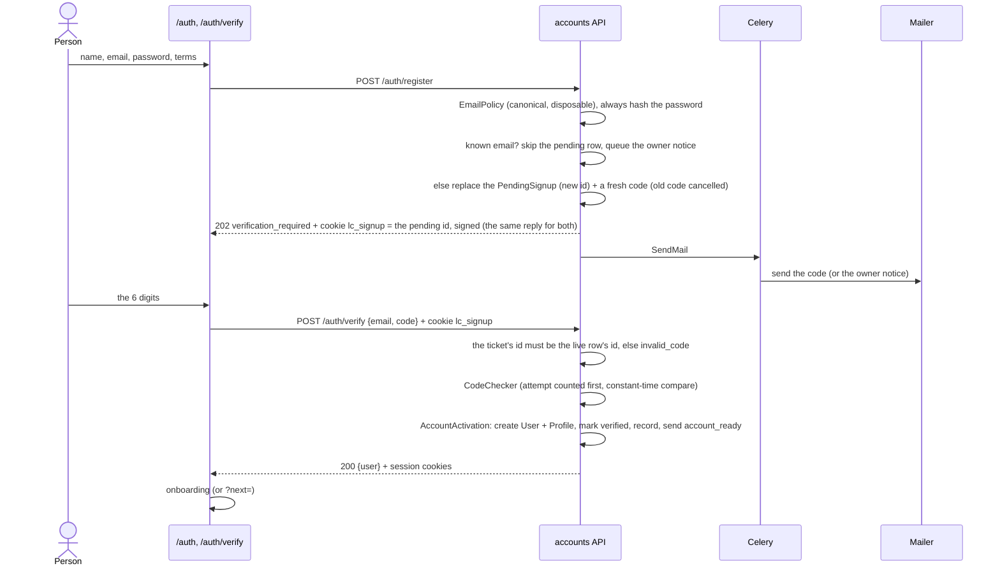
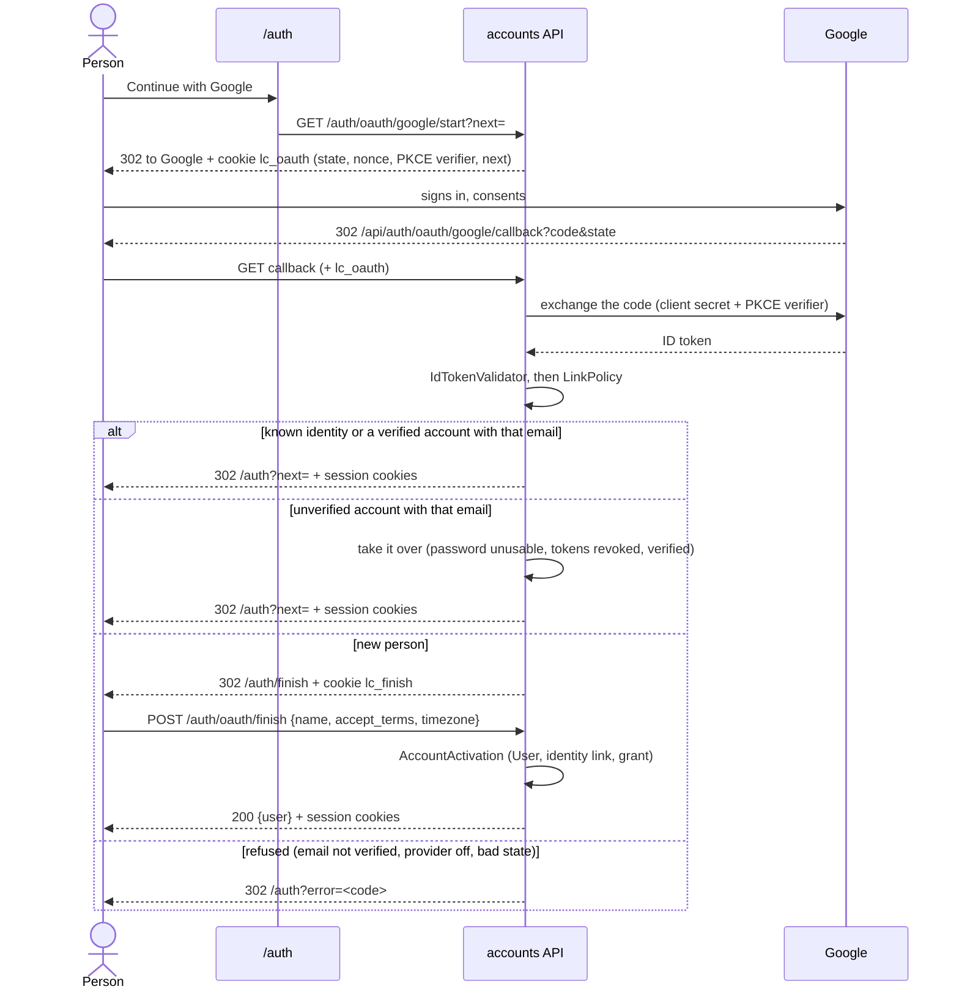
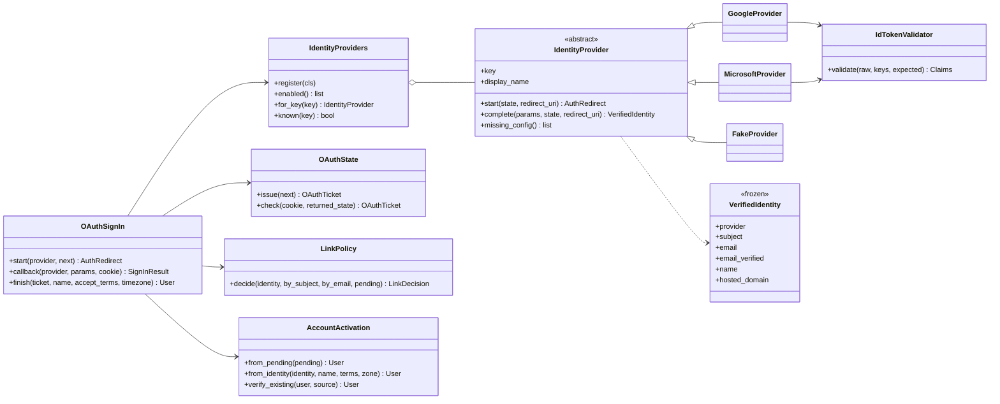
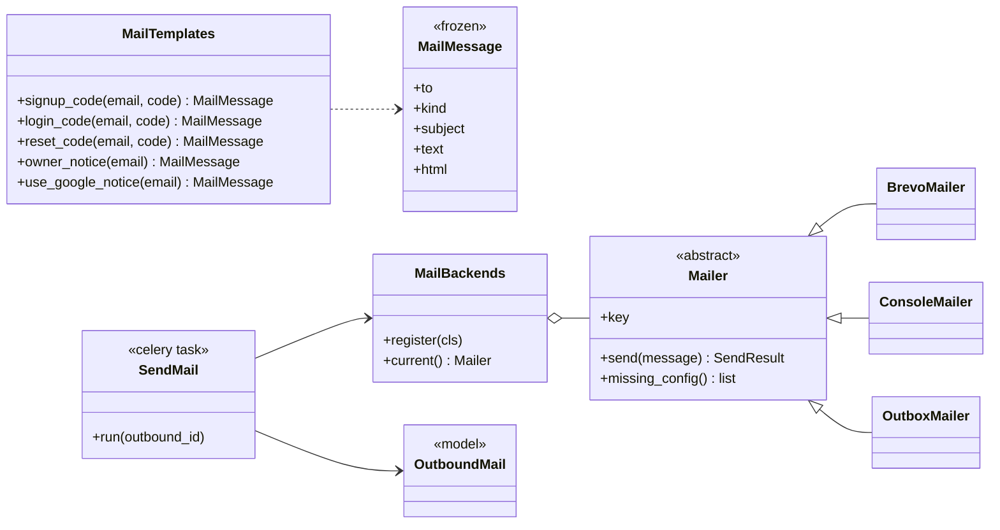
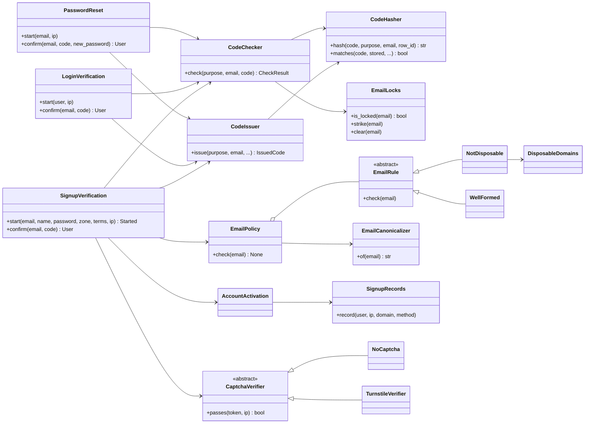

# Implementation plan: Sign-in and account verification (Phase 11)

**Spec:** [credits-system.md](../architecture/credits-system.md) §4.1 and A22 (sign-in is its own phase and **public launch is blocked on it**); the seam is `account_ready` ([design.md](../architecture/design.md) §4.26, [credits plan §5.12](../archive/credits-implementation-plan.md#512-sign-in-is-phase-11))
**Status:** **In progress:** phase 11.0 is built (see 12.1); 11.1 onward are planned. Product decisions confirmed by the product owner on 2026-11-12 (D1 to D17), amended after the plan review (S2) and the 11.0 answers (S3).
**Last updated:** 2026-11-12
**Checked against:** `main` at `3b20983`: `backend/accounts/` (models, serializers, views, cookies, authentication, throttling, signals), `backend/credits/earning/signup.py`, `credits/signals.py`, `credits/erasure.py`, `config/settings.py`, `frontend/proxy.ts`, `lib/route-guard.ts`, `app/auth/`, `app/api/[...path]/route.ts`, `console/`, `e2e/spec-map.json`, and the docs named in [section 15](#15-docs-to-update).

This plan says how to close the free-credit farming hole before public launch: **credits only for a verified account**, with low friction for students. Today `POST /auth/register` makes the account, signs the person in and gives 30 credits to an address nobody has proved they own. The plan adds email sign-up with a one-time code, Google sign-in, password reset, an email delivery adapter, the abuse limits that make them safe, and the console screens to support a learner who is stuck. Microsoft is an optional last phase. **Every fact the plan relies on that was not read from an official page or from the code is marked "(unverified)" and listed in [section 4.3](#43-unverified-facts-read-these-before-the-phase-that-needs-them).**

## Changelog

| # | Change | Sections touched |
|---|---|---|
| S1 | First version of the plan, written after the product owner answered the sixteen questions of 2026-11-12. Question 3 (the sending domain) was left as an unfilled template, so it is planned as **"no domain yet": a launch blocker with the DNS steps** (D3) | all |
| S2 | Plan review before building. **(1)** A *signup ticket* cookie binds a pending signup to the browser that made it, so a second person re-registering a victim's email can neither set the password nor finish the sign-up (T19, D4). **(2)** Checked whether a learner can change their email: **no** (profile, serializer, console); **the Django admin form can**, which is closed. Email change is out of scope (D17); a defensive model rule and tests hold it; `LinkPolicy` never matches an email that was never proved by its owner (5.5), and never touches a staff account. **(3)** Console *approve* creates the account with an **unusable password**; staff confirm the person out of band first (D15). **(4)** A password reset for an email that has only a pending signup is **unknown** (same reply, nothing sent) (D11). **(5)** D3 unchanged: the domain is not owned yet. A reset for a password-less account with no linked identity (a staff-approved one) works and sets its first password (D11) | 1, 3, 4, 5.2, 5.5, 5.8, 5.11, 7.2, 8.1, 8.3, 10, 11, 12.1, 12.2, 12.5, 13 |
| S3 | Answers to the 11.0 report. **(1)** The signup ticket lives **24 hours**, the pending row's life (`SIGNUP_TICKET_MINUTES` default 1440); the code still expires in 10 minutes, so a late visitor asks for a new code, which is a resend that the ticket authorises (T19, R14). **(2)** Existing lowercased dev addresses stay as they are: the move to "stored as typed" (11.1) touches only new accounts (D7). **(3)** `REFUSE_STAFF` is confirmed: a staff account is never linked to or taken over by Google (5.5, D6); **two-factor sign-in for staff accounts** is a roadmap item, not this phase. **(4)** A deploy-time probe, `manage.py probe_forwarded_header` (`make probe-proxy URL=…`), sends a forged `X-Forwarded-For` through the real front door and prints the address Django counted; launch checklist item 8 runs it (5.10, 12.7) | 1, 4.2 (T19), 5.5, 5.10, 8.3, 12.1, 12.7, 14 (R14) |

## Contents

1. [Summary](#1-summary)
2. [Why this is the right shape](#2-why-this-is-the-right-shape)
3. [What the code says today](#3-what-the-code-says-today)
4. [Decisions](#4-decisions) (product D1 to D17, technical T1 to T20, unverified facts U1 to U12)
5. [Architecture](#5-architecture)
6. [Object design](#6-object-design) (class diagrams)
7. [Database](#7-database)
8. [API](#8-api)
9. [Frontend](#9-frontend)
10. [Console and admin](#10-console-and-admin)
11. [Security and abuse](#11-security-and-abuse)
12. [Rollout: phases 11.0 to 11.5, exit criteria, the launch checklist](#12-rollout-phases-and-exit-criteria)
13. [Test plan](#13-test-plan)
14. [Risks](#14-risks)
15. [Docs to update](#15-docs-to-update)
16. [Appendix](#16-appendix)

---

## 1. Summary

**The rule.** The 30 signup credits are given on `account_ready`, and `account_ready` is sent only when an account exists **and its email has been proved**: by a code sent to it, or by Google saying it is verified. Nothing else changes in `credits`.

**The shape.**

- **No account until the code is entered.** `POST /auth/register` stores a *pending signup* (name, hashed password, time zone, the terms the person agreed to), emails a 6-digit code, and answers `202` with a **signup ticket** cookie bound to that pending row. The real `User`, the session cookies and the grant come when the right code **and the matching ticket** arrive. An unverified person has no session, so there is no half-verified account to guard and no per-view check to forget (D4). The ticket means nobody who re-registers a victim's address can set the password that account gets (T19).
- **Google sign-in** by the server-side authorization-code flow with `state`, `nonce` and PKCE. A new Google identity lands on a "one last step" screen (name, the terms checkbox) before the account exists, because the terms consent is a legal record, not a convenience (D12).
- **One person, one account.** A canonical email (the `+tag` stripped everywhere, the dots stripped for Gmail) is unique. The address is stored exactly as typed for sending and display (D7). Disposable domains are refused from a vendored snapshot with a school allow-list (D8). A Google identity links to an existing account only when that account's email is verified; an unverified account is taken over, never merged (D6).
- **Email delivery** through a `Mailer` port with a registry, like the payment gateways: Brevo on its free plan for launch, ZeptoMail or SES as scale-up adapters, a console backend for development and an outbox backend for the throwaway test stack (D2).
- **Abuse limits**: per-address and per-email throttles on sign-up, code send and code check; a code lives 10 minutes and dies after 5 wrong tries; every failure answers the same words; known and unknown emails get the same reply. The forwarded-header bypass is fixed first, in 11.0, because every per-address limit depends on it (D13). A Turnstile adapter is built and **off**; the switch is an audited console setting (D14).
- **The console** shows each learner's verification, lets staff resend a code, unlock a locked email and mark an account verified with a typed reason, and shows people still waiting for a code (D15).

**Rollout** (each phase shippable, each ends with `make check` and `make e2e-affected` green; the full `make e2e` before every merge to `main`): **11.0** prepare and fix the header · **11.1** email with a code (this alone closes the hole) · **11.2** password reset · **11.3** Google · **11.4** console and abuse board · **11.5** Microsoft, optional (D16).

**Launch is blocked on** 11.1 to 11.4 **and on a sending domain** (D3): without SPF, DKIM and DMARC the codes land in spam. The launch checklist is in [12.7](#127-the-launch-checklist).

## 2. Why this is the right shape

- **Verified email stops the cheap attack.** A script making a thousand `x+1@example.com` accounts now needs a thousand inboxes, and the alias rule and the disposable list close the two obvious shortcuts. A determined person can still make many real Gmail accounts; email is a speed bump, not a wall (see [risk R1](#14-risks)). The counters of 11.4 are how that is noticed.
- **No account before the code** removes whole classes of bugs: no `IsVerified` check on a hundred endpoints, the route-auth guard test (G3) unchanged, no way to register a password against someone else's address (pre-hijacking), and no junk accounts from typos.
- **The seam already exists.** `account_ready` and the keyed grant (`signup:<user>`, so the signal arriving twice gives the credits once) were built for this. The plan moves *where the signal is sent*, nothing else.
- **A provider port keeps launch independent of any one vendor.** Brevo today, anything with an HTTP API tomorrow, for the price of one class and one setting.

## 3. What the code says today

Findings from reading the code that shape the plan. None of them is a surprise to the product owner except where marked.

| # | Finding | Where | What the plan does |
|---|---|---|---|
| F1 | `POST /auth/register` creates the user, sets the session cookies and sends `account_ready` in one request | `accounts/views.py` `RegisterView`, `serializers.py` `RegisterSerializer.create/_announce` | Register stores a pending signup and answers `202`; the grant and the cookies move to the code check (5.2) |
| F2 | The register error "An account with this email already exists." tells anyone which emails have accounts | `RegisterSerializer.validate_email` | One reply for known and unknown emails; the owner is emailed instead (D5) |
| F3 | The backfill gives the 30 credits to **every active account**, verified or not | `credits/earning/signup.py` `SignupGrant.backfill` | Skips unverified accounts and reports them (11.1) |
| F4 | The terms consent (`accept_terms`, `terms_accepted_at`, `terms_version`) is collected only on the register form | `RegisterSerializer`, `User` | The pending row carries it; Google gets the "one last step" screen (D12) |
| F5 | `User.email` is lowercased on save and looked up with `iexact`; no canonical form exists | `accounts/models.py` `UserManager`, `get_by_natural_key` | `email_canonical` (unique) for uniqueness and throttle keys; `email` kept as typed (D7, T7) |
| F6 | The per-account login throttle keys on the lowercased email, so an alias would dodge it once lookup is by canonical email | `accounts/throttling.py` `LoginAccountThrottle` | Throttle keys use the canonical email (T8) |
| F7 | Per-address limits trust the first `X-Forwarded-For` entry, which a client can set. Already an open roadmap item | `app/api/[...path]/route.ts`, `TRUSTED_PROXY_COUNT`, [api.md](../reference/api.md) | Fixed first, in 11.0, starting with a test that proves how Next fills the header (D13, U8) |
| F8 | Nothing in the repo sends email | whole repo | The `Mailer` port, its backends, a Celery task and templates are new (5.9) |
| F9 | `UserDataMap` fails a test for any table that points at a user and is not listed | `credits/erasure.py`, `test_account_erasure_traces` | Every new table is listed with its fate (7.4) |
| F10 | The route-auth guard (G3) lists every route open without a sign-in; a new open route fails until it is listed with a reason | `tests/core/test_every_route_needs_sign_in.py` | The new open routes are added with reasons (8.4) |
| F11 | `frontend/app/auth/**`, `lib/auth-form.ts`, `proxy.ts` and `backend/accounts/**` are **triggers** in `e2e/spec-map.json` | `e2e/spec-map.json` | Every phase here runs the full e2e under `make e2e-affected`; that is expected, not a mistake |
| F12 | `/auth` is the only auth path the proxy matcher and `RouteGuard` know; `route-coverage.test.ts` fails for a page the proxy does not match | `frontend/proxy.ts`, `lib/route-guard.ts` | `/auth/:path*` joins the matcher; the new pages are listed public (9.3) |
| F13 | 15 call sites use `/auth/register` (tests and the e2e `Api.signUp`, which 13 specs use) | `tests/`, `e2e/support/api.ts` | Updated in 11.1 (13.5); the e2e reads the code from the outbox |
| F14 | Erasure frees the real email (`deleted-<id>@erased.invalid` replaces it), so a person erased by staff could register again for another 30 credits | `credits/erasure.py` | Staff-only erasure today, so not exposed; listed as [risk R6](#14-risks) for the day self-service deletion exists |
| F15 | **A learner cannot change their email today.** `ProfileSerializer.email` is read-only (`source="user.email"`) and `update` touches only `name`; the profile page shows it disabled ("Your sign-in email can't be changed"); the console has no endpoint that edits it (erasure only reads it); `tests/accounts/test_views_profile.py::test_patch_updates_name_but_not_email` covers PATCH. **The Django admin's `User` form lets staff edit `email`**, which would leave `email_canonical` and the verification stale | `accounts/serializers.py`, `accounts/admin.py` | Email change is **out of scope** (D17); the admin field becomes read-only after creation; a model rule clears verification if the email ever changes anyway (T20); tests in 12.1 |

## 4. Decisions

### 4.1 Product decisions (confirmed on 2026-11-12)

| # | Decision |
|---|---|
| **D1** | **Methods now: email with a code, and Google.** Microsoft is an optional phase 11.5 (many Indian colleges use Microsoft 365 student accounts); its verified-email rule stays open until then. **No Apple:** it needs a paid developer membership and its guideline 4.8 concerns apps that offer other third-party sign-in. |
| **D2** | **Email provider: Brevo's free plan** through the mailer adapter. ZeptoMail and Amazon SES are the documented scale-up options (one class and one setting each). |
| **D3** | **Sending domain: none yet** (the question's answer was left as a template; this is the safe reading). It is a **launch blocker**. The public contact address on the legal pages stays `satyamjha4@gmail.com`; sending uses `no-reply@<your-domain>`. The exact DNS steps are in [12.7](#127-the-launch-checklist). |
| **D4** | **Nothing before verifying.** A sign-up is a *pending signup*, not an account; no `User`, no session, no credits until the code is entered **by the browser that registered** (the signup ticket, T19). A second register for the same email replaces the row and the ticket; the old ticket and the old code stop working. |
| **D5** | **`POST /auth/register` answers `202 verification_required`**, with the same reply for a known and an unknown email. The owner of a known address is emailed ("someone tried to sign up with your address"). The e2e reads codes from an **outbox that exists only on the throwaway stack**, and the app **refuses to start** in production with it on. |
| **D6** | **Linking.** Link by the provider's stable id, never by email alone. Refuse an identity whose email the provider does not call verified. A Google sign-in for an email that has a **verified** account links to it. For an email that has an **unverified** account (or a legacy one, D9), the sign-in **takes the account over**: its password is made unusable, its refresh tokens are revoked, and it is marked verified. |
| **D7** | **One person, one account by a canonical email.** Lowercased; the `+tag` removed for every domain; dots removed for `gmail.com` and `googlemail.com`. The canonical form is unique and is used **only** for the uniqueness check, the throttle keys and lookups. The email is **stored exactly as typed** for sending and display. |
| **D8** | **Disposable domains** are refused from a vendored snapshot of [disposable-email-domains](https://github.com/disposable-email-domains/disposable-email-domains) (CC0, also on PyPI), with an allow-list of ours (schools and colleges) that always wins, checked at sign-up and at code send. **A test proves the snapshot never contains a major real provider** (gmail, googlemail, outlook, hotmail, live, yahoo, icloud, rediffmail and the common Indian ISPs). |
| **D9** | **Existing accounts** are marked verified with source `legacy` by a migration; they keep their credits. A legacy account does **not** count as verified when deciding whether Google may link to it (D6). The backfill skips unverified accounts. **`manage.py require_reverification`** flips legacy accounts back before launch and is on the launch checklist. |
| **D10** | **Codes:** 6 digits, valid 10 minutes, 5 wrong tries kill the code, a new code after 60 seconds, 5 sends an hour per email and 20 an hour per address, a new code cancels the old one, only a keyed hash is stored, sending is a Celery task so a known and an unknown email take the same time. |
| **D11** | **Password reset** uses the same code and limits. An unknown email gets the same screen, **and an email that has only a pending signup is unknown** (same reply, nothing sent). A successful reset revokes every refresh token and signs the person in. An account **with a linked Google identity and no password** gets "sign in with Google" instead of a code. An account with **no usable password and no linked identity** (one staff approved, D15) gets the normal code, and the reset sets its **first** password. **No adding a password to a Google account for now.** |
| **D12** | **A new Google identity gets a "one last step" screen** (name, the terms checkbox) before the account exists and before the grant. **The time zone is taken from the browser, not asked.** |
| **D13** | **The forwarded-header fix is 11.0**, starting with the test that proves how the header is filled (U8). |
| **D14** | **Beyond verified email:** the alias rule, the disposable list, per-address and per-domain counters visible in the console, and a **Cloudflare Turnstile adapter built and off by default. The switch is a console setting (audited), not an environment variable** (the site and secret keys stay in the environment). **No phone verification.** |
| **D15** | **The console** shows each learner's verification state (method, time, legacy or not), lets staff **resend a code, unlock a locked email and mark an account verified** (typed reason, audited), and lists people **waiting for a code**. **Approving a pending signup creates the account with an unusable password** (never the pending row's hash) and the reply tells staff the learner signs in with Google or sets a password by a reset; the console and the docs tell staff to **confirm the person out of band first** (a message from the address on file, or in person). |
| **D16** | **Order:** 11.0 prepare and header · 11.1 email with a code · 11.2 reset · 11.3 Google · 11.4 console and abuse · 11.5 Microsoft (optional). 11.1 alone closes the farming hole, so launch is not hostage to Google. |
| **D17** | **Changing the sign-in email is out of scope for phase 11.** A learner cannot do it today (F15) and nothing here adds it. If it is ever built, it is a code to the **new** address; the account keeps the old email and its verification until that code is entered; the new address's canonical form must be free; and linking only ever matches an email proved by its owner (5.5). Until then the only ways an account's email changes are erasure and a staff edit of nothing (the admin field is read-only, T20). |

### 4.2 Technical decisions

| # | Decision | Why |
|---|---|---|
| **T1** | Pending signups live in a **database table** (`PendingSignup`), purged after 24 hours. | Survives a Redis flush, can be listed in the console, and holds the hashed password for the person who finishes later. |
| **T2** | A code is stored as an **HMAC-SHA256** keyed from `SECRET_KEY` (salted with the purpose, the canonical email and the row id) and compared with `hmac.compare_digest`. | Keeps codes out of logs, dumps and a staff member's screen. A 6-digit code has only a million values, so a leaked table is **not** protected by the hash for the minutes the code lives; the 10-minute life and single use are the real control (11). |
| **T3** | Mail is sent by a **Celery task** (`accounts.send_mail`, retries with backoff), never in the request. | A known and an unknown email take the same time; a provider outage does not fail a sign-up request; the request thread never waits on a third party. |
| **T4** | Identity providers are a **registry** like `PaymentGateways` (`IdentityProviders`, `AUTH_PROVIDERS_ENABLED`), each a subclass of `IdentityProvider`. A fake provider exists only behind `AUTH_ALLOW_FAKE_PROVIDER`, with the same start-up refusal in production as the fake payment gateway. | The proven pattern of this codebase; adding Microsoft is one class and one line. |
| **T5** | Google is the **server-side authorization-code flow** (redirect to Google and back to our own callback), with `state`, `nonce` and PKCE, not a client-side button that posts an ID token. | The tokens never reach the browser's JavaScript, the redirect URI is exact-match, and it works with `SameSite=Lax` cookies (the callback is a top-level GET). PKCE is added on top of the client secret as defence in depth (U4). |
| **T6** | The identity key is `(provider, subject)`: Google's `sub` ("never reused", Google's docs). The `email` claim is read, never used as the key ("could change over time"). | The same reasoning the docs give; a changed Gmail address must not create a second account or take over another. |
| **T7** | `User.email_canonical` is a unique, non-null `char(320)` column computed by `EmailCanonicalizer` on save. The data migration (built in 11.0, `accounts.0006`) fills it; on a collision between existing dev rows the earlier keeps the canonical form and the later gets `dup:<id>:<address>`, which cannot collide with a real address or another row (the plain lowercased address, as first written here, can: `a.b@gmail.com` and `ab@gmail.com`); the console lists those. | A real unique index makes the rule hold under a race, which a validator cannot. |
| **T8** | Every per-email throttle key uses the **canonical** email, whether or not an account exists. | Otherwise aliases dodge the limit, and a limit that behaves differently for unknown emails would leak which exist. |
| **T9** | **One failure answer** for the code check: a wrong code, an expired one, a used one, a killed one and an unknown email all give `400 invalid_code`. Throttles (`429`) key on the input, not on existence. | No account enumeration through errors. |
| **T10** | Time comes from an injected clock (a small `Clock` port in `accounts`; `credits.clock` is not reused because `credits` depends on `accounts`, not the other way). | Tests move time instead of sleeping, as the credits tests do. |
| **T11** | ID tokens are verified with **PyJWT** and its JWKS client (`PyJWT[crypto]`; simplejwt already depends on PyJWT), checking signature, `iss`, `aud`, `exp` and `nonce`, and refusing `alg: none` and any algorithm not in the provider's list (U9). | No hand-rolled crypto; the validator is a small pure class with a table test. |
| **T12** | Two new short-lived signed cookies, `lc_oauth` (state, nonce, PKCE verifier, `next`) and `lc_finish` (the verified identity waiting for the "one last step"), both httpOnly, `SameSite=Lax`, path `/api/auth/oauth`, signed with Django's signer and a maximum age, cleared after use. | Server state without a session table; neither carries authority. |
| **T13** | Purges run on **beat**: `accounts.purge` daily (expired pending signups, spent codes after 7 days, `OutboundMail` and `SignupRecord` after 30 days). | IP addresses and emails are personal data; they are kept only as long as abuse work needs them (Privacy Policy line, 15). |
| **T14** | Everything fake or dev-only (`ConsoleMailer`, `OutboxMailer`, the outbox endpoint, the fake provider) is refused by a **system check** unless its switch is on, and the switch is refused when `DJANGO_DEBUG` is false (`accounts.E001` to `E004`, modelled on `payments.E003/E004`). | A test-only backdoor in production would let anyone read codes. |
| **T15** | `account_ready` stays the only seam. One class, `AccountActivation`, is the only code that sends it (after commit, receivers' failures logged and never undoing the account, as `_announce` does today). | One place decides "ready", so a new method cannot forget the grant or send it twice. |
| **T16** | No log line, error message or audit entry ever contains a code. The `ConsoleMailer` prints the code to the backend log **only with `DJANGO_DEBUG` true**. | Codes are credentials for ten minutes. |
| **T17** | The e2e stack runs `MAIL_BACKEND=outbox` and `AUTH_ALLOW_FAKE_PROVIDER=true`; `Api.signUp` registers, reads the code from `GET /api/dev/outbox`, verifies, then fills the profile. | One helper changes; 13 specs keep working. |
| **T18** | `auth_live` and `mail_live` pytest markers, excluded by default like `payments_live`: optional checks against the real Brevo API (send to a test address) and Google's discovery and JWKS documents. | The tests never need real credentials; the live ones catch API drift when keys exist. |
| **T19** | **The signup ticket.** `POST /auth/register` sets `lc_signup`, a Django-signed (salt `accounts.signup-ticket`), httpOnly, `SameSite=Lax`, cookie (path `/api/auth`, `SIGNUP_TICKET_MINUTES`, default 1440: 24 hours, the pending row's life; the code inside it still lives 10 minutes) whose value is the **pending row's id**. `POST /auth/verify` (purpose `signup`) and `POST /auth/verify/resend` (purpose `signup`) need the cookie **and** that its id equals the live pending row's id for the typed email; otherwise the usual `invalid_code` (or the usual `202` with nothing sent for a resend). A re-register makes a **new row with a new id** and a new cookie; the old ticket then matches nothing. The ticket is not stored anywhere. | Without it, whoever re-registers a victim's address replaces the pending row with their own password and the victim's own code would then create an account with the attacker's password. With it the attacker holds a ticket but not the code, and the victim holds the code but a dead ticket. |
| **T20** | **A model rule backs the "no email change" decision.** `User.save()` remembers the email it was loaded with; if a saved user's `email` differs, `email_canonical` is recomputed **and `email_verified_at` and the source are cleared**. The admin's `email` field is read-only on the change form (it stays editable on the add form), so there is no ordinary path that triggers it. Erasure, which rewrites the email on purpose, is the one caller and is tested. | Defence in depth: a future form, script or console action that edits an email cannot leave a verified flag behind that belongs to the old address. |

### 4.3 Unverified facts: read these before the phase that needs them

Every item below was **not** confirmed from an official page or from the code. Each says where it is first needed and what to do. Nothing in the plan is built on one without that step.

| # | Unverified | Needed in | What to do |
|---|---|---|---|
| **U1** | **Partly resolved in 11.0.** Read from Brevo's reference page for "send a transactional email": `POST https://api.brevo.com/v3/smtp/email`, the `api-key` header, `sender`, `to`, `subject`, `htmlContent` (required without a template), `textContent`, a `201` with `messageId`, and a `400` body with `code` and `message`; `BrevoMailer` is built on exactly that. **Still unverified:** which statuses Brevo wants retried (our rule: 429, 5xx and network failures retry), its rate limits, whether the sender must be verified before sending, and the exact DNS records (domain-ownership TXT, DKIM, SPF `include`) its dashboard shows. *Was:* **Brevo's transactional API**: the endpoint, the auth header, the request body, and the exact DNS records (domain-ownership TXT, DKIM, SPF `include`) its dashboard shows. The pricing page rendered no plan text for the fetch tool; the 300-a-day figure and the 1,000-message retry queue come from Brevo's help-centre FAQ, read through a search result, not the pricing page. | 11.0 | Read Brevo's API reference and sender-domain help pages before writing `BrevoMailer`; copy DNS values from the dashboard, never from this plan. |
| **U2** | Whether Brevo's free 300 a day covers **transactional** mail the same as marketing mail, whether the free plan allows a custom authenticated domain, and whether Brevo has an Indian region. | 11.0, launch | Read the help centre; if transactional shares the 300, the launch estimate is about 200 sign-ups a day (one code each, plus resends). |
| **U3** | **Amazon SES**: one AWS source says the 3,000-a-month free tier closed to new accounts on 21 July 2026; the SES FAQ still describes it. **ZeptoMail**: the free credit (10,000 emails, 100 a day, one month) is from Zoho's blog; an Indian data centre and the current rupee price were not confirmed. Resend's free 100-a-day cap makes it unfit. | only when scaling up | Check the AWS console and Zoho's pricing page on the day of the switch. |
| **U4** | **Google OIDC details**: the page read was truncated; it was inconsistent about `nonce` (required in the parameter table, "when present" in the validation step), did not mention PKCE, and did not say whether apps that request only `openid email profile` need Google's app verification or what "In production" publishing status requires. Whether a school's Workspace administrator can block third-party sign-in was not read. | 11.3 | Re-read the page; **validate `nonce` always**; send PKCE (Google's token endpoint is expected to accept it; confirm in the test project); publish the consent screen to "In production" before launch and read Google's current verification rules then. |
| **U5** | **Microsoft's verified-email rule.** The claims page says `email` "isn't guaranteed to be correct" and must never be used for authorization, and that `sub` or `oid` (with `tid`) is the stable key. The `xms_edov` claim, the "nOAuth" article, and the choice between the `common`, `organizations` and `consumers` authorities were **not read**. | 11.5 | Decide the rule from those pages before any Microsoft code; until then Microsoft is not a verified-email source. |
| **U6** | **Apple's** developer-programme price and whether guideline 4.8 applies to web-only services. | never (D1) | Nothing; revisit only if an iOS app ships. |
| **U7** | **Resolved in 11.1.** *Was:* the **disposable list's** domain count, last-commit date, and whether it contains any major or Indian provider. (The licence, CC0, and the PyPI package are from the README; the lists were not opened.) | 11.1 | The snapshot test of D8 answers the last point for the file we take; record the commit and date in the file's header. |
| **U8** | **Resolved in 11.0.** *Was:* **How Next fills `X-Forwarded-For`** and whether a client-sent value can be kept or replaced. The comment in the proxy says Next fills it from the socket only when the client sent none. | 11.0, first step | **Measured:** Next sets the header from the socket only when the client sent none (`next/dist/server/base-server.js`, `??=`), so a client's value is kept and an appending edge leaves it first; 25 logins with a new forged first entry and a fixed last one were never limited before the fix and are limited after it. A single forged entry with nothing in front of Next still picks the address: only an edge can stop that. The fix is `ClientAddress` (the last entry, or the Nth from the right) and `core.E002` (5.10). |
| **U9** | Whether `cryptography` (needed by PyJWT for RS256) is in the backend image, and the PyPI version of the disposable-domains package. | 11.0 | `uv add` and `docker compose up --build`; check the lock file. |
| **U10** | **Cloudflare Turnstile**: the verify endpoint and its request and response, the free tier's limits, and whether it works well for visitors in India. Not read. | 11.4 | Read Cloudflare's docs before writing `TurnstileVerifier`. |
| **U11** | The `type` of the `email_verified` claim in Google's ID token (the docs say "True if…", read as a boolean). | 11.3 | The validator requires boolean `true` and a test feeds the string `"true"` and expects a refusal. |
| **U12** | How **college and school mail systems** treat a new sender: some institutional filters quarantine unknown senders and delay the code. | launch | Send test codes to a few `.ac.in` and school addresses before launch; the "use Google instead" hint on the verify screen is the fallback. |

## 5. Architecture

### 5.1 What stays and what is new

**Stays:** the `User` and `Profile` models and the `post_save` profile receiver; cookie JWT auth (`lc_access`, `lc_refresh`, `lc_session`, `lc_onboarded`), CSRF, refresh rotation and the blacklist; `RedirectPolicy`; `account_ready` and `SignupGrant` (key `signup:<user>`); the route guard and the proxy; `AccountErasure`; the console and its `AuditTrail`.

**New** (all in `backend/accounts/` unless noted):

| Area | Classes |
|---|---|
| Identity | `IdentityProvider` (port), `IdentityProviders` (registry), `GoogleProvider`, `MicrosoftProvider` (11.5), `FakeProvider`, `VerifiedIdentity`, `IdTokenValidator`, `OAuthState`, `LinkPolicy`, `LinkDecision` |
| Mail | `Mailer` (port), `MailBackends` (registry), `BrevoMailer`, `ConsoleMailer`, `OutboxMailer`, `MailMessage`, `MailTemplates`, `SendMail` (task) |
| Verification | `CodeHasher`, `CodeIssuer`, `CodeChecker`, `SignupVerification`, `LoginVerification`, `PasswordReset`, `AccountActivation`, `EmailLocks` |
| Email rules | `EmailCanonicalizer`, `EmailPolicy` (a chain of `EmailRule`s: `WellFormed`, `NotDisposable`), `DisposableDomains` |
| Abuse | `SignupRecords`, `AbuseCounters`, `CaptchaVerifier` (port), `NoCaptcha`, `TurnstileVerifier`, `AuthSettings` (singleton model) |
| Console | `LearnerVerification`, `PendingSignups` (services under `console/services/`) |
| Frontend | `AuthRules` (extended), `CodeEntry`, `ResendClock`, `AuthErrors`, `SignInProviders`, `AuthApi` |

### 5.2 The flows

**Email sign-up (11.1).**



**Sign-in with a password for an unverified account (legacy or created by hand).** Password right, `email_verified_at` empty: queue a login code, answer `403 verification_required`, and the verify screen asks for it (`purpose: "login"`). A wrong password still answers `401 invalid_credentials`.

**Google (11.3).**



**Password reset (11.2).** `forgot {email}` → `202` always, a reset code is queued if the address belongs to an account (or the "this address signs in with Google" mail if the account has no usable password). `reset {email, code, new_password}` → validators run, the password is set, **every refresh token of the user is blacklisted**, a successful reset also counts as proof of the inbox (a legacy account becomes `code`-verified), and the person is signed in.

### 5.3 Package layout

```
backend/accounts/
  identity/        provider.py (port, VerifiedIdentity)  registry.py  google.py  microsoft.py  fake.py
                   tokens.py (IdTokenValidator)  state.py (OAuthState)  linking.py (LinkPolicy)
  mail/            mailer.py (port, MailMessage)  registry.py  brevo.py  console.py  outbox.py
                   templates.py  tasks.py (SendMail)  checks.py
  verification/    hasher.py  issuer.py  checker.py  signup.py  login.py  reset.py  activation.py  locks.py
  emailrules/      canonical.py  disposable.py  policy.py
  abuse/           records.py  counters.py  captcha.py
  data/            disposable_email_domains.txt  school_allowlist.txt
  management/commands/   refresh_disposable_domains.py  require_reverification.py
```

### 5.4 The canonical email (D7)

`EmailCanonicalizer.of("A.B+tag@Gmail.com") == "ab@gmail.com"`.

| Step | Rule |
|---|---|
| 1 | Trim, split at the last `@`, lowercase the domain and the local part |
| 2 | Remove everything from the first `+` in the local part, for every domain |
| 3 | For `gmail.com` and `googlemail.com` only: remove the dots of the local part, and treat `googlemail.com` as `gmail.com` |
| 4 | An address with no local part left after step 2 (`+x@a.com`) is refused as malformed |

The typed address is what is stored in `User.email` and shown; mail goes to it as typed. A table test holds every case, including the ones that must **not** change (a dot in a Yahoo address is meaningful, so it stays).

### 5.5 Linking rules (D6): `LinkPolicy`

A pure class: given the identity, the account found by `(provider, subject)`, and the account found by canonical email, it returns one `LinkDecision`.

**The rule that matters:** an email is matched for linking **only if its owner proved it**, that is, the account's `email_verification_source` is `code`, `google` or `microsoft`. `legacy` (never proved), `staff` (someone vouched, the owner did not prove it), an empty source (unverified), and the `operator` source of `createsuperuser` accounts are **never** matched: for those the sign-in takes the account over instead, because the person at the keyboard has just proved the address and nobody else has.

| Identity from the provider | Account with this `(provider, subject)` | Account with this canonical email | Decision |
|---|---|---|---|
| email **not** verified | any | any | `REFUSE_UNVERIFIED_EMAIL` |
| verified | exists, active | n/a | `SIGN_IN` (the link is the key, the email may have changed) |
| verified | exists, closed or erased | n/a | `REFUSE_CLOSED` (the same plain error as a wrong password) |
| verified | none | exists, **a staff account** (`is_staff` or `is_superuser`) | `REFUSE_STAFF` (a staff account signs in with its password; the same plain error; **confirmed by the product owner on 2026-11-12, S3**; two-factor sign-in for staff is a later roadmap item) |
| verified | none | exists, source **`code`, `google` or `microsoft`** | `LINK_AND_SIGN_IN` |
| verified | none | exists, source **`legacy`, `staff`, `operator` or empty** | `TAKE_OVER` (password unusable, tokens revoked, verified with the provider as the source, the link made) |
| verified | none | none | `NEEDS_FINISH` (the "one last step" screen) |
| verified | none | none, but a **pending signup** has this email | `NEEDS_FINISH`, and the pending row is deleted when the account is made |

### 5.6 Codes (D10): the one place the numbers live

`VerificationSettings` (read from the environment, never hard-coded): `code_digits=6`, `code_ttl_minutes=10`, `max_attempts=5`, `resend_cooldown_seconds=60`, `sends_per_email_per_hour=5`, `sends_per_ip_per_hour=20`. A code is made with `secrets.randbelow`; a new code for the same `(purpose, email)` marks the old one `invalidated_at`; **the attempt is counted in the database before the comparison** (an `UPDATE … SET attempts = attempts + 1 … WHERE attempts < max` that returns a row only if a try was left), so five simultaneous wrong guesses use up five tries, not one.

Locks: three dead codes for one canonical email within an hour create an `EmailLock` for an hour. The lock is a row, not a cache entry, so the console can show and clear it (D15). Locks and throttles apply to the **input** email whether or not an account exists, so they cannot be used to find accounts.

### 5.7 Existing accounts (D9)

Migration `accounts.00NN` (a data migration, reversible):

1. add `email_verified_at`, `email_verification_source`, `email_canonical` (nullable first);
2. every existing user gets `email_verified_at = date_joined` and source `legacy`, except accounts with `deleted_at` set (left unverified: they cannot sign in anyway);
3. fill `email_canonical`; on a collision keep the plain lowercased address for the later row;
4. make `email_canonical` non-null and unique.

`manage.py require_reverification [--dry-run] [--keep-staff]` sets `legacy` accounts back to unverified (staff kept by default) so the next password sign-in asks for a code. They keep their credits (the grant key is unchanged and clawing back is not wanted). Launch checklist item (12.7).

`createsuperuser` marks the account verified with source `operator` (the operator owns the machine; it is not a proof by the owner of the address, so it never counts for linking); `UserManager.create_user` leaves it unverified unless `verified=True` is passed. The shared test fixtures pass it.

### 5.8 Password reset (D11) edge cases

- A reset for an address that has **only a pending signup** is an **unknown** address: the same `202`, nothing sent, nothing changed. (The person who never finished uses the code they were already sent, or registers again.) There is no second flow and the reset endpoint cannot be used to finish or to resend a sign-up.
- A reset for an account whose password is unusable **and which has a linked identity** (Google-only): the mail says "sign in with Google"; nothing is changed.
- A reset for an account whose password is unusable **and which has no linked identity** (one that staff approved, D15): the normal reset code is sent, and the reset sets its **first** password.
- A reset needs the code **and** passes `validate_password` for a user built from the account (same validators as register).
- After a reset all refresh tokens are blacklisted and the access cookie is replaced; an access token already issued lives out its 30 minutes (the same as logout today; noted in 11).

### 5.9 Mail delivery

`Mailer.send(message) -> SendResult` is the port; `MailBackends` finds the class named by `MAIL_BACKEND` (`brevo`, `console`, `outbox`). `SendMail` is a Celery task: it loads the `OutboundMail` row, calls the mailer, records `sent` or `failed` with a short reason (never the body for a real provider), and retries with backoff on a transient error. The row is what the console shows ("did the email go out?").

Message kinds (`MailTemplates`, plain text and a simple HTML part, one template class each): the **signup code**, the **login code**, the **reset code**, the **"someone tried to sign up with your address"** notice, the **"this address signs in with Google"** notice. Codes are in the body, not the subject (a lock-screen preview must not show one); the verify input carries `autocomplete="one-time-code"` and `inputmode="numeric"` so phones can offer the code. No links carry tokens (a link scanner would consume them).

`BrevoMailer` is a small `httpx` client like the payment adapters, tested with `httpx.MockTransport`. Its endpoint and payload are **(unverified, U1)** and are read from Brevo's documentation at the start of 11.0.

### 5.10 The forwarded-header fix (D13, F7)

11.0 starts with a **test that sends a forged `X-Forwarded-For` through the real proxy to the backend and records what Django's `NUM_PROXIES` logic counts as the client address (U8).** The fix is then one of, in this order of preference, decided from the result:

1. **The Next proxy forwards the entry the edge appended (the last), not the first**, and `TRUSTED_PROXY_COUNT` is set to the real number of hops. In production an edge proxy (needed for TLS anyway) overwrites the header.
2. If Next cannot see the socket address, the proxy forwards nothing and the edge is the only source.

Either way the app gains a **system check**: with `DJANGO_DEBUG` false, `TRUSTED_PROXY_COUNT` must be set deliberately (not left at the development default), and the docs say what the edge must do. Closing this item removes it from the roadmap's open list.

**The deploy-time probe (S3).** The unit tests prove the proxy's rule, not the edge in front of it. `manage.py probe_forwarded_header [--url <front door>]` (`make probe-proxy URL=https://<the site>`, run where the app's cache is reachable) sends two forged headers through the real front door, **a single forged entry** and **a forged entry followed by an edge's**, then reads the throttle cache and prints which address Django counted. It exits non-zero if the visitor's chosen address was the one counted: a single forged entry that is counted means nothing in front overwrites the header. The launch checklist runs it against the public URL (12.7 item 8). Its logic (`core.proxy_probe.ForwardedHeaderProbe`) is unit-tested against fake front doors; the edge itself can only be tried for real.

### 5.11 Changing an email: out of scope (D17, T20)

A learner cannot change their email (F15), and phase 11 does not add it. What the plan does to keep it that way:

- The profile serializer's `email` stays read-only; the tests of 12.1 prove a `PUT` and a `PATCH` leave it alone and cannot set `email_verified_at`, `email_verification_source` or `email_canonical` either.
- The Django admin's `email` field is read-only once the account exists (it can be typed when staff add one; such an account is unverified and signs in with Google or a reset).
- `User.save()` clears the verification if a saved user's email ever changes (T20), so a new code path cannot leave a verified flag on an address nobody proved.
- If email change is ever built, its design is fixed in D17: a code to the new address, the old email and verification kept until then, a free canonical form, and linking that matches only emails their owner proved (5.5).

---

## 6. Object design

All behaviour is in classes (CLAUDE.md); the receivers, tasks, views and settings are the thin framework hooks.

### 6.1 Identity providers (T4, T5, T6)



**Patterns:** Strategy plus registry (providers), Template Method (the OAuth code flow is shared; a provider supplies endpoints, scopes and how it reads claims, and `email_verified` is computed **by the provider class**, so Microsoft's rule is its own), Facade (`OAuthSignIn`), a pure policy (`LinkPolicy`), Value Object (`VerifiedIdentity`).

### 6.2 Mailer (T3, T14)



`FakeMailer` (tests, `tests/support/`) is a plain recording `Mailer`; it needs no inheritance because the port is a protocol as well.

### 6.3 Verification flow (T1, T2, T9, T15)



**Patterns:** Facade (the three flows), Chain of responsibility (`EmailRule`s, a new rule is a new class in `EmailPolicy.DEFAULT`), Strategy (`CaptchaVerifier`, chosen by `AuthSettings`; `NoCaptcha` is the Null Object), Value Objects (`IssuedCode`, `CheckResult`, `Started`). `AccountActivation` is the only sender of `account_ready` (T15); `RegisterSerializer._announce` moves into it.

## 7. Database

Migrations only (`make makemigrations`). Types are Postgres; UUID keys for `accounts`, like `User`.

### 7.1 `accounts.User` (changed)

| Column | Type | Notes |
|---|---|---|
| email_verified_at | datetime, null | When the address was proved. Null = unverified |
| email_verification_source | char(12), blank | `code`, `google`, `microsoft` (the owner proved the address), `staff` (the console vouched), `operator` (`createsuperuser`), `legacy` (never proved). **Only the first three count as proved for linking (5.5)** |
| email_canonical | char(254), **unique** | D7, T7. Filled by `save()` and by the data migration |

`email` keeps its meaning, stored as typed (the domain lowercased by Django's `normalize_email`, the local part as typed). `get_by_natural_key` and `authenticate` look up by `email_canonical`, so an alias form of a known address signs in to the same account.

### 7.2 New tables (`accounts`)

| Table | Columns | Notes |
|---|---|---|
| `PendingSignup` | id uuid, email, email_canonical (unique), name, password_hash, timezone, terms_accepted_at, terms_version, created_at, expires_at | One per canonical email. **A new register deletes the row and makes a new one with a new id**, so a signup ticket (T19), which holds the id, stops matching. Purged after 24 hours (T13). The ticket itself is not stored |
| `VerificationCode` | id uuid, purpose (`signup`/`login`/`reset`), email_canonical, pending FK null, user FK null (`PROTECT`), code_hash, attempts, max_attempts, created_at, expires_at, consumed_at null, invalidated_at null, requested_ip (inet) | **At most one live code per `(purpose, email_canonical)`**: a partial unique index where `consumed_at` and `invalidated_at` are null. Never stores the code. Spent rows purged after 7 days |
| `EmailLock` | email_canonical (unique), locked_until, strikes, updated_at | The console's "unlock" deletes it |
| `ExternalIdentity` | id, user FK, provider, subject, email_at_link, hosted_domain, created_at, last_sign_in_at | **Unique `(provider, subject)`**. Erased with the account |
| `OutboundMail` | id, kind, to_email, backend, status (`queued`/`sent`/`failed`), provider_message_id, error (short), body_text (outbox backend only), created_at, sent_at | The console's answer to "did it go out?". 30 days |
| `SignupRecord` | id, user FK (`PROTECT`), ip (inet), email_domain, method (`code`/`google`/`microsoft`), created_at | The counters of the abuse board (D14). 30 days for the IP, the domain count kept as a daily aggregate |
| `AuthSettings` | singleton: `captcha_enabled` bool, updated_at | Loaded like `CreditSettings.load()`; changed only through the console, audited |

### 7.3 Indexes and constraints that carry the rules

- `User.email_canonical` unique: two simultaneous sign-ups for aliases of one inbox cannot both win.
- `VerificationCode` partial unique index: two simultaneous sends cannot leave two live codes.
- `ExternalIdentity` unique `(provider, subject)`: one Google identity, one account.
- `PendingSignup.email_canonical` unique.

### 7.4 `UserDataMap` (F9)

| Table | Fate | Why |
|---|---|---|
| `accounts.ExternalIdentity.user` | erased | A link to a Google identity is personal data |
| `accounts.VerificationCode.user` | erased | Codes are spent anyway |
| `accounts.SignupRecord.user` | erased | Holds an address |
| `OUTSIDE`: `PendingSignup`, `OutboundMail`, `EmailLock` (by email) | erased | Found by the account's canonical and typed email and deleted by `AccountErasure` |

The erasure test (`test_account_erasure_traces`) fails until these are listed, which is the point.

## 8. API

Paths have no trailing slash. Every endpoint gets `@extend_schema`. Updates go into [api.md](../reference/api.md) in the phase that builds them.

### 8.1 Email (11.1, 11.2)

| Method | Path | Body | Success | Errors |
|---|---|---|---|---|
| POST | `/auth/register` | `{email, password, name, accept_terms, timezone?}` | **`202 {status: "verification_required"}`** and the **`lc_signup` ticket cookie** (no session cookies). **The same for a known and an unknown email**, ticket included (for a known one the ticket matches no row and the owner gets the notice instead of a code) | `400` for a malformed or **disposable** address, a weak password, a missing consent (field errors, as today, but never "already exists"); `429` |
| POST | `/auth/verify` | `{email, code, purpose: "signup" \| "login"}`; for `signup` the **`lc_signup` cookie must come with it** and match the live pending row | `200 {user}` + the session cookies; `lc_signup` cleared | **`400 invalid_code`** for every failure (T9), **including a missing, expired, forged or stale ticket**; `429 throttled` |
| POST | `/auth/verify/resend` | `{email, purpose}` (for `signup`, with the `lc_signup` cookie) | `202` always. A `signup` resend **without a matching ticket sends nothing** (the same reply), so a stranger cannot cancel someone's live code | `429` with `Retry-After` (cooldown, per-email, per-address) |
| POST | `/auth/login` | as today | as today | **new:** `403 verification_required` when the password is right and the email is unverified (a login code is queued); `401 invalid_credentials` as today |
| POST | `/auth/password/forgot` | `{email}` | `202` always | `429` |
| POST | `/auth/password/reset` | `{email, code, new_password}` | `200 {user}` + cookies; all refresh tokens blacklisted | `400 invalid_code`, `400` with `fields.new_password` for a weak one, `429` |

### 8.2 Providers (11.3)

| Method | Path | Notes |
|---|---|---|
| GET | `/auth/providers` | `{providers: [{key, label}]}`: the enabled ones, so the screen draws only buttons that work |
| GET | `/auth/oauth/{provider}/start?next=` | `302` to the provider; sets `lc_oauth`. `next` goes through `RedirectPolicy` |
| GET | `/auth/oauth/{provider}/callback` | `302` to `/auth?next=` with the session cookies, to `/auth/finish` with `lc_finish`, or to `/auth?error=<code>`. Codes: `email_not_verified`, `provider_off`, `state_mismatch`, `sign_in_failed`, `account_closed` |
| GET | `/auth/oauth/finish` | `{email, name}` from `lc_finish`, for the form; `404` with no ticket |
| POST | `/auth/oauth/finish` | `{name, accept_terms, timezone?}` → `201 {user}` + cookies (the terms rule is the register rule) |

### 8.3 Cookies (added to the table in api.md)

| Cookie | Holds | Path | Lifetime |
|---|---|---|---|
| `lc_signup` | signed id of the pending signup (T19) | `/api/auth` | `SIGNUP_TICKET_MINUTES` (1440, the pending row's life); cleared after a successful verify |
| `lc_oauth` | signed state, nonce, PKCE verifier, `next` | `/api/auth/oauth` | 10 minutes |
| `lc_finish` | signed verified identity awaiting the last step | `/api/auth/oauth` | 15 minutes |

### 8.4 Open routes the route guard (G3) must list, each with its reason

`/auth/verify`, `/auth/verify/resend`, `/auth/password/forgot`, `/auth/password/reset`, `/auth/providers`, `/auth/oauth/{provider}/start`, `/auth/oauth/{provider}/callback`, `/auth/oauth/finish`, and (throwaway stack only) `/dev/outbox`. The guard test fails for any of them until it is listed, which is its job.

### 8.5 Throttles (settings and `.env.example`)

| Scope | Key | Default | Variable |
|---|---|---|---|
| `auth` | address | `20/min` (existing: register, login) | `AUTH_THROTTLE_RATE` |
| `auth_code_send_email` | canonical email | `5/hour` | `AUTH_CODE_SEND_EMAIL_RATE` |
| `auth_code_send_ip` | address | `20/hour` | `AUTH_CODE_SEND_IP_RATE` |
| `auth_code_cooldown` | canonical email | `1/min` | `AUTH_CODE_COOLDOWN_RATE` |
| `auth_code_check_email` | canonical email | `15/hour` | `AUTH_CODE_CHECK_EMAIL_RATE` |
| `auth_code_check_ip` | address | `60/hour` | `AUTH_CODE_CHECK_IP_RATE` |
| `auth_oauth` | address | `30/min` | `AUTH_OAUTH_RATE` |

All keys use the input email, whether or not it has an account (T8). A school behind one address can reach `auth_code_send_ip` ([risk R3](#14-risks)); the limits are variables for that reason.

### 8.6 Console (11.4)

See [section 10](#10-console-and-admin).

## 9. Frontend

Copy rules (CLAUDE.md) apply: plain, warm, no internal words. Learners read **"code"** and **"Check your email"**, never OTP, pending, token, identity provider or canonical.

### 9.1 Screens (also added to [pending-screens.md](../design/pending-screens.md) section 11)

| Screen | Route | Built in | Notes |
|---|---|---|---|
| Sign in / Create account (changed) | `/auth` | 11.1, 11.3 | A "Continue with Google" button above the form with an "or" divider (only when `GET /auth/providers` lists it); the create tab ends by going to the verify screen, not to onboarding; an `?error=` card for a refused Google sign-in |
| Check your email | `/auth/verify` | 11.1 | One input styled as six boxes (and a plain "Start again" line for someone whose browser lost the ticket), `autocomplete="one-time-code"`, auto-submits at 6 digits, paste of `123 456` works; the address shown as typed; **Send a new code** with a 60-second countdown; **Use a different email**; a "Try Google instead" line; the same words for every wrong code |
| Forgot password | `/auth/forgot` | 11.2 | An email box and one button; the next screen says the same thing whether or not the address has an account |
| Choose a new password | `/auth/reset` | 11.2 | The code, the new password with the same checklist as sign-up |
| One last step | `/auth/finish` | 11.3 | The Google email (read only), the name (prefilled), the terms checkbox with its links, one button. The time zone is read from the browser and is not shown |
| Emails | n/a | 11.1, 11.2 | The code email, the owner notice, the reset email, the "sign in with Google" email. Plain, one big code, no buttons, no links that carry tokens |
| Console | `/console/learners`, `/console/signups`, `/console/abuse` | 11.4 | [Section 10](#10-console-and-admin) |

Every screen holds at 400 px, has visible focus, labelled controls and a reduced-motion path.

### 9.2 Classes (pure, in `frontend/lib/`, bun-tested; the components only draw)

| Class | Responsibility |
|---|---|
| `AuthRules` (extended) | Copy and validation for the new screens; where to go after each outcome (`destination`); `?next=` kept through verify and Google |
| `CodeEntry` | Turns what was typed or pasted into six digits (spaces and dashes dropped, non-digits ignored), says when it is complete |
| `ResendClock` | The countdown for "Send a new code", from the `Retry-After` the server gave |
| `AuthErrors` | Every error code to a sentence: `invalid_code`, `throttled`, `verification_required`, and the five `?error=` codes of the Google callback |
| `SignInProviders` | Which buttons to show from `/auth/providers`, none when the call fails |
| `AuthApi` | Typed calls: `register` (now a status), `verify`, `resend`, `forgot`, `reset`, `oauthFinish` |

`AuthProvider.register` no longer returns a user; the verify call does. `BrowserTimezone` is read at register and at finish. The verified email is kept in `sessionStorage` (`socra.pendingEmail`, never throwing, like `PendingTopic`) so a refresh on the verify screen still knows where the code went.

### 9.3 Route guard and proxy (F11, F12)

- `RouteGuard`: a signed-in visitor opening `/auth` **or any `/auth/...` page** is sent on (the rule widens from `pathname === "/auth"` to the prefix); the new pages are signed-out pages.
- `proxy.ts` matcher gains `/auth/:path*`; `route-coverage.test.ts` lists the four new pages as public.
- The `/api` proxy already passes `Set-Cookie` and `redirect: "manual"`, so the OAuth `302`s and their cookies reach the browser unchanged; a test proves it (the callback is the first redirecting endpoint behind the proxy).
- `PendingTopic` survives sign-up through verification, as it does today through onboarding.

## 10. Console and admin

All console endpoints are staff-only, the `console` throttle, `Cache-Control: no-store`, and every write goes through `AuditTrail.record` in the same transaction.

| Method | Path | What |
|---|---|---|
| GET | `/console/learners` (changed) | Adds `email_verified`, `verified_at`, `verification_source` (`legacy` is shown as such), `sign_in_methods` (`password`, `google`, …) and `locked_until`; a `?verification=unverified\|legacy\|locked` filter; `summary` gains the counts |
| GET | `/console/learners/{id}/verification` | **See:** the state, the identities (provider, linked on), the last five codes (created, expires, tries, used or cancelled; **never the code**), the last mail rows (kind, status, reason), the lock, the sign-up record (address and domain) |
| POST | `/console/learners/{id}/verification/resend` | **Resend:** queues a fresh login code to the learner's own address. Audited `learner.verification_resent`. Refused for a verified or erased account |
| POST | `/console/learners/{id}/verification/unlock` | **Unlock:** clears the `EmailLock` and cancels live codes so the next try starts clean. Audited `learner.verification_unlocked` |
| POST | `/console/learners/{id}/verification/mark-verified` | `{reason}` (at least 10 characters). Verifies the account with source `staff` and sends `account_ready` (the grant, idempotent). Audited `learner.verification_marked` with the reason. Refused for a verified, closed or erased account |
| GET | `/console/signups` | **Waiting for a code:** the pending signups (email, created, tries left, lock), searchable |
| POST | `/console/signups/{id}/resend`, `/unlock`, `/approve` | The same three actions for a person who has no account yet. **`resend` sends a new code, which the person can enter only in the browser that registered** (the ticket, T19; if they have lost it they register again). **`approve`** (typed reason, audited) makes the account from the pending row **with an unusable password: the pending row's hash is never copied**, marks it verified with source `staff`, grants the credits once, and deletes the row. The reply is `{learner_id, signs_in_with: "google_or_reset", note}`, and the console shows the note: *"Confirm this person out of band first (a message from the address on file, or in person). They have no password yet: they sign in with Google, or choose a password with "Forgot password"."* **Staff docs** (a paragraph in `docs/getting-started/` and the console's own help text) say the same |
| GET | `/console/abuse` | Accounts made, codes sent and failed checks per day; the top addresses and email domains of the last 24 hours; disposable refusals. Read-only |
| GET, PUT | `/console/auth-settings` | `{captcha_enabled}`, audited |

**Django admin:** read-only registrations of `PendingSignup`, `VerificationCode` (no hash column), `OutboundMail` and `ExternalIdentity`; the `User` admin shows the three new fields read-only.

Learners never see any of this. The console's words may be technical, but a learner-facing message that came from it (a resent email) follows the copy rules.

## 11. Security and abuse

| Risk | Control |
|---|---|
| **Signup farming with many addresses** | A code to a real inbox; the canonical email (D7); the disposable list (D8); per-address and per-email limits; counters in the console (D14); a Turnstile adapter ready to switch on. **Not stopped:** a person who makes many real Gmail accounts (R1) |
| **Account enumeration** | One reply for known and unknown emails on register, resend, forgot (T9); one `invalid_code` for every code failure; throttles key on the input; the password is always hashed on register (so timing matches); mail is sent by a task |
| **Guessing a code** | 6 digits and 5 tries is about 1 in 200,000 per code; at most 5 sends and 15 checks an hour per email means about 15 guesses an hour, roughly 1 in 65,000; the attempt is counted before the compare under a database guard; the code is single-use and dies in 10 minutes |
| **A leaked database** | Codes are HMACs, which a staff member or a log cannot read, **but a million-value space is brute-forced offline in a blink**, so the hash is not a defence for the 10 minutes a code lives. The defence is the short life and single use; no code is ever logged (T16) |
| **Locking a victim out** (an attacker burns their email's check budget) | Accepted and bounded: it never reveals whether the account exists, it lasts an hour, the victim can use Google, and the console can unlock (R4) |
| **Pre-hijacking** (an attacker registers the victim's address first) | There is no account before the code (D4), so there is nothing to hijack; a legacy or admin-made unverified account is **taken over** by the first proved owner (D6) |
| **Re-registering a victim's address with the attacker's password** (the victim's own code would then create an account the attacker can sign in to) | The **signup ticket** (T19): the code only works in the browser that holds the ticket for the **current** pending row. The attacker's re-register replaces the row and issues the attacker a ticket, but the code goes to the victim's inbox; the victim's code arrives with the victim's old ticket, which no longer matches. **Neither can finish**, and every failure is the same `invalid_code`. A stranger's resend without a ticket sends nothing, so it cannot cancel a live code. The victim's remedy is to register again, which replaces the attacker's row |
| **A signed-in learner or staff edit changing an email** | A learner cannot (F15, tested); the admin field is read-only after creation; `User.save()` clears the verification if an email ever changes (T20); the provider link is by `sub`, and linking matches only emails their owner proved (5.5) |
| **Console `approve` as a back door to someone's account** | The account is made with an **unusable password** (the pending row's hash is never used), so approval by itself gives nobody a way in; the person must then prove the inbox through Google or a reset code. Typed reason, audit entry, out-of-band confirmation in the console text (D15) |
| **Google or Microsoft returning an email that is not the person's** | Refuse unless `email_verified` is boolean `true` (U11); key by `sub`, never by email (T6); Microsoft is not a verified-email source until its rule is decided (U5, D1) |
| **OAuth state forgery, replay, code interception** | `state` bound to a signed cookie, `nonce` always checked, PKCE, exact-match redirect URI, ID token signature, `iss`, `aud`, `exp` checked, `alg: none` refused, `next` through `RedirectPolicy` (no open redirect) |
| **Forged `X-Forwarded-For`** | Fixed first in 11.0 (D13). The per-email limits do not depend on it |
| **CSRF** | The POSTs are `_PublicAuthView`s and keep the CSRF header rule; the two `GET`s of the OAuth dance are protected by `state`, not a header (a top-level navigation cannot send one) |
| **Session theft after a reset** | All refresh tokens blacklisted on reset; an access token already issued lives out its 30 minutes, as at logout today (accepted) |
| **A test backdoor in production** | `ConsoleMailer`, `OutboxMailer`, `/dev/outbox` and the fake provider are refused by system checks unless switched on, and the switch is refused when `DJANGO_DEBUG` is false (T14) |
| **Sending-domain spoofing and spam folders** | SPF, DKIM and DMARC on the sending domain (D3, [12.7](#127-the-launch-checklist)); `no-reply@<domain>` only |
| **Personal data** | IP and email are kept 30 days and then purged (T13); the Privacy Policy names the mail provider and Google as processors (15); erasure covers every new table (7.4) |
| **A staff action that grants credits** | `mark-verified` and `approve` need a typed reason, are audited with the actor, and are idempotent (the grant key is the learner) |

## 12. Rollout: phases and exit criteria

Each phase is its own branch (`phase-11/<topic>`), ends with **`make check` and `make e2e-affected` green**, and the **full `make e2e` runs before each merge to `main`** (CLAUDE.md). Because `backend/accounts/**` and `frontend/app/auth/**` are e2e triggers, `make e2e-affected` runs every spec here. Tests come first, each shown failing for the right reason before the code. Sizes: S, M, L, XL.

### 12.1 Phase 11.0: Prepare, and fix the header: M

**Built** on branch `phase-11/prepare` (not merged). Deviations from the list below: `UserManager` still lowercases the email (it was lowercased before; storing it as typed arrives in 11.1 with the register change, so learners see no change now); the migration's collision fallback is `dup:<id>:<address>` and the column is `char(320)` (T7); the `OUTSIDE` entry for the mail log is deleted by `AccountTraces.mail()` and counted in the erasure report; the purge covers only the mail log for now (the other tables arrive with 11.1). The deploy-time probe of 5.10 was added after the 11.0 review.

Branch `phase-11/prepare`. **Behaviour for learners does not change.**

- **First:** the forwarded-header test (U8) and the fix it points to (5.10); the `TRUSTED_PROXY_COUNT` system check; the roadmap item closed.
- `User.email_verified_at`, `email_verification_source`, `email_canonical`; the data migration of 5.7; `EmailCanonicalizer` with its table test; `create_user(verified=)`, `createsuperuser` verifies (source `operator`); shared fixtures pass `verified=True`.
- **The no-email-change guards (D17, T20):** the `User.save()` rule, the admin's `email` read-only on the change form, and the tests that a learner's `PUT` and `PATCH` of the profile cannot change `email`, `email_canonical`, `email_verified_at` or `email_verification_source`.
- The `Mailer` port, `MailBackends`, `ConsoleMailer`, `OutboxMailer`, `BrevoMailer` (after reading U1), `MailTemplates`, `OutboundMail`, `SendMail`, the system checks `accounts.E001` to `E004`, `MAIL_*` variables in `.env.example` and compose, `docker-compose.e2e.yml` (`MAIL_BACKEND=outbox`).
- `AuthSettings`, the `accounts` beat entry (`accounts.purge`), the `UserDataMap` rows for the tables made so far.
- The `Clock` port.

*Exit:* every existing test green and unchanged except fixtures; a forged forwarded header no longer picks the address a limit counts (proved by the test, in both directions); the migration is reversible and fills `email_canonical` for a seeded set with collisions; **a learner's `PUT` and `PATCH` cannot change the email or any verification field; changing a saved user's email clears its verification; the admin change form shows the email read-only (each shown failing once against the code without its guard)**; the checks refuse each dev backend in production; the mail task records `sent` and `failed`; a mocked Brevo call matches the documented payload; `make check` and `make e2e` green.

### 12.2 Phase 11.1: Email with a code: XL

**Built** on branch `phase-11/email-code` (not merged). Deviations from the list below: `require_reverification` keeps staff by default (`--include-staff` includes them; `--keep-staff` is accepted and is the default) as 5.7 says, where the launch checklist wrote `--keep-staff`; the send limits (`auth_code_send_*`, cooldown) are spent **after validation** inside the view (`CodeLimits`), not as pre-validation throttles, so a mistyped form does not cost a minute's wait; a **login** resend needs no ticket (the code only exists because the password was right) and can be asked for any active unverified address, bounded by the limits; the owner notice goes to the address **the account has**, never the typed one (a `+tag` address may not exist at the provider); `AccountActivation.announce` runs right after the account's own transaction, not through `on_commit` (the same moment in production, and testable); the snapshot refresh **drops** real providers the upstream list holds (it holds `sify.com`, an Indian ISP, so the snapshot would have failed the product owner's own test); the allow-list matches whole suffixes (`ac.in`, `edu`...); the dev-outbox route is excluded from the OpenAPI schema; `Try Google instead` on the verify screen arrives with 11.3. U7 is resolved: the list is CC0 (its `LICENSE.txt`), about 10,180 domains at commit `206a1b0`, and held only one real provider.

Branch `phase-11/email-code`. **This alone closes the farming hole.**

- `PendingSignup`, `VerificationCode`, `EmailLock`, `SignupRecord`; `CodeHasher`, `CodeIssuer`, `CodeChecker`, `EmailLocks`, `SignupVerification`, `LoginVerification`, `AccountActivation` (`account_ready` moves here), `EmailPolicy` with `WellFormed` and `NotDisposable`, `DisposableDomains`, the vendored snapshot and allow-list, `refresh_disposable_domains`, `require_reverification`.
- Endpoints `register` (202 and the **`lc_signup` ticket**, T19), `verify` (needs the ticket for `signup`), `verify/resend`, the `login` change; the throttles; the owner notice mail; `AuthCookies` learns `lc_signup`.
- `SignupGrant.backfill` skips unverified accounts and reports them.
- Frontend: the changed create tab, `/auth/verify`, `CodeEntry`, `ResendClock`, `AuthErrors`, `AuthApi`, the guard and matcher widening, `route-coverage` and `app-routes` updates.
- e2e: `Api.signUp` reads the outbox; new spec `signin.spec.ts` (register, wrong code, resend, a legacy account asked for a code at sign-in); `spec-map.json` entry for it; G3 list updated.
- Docs: api.md, data-model.md, design.md, frontend.md, testing.md, `.env.example`.

*Exit:* **no credits until the code is entered**, and exactly 30 after (a test); **the ticket test: an attacker re-registers the victim's email with their own password; the victim's code with the victim's browser (its old ticket) cannot create an account, and the attacker with their own ticket cannot create one without the code (each shown failing once against a `verify` that ignores the ticket); a forged, expired or missing ticket gives the same `invalid_code`; a `signup` resend without a ticket sends nothing and does not cancel the live code; a register by the victim afterwards replaces the attacker's row**; the same reply for known and unknown emails (a test over status, body, cookie presence and queued tasks); five simultaneous wrong guesses spend five tries (two-thread test); two sign-ups for aliases of one inbox make one account; the snapshot contains none of the major providers (D8's test, failing once against a snapshot with `gmail.com` added); the backfill does not grant to an unverified account; a legacy account signs in with no code and an unverified one is asked for one; `make check`, `make e2e-affected` and the full `make e2e` green.

### 12.3 Phase 11.2: Password reset: M

**Built** on branch `phase-11/reset` (not merged). Deviations from the list below: **`ExternalIdentity` is made in 11.2** (migration `0009`), not 11.3, because "a Google-only address gets the notice" needs something to read; 11.3 only writes the rows. A new password is judged against the **typed address only** (not the account's name), because a rule that knew a real account's name would tell whether the account exists. A weak password is refused **before** the code is checked, so it spends no try. A reset sets `email_verified_at` to the time of the reset for a legacy, staff, operator or never-verified account (source `code`); an account already proved by `code`, `google` or `microsoft` is left alone. `/auth/forgot` and `/auth/reset` share one `CodeBoxes` component with `/auth/verify`.

Branch `phase-11/reset`. `PasswordReset`, the two endpoints, `/auth/forgot` and `/auth/reset`, the reset and "use Google" mails, token revocation. Spec: `signin.spec.ts` gains the reset path.

*Exit:* a reset signs the person in and **every older refresh token is refused** (a test); a Google-only address gets the notice and changes nothing; **a staff-approved account (no password, no identity) gets a code and the reset sets its first password**; **an address with only a pending signup is treated as unknown: the same reply, nothing sent, the pending row and its live code untouched**; an unknown address gets the same reply; a weak password is refused with fields; the cooldown and limits hold; green checks.

### 12.4 Phase 11.3: Google: XL

Branch `phase-11/google`. `IdentityProvider`, `IdentityProviders`, `GoogleProvider`, `FakeProvider`, `IdTokenValidator`, `OAuthState`, `LinkPolicy`, `OAuthSignIn`, `ExternalIdentity`, the five endpoints, the two cookies, `/auth/finish`, the Google button, `SignInProviders`, the `?error=` card, `AUTH_PROVIDERS_ENABLED` and the Google variables. The Google Cloud project, consent screen and client are set up by the product owner (12.7); the plan's tests never need them.

*Exit:* every row of the `LinkPolicy` table has a test; a wrong `state`, `nonce`, `aud`, `iss`, an expired token, `alg: none`, an unsigned token and a string `"true"` for `email_verified` are each refused (against a test JWKS that signs real tokens); a new Google person has **no account and no credits until the last step** and 30 after; taking over an unverified account makes its old password fail and its old refresh token fail; a Google sign-in to a verified account makes no second account and no second grant; the OAuth `302`s and cookies pass through the `/api` proxy (e2e with the fake provider); the fake provider is refused in production; green checks.

### 12.5 Phase 11.4: Console and abuse: L

Branch `phase-11/console`. The learner verification panel, the three actions, `/console/signups` and its actions, `/console/abuse`, `AuthSettings` and the console switch, `CaptchaVerifier`, `NoCaptcha`, `TurnstileVerifier` (after reading U10), `SignupRecords` and `AbuseCounters`, the admin registrations, the `UserDataMap` completion, the pending-screens rows.

*Exit:* each action is audited with the actor and the reason and is refused for the wrong state; `mark-verified` and `approve` grant exactly once; **`approve` makes an account whose password is unusable (`has_usable_password()` is false and the pending row's hash is nowhere on the user), the reply carries the out-of-band note and says the learner signs in with Google or by a reset, and the new account can then be reset into a first password (the 11.2 path)**; unlock lets a locked email check again; with the switch on, register and resend refuse a missing or failed challenge (a fake verifier), off by default; the abuse board's numbers match seeded events; the erasure trace test passes with every new table; non-staff get the console's 404 for every new path; green checks.

### 12.6 Phase 11.5: Microsoft: M, optional

Branch `phase-11/microsoft`. **Starts with reading U5 and writing down the verified-email rule** in this plan's decisions, then `MicrosoftProvider`, its button, its tests against the fake JWKS (a work-or-school token with an unverified `email` must not link or take over).

*Exit:* the rule is written and tested; `LinkPolicy` is unchanged (the provider computes `email_verified`); green checks.

### 12.7 The launch checklist

Public launch needs **11.1 to 11.4 merged and all of this done**:

1. **Buy a domain** and choose where its DNS lives (the registrar or Cloudflare). **This blocks launch (D3).**
2. **In Brevo,** add the domain as a sender domain (the exact menu path is U1; read their help page). Brevo shows the records to publish. **Copy the values from Brevo, never from here.** Publish, at the domain's DNS:
   - the **domain-ownership TXT** record, if Brevo asks for one (U1);
   - the **DKIM** record(s) Brevo shows (a CNAME or a TXT at a `…_domainkey` name);
   - **one SPF TXT record** at the domain's root (a domain may have only one; if it already has one, add Brevo's `include:` to it instead of making a second), ending `~all` at first;
   - a **DMARC TXT** record at `_dmarc.<domain>`: start with `v=DMARC1; p=none; rua=mailto:<a mailbox you read>`, read the reports for two to four weeks, then move to `p=quarantine`.
3. Wait until Brevo marks the domain **authenticated**, set `MAIL_FROM=Socra <no-reply@<domain>>`, and send a test code to a Gmail, an Outlook and a few `.ac.in` or school addresses. In the message headers confirm **SPF, DKIM and DMARC all pass**, and that the mail is in the inbox, not spam (U12).
4. Put the **Brevo API key** in the production environment only (never in the repo or `.env.example`).
5. **Google Cloud:** create the project, the OAuth consent screen (app name, the domain, the contact address `satyamjha4@gmail.com`), set it **In production**, create a **Web application** client with the exact redirect URI `<public site>/api/auth/oauth/google/callback`, and put the client id and secret in the production environment (U4).
6. **Run `manage.py require_reverification --keep-staff`** (try `--dry-run` first) if dev accounts exist on the production database, or start from an empty one.
7. **Run `manage.py grant_signup_credits --dry-run`** and read the report: it must now say it skipped the unverified.
8. Set `TRUSTED_PROXY_COUNT` (and `EDGE_PROXY_HOPS` if more than one proxy stands in front of Next) for the real edge, then **run `make probe-proxy URL=https://<the public site>`** and read it: it must say both cases passed (a single forged `X-Forwarded-For` is not the address Django counts). If it fails, the edge is not overwriting or appending the header; fix the edge before launch (5.10).
9. Update the Privacy Policy for the mail provider, Google, and the 30-day retention (15) and bump its version.
10. Check the console's abuse board is empty and the Turnstile switch is **off** and understood.
11. Run the optional `mail_live` and `auth_live` checks once if keys exist (T18).

## 13. Test plan

The rules of [testing.md](../process/testing.md) apply: test first, a header with use cases on every file, fakes not patches, nothing external outside the live markers, `make check` before finishing. Tests mirror `backend/` under `tests/accounts/`. Money and credits tests stay as they are.

### 13.1 Pure classes (table-driven, the bulk of the value)

| Unit | Must cover |
|---|---|
| `EmailCanonicalizer` | Case; `+tag` on every domain; dots removed only for gmail and googlemail; `googlemail.com` becomes `gmail.com`; a Yahoo dot is kept; `+x@a.com` is malformed; a quoted local part; unicode domains; trailing spaces |
| `DisposableDomains`, `EmailPolicy` | A listed domain is refused; **the allow-list wins**; a subdomain of a listed domain; **the snapshot never contains** gmail.com, googlemail.com, outlook.com, hotmail.com, live.com, yahoo.com (and the country variants in use), icloud.com, rediffmail.com, and the common Indian ISPs (the list is in the test, one name per line, and the test fails if a name is missing from it **or** present in the snapshot); the snapshot's header names its source commit and date |
| `CodeHasher` | Same inputs, same hash; any change of purpose, email or row id changes it; the stored value is not the code; constant-time compare |
| `LinkPolicy` | Every row of 5.5; **an email that was never proved by its owner is never matched for linking: each of the sources `legacy`, `staff`, `operator` and empty gives `TAKE_OVER`, never `LINK_AND_SIGN_IN`, and only `code`, `google` and `microsoft` link** (a parametrised test over every source value, so a new source added later fails until it is placed); a staff account is refused; a closed account |
| `IdTokenValidator` | Good token; wrong signature; `alg: none`; an algorithm not allowed; wrong `iss`; wrong `aud`; expired; missing or wrong `nonce`; `email_verified` false, missing, and the string `"true"` |
| `OAuthState` | Issue and check; a changed state; an expired cookie; a cookie signed with another key; `next` that is not a safe path is dropped |
| `MailTemplates` | Each kind has the code once, in the body not the subject; no link with a token; plain text and HTML agree |
| Frontend: `CodeEntry`, `ResendClock`, `AuthErrors`, `AuthRules`, `SignInProviders` | Pasted `123 456`, `123-456`, letters, seven digits; the countdown from a `Retry-After`; every error code has a sentence with no internal word; `destination` for each outcome and with `?next=` |

### 13.2 Services and views (database, fake mailer, test clock)

- `CodeIssuer` and `CodeChecker`: issue, expire at the minute, the 5th wrong try kills the code, a new code cancels the old, the cooldown, the hourly limits, the lock after three dead codes, unlock; **the compare is after the counted try**.
- `SignupVerification`: pending row, replaced by a second register, the owner notice for a known address (no pending row, no code), the same reply, always-hash, the disposable refusal, the alias refusal, the terms refusal.
- `AccountActivation`: creates user and profile, applies the time zone, stamps the terms, sends `account_ready` after commit once, survives a failing receiver, records the sign-up.
- Views: every status and body of 8.1 and 8.2; throttles by scope; the CSRF rule on the POSTs; cookies set only on success; `login` for legacy, unverified and Google-only accounts.
- `OAuthSignIn` with `FakeProvider`: each decision of `LinkPolicy`, the callback's error redirects, the finish step, the two cookies.
- Adapters: `BrevoMailer` with `httpx.MockTransport` (payload, error statuses, retry classification); `GoogleProvider` with a mock token endpoint and a test JWKS that signs real tokens.
- Console services and views: each action's state rules, audit entries, 404 for non-staff, the abuse numbers.
- System checks: each refused in production, accepted in development.

### 13.3 Concurrency (a real two-thread test with `transaction=True`, using the barrier helper of the money tests)

- Two simultaneous `verify` calls with the right code make **one user and one grant** (the second gets `invalid_code`, never a 500).
- Two simultaneous registers for one canonical email (the victim's and an attacker's) leave **one** pending row and one live code, and **exactly one of the two tickets matches it** (whichever register won); the loser's `verify` is `invalid_code`.
- A `verify` racing a re-register: whichever order, no account is ever made with the password of a row whose ticket the caller does not hold.
- Five simultaneous wrong guesses use five tries.
- Two simultaneous Google callbacks for one new identity make one account.

### 13.4 Enumeration and abuse

One test drives register, resend, forgot and verify for a known and an unknown email and asserts identical status codes, bodies and the same number of queued mails; another proves throttles key on the input (an unknown email is throttled exactly like a known one).

### 13.5 Existing tests that change (F13)

The 15 `/auth/register` call sites change in 11.1: tests that only need a user use the verified fixture instead of the endpoint; tests of the register endpoint now assert the `202` and complete with the code read from the fake mailer; `test_signup_grant.py` gets the new "credits only after the code" cases and keeps its keyed-grant ones. The e2e `Api.signUp` reads the outbox. The test suite's size and speed are watched: the new tests use the fast password hasher and the test cache like the rest (`make check` stays under 3 minutes).

### 13.6 Fake Google OIDC and fake mailer (real credentials optional)

`FakeProvider` (a registered provider, refused in production) drives the e2e. For the unit tests, an in-process OIDC double built on `httpx.MockTransport` serves `/token` and a JWKS made from a generated RSA key and signs real ID tokens, so the validator is proved against genuine signatures, not stubs. **No test needs a real Google or Brevo account.** The optional `auth_live` and `mail_live` markers (excluded by default) check that Google's discovery document and JWKS parse with our validator, and that Brevo accepts a send to a test address.

### 13.7 End to end (`make e2e`)

`signin.spec.ts` (learner project, makes its own learners, changes nothing shared): register, read the code from the outbox, verify, land in onboarding with 30 credits; a wrong code; a resend; the reset path; a legacy account asked for a code; Continue with Google (new person through the last step; an existing verified account; an unverified one taken over; an unverified Google email refused); a console staff member marks a stuck sign-up approved. `e2e/spec-map.json` maps the new spec; the existing specs keep working through the new `Api.signUp`.

## 14. Risks

| # | Risk | Likelihood | Impact | Mitigation |
|---|---|---|---|---|
| R1 | **A person with many real Gmail accounts** still farms credits; verified email is a speed bump | High | Medium (model spend) | The alias and disposable rules, the counters (11.4), the Turnstile switch, the existing per-user action throttles, `signup_credits` is a console setting that can be lowered, and a "first real lesson" condition on the grant stays an option if the board shows abuse |
| R2 | **The sending domain does not exist or is not authenticated** and codes land in spam | High until D3 is done | High (nobody can sign up) | A launch blocker with the DNS steps (12.7); test on Gmail, Outlook and college addresses before launch (U12); Google sign-in does not depend on mail |
| R3 | **A classroom or hostel behind one address** hits 20 sends an hour per address | Medium | Medium (students blocked for an hour) | The limits are variables; the per-email limit stays; Google sign-in sends no code; Turnstile can later relax the address limit; watch the board in the first weeks |
| R4 | **An attacker locks a victim's email** by burning its check budget | Low | Low | Bounded to an hour, reveals nothing, Google is the way round, the console unlocks |
| R5 | **Brevo's free plan changes or is too small** (about 200 sign-ups a day at 300 sends; U2) | Medium | Medium | The adapter makes ZeptoMail or SES one class and one setting (U3); the console shows failed sends; the retry queue helps a burst |
| R6 | **Erase and re-register** gives a second 30 credits | Low today | Low | Erasure is staff-only (F14); decide a tombstone (a hash of the canonical email, kept for abuse prevention) with the Privacy Policy before self-service deletion is built |
| R7 | **Google changes its consent-screen rules** or a school administrator blocks third-party sign-in (U4) | Medium | Low | Email with a code is always available; the error card says so |
| R8 | **The proxy fix does not hold** behind the real host | Medium | High (every per-address limit) | The test of 11.0 is repeated on the real host at launch (12.7 item 8); the per-email limits do not depend on it |
| R9 | **The change breaks the e2e helpers and 15 call sites** | High | Medium | They are the first thing 11.1 changes, with the outbox helper; the full e2e runs before the merge |
| R10 | **A student cannot receive the email at all** (a school filter, a typo that is a valid address) | Medium | Medium | "Send a new code", "Use a different email", "Try Google"; the console's `approve` for a stuck signup |
| R11 | **A legacy dev account is taken over** by a Google sign-in for its address | Low | Low (dev data) | By design (D6, D9); `require_reverification` before launch makes it the rule for all of them |
| R12 | **Scope:** the largest piece since phase 10 | High | High | Six independently shippable phases; 11.1 closes the hole alone; 11.5 is optional |
| R13 | **Two sources of "now" and of "ready"** | Low | Medium | One `AccountActivation` sends `account_ready` (T15); one `Clock` port in `accounts` (T10) |
| R14 | **The signup ticket lives in one browser** (24 hours): someone who registers on a phone and opens the email on a laptop can read the code but must type it on the phone; one who clears cookies or switches browser must register again; the code (10 minutes) is the shorter clock, and a late visitor asks for a new one | Medium | Low | The verify screen says where to enter the code and offers "Start again"; a re-register replaces the old row; console `resend` has the same limit and says so |

## 15. Docs to update

`CLAUDE.md` requires these in the same change as the behaviour. Per phase, update only what that phase changes.

| Doc | What changes |
|---|---|
| [architecture/design.md](../architecture/design.md) | A new section for the sign-in and verification code (the three class diagrams of section 6, the patterns), `accounts` §4.1 updated, the refactor backlog entry for `RegisterSerializer._announce` closed |
| [architecture/data-model.md](../architecture/data-model.md) | The three `User` fields; the seven new tables; the `UserDataMap` rows; access rules (pending signups are not users) |
| [architecture/credits-system.md](../architecture/credits-system.md) | §4.1: the grant is given on a verified email; the status line and the open question "sign-in phase scope" closed; A22 marked built |
| [reference/api.md](../reference/api.md) | Section 8: the new and changed endpoints, the two cookies, the throttles, `403 verification_required`, the register `202`, the forwarded-header paragraph rewritten when 11.0 lands, the console endpoints |
| [reference/frontend.md](../reference/frontend.md) | The new routes and screens, the classes of 9.2, the guard and matcher change, "there is no forgot password" removed |
| [reference/onboarding.md](../reference/onboarding.md) | Where onboarding now starts (after the code or the last step) |
| [architecture/overview.md](../architecture/overview.md) | The sign-up lifecycle and the security section |
| [process/roadmap.md](../process/roadmap.md) | A Phase 11 block (the checklist below); the Phase 11 and forwarded-header items under Open work updated as they land |
| [process/testing.md](../process/testing.md) | The fake mailer and fake provider, the outbox, `auth_live` and `mail_live`, the barrier helper's use here |
| [process/ci.md](../process/ci.md) | New environment for the throwaway stack |
| [getting-started/local-setup.md](../getting-started/local-setup.md) | Where codes appear in development (the backend log), how to try Google with the fake provider, how to set up Brevo and Google for real |
| [design/pending-screens.md](../design/pending-screens.md) | Section 11: the screens of 9.1 |
| `.env.example`, `docker-compose.yml`, `docker-compose.e2e.yml` | `MAIL_BACKEND`, `MAIL_FROM`, `BREVO_API_KEY`, `MAIL_ALLOW_OUTBOX`, `AUTH_PROVIDERS_ENABLED`, `AUTH_ALLOW_FAKE_PROVIDER`, `GOOGLE_OAUTH_CLIENT_ID`, `GOOGLE_OAUTH_CLIENT_SECRET`, `AUTH_PUBLIC_BASE_URL`, `TURNSTILE_SITE_KEY`, `TURNSTILE_SECRET_KEY`, the code settings and the seven throttles (names and comments only, **no values for secrets**) |
| `frontend/content/legal/privacy.md`, `User.TERMS_VERSION` | Privacy: the mail provider and Google as processors, what is kept (the typed and canonical email, IP for 30 days, the sign-in method), why. Bump the date |
| `e2e/spec-map.json`, `e2e/spec-map.test.ts` | The new spec |
| [README.md](../README.md) | An index row for this plan under a `to_be_developed/` heading; it moves to `archive/` when 11.4 ships |
| `CLAUDE.md` | Nothing now; the copy rule gains "code" (a word a learner may see) when 11.1 lands |

### Roadmap checklist to copy into `roadmap.md` when work starts

- [ ] 11.0 Forwarded-header test and fix, `User` verification fields and canonical email, the mailer port and backends, system checks, `AuthSettings`
- [ ] 11.1 Email with a code: pending signup, codes, `register` 202, `verify`, the verify screen, disposable list, backfill skips unverified
- [ ] 11.2 Password reset by code
- [ ] 11.3 Google: provider port, flow, linking, the last step
- [ ] 11.4 Console (see, resend, unlock, mark verified, waiting list), abuse board, Turnstile switch
- [ ] 11.5 Microsoft (optional, after its rule is written)
- [ ] Launch checklist ([12.7](#127-the-launch-checklist)): the domain and its DNS, the Brevo key, Google Cloud, `require_reverification`, the proxy, the Privacy Policy

---

## 16. Appendix

### 16.1 What stays the same

`User` and `Profile`, cookie JWT auth and refresh rotation, CSRF, `RedirectPolicy`, `account_ready` and `SignupGrant`'s key, the credit gate and ledger, `AccountErasure` (extended, not changed), the console's access rule and `AuditTrail`.

### 16.2 File map (where the work lands)

| Area | Files |
|---|---|
| Models and migrations | `backend/accounts/models.py` and `migrations/` (the User fields and the data migration; the new tables) |
| Services | `backend/accounts/{identity,mail,verification,emailrules,abuse}/` |
| Views, serializers, urls | `backend/accounts/{views,serializers,urls,throttling,cookies,authentication}.py`; `backend/console/{views,services}/` |
| Settings | `backend/config/settings.py` (mail, providers, code and throttle settings, the beat entry) |
| Credits | `backend/credits/earning/signup.py` (the backfill skips unverified); `credits/erasure.py` (`UserDataMap`) |
| Frontend | `frontend/app/auth/{page,auth-form}.tsx` and the four new pages; `frontend/lib/{auth-form,route-guard}.ts` and the new classes; `frontend/proxy.ts`; `frontend/app/api/[...path]/route.ts` (11.0); `frontend/components/auth-provider.tsx`; `frontend/components/console/` |
| Tests | `tests/accounts/`, `tests/console/`, `tests/credits/test_signup_grant.py`, `tests/core/test_every_route_needs_sign_in.py`, `frontend/lib/*.test.ts`, `e2e/tests/signin.spec.ts`, `e2e/support/api.ts`, `e2e/spec-map.json` |
| Stack | `docker-compose.yml`, `docker-compose.e2e.yml`, `.env.example`, `Makefile` (a `make mail-log` is optional) |

### 16.3 Traceability: the product owner's answers of 2026-11-12

| Answer | Where it is planned |
|---|---|
| 1 Email with a code and Google; Microsoft optional 11.5; no Apple | D1, 12.4, 12.6, U5, U6 |
| 2 Brevo free plan via the adapter; ZeptoMail and SES as scale-up | D2, 5.9, U1 to U3 |
| 3 Domain (left as a template: planned as not owned yet); legal address stays; send from `no-reply@<domain>` | D3, 12.7, R2 |
| 4 Nothing before verifying; a pending signup | D4, 5.2, 7.2 |
| 5 `202 verification_required`, identical reply, owner notified, outbox only on the throwaway stack with a production refusal | D5, T14, 8.1 |
| 6 Linking rules | D6, 5.5 |
| 7 Canonical email only for uniqueness; the address stored as typed | D7, 5.4, 7.1 |
| 8 Disposable snapshot, the snapshot test for major providers | D8, 13.1 |
| 9 Legacy accounts; `require_reverification` on the checklist | D9, 5.7, 12.7 |
| 10 Code rules | D10, 5.6 |
| 11 Password reset | D11, 5.8 |
| 12 The last step; the time zone from the browser | D12, 9.1 |
| 13 The header fix as 11.0, test first | D13, 5.10, 12.1 |
| 14 Turnstile as a console setting, audited | D14, 7.2, 10 |
| 15 Console: see, resend, unlock, mark verified | D15, 10 |
| 16 The order of phases | D16, 12 |
